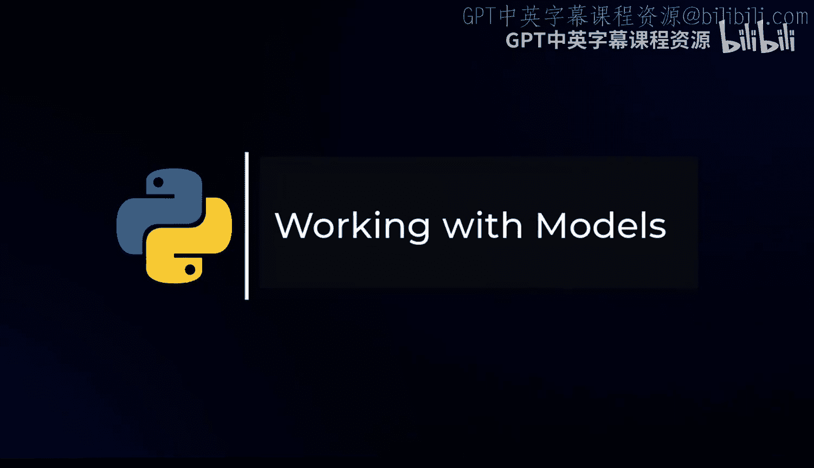
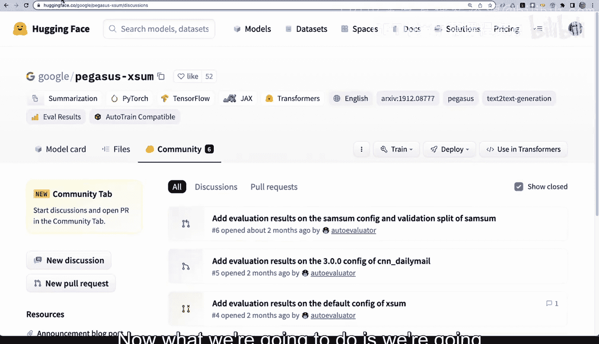
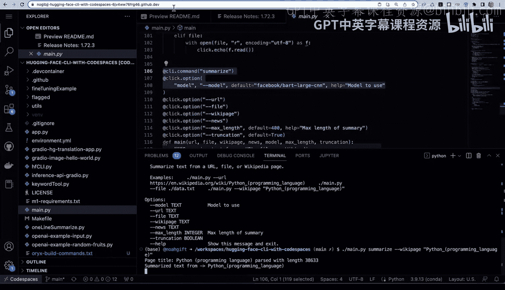
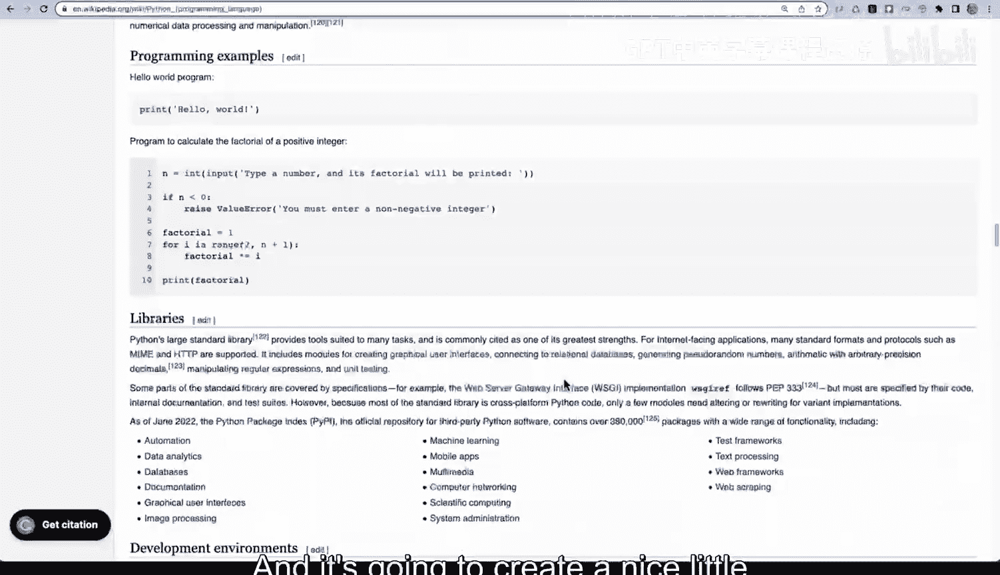
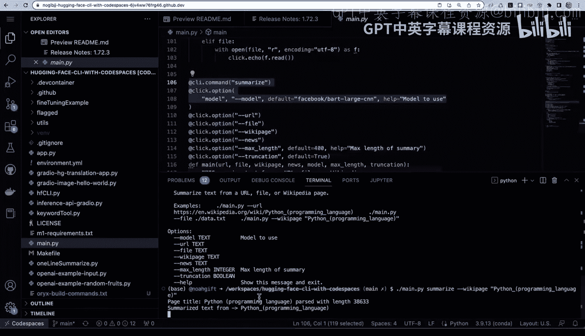
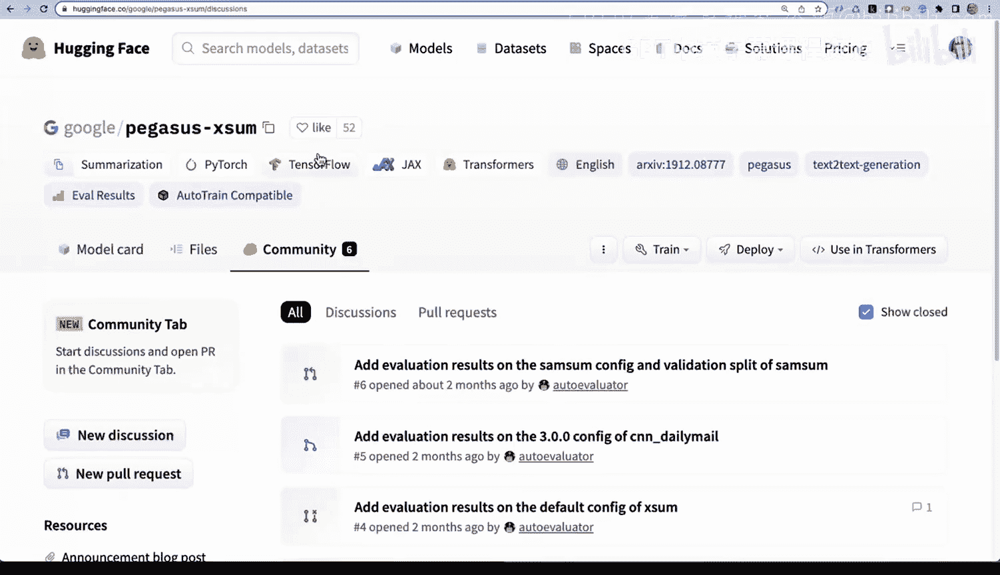
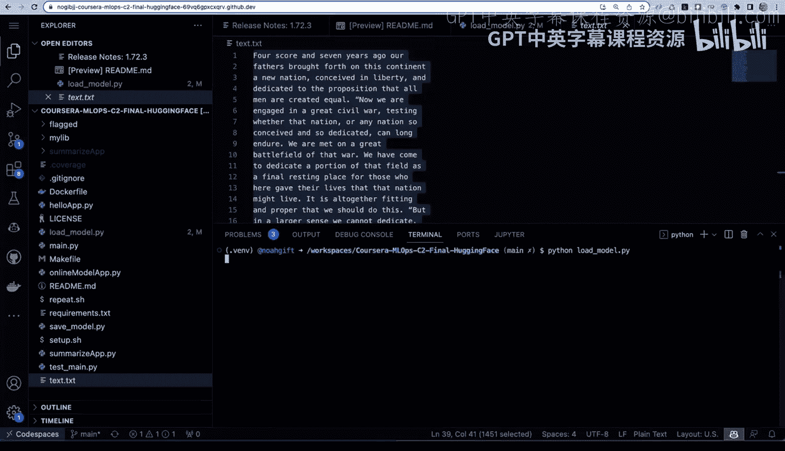
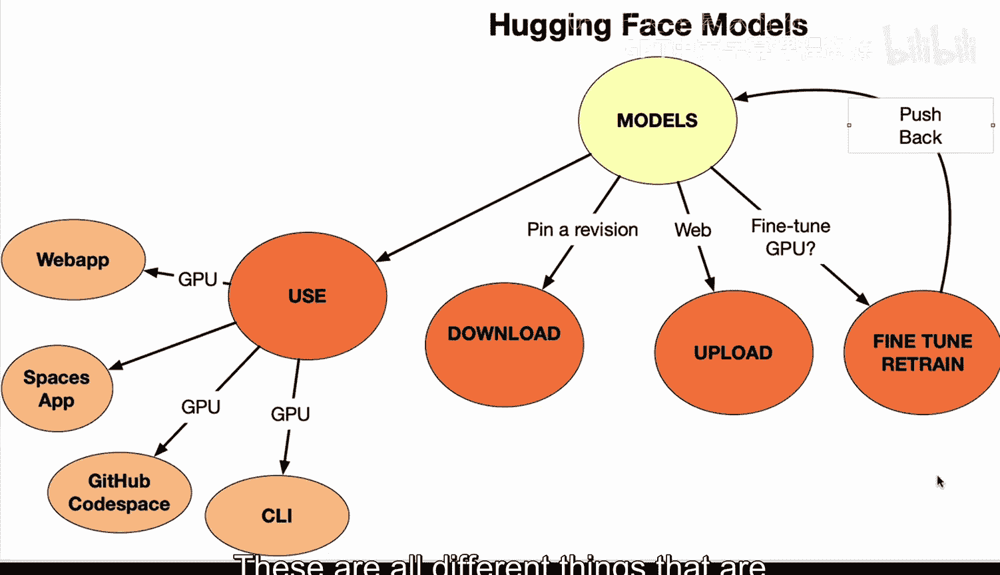

# 杜克大学｜机器学习运维｜DevOps⧸DataOps、Azure、MLFlow和抱脸｜MLOps ｜ Machine Learning Operations p165 24_02_04_模型操作实践.zh_en -BV1yE421c7uA_p165-

Let's take a look at this hugging face model ecosystem here。

 There is more than just one thing you would do with hugging face because there are interactive workflows。

 First， one of the things you may want to start with and probably most people start with is you go to hugging face look at all the models you know100 thousands of them and go ahead and use them in potentially a spaces app that's hosted on the Huging face platform right so this is really the first place to play around。

 Now one of the problems with this is that GPU is not something you're going to get by default。

And so as a result of that， you may want to use a workspace like for example。

 Github Workspaces that actually have access to GPUs which will significantly speed up your performance so that's really helpful likewise if you had a chaan tool potentially that you're using GPU could be integrated with that chalan tool likewise if you wanted to you could build out a fast API or radio app or something like this that would also be able to use a GPU as well。

 So there's lots of different ways that you could use it in general。

 these are the four that we cover briefly。 Now the other thing you can do is you can actually just download the model itself and will cover that in detail as well but one of the things to be aware of with this is that when you do download you may want to pin。

A revision。 and the idea here with painting a revision is that you're able to specifically get the same version over and over。

 And if it's a large model， like 5 GBs， you're not going to have to download it over and over again because you can save it locally on your file system。

The other thing to be aware of is that you can also just you know upload this through the web right。

 you can go to the web interface and put this inside of the hugging face ecosystem。

 we're going to do it in a second。 and then finally the last thing you can do is you can。Fine tune。

 potentially with the GPU and let's say， you know， GitHub codespaces。

And then push that model back into the huggingface ecosystem right so there's a lot of really cool things that you can do when you're playing around with the huggingface ecosystem。

 It really depends on what type of problem you're solving。

 and this would be again push back to the model repository as you make changes that are helpful like better accuracy that is fine- tuneuned for the model that you're using Okay let's go ahead and take a look at how we would actually accomplish this。

 The first thing I would recommend is go to Huging face take a look at all the models that are available and pick the one that you want to use。

 and in particular， I think again， the interface here where you look at the most downloads or most likes these are a good idea。

 the Google Pegasus is a good one to play around with here notice what it does is allows us to just play around with it without having to do a bunch of。

Of so if I go through here and I say compute， right。

 it goes through here and it is able to summarize all that into one sentence。Now。

 if I wanted to use this locally notice here that I could actually go ahead and put that into some code and build out some kind of a solution right so first first step is play around with it inside of the interface。

 second potential look at the community， look at some of the things that are happening here。

And potentially look at some of the code spaces that are using this and then go from there。

 Now what we're going to do is we're going to go over to a GitthHub code space here and we're going to actually do something similar。

 I'm going to use a Cammelan tool in this case， in this case。

 click and I'm going to use beautiful soup Wikipedia also a newspaper library that can interface with our code and if I go ahead and I run this and I say main。

Dsh help notice all the different things that we can do。 so we can encode， we can summarize。

 And if I go through here and I say， let's look at what kind of summarize code I've got built up。

 one of the things that we can do is we can actually summarize a Wikipedia page just by putting it in。

 So how do we do this Well， first I use the Wikipedia library here。

 which is a very small amount of code。 you can say it's just this right， I just say Wikipedia page。

 essentially And then。What I do is I put this into the huggingface model here and we can say right here。

 here's our hugging face model。 we have a tokenizer that prepares the data for us。

 and then at the end we can just put this into a chamelan tool in this case right here。

 I just created a click chamelan tool called summarize and actually it will choose some kind of a model as a default。

 but we can also change it out based on whatever it is we want it to do。

 So the first thing I would recommend would be let's go ahead and do that that python example here So again。

 if we we look at this summarize it's going to tell us that if we say。

D Wikipedia page Python programming。Then it should be able to go and summarize this Python programming page。

 So what is it going to do， Well， we can take a look real quick while it's running。

 it's going to go to Wikipedia right here， the Python programming language page and it's gonna to grab all of this text in this page and it's going to create a nice little summary of what's happening on this particular page and if we go back here。

 we can see it's summarizing the text from that particular problem。 there we go。

 and it created a nice summary of what it is that that we were trying to to solve here。

 And if I wanted to， because I've enabled these flags here for model。

 I could swap it out for lots of different models that appear right here。 So this is。

 I think one of the better ways to play around with the huggingface interface。

 Now the next thing I'm going to show you here is that if you wanted to you could also。

Save the model locally， and how would you do this？In this piece of code here。

 I say from transformformers import pipeline， and then I say model and I save it in particular。

 this is the model and this is actually the revision。 So when you download it。

 it'll print out the revision number and you can say I want to just save this particular revision and once it's saved。

 you can actually unzip it and in fact， keep it locally on your machine。

 So in this case we see this downloaded model here and then in order to use it。

 if I want to have a really fast performance every time I load it。

 I can just say load model and look， we just go here and we say here's a text file I want you to read。

And in this case， we want to actually use the pretrained model that's actually on disk。

 which is right here。And it'll actually go through and run this summarization。

 So I'm going to go ahead and run this。 And what it's going to do is going to look at this text file。

 which is just the Gettysburg address and it's going to summarize it。

 So we just say Python load model it's going to look for this text file。

 use the pretrain model that's been downloaded onto the disk and then actually do its summarization。

 There we go。 It was actually extremely fast because once it's got GPU to it's actually on the disk。

 So we've covered， I think almost everything with the exception。

Potentially of uploading a model。 Now， how would we do this， Well。

 a really easy way to upload the model would be to grab a second learn model。 In this case。

 I've got one in theOAAgift Python Emops cookbook。 I have model do joblibb。

 I'm going to go ahead and grab this and click download。Once I download。

 it's very easy to go over to my own interface here on my profile and I can go down to models right here and you can see that I can put new models into my ecosystem right here。

 so if I go here I say here's my model， let's go ahead and upload a file。

 I can just take that file that I just downloaded。And put this directly inside of this repository。

 And then now we've got a model all set up for us。 And in fact。

 it knows that it's a job model and I could tweak it out further and further。 So in a nutshell。

 really， there is a lot to be said for going through here and bringing out the different interfaces of what it is you're trying to build and pulling up exactly the kind of ecosystem that you want to pull up right。

 So do you want to use the model Do you want to download the model， Do you want to upload the model。

 Do you want to do a fine tuned retraining the model。

 These are all different things that are important to consider when you're dealing with hugging face。

