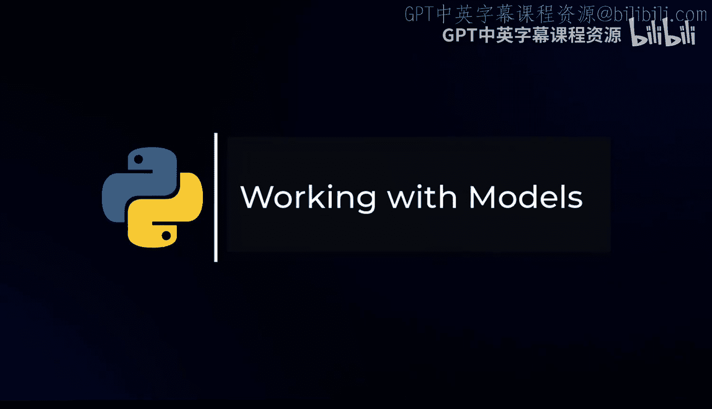
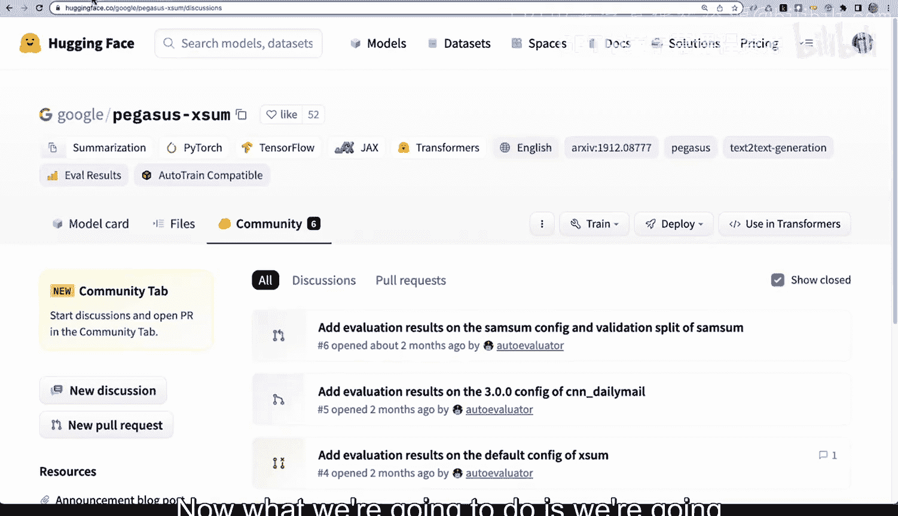
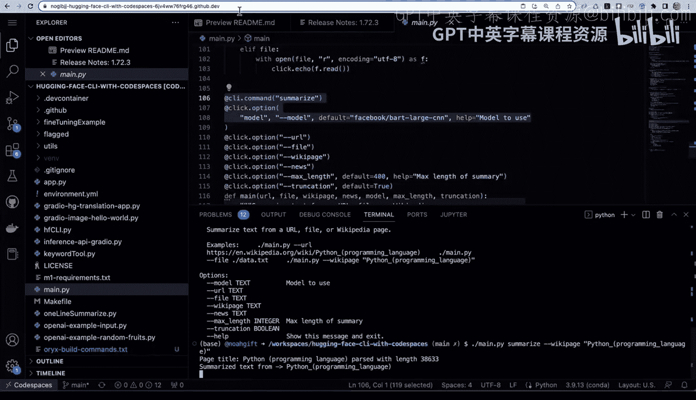
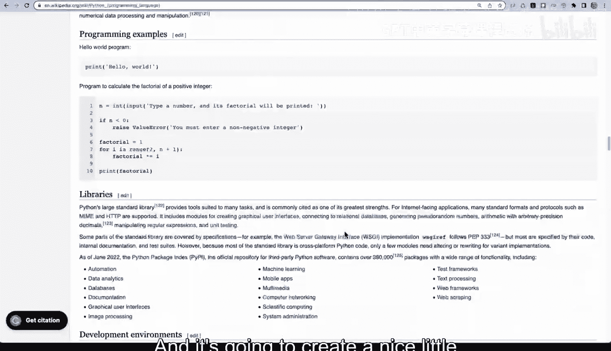
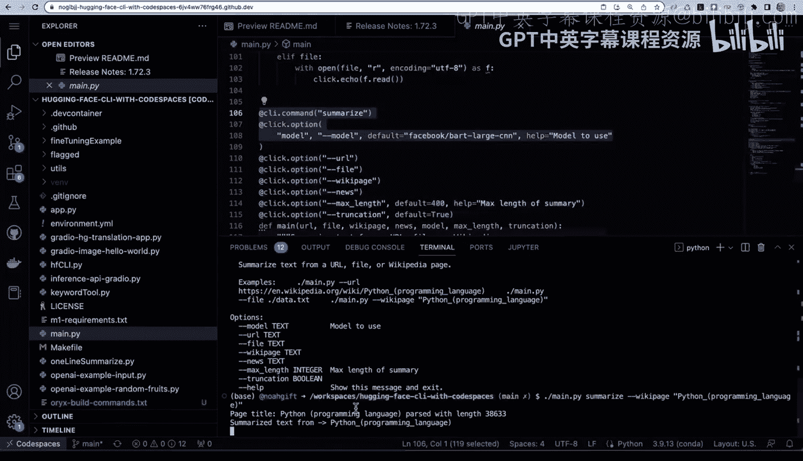
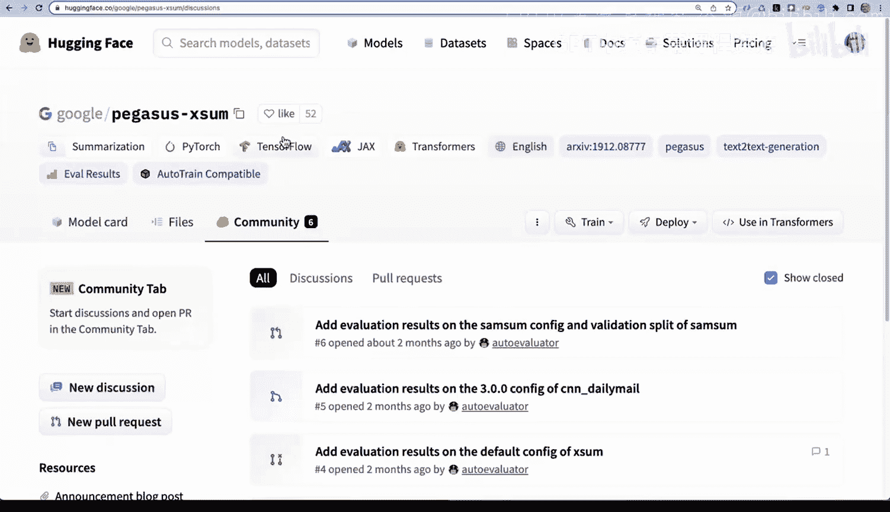
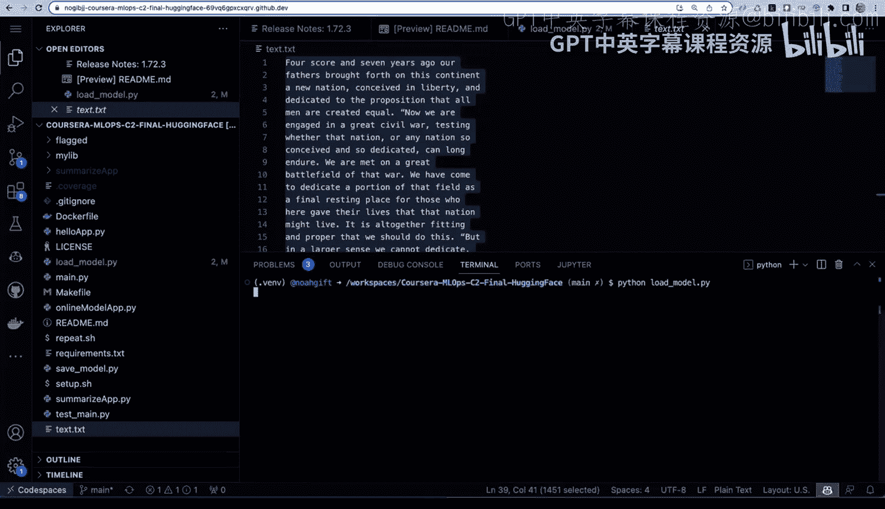
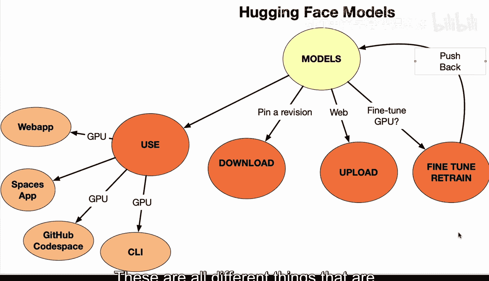

# 机器学习运维：第24章：模型操作实践 🚀



在本节课中，我们将学习如何实际操作Hugging Face生态系统中的模型。我们将涵盖从探索和使用模型，到下载、本地保存，再到上传自定义模型的完整流程。通过具体的代码示例，你将了解如何将预训练模型集成到自己的应用中。

---

## 探索与使用模型

上一节我们介绍了MLOps的基本概念，本节中我们来看看如何与Hugging Face平台上的海量模型进行交互。Hugging Face不仅是一个模型仓库，更提供了一系列交互式工作流。

以下是开始使用Hugging Face模型的几种主要方式：

1.  **在线体验**：访问Hugging Face网站，浏览数十万个模型，并直接在平台上托管的Spaces应用中试用。这是初步探索模型功能的最佳起点。
2.  **在GPU环境中运行**：为了获得更好的性能，可以在支持GPU的环境中运行模型，例如GitHub Codespaces。这能显著加速模型推理过程。
3.  **集成到开发工具**：可以将模型集成到如Chamelaen等工具链中，利用GPU加速。
4.  **构建应用**：通过FastAPI或Gradio等框架构建应用程序，并部署支持GPU的模型服务。

现在，让我们进入实践环节。首先，建议访问Hugging Face，根据下载量或点赞数筛选出热门模型进行试用。例如，Google的Pegasus模型可以用于文本摘要任务。

在模型页面的交互界面中，你可以直接输入文本进行测试。例如，输入一段长文本，模型会将其摘要为一句话。这是验证模型是否满足需求的第一步。

---

## 在代码中集成模型

在界面中试用模型后，下一步是将其集成到自己的代码中。我们可以在GitHub Codespace中创建一个项目来实现。

以下是一个使用Hugging Face模型摘要维基百科页面的代码示例。我们使用`wikipedia`库获取页面内容，然后用Hugging Face的`pipeline`进行处理。

```python
from transformers import pipeline
import wikipedia

# 1. 获取维基百科页面内容
page = wikipedia.page("Python programming")
text = page.content

# 2. 创建摘要pipeline
summarizer = pipeline("summarization", model="google/pegasus-xsum")

# 3. 生成摘要
summary = summarizer(text, max_length=50, min_length=25, do_sample=False)
print(summary[0]['summary_text'])
```

这段代码首先获取“Python programming”维基百科页面的全部文本，然后使用Pegasus模型生成一个简洁的摘要。通过调整`max_length`和`min_length`参数，可以控制摘要的长度。



此外，通过代码可以灵活地切换不同的预训练模型，只需更改`pipeline`函数中的`model`参数即可。

---

## 下载与本地保存模型

为了提升推理速度并确保版本一致性，我们经常需要将模型下载并保存到本地。

在下载模型时，**固定修订版本**非常重要。这能确保你每次获取的都是完全相同的模型版本。对于大型模型（如5GB），本地保存可以避免重复下载。

以下是下载并保存模型的代码：

```python
from transformers import pipeline, AutoModelForSeq2SeqLM, AutoTokenizer

model_name = "google/pegasus-xsum"
revision = "a1a1a1a1a1a1a1a1a1a1a1a1a1a1a1a1a1a1a1a1" # 示例修订号

# 下载并保存模型与分词器
model = AutoModelForSeq2SeqLM.from_pretrained(model_name, revision=revision)
tokenizer = AutoTokenizer.from_pretrained(model_name, revision=revision)

save_directory = "./my_pegasus_model"
model.save_pretrained(save_directory)
tokenizer.save_pretrained(save_directory)
print(f"模型已保存至: {save_directory}")
```









下载后，你可以直接加载本地模型进行推理，速度会快很多：

```python
from transformers import pipeline

# 从本地目录加载模型
summarizer = pipeline("summarization", model="./my_pegasus_model")

# 读取一个文本文件（例如葛底斯堡演说）
with open("gettysburg.txt", "r") as f:
    text = f.read()

summary = summarizer(text, max_length=30, min_length=15)
print(summary[0]['summary_text'])
```

---

## 上传自定义模型



最后，我们学习如何将自己的模型上传到Hugging Face平台，与他人分享或用于部署。

上传过程非常简单：
1.  准备好你的模型文件（例如一个`.joblib`或`.pkl`文件）。
2.  登录Hugging Face，进入你的个人主页。
3.  点击“Models”，然后选择“Upload a model”。
4.  填写模型信息，并上传模型文件。

例如，如果你有一个训练好的Scikit-learn模型保存为`model.joblib`，可以直接将其拖入上传界面。平台会自动识别文件类型，并为你创建模型仓库。之后，你可以添加模型卡（README）来描述模型用途、训练数据和使用方法。

---

## 总结

本节课中我们一起学习了Hugging Face模型生态的实践操作。我们从**探索和在线试用模型**开始，了解了如何筛选合适的模型。接着，我们学习了如何在**自己的代码中集成模型**，并运行了一个摘要维基百科页面的实例。然后，我们探讨了**下载和本地保存模型**的重要性，包括如何固定版本以保障可复现性，以及如何加载本地模型加速推理。最后，我们介绍了如何**上传自定义模型**到Hugging Face平台。



根据你的具体需求——是直接使用模型、下载到本地、上传自己的成果，还是进行微调训练——Hugging Face都提供了相应的工具和接口来支持你的机器学习运维流程。