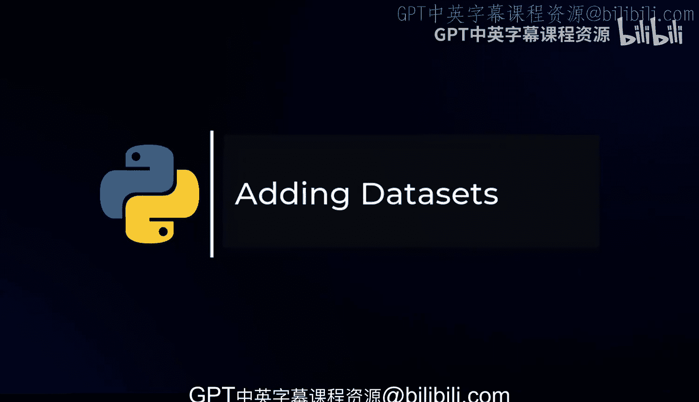
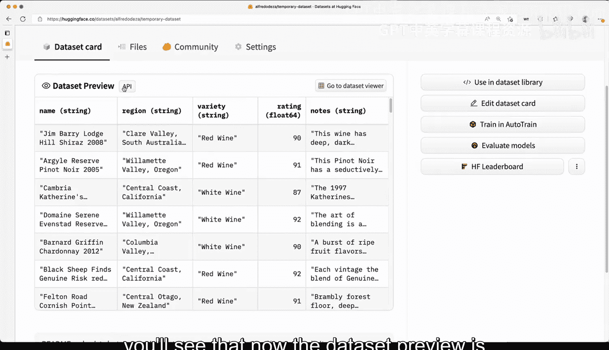
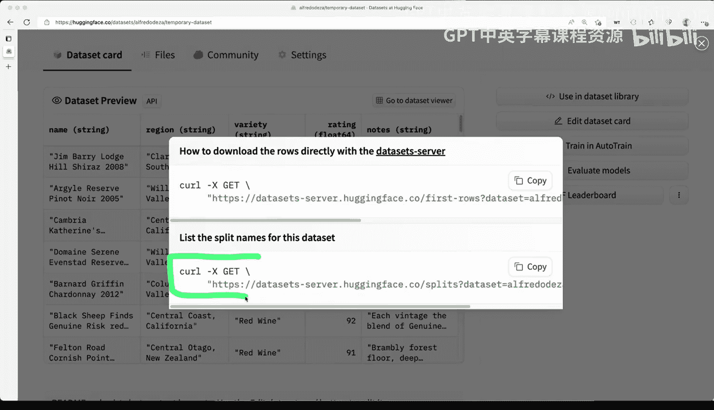
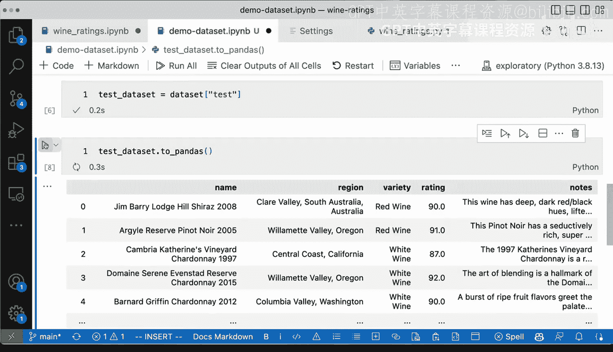

# 杜克大学｜机器学习运维｜DevOps⧸DataOps、Azure、MLFlow和抱脸｜MLOps ｜ Machine Learning Operations p166 25_02_05_添加数据集.zh_en -BV1yE421c7uA_p166-

Let's go through some of the steps that you will need to know in order to add some data sets。

 so I have here my account and you can see that I've already added。

 I'll actually update the data one day ago well I'll show you a couple of the things that you can do in order to create your own dataset so in hugging phase in the webage in the main UI however it is make sure that you have an account I've logged in and I've authenticated so that's why my profile shows up so make sure that that's a thing for you as well and then head over to don't head over to actually datas here because that's kind of like more of the exploratory datasets that you might want to take a look and want to reuse Now what you want to do is click on your profile So I'm going to click over here and then I'm going to say I want to add a new dataset so how does this work I'm going to click here and then it is essentially。

As we've seen all throughout our hugging phase a new repository now there's a distinction here。

 it says this is going to be a data repository right but behind the scenes it is still a repo and you're going to be uploading some files so here we could say something like this is going to be temporaryaries or I say temporary data and the license sure why don't we do Apache you can pick any license that you actually prefer or you feel like you're more comfortable with so then you're gonna to click create data and of course this can also be known through the command line tool as I've shown you before Now once these loads you have a couple of different things first there's nothing available so you can see here that there's a dataset preview so these are features related to a data where we're going to be doing is trying to add an actual data there's a couple。

Things that you can do here。 You can either upload a file。 So if we go here and say files。

You can see here that there's Gi attributes and a basic readme so you can add a file and add a CSB file directly now adding a CSB file directly and then click upload files and then select a file to upload that。

Alright， so I'm gonna drag a file here or click to browse So I'm just gonna drag one and then get that uploaded and then commit。

 So I'm dragging this CSB file。 It's a comma separatedpar value file is called test that CSB and as always this is going to require me to make a commit So default message for this is fine I'm going to commit the changes and the test CSB has been committed。

 Now one thing to notice that this is just 81 kilobys it's very very small Now if I go to temporary data and I click on here you'll see that now the data preview is right there。

 and you even have an API。 So let's take a look at the API you have the ability to use curl to get actually the whole data or if you want to see if there are splits will'll take a look at what those splits are but essentially it gives you the ability to have different ways to access these and of course you can also。

So clone this repository because behind the scenes as I've told you before。

 this is a gi repository and you can use the data sets library from Hugingface to interact with that Now here we have like a a few columns you can see here there's name it has detected the types region variety rating ratings a float 64 that sounds about correct and it is a data about wines and ratings and I've been able to below that。

 So that is how you add data sets to hugging face and then anyone that wants to interact with these。

 like I said， has the ability to actually use temporary data or if you want to actually use the datas library you will be able to do that with the data with these name which is my account and then the name so I'm gonna show you open。

a Jupyter notebook here。 and then we'll see how that goes。

 Let me let me open up Vsco with a Jupyter notebook。 So I have this Jupyter notebook here。

 I'm going execute this again， make sure that these runs。 I have the datas library installed。

 And now I am going to load that dataset that we just uploaded。

 So the way to do that is going to be say， for example， data is going to be datas。Data sets load。

 We're going to use the load underscore data set。 and we this was。Fnodesa slash。

What was the demo demo data set？Right， so let's just triple check that's true。

 It's actually temporary dataset。 So you have to be careful with the naming Otherwise this is not going to work out。

 So I'm going say temporary data。 and we're going to run these。 and this is going to fetch。

 It's going to fetch that is going to cache it。 You can see here is using a cache and then it's going to download that that's perfect。

 So now we have a data。 let's explore what that data is。

 I'm going to click code ands to data and then execute the cell and it's a data dictionary And the first thing show its test。

 So well we can actually get that test is this is a dictionary behind the scenes and we can say as。

Paands， and I think this should work。 And this should return a pandas。 Oh。 So it， it is not。

 So let's try to。Let's try to poke a little bit more data test dataset set and then let's do that and then let's poke around what this test dataset object is now we have some features and I'm pretty sure that oh it's two pandas is not as panda so if we run that it will create a data from So there you go that is how you add very quickly a CSV now I show you one way which is through the UI and you can do this with different other ways including using the Githbuory or even using the CLI。

