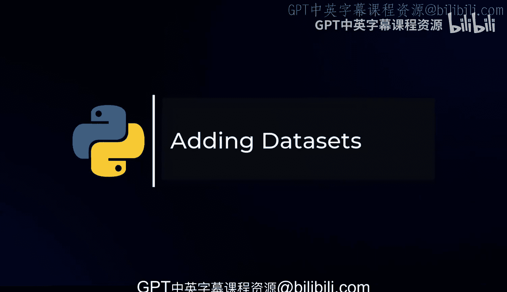
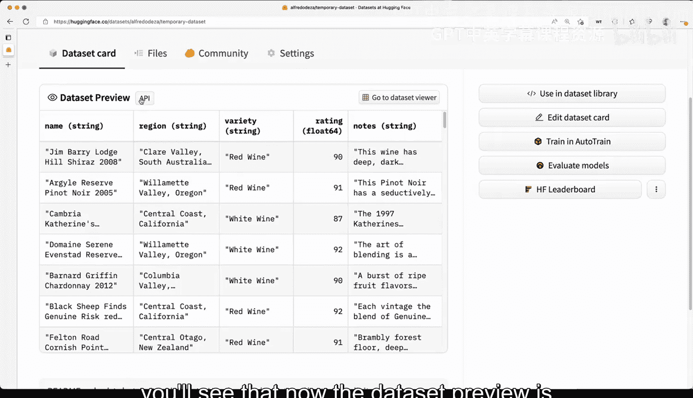
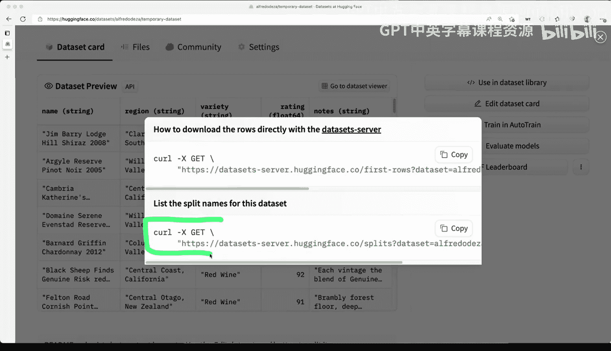
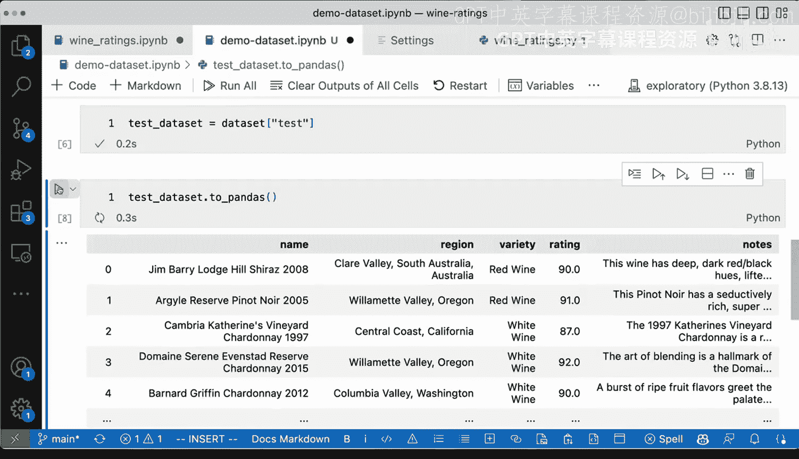

# 机器学习运维：25：在Hugging Face添加数据集 📊



在本节课中，我们将学习如何在Hugging Face平台上创建并上传自己的数据集。你将了解通过网页界面操作的完整流程，并最终学会如何在代码中加载和使用这个数据集。

## 概述

Hugging Face不仅是一个模型库，也是一个强大的数据集托管平台。掌握如何添加和管理数据集，是构建机器学习工作流的重要环节。本节将引导你完成从创建数据仓库到在代码中加载数据的全过程。

## 准备工作

在开始之前，你需要确保已经拥有一个Hugging Face账户并成功登录。登录后，你的个人资料会显示在页面右上角。这是后续所有操作的基础。

## 创建数据集仓库

首先，点击页面右上角的个人头像，在下拉菜单中选择“New dataset”来创建一个新的数据集仓库。

虽然这里创建的是“数据仓库”，但其底层仍然是一个Git仓库，你将通过上传文件的方式来添加数据。

以下是创建新数据集时需要填写的关键信息：
*   **数据集名称**：例如，我们可以命名为 `temporary-data`。
*   **许可证**：你可以选择任何你偏好或熟悉的开源许可证，例如 `Apache 2.0`。

填写完毕后，点击“Create dataset”按钮。当然，这个操作也可以通过命令行工具来完成。

## 上传数据文件

创建成功后，页面会跳转到新数据集的仓库。初始状态下，仓库里只有Git属性和一个基础的README文件。

此时，你可以通过上传文件的方式添加数据。点击“Files”选项卡，然后点击“Add file”按钮，选择“Upload file”。

你可以直接将一个CSV文件拖拽到上传区域，或点击按钮浏览选择。我们以名为 `test.csv` 的逗号分隔值文件为例。上传文件后，系统会要求你提交这次更改。使用默认的提交信息即可，点击“Commit changes”完成提交。

## 查看与使用数据集





文件提交后，数据集预览功能会自动激活。你可以直接在网页上查看数据的结构和前几行内容。

更重要的是，Hugging Face为你的数据集生成了访问API。你可以通过`curl`命令获取整个数据集，或查看其数据划分（splits）。本质上，这为你提供了多种访问数据的方式。

此外，由于数据集底层是Git仓库，你也可以直接克隆它。更常见的是使用Hugging Face的 `datasets` 库来交互。

## 在代码中加载数据集

上一节我们介绍了如何在网页上创建和查看数据集，本节我们来看看如何在Python代码中加载并使用它。

确保你已经安装了 `datasets` 库。然后，你可以在Jupyter Notebook或任何Python环境中按以下步骤操作。

以下是加载并使用数据集的代码示例：

```python
# 从Hugging Face加载我们刚刚上传的数据集
# 格式为：`load_dataset(“你的用户名/数据集名称”)`
from datasets import load_dataset

data = load_dataset("你的用户名/temporary-data")

# 探索加载的数据对象
print(data)

# 数据集通常以字典形式组织，键名对应数据划分（如‘train‘, ‘test‘）
# 获取‘test‘划分并转换为pandas DataFrame以便查看和分析
test_data = data[‘test‘].to_pandas()
print(test_data.head())
```

运行代码后，`datasets`库会从Hugging Face获取数据并进行缓存。随后，你就可以像操作普通的Pandas DataFrame一样，对数据进行探索和分析。

## 总结



本节课中，我们一起学习了在Hugging Face平台添加数据集的完整流程。我们首先通过网页界面创建了一个新的数据集仓库，然后上传了一个CSV文件。最后，我们学会了如何在Python代码中使用 `datasets` 库来加载和操作这个远程数据集。除了网页界面，你还可以通过Git命令或Hugging Face CLI工具来完成这些操作，这为集成到自动化流程中提供了便利。