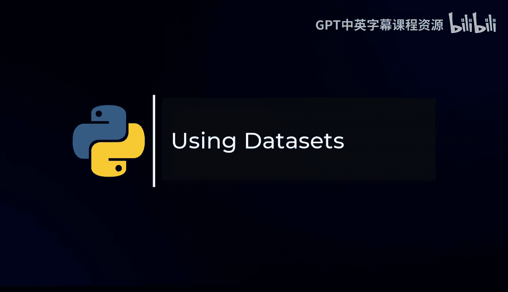
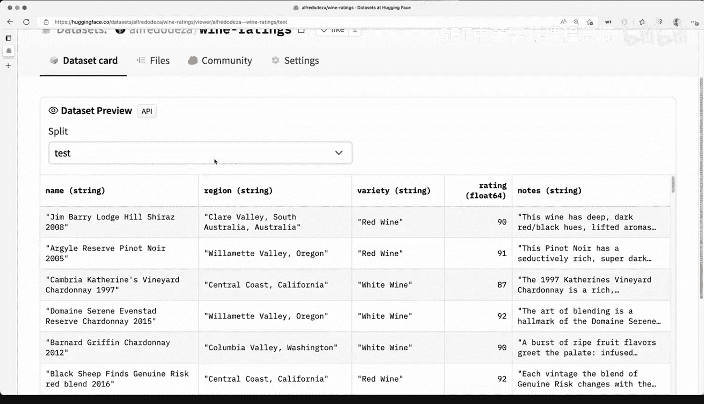
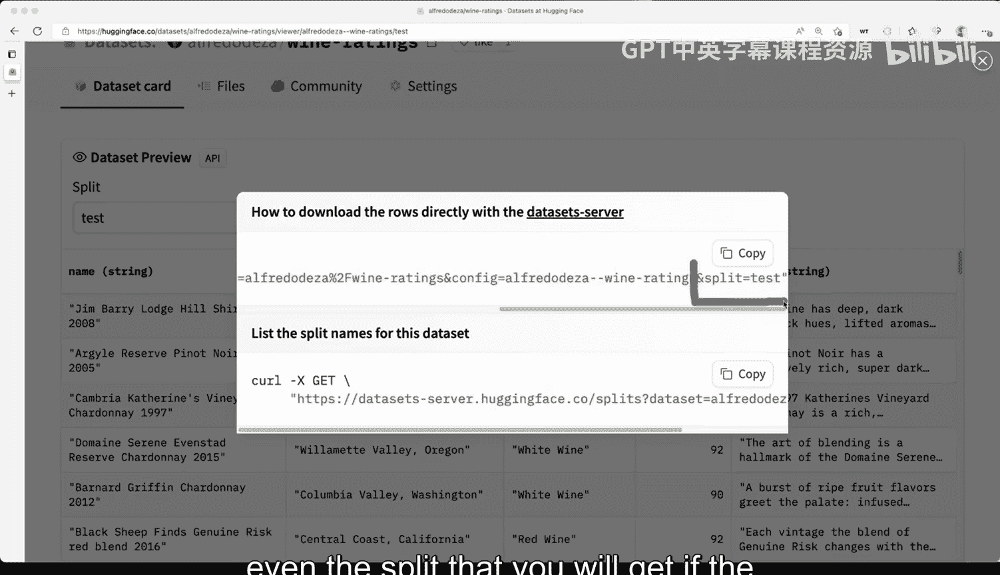
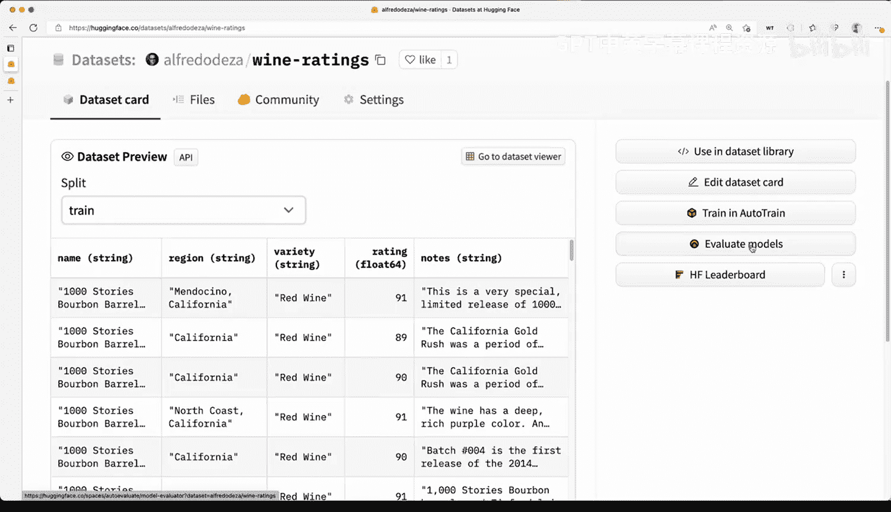
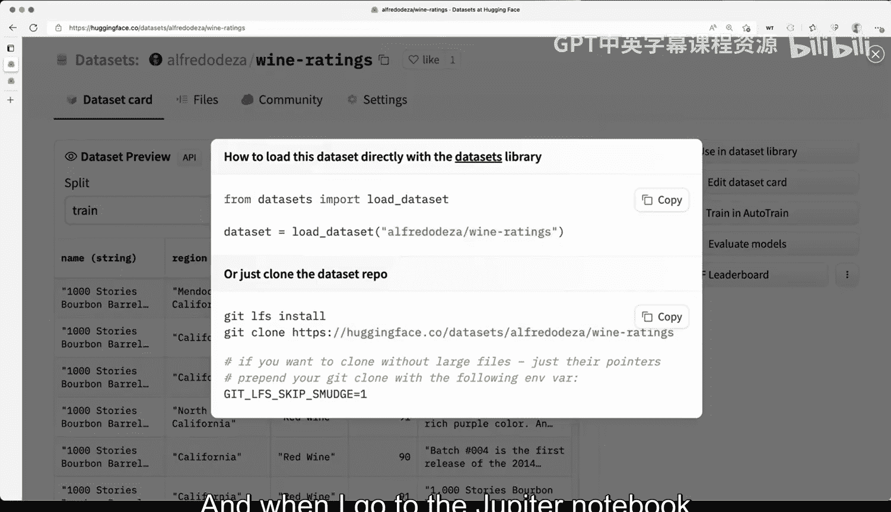
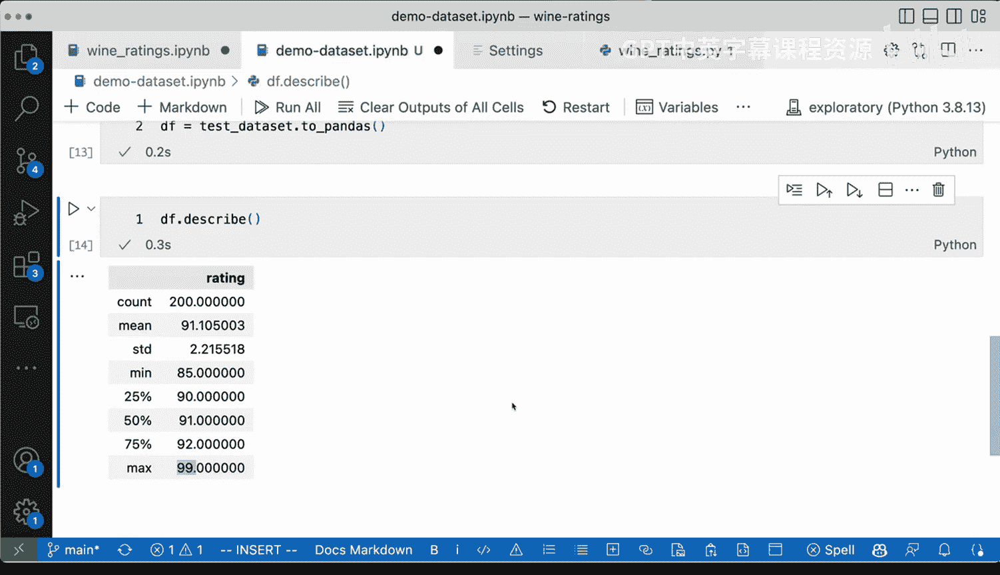
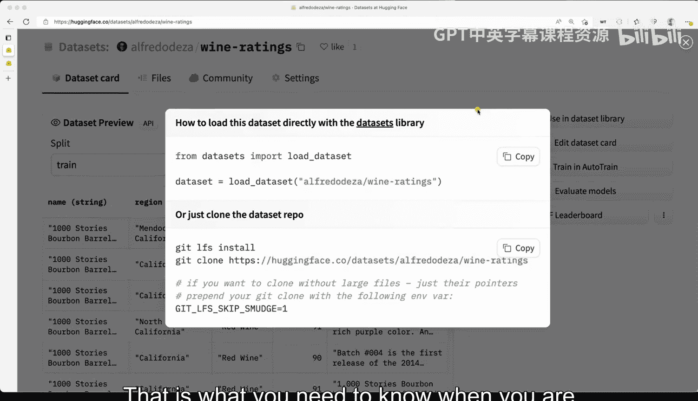
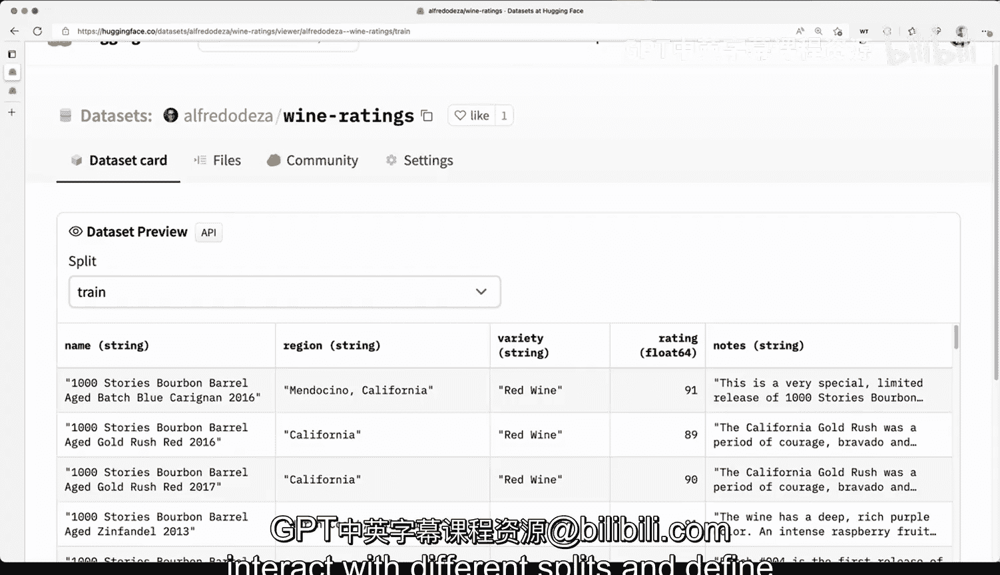

# 杜克大学｜机器学习运维｜DevOps⧸DataOps、Azure、MLFlow和抱脸｜MLOps ｜ Machine Learning Operations p167 26_02_06_使用数据集.zh_en -BV1yE421c7uA_p167-

We've seen how to add a CSB file directly into Hugingface and then start serving that with the datasets repository and access it either with the UI so through here or using the datas hugging face library so one thing that you could do that is slightly different I'm going to show you things that you can actually implement is to add a custom files these are optional for CSB tab separator values。

 and I think even and Jason you can add them directly into the UI。

 but I'll show you a couple of things that are extra that you can do here Now I've added the same mind ratings but with different splits the splits allows you to have access to a subset of the same data so that you don't have to or to make it easier for your users if they want to have different parts of the data so here because I've added a few of those supporting files you can see here that now。

Have a split if I click here， I have test and I have validation。 So if training will have。

 I'm gonna scroll here is tru to 10 rows， but it has around two or 3000。

 I believe and a rows and if I change this to say test it will just have a a couple hundred。

 I think it just 2 hundred Now doesn't have an ID so that's kind of problematic there。

 but I'm telling you that that's actually the case。 So that is why that is why this is useful。

 And again if we go here to list the split names for this dataset。

 this is why this is why this is useful because now you can see what what the splits are and you can actually get a specific a specific split you can see here even the split you will get if you do the curl command will be the test one Now if you don't want the test one and if you want the one the the full one like the train that will be this one right here。

So how do you do that Let me show you a few files that you can add And again， these are all optional。

 The first thing that you'll notice is that the train one is 13 megabytes and that will have the LFs icon in there。

 that means that you have to enable LFs for if you're adding this on the command line tool if I click here will download the file we don't want to download the file again。

 this is the LFs if you do it on the commandline tool that's get LFs install and they install some prehooks precomit hooks and and prepush hooks that will enable that LFs will actually work if you don't do that it'll get into trouble so don't worry if if you do that you'll have some some output that shows you right on the terminal of what's going on Allright so a few files are going on here。

 let me show you first the one underscore ratings pi。

So this file is there's a sample actually that you can use and what it is is that you can get a little bit of the particulars of these data I' put this was created by myself I created them back in 2022 I had a short description was a homeage that's you know fine you you can actually add those inside the UI。

 but then we start getting into particulars of these data so have I added the version here and this is captured by the UI we can also have a little bit of the features。

 what are some of the features here actually are what are some of the columns that we have so you can see here that have name region and I added that rating is actually a floatat and everything else is a string so then we continue to well this is the information and then we return these object a data info object with all of those things。

And now we get into the split generators So what are the split generators we are telling these what are the specific splits that we want to provide through the API to any user downloading this so you can see here there's a train one there's a validation one and there's a test one this is fairly fairly common and the template。

 the hugging face offers for for creating these data sets。

 optional files all have these premates so you don't have to remember all of the syntax and you can of course reference these wine underscore ratings pie file whenever you want to get a quick refresher on how toulu this and finally you can generate examples from the data if you want to if you want to generate a little bit of samples on how toulu this alright so。

Let's go back and show you why these file paths are important if I go back to files。

We should be able to see that there is a test one。 There you go， a train and a validation thats CSB。

 Now train is the main one is the full one is the big the big CSB but why are these right here because it's allowed when you have CSB files hugging face allows you to get that in there but this could live somewhere else and that's why you may want to consider an optional file file for loading so a file that is not hosted that is not in hugging face well need to have we need to have like a loader and the loader will point and I'll show you let's go let's go to another datas here。

 So say for example blimp if we click on this one there's a dataset preview that'ss perfect let's take a look at the files So if we look at the files's no there's no data in there。

 there's a dummy here。 you know there's there's a little bit of let me see if there's some stuff in there。

Yeah， so there is there is some dummy dummy data， but if we take a look at blimed up pi。

 which is the loader， let's take a look at what the URLls are。

 So you can see that the download URL will be on Github。

 So these loader will know how these URLs are going to go through and fetch that data and provided through hugging face。

 which is a pretty nifty way of serving things。 And you can see here that the features。

 these are the actual column names So that's fine and then we go into the generate examples very。

 very similar to what I was having。 Now the split generators， you'll see that it will use the URL。

 So here download URLs。 it has a download downloaded file download the URLs。

 you'll have a way of defining defining where these resources live so that you can access them so if we go back to the wine ratings one now you have。

We've explained what these CB files are here for， what this loading file is here for the readmi has some information which is called a card for datasets。

 which is the documentation for how people can use your data and haven being good because they haven't added much information there and the last thing is this dataset info file which is again super optional and you don't has the description citation is effectively something that is generated from。

From these wine ratings， one ratings file that has the class and the info and all of those nift files Now if you remember this has。

 if I go click here this will have different splits and we can actually do do some things there now you can you can use these in a data library so if you want this example is great because then it has everything you can clone the repo remember that you have to you have to do Git LFS installed which is this one right here that'll make sure that you have youre good to go but if you don't want to get all of those super large files into your computer then you can do that so we're gonna do this one right here and I copy that and we're to go to the Jupyter notebook and see how we can work with that All right so we are here in the。

notebook and I'm going paste what hugging face was suggesting we should be doing and I'm going to run this and we're going to see when I poke around this dataset oh actually it found a cache data so you didn't have to download anything So if I run these it's again going to be super fast because I've already downloading that so let's poke around these data object see what it returns and as always it' going to return a data di Now this dictionary will have the splits。

 the train， the test one and the validation one so you can see here this is 200 rows。

 200 rows and the train， the main one will have 3200 32000 rows which is like the complete dataset and you have the features name region variety rating so you could essentially have something customized where you only have say for example。

 region and ratinging and a data that is custom。You're advertising these through this configuration and so say for example we only want the test one and going we want to get the test one so test data set。

 well， we're getting the auto complete like an if the auto complete over there and we could say。

Test data set 2。Pands to aenddas data frame。 I'm going I call that。

 And we're going to assign this to the D F variable。

So we run that that's perfect and now we can say the F describe and see what is going on here with this data and you can see there is in fact 200 rows。

 we have some values there on the rating and that's perfect we have the ratings usually go all the way from 85 usually to 100。

 but this data only has a one that goes up all the way up until 99。So there you go。

 that is what you need to know when you are dealing with the specifics of a dataset on hugging face with all of these different ways of enhancing a data we saw something that was very simple before now this is a slightly like a step above that where you are able to do an interact with different splits and to those with a custom loading file。

