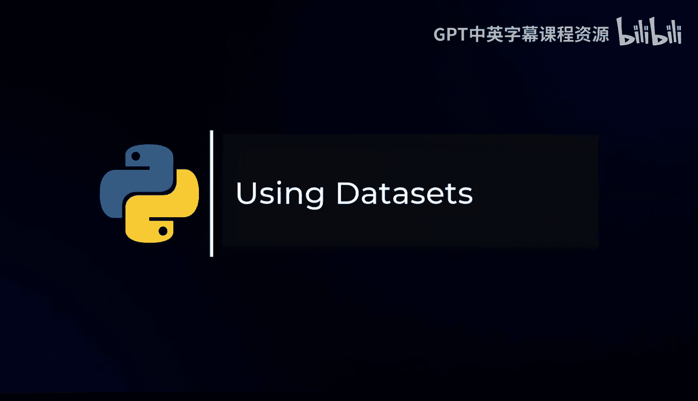
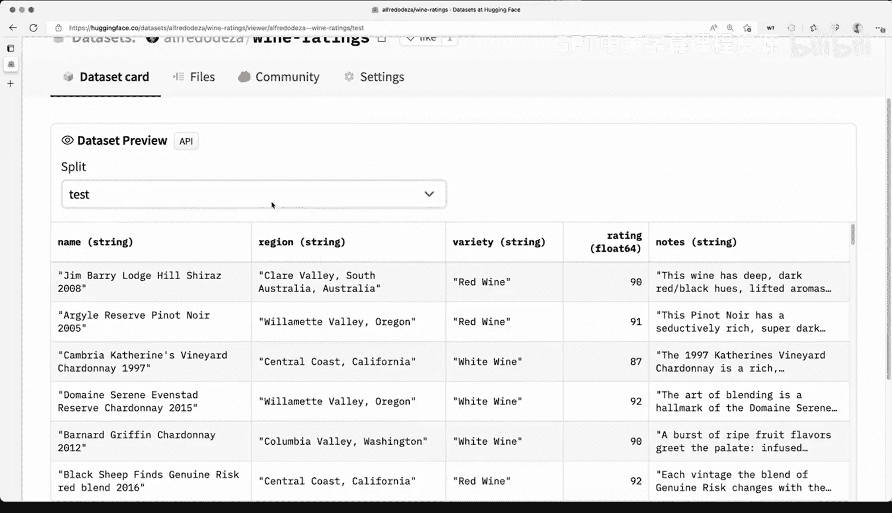
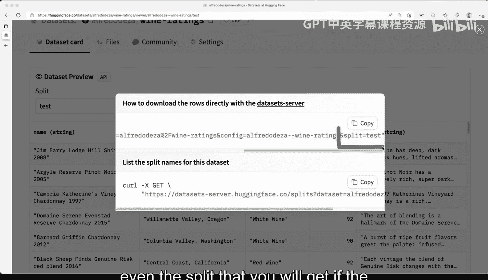
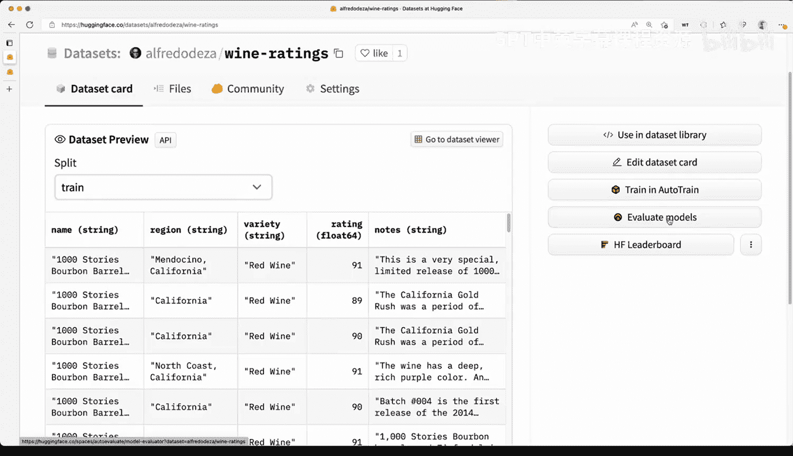
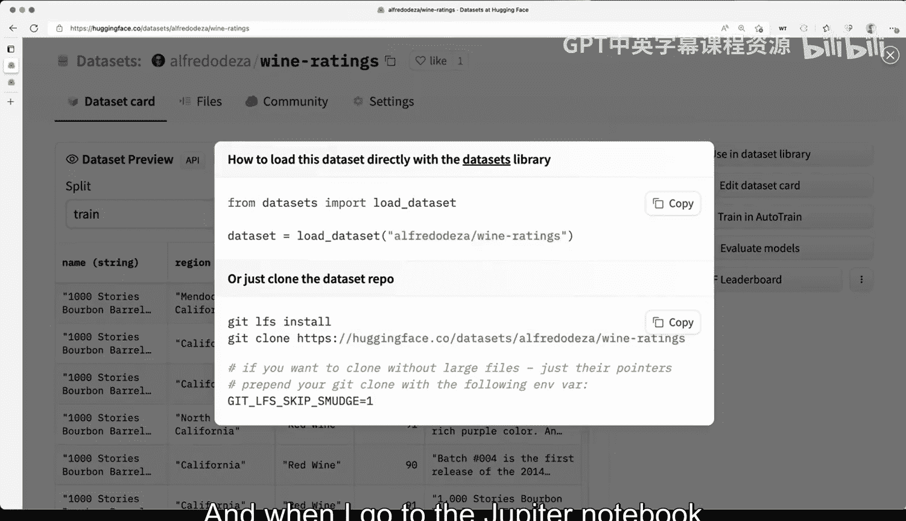
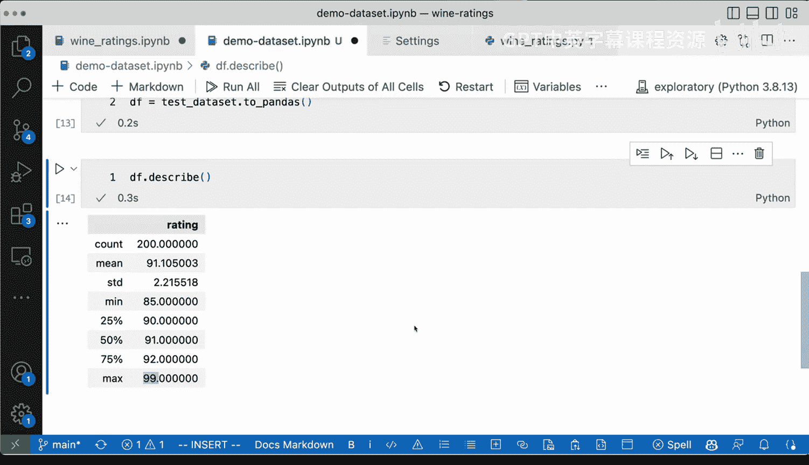
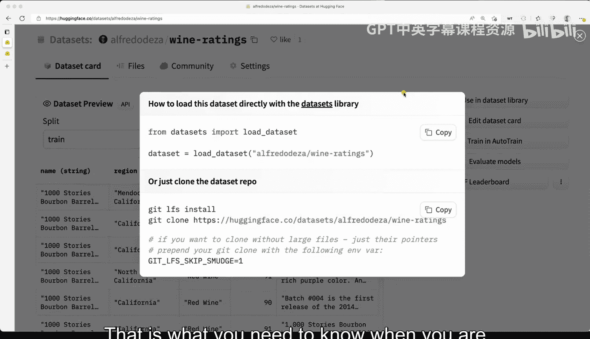
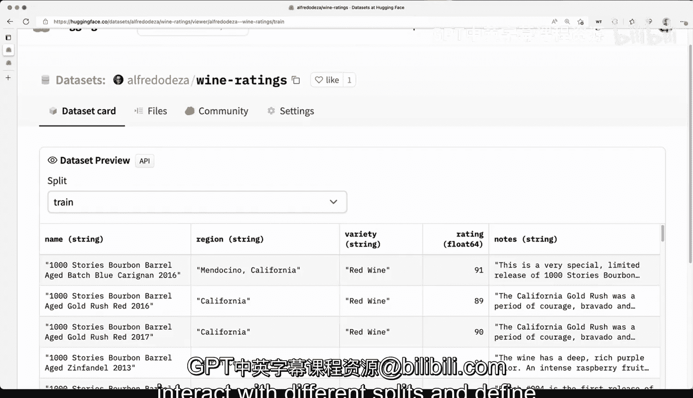

# 机器学习运维：26：使用Hugging Face数据集



在本节课中，我们将学习如何在Hugging Face平台上使用和管理数据集。我们将了解如何上传包含不同数据分割（如训练集、验证集和测试集）的数据集，以及如何通过自定义加载脚本来增强数据集的功能。

## 概述

上一节我们介绍了如何将CSV文件直接上传到Hugging Face。本节中，我们将进一步探索如何通过添加自定义文件来增强数据集的功能，特别是如何创建和管理数据分割。

## 添加数据分割

我们已经知道如何将CSV文件添加到Hugging Face，并通过`datasets`仓库或UI界面来访问它。现在，我们将展示一种略有不同的方法：添加自定义文件。这些文件对于CSV（制表符分隔值）文件是可选的，甚至对于JSON文件，你也可以直接通过UI添加。但这里，我将展示一些额外的、可以实现的功能。





我已经上传了相同的葡萄酒评分数据，但这次包含了不同的数据分割。数据分割允许你访问同一数据集的不同子集，这样用户无需手动分割数据，就能更方便地获取所需部分。由于我添加了一些支持文件，你现在可以看到数据集有了分割选项。

如果我点击这里，可以看到有“test”（测试集）和“validation”（验证集）。而“train”（训练集）——我在这里滚动一下——虽然只显示前10行，但实际上包含了大约两三千行数据。如果我将视图切换到“test”，它将只显示几百行数据（大约是200行）。注意，测试集没有ID列，这可能会带来一些问题，但这种情况确实存在，这也正是数据分割有用的原因。

同样，如果我们在这里列出该数据集的分割名称，就能看到具体有哪些分割，并且可以获取特定的分割。你甚至可以看到，如果使用`curl`命令，默认获取的将是测试集。如果你不想要测试集，而是想要完整的训练集，那么对应的就是这个文件。

## 自定义文件详解

那么，具体如何操作呢？让我展示几个可以添加的文件。再次强调，这些都是可选的。

首先，你会注意到训练集文件大小为13MB，并且带有LF（大文件存储）图标。这意味着如果你在命令行工具中添加此文件，需要启用Git LFS。如果点击这里，它会下载文件。我们不想再次下载。如果你在命令行工具中操作，需要运行`git lfs install`来安装一些预提交和预推送钩子，以确保Git LFS正常工作。如果不这样做，可能会遇到问题。不过别担心，如果你操作正确，终端上会显示相应的输出。

这里有几个关键文件，让我先展示`wine_ratings.py`文件。

这个文件是一个示例，你可以用它来获取数据的一些具体信息。这是我本人在2022年创建的。它包含一个简短的描述和一个主页链接，这些信息其实也可以通过UI添加。但接下来，我们开始深入这个数据的具体细节。

我在这里添加了版本信息，这会被UI捕获。我们还可以定义数据的特征，也就是我们有哪些列。你可以看到这里有`name`、`region`，并且我指定`rating`是浮点型，其他都是字符串类型。然后，我们继续填充信息，最后返回一个包含所有这些信息的`DatasetInfo`对象。

接着，我们来看分割生成器。分割生成器用于定义我们希望通过API向任何下载此数据集的用户提供哪些特定的分割。你可以看到这里有`train`、`validation`和`test`分割，这非常常见。Hugging Face为创建这些数据集的可选文件提供了模板，其中预设了这些参数，所以你无需记住所有语法。当然，你也可以随时参考这个`wine_ratings.py`文件来快速复习如何操作。最后，如果需要，你还可以从数据中生成示例。

## 文件路径的重要性

让我们回到文件列表，看看为什么这些文件路径很重要。在文件列表中，我们应该能看到一个测试集文件。没错，还有训练集和验证集的CSV文件。训练集是主要的、完整的、大的CSV文件。但为什么这些文件会在这里？因为当你拥有CSV文件时，Hugging Face允许你上传它们。但这些数据也可以存放在其他地方，这时你可能就需要考虑使用一个可选的加载文件。

一个不托管在Hugging Face上的文件需要一个加载器。加载器会指向数据源。让我用另一个数据集“blimp”来举例说明。如果我们点击这个数据集，有一个完美的数据集预览。让我们看看它的文件。文件列表里没有实际数据，只有一个“dummy”文件。但如果我们查看`blimp.py`这个加载器文件，看看它的URL是什么。

你可以看到下载URL指向GitHub。这个加载器知道如何通过这些URL获取数据，并通过Hugging Face提供，这是一种非常巧妙的数据服务方式。你还可以在这里看到特征定义，也就是实际的列名。然后，我们进入生成示例的部分，这和我之前展示的非常相似。在分割生成器中，你会看到它使用了URL。这里定义了下载URL和资源位置，以便访问它们。

回到葡萄酒评分数据集，我们现在已经解释了这些CSV文件的作用，以及这个加载文件的作用。`README`文件包含一些信息，称为数据集卡片，是人们如何使用你数据的文档。这个数据集的信息还不够完善。最后是`dataset_inf.json`文件，这同样是完全可选的。它包含了描述、引用等信息，这些内容实际上是从`wine_ratings.py`文件中的类和info等信息生成的。

如果你还记得，这个数据集有不同的分割，我们实际上可以在那里进行一些操作。你可以在代码库中使用这些数据。这个例子很好，因为它包含了一切。你可以克隆这个仓库，但请记住，你必须安装Git LFS（就是这里显示的这个），以确保一切正常。但如果你不想把所有超大的文件都下载到电脑上，也可以选择不这样做。

我们将复制这里的代码，然后转到Jupyter笔记本，看看如何操作。



## 在代码中使用数据集



我们现在在Jupyter笔记本中。我将粘贴Hugging Face建议我们执行的代码，然后运行它。当我们查看这个数据集对象时，会发现它找到了缓存数据，所以无需再次下载任何东西。运行这段代码会非常快，因为数据已经下载过了。

让我们探索一下这个数据对象，看看它返回什么。和往常一样，它将返回一个数据字典。这个字典包含了分割：`train`、`test`和`validation`。你可以看到测试集有200行，而主要的训练集有3200行（实际上是约32000行），这是完整的数据集。特征包括`name`、`region`、`variety`、`rating`。

你完全可以创建一个自定义配置，只包含特定的列，例如只包含`region`和`rating`。你通过这个配置来发布这些数据。

例如，假设我们只想要测试集。我们获取测试集，使用自动补全功能，然后我们可以说：
```python
test_dataset = dataset[‘test’]
```
接着，我们将其转换为Pandas DataFrame。我将调用它，并将其赋值给`df`变量。

运行这段代码，一切正常。现在我们可以调用`df.describe()`来看看这个数据的情况。你可以看到确实有200行，评分列有一些数值。通常评分范围从85到100，但这个数据中最高只到99。

## 总结







本节课中，我们一起学习了在Hugging Face上处理数据集的具体细节。我们看到了之前非常简单的操作，而现在这是一个稍微进阶的步骤，使你能够通过自定义加载文件与不同的数据分割进行交互。你现在应该知道如何利用数据分割和增强功能来更有效地管理和使用Hugging Face上的数据集了。