# 杜克大学｜机器学习运维｜DevOps⧸DataOps、Azure、MLFlow和抱脸｜MLOps ｜ Machine Learning Operations p168 27_02_07_数据集操作实践.zh_en -BV1yE421c7uA_p168-

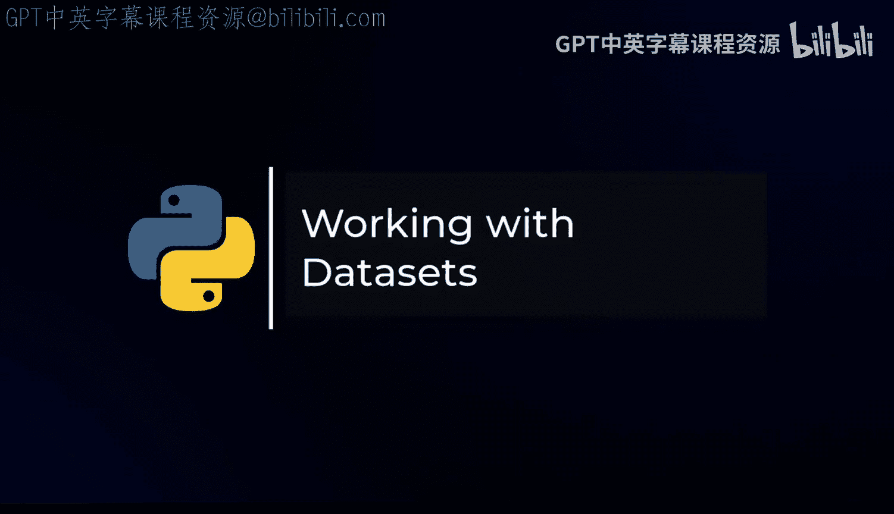

Here we're in the Huging face interface and I'm going to talk a little bit about datasets here。

 Now datas are one of the raw materials for working with the Huging F hub and in fact。

 one of the best ways to look at a dataset is to go to the datasets interface here and filter through things like the most likes。

 for example， and in fact， here's a really useful one Wikipedia。

 we can take a look at this and say that the Wikipedia data contains cleaned up articles of all languages and it's from the dump。

 So's super useful。 someone could actually get inside of here and grab this entire Wikipedia data here and get it from a particular date。

And go through here and do whatever they needed to do， for example， make instances of the data。

 get a very large file。 Now， if you wanted to grab a slightly smaller version。

 you can take a look at glue here， which is a very popular dataset。

 And if we go to the dataset viewer here。 This really shows you how it's designed for machine learning right so that's one of the differences here is it's really the raw material。

 So if we go to split you can see I can grab the validation， I can grab the test right。

 I can go through here and a pick subsets of the data and I can actually get this information inside of a fine- tune job for example。

 So this is previewing the data and it's also fairly easy to。

Write some code that talks to this and pulls it into your local workspace。

 But what if you want to upload your own data， Well， fortunately。

 it's fairly straightforward if we go to the profiles section here， notice how there's new model。

 new data， new space， we just go to new model， new dataset right here。

 and we can call this one NBA data。And。Inside of this NBA data set。

 I would just go ahead and say create data set。And all I would need to do now is put this data inside of this location。

 So how would I do this， I would just go to files and say add file。

 So this is one of the easiest ways to add things to your information here and notice that I'm going to grab some data from a previous CAgle project I did five years ago。

 I'm going to go ahead and just upload it inside of here， and I'm going to say upload files。

Select something that's on my desktop， see if we can find this particular data set here we go。

 here's this MBA data set， and it's very straightforward to then immediately start using it because this particular piece of data。

Is now been uploaded and I can actually use this inside of a particular project。

 So once you've gone through here， you've set it up， you can go to the data viewer。

 it should be available in just a second and I also could curl this data and grab it into a particular project。

 So let's go ahead and take a look at a data that I've already uploaded previously。

 if I go back to my profile here， and I look at datas here。

 Here's one that I've uploaded the exact same data。

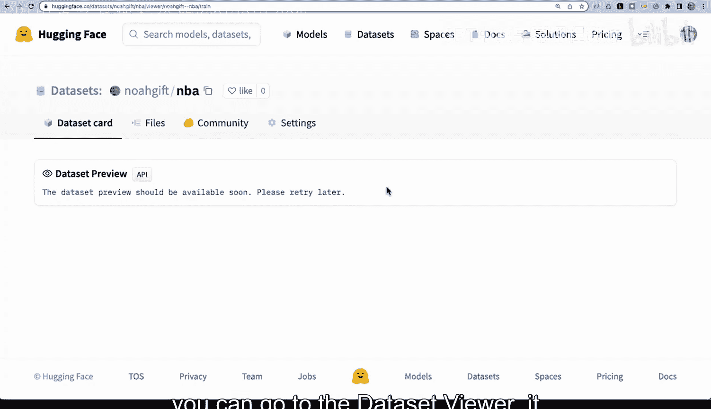

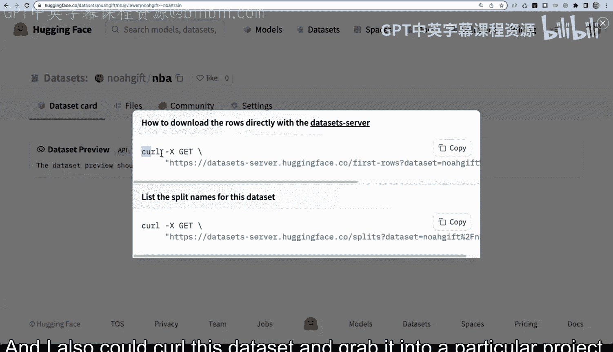

And one of the things that we'll notice is that this particular dataset has the information about it。

 It has the API call that I could actually use if I wanted to curl it。 And in fact。

 let's go ahead and try that。 If I go here and I say copy and I want to go into this workspace that I've got set up here。

 I could just paste that command in and you'll see that， in fact， it is able to actually do a curl。

 so it it's a really useful way to interact with my data。

 I can also go to the data viewer and and look at all the different stats here as well。

 Now that the really useful part next once you've got it inside of there would be to actually go into the interface and interact with it。

 So what I'm going to do。

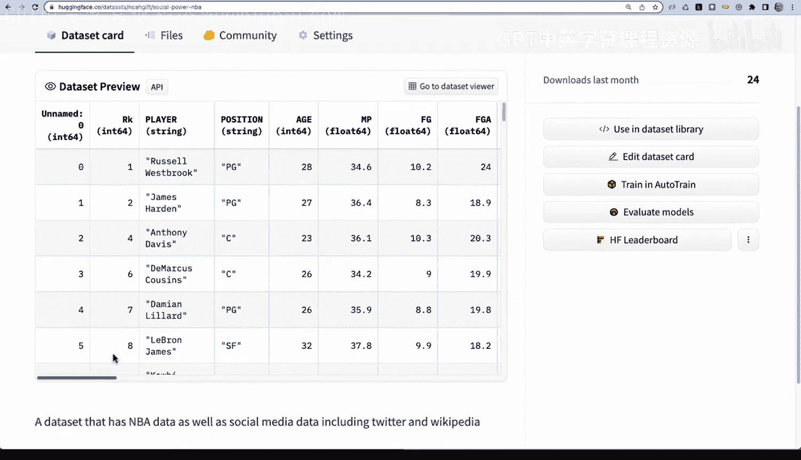

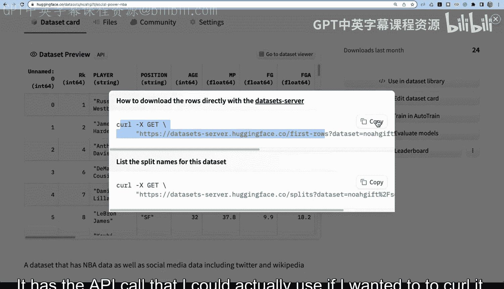

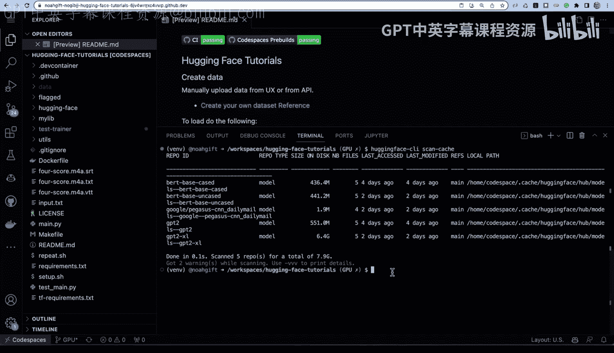

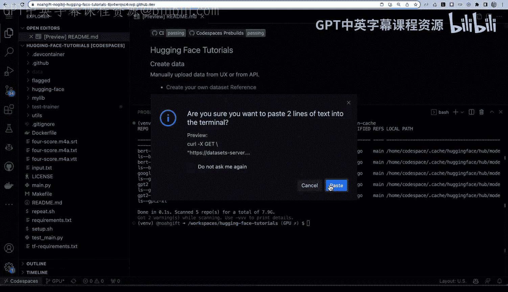

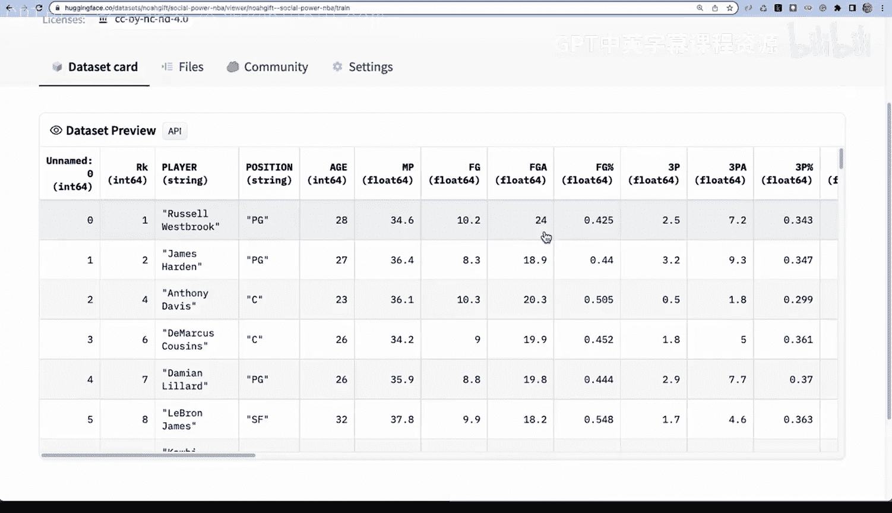

Because I'm going to go to download data right here and you can see that there's not much code to programmatically download download the data。

 you just say from data sets and port load data。If you want。

 you could pretty print it and then you just put the name of the organization and the name of the data location that you created in this case social power MBA at that point I can print out the features and then I can print out one of the examples as well in this case I can print out this particular record so let's go ahead and do that we'll just go ahead and say Python download data we'll say huggingface download data。

And notice that it is able to go to Hugingface， grab this data set and in fact。

 pull this one record directly out of here。 And it has all of the information about this particular player。

 right And if I wanted to change it or build it into command line tool or whatever it is I needed to do。

 it would be pretty straightforward to actually do more to it。 Now。

 another way that I would recommend that would be a great way to interact with data sets is to use I Python。

😊，And in fact， if you go through here and you do this。

 this is one of the more useful ways to interact with a dataset would be to load in the data into a variable right here and then you could actually go through and have a little bit more of an interaction with a particular data so in this case notice that I did grab that player again。

 but what if I wanted to grab the next record well， it's pretty easy know。

 because I interactly could play around with it， and here we see this player is Anthony Davis if I wanted to grab a third player I could go through here and I I could play around with it。

 So once you've got this data this data loaded here there are a couple really good options to interact with it。

 one would be to use I Python a second would be to use a communitylan tool library like click for example and to programmatically play around with it again though you also could just go back to this interface。

 look at the data card。

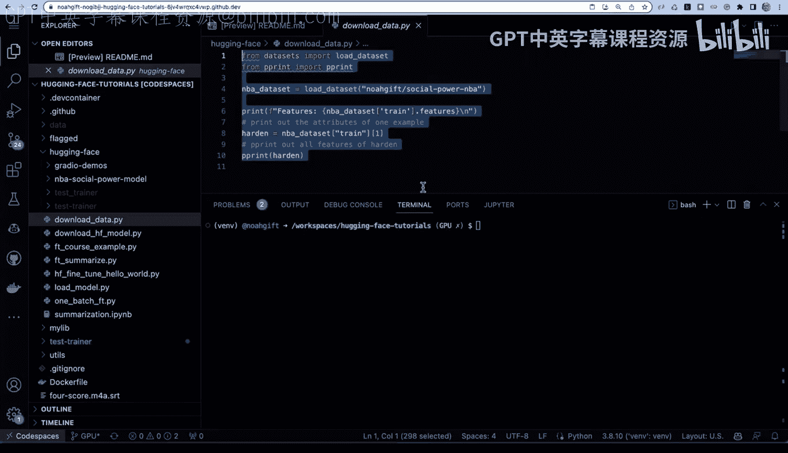

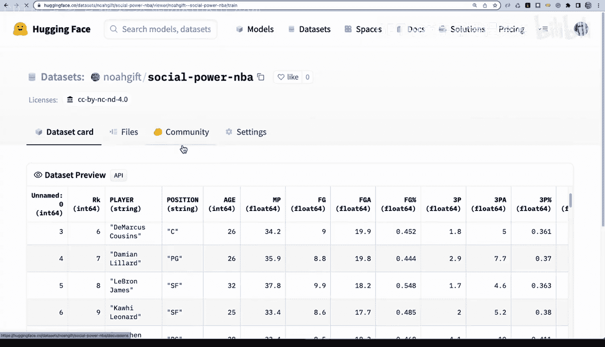

If you wanted to and notice how it says this API call。

 you could just go through here and copy it and just run it and also get the entire bit of information as well。

 so there's lots of different ways to interact with a data on the Huging F H。

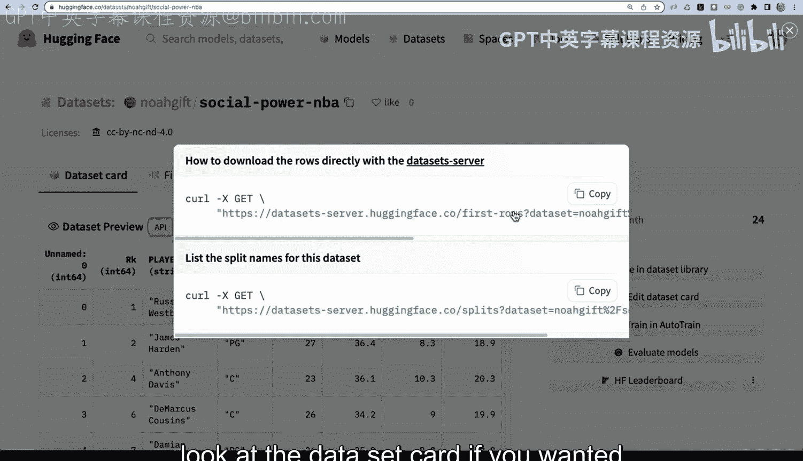

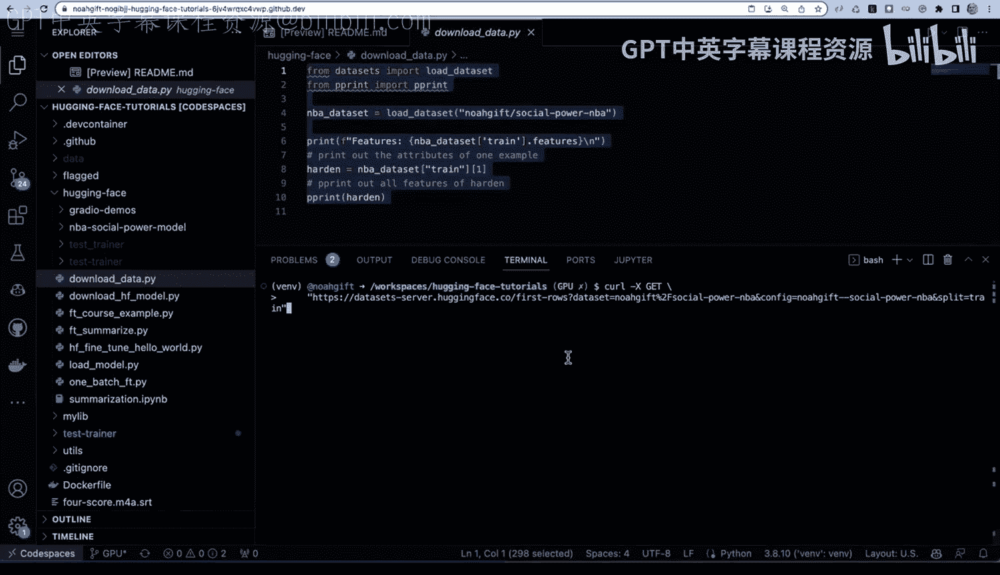