# 机器学习运维：第168课：Hugging Face数据集操作实践 🗂️

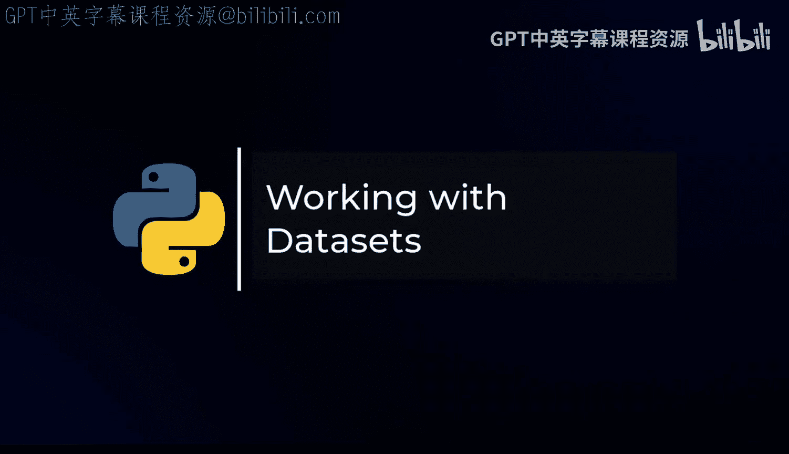

在本节课中，我们将学习如何在Hugging Face平台上操作数据集。我们将涵盖浏览现有数据集、上传自定义数据集以及通过代码与数据集进行交互等核心操作。

## 浏览Hugging Face数据集

Hugging Face Hub是机器学习工作的重要资源库，数据集是其中的核心原材料之一。

以下是浏览和筛选数据集的方法：
*   访问Hugging Face的“Datasets”界面。
*   使用筛选功能，例如按“Most Likes”（最多点赞）进行排序。
*   例如，“Wikipedia”数据集是一个非常有用的资源，它包含了所有语言的清理后文章，源自维基百科的转储文件。用户可以获取特定日期的完整数据，或提取部分数据用于特定任务。

另一个流行的数据集是“GLUE”。在数据集查看器中，可以清晰地看到其专为机器学习设计的结构。通过“Split”选项，用户可以获取验证集、测试集或数据的子集，这些数据可以直接用于微调任务。

## 上传自定义数据集

上一节我们介绍了如何浏览现有数据集，本节中我们来看看如何上传自己的数据到Hugging Face平台。

上传自定义数据的过程非常直接。

以下是上传自定义数据集的步骤：
1.  在个人资料页面，点击“New dataset”（新建数据集）。
2.  为数据集命名，例如“NBA data”。
3.  点击“Create dataset”（创建数据集）。
4.  进入数据集页面后，在“Files”选项卡下点击“Add file”（添加文件）。
5.  从本地选择文件（例如一个CSV文件）并上传。

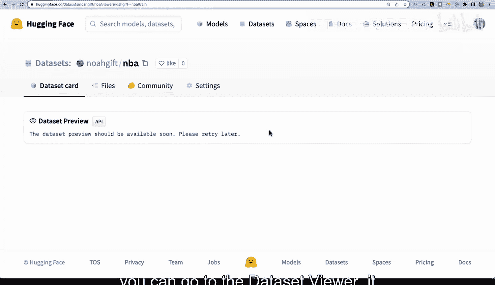

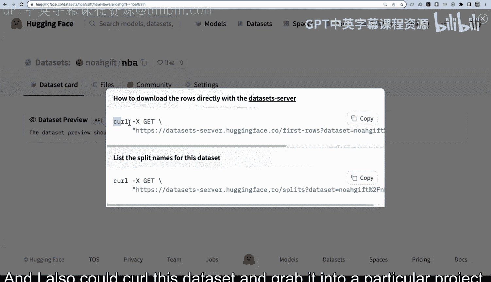

上传完成后，数据会立即可用。你可以通过“Dataset viewer”（数据集查看器）预览数据，也可以通过API调用将其拉取到本地项目中使用。

## 通过代码与数据集交互

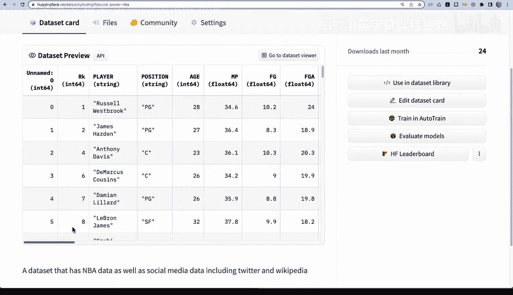

我们已经了解了如何浏览和上传数据集，接下来看看如何通过编程方式与这些数据集进行交互。

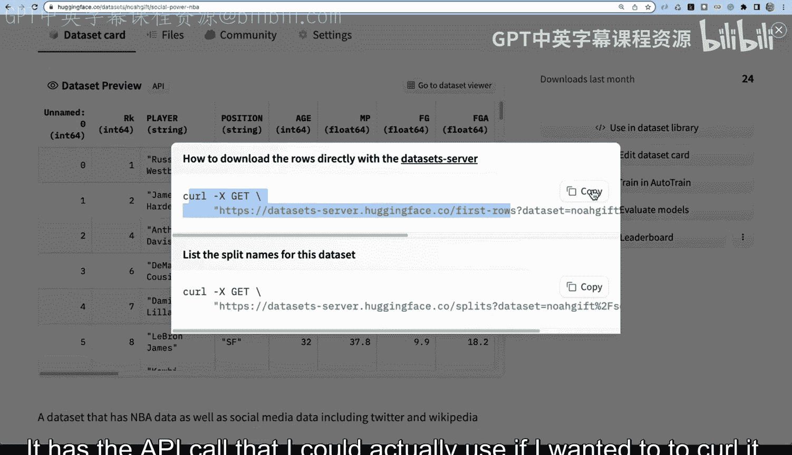

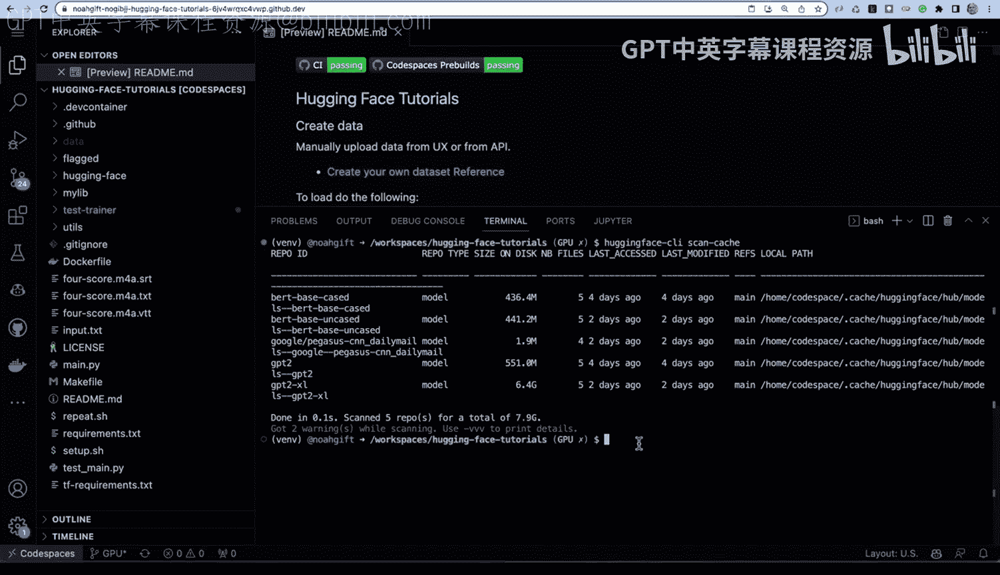

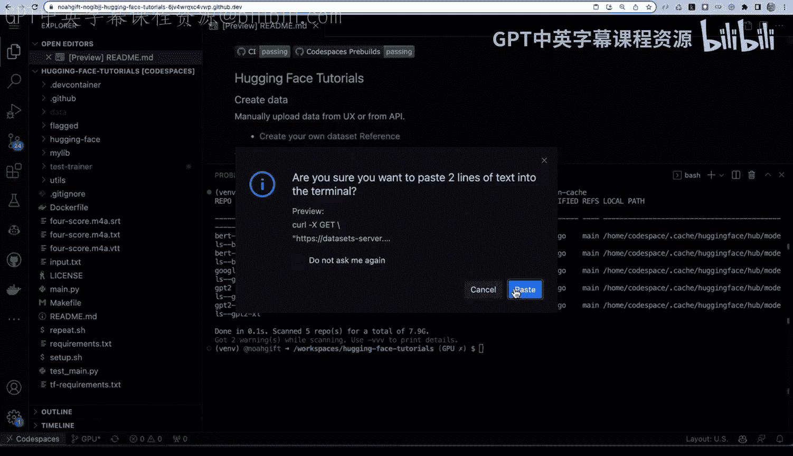

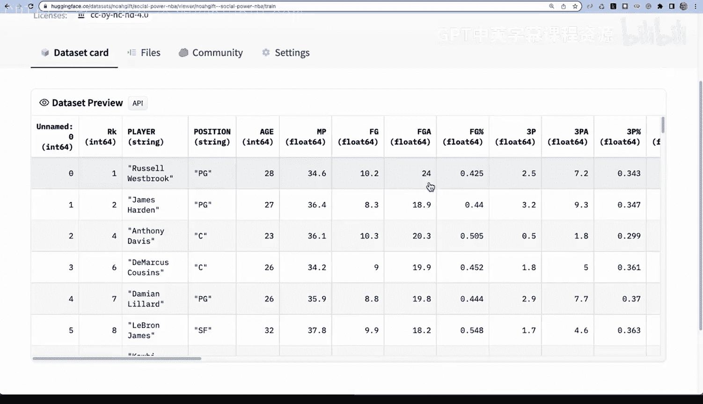

上传数据集后，页面会提供该数据集的API调用信息。例如，可以使用`curl`命令直接获取数据。

更常用的方式是通过Hugging Face的`datasets`库来加载数据。核心代码如下：

```python
from datasets import load_dataset

dataset = load_dataset("socialpower/nba-data")
print(dataset.features)
print(dataset[0])
```

运行上述代码，程序会从Hugging Face拉取指定的数据集，并打印出数据特征和第一条记录。

## 交互式探索与工具

加载数据到变量后，有几种有效的方式进行交互式探索。

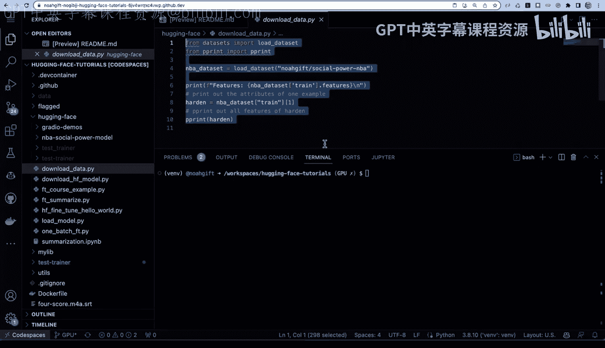

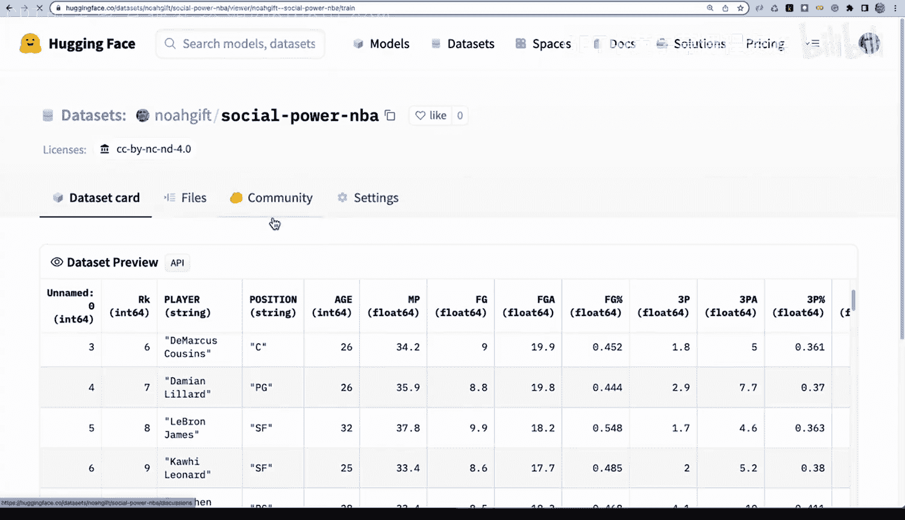

以下是推荐的交互方式：
*   **使用IPython**：在交互式环境中加载数据，便于逐条查看和探索。例如，执行`dataset[1]`可以获取第二条记录。
*   **使用命令行工具库**：例如使用`click`库构建自定义的命令行工具来操作数据。
*   **返回Web界面**：始终可以回到Hugging Face网站的数据集卡片页面，查看数据详情并复制API调用命令。

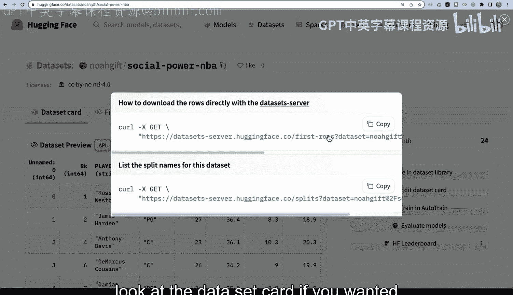

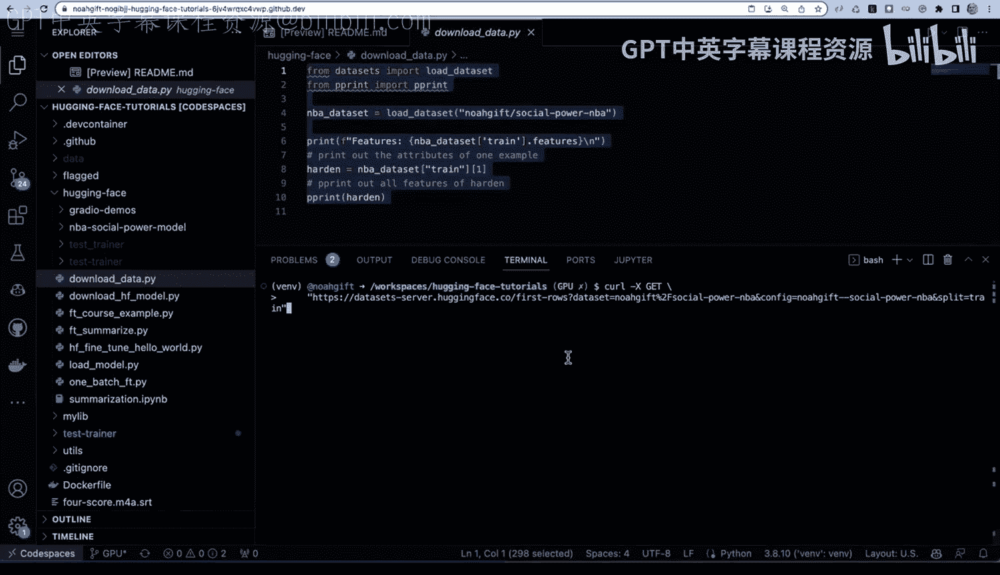

本节课中我们一起学习了Hugging Face数据集的核心操作：从浏览和筛选平台上的优质数据集，到上传和管理自己的自定义数据，最后通过代码和交互式工具有效地加载与探索数据集。这些技能是构建机器学习工作流的重要基础。