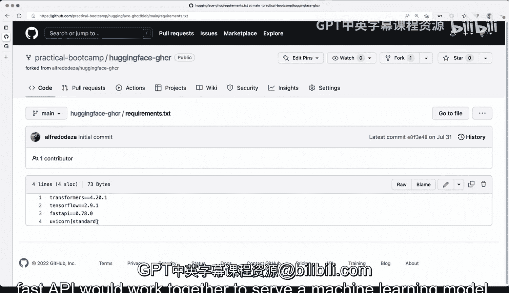

# 杜克大学｜机器学习运维｜DevOps⧸DataOps、Azure、MLFlow和抱脸｜MLOps ｜ Machine Learning Operations p169 28_03_02_Hugging-Face与FastAPI集成.zh_en -BV1yE421c7uA_p169-

Let's take a look at Huinface working with fast API。

 which is a web framework from Python that allows you to expose an API。

 and in this case it's going to be of course， a machine learning API so we have a couple of files here in a couple of directories。

 Let's take a look first how hugging face and fast API work together。

 we're going to concentrate in this web app directory and it's only a single file called mainda Pi and we're trying to make it super simple so that it is very straightforward。

 Allright so。I'm going to go in into the code and let's go step by step and see what is going to be doing first。

 We're going to get our imports done。 We're going to be using the pipeline from transformers。

 which is an abstraction actually that allows you to interact with various different models from transformers Now that abstracts a away all of the complexity from dealing with different types of models that is going to be fine。

 then from fast API we're going to import the fast API to create our application。

 and then we're going to import HTML response because we are going to be using a little bit of HTML and finally we're going to do a little bit of typing that is why we're going to import these base model over here。

 All right moving on we have the generator So that's going to instantiate it's going to download dynamically in this case the GT to model from hugging face。

And we're going to concentrate specifically on that text generation part so we're going to do some text generation I'm going to try to make this a little bit a little bit bigger。

 there we go so once we do that GP2 generation we're going to instantiate and we're I'm actually going from top to bottom so we're going to instantiate here the fastTpi similar to flask if you're familiar with flask we're going to create this class so that we can define exactly what our inputs are for this HtTP API and that's going to be that the JO body with a key of text and the value is going to be string so that's how we define our schema that is going to be accepting for the JSOM body that our endpoint is going to be accepting then we're going to expose slash so the root of this web application and we're going to return an HTML。

Response， which is this right here。 nothing， nothing too complex is really actually very bad Hl form there。

 but oversimplifying things to concentrating the actual example。 All right。 and finally。

 we are going to generate we're going generate we're going to expose these generate endpoint which is this one right here and that generate endpoint is going to allow us to interact is going to send request to that slash generate on our hosted API and use the generator from line6 right here and use it here for results and then return return the first the first item that。

Those square brackets in the0 in the middle means that we'll return the first item。

 So that's all we are going to need。 I'm going to go very quickly through the requirements。

 which is the last thing I want to show you so that you can take a look at how this is going to work so a couple of the things that we're going to use well we're going to use transformers we're going to use Tensorflow for because transformers will need either Pytorch or Tensorflowlow installed for this to work。

 then we're going to be using fast API with that version and then to run all of these we're going to use Uicorn。

 which is the recommended server that fast API works with so that's a quick overview how hugging face and fast API would work together to serve a machine learning model。

