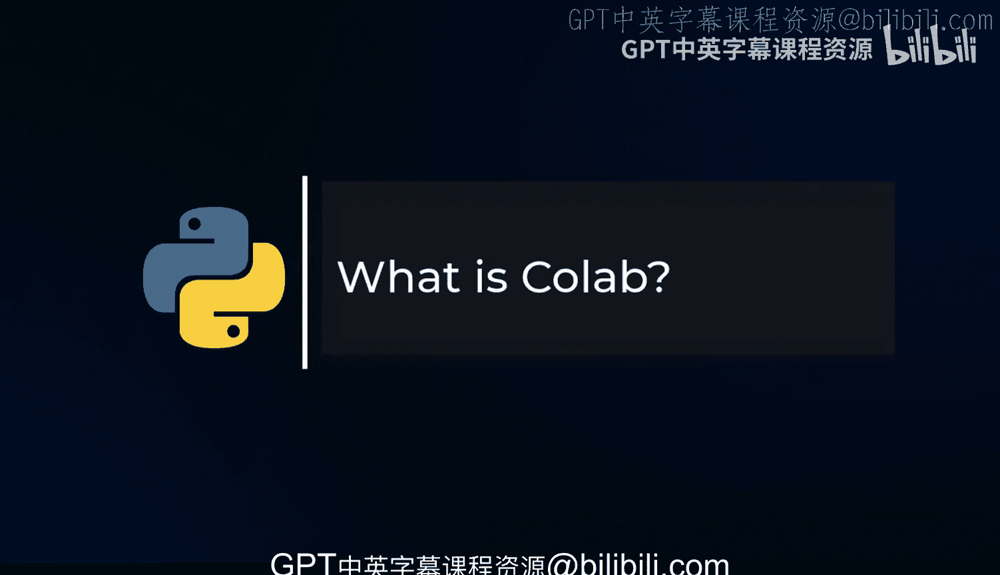
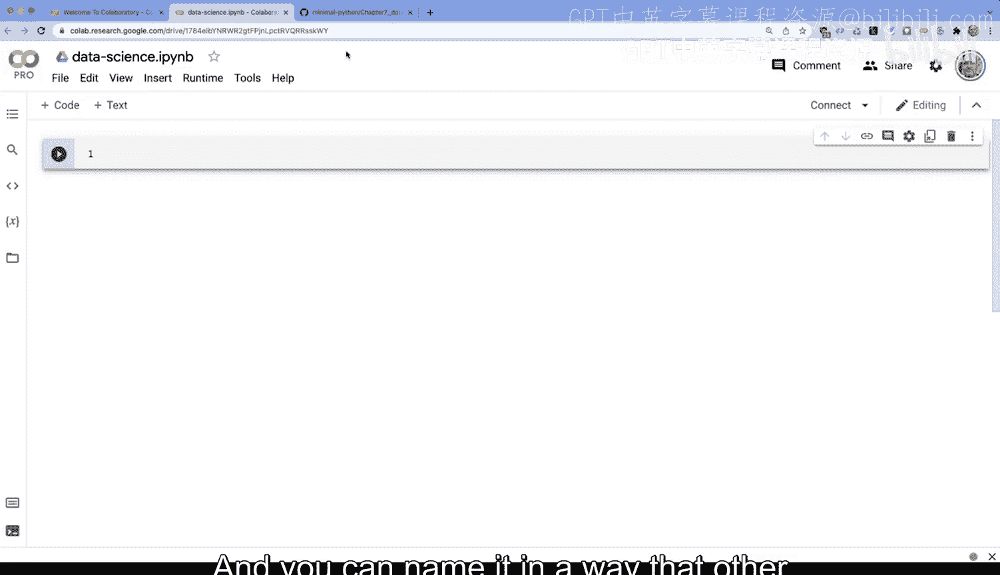
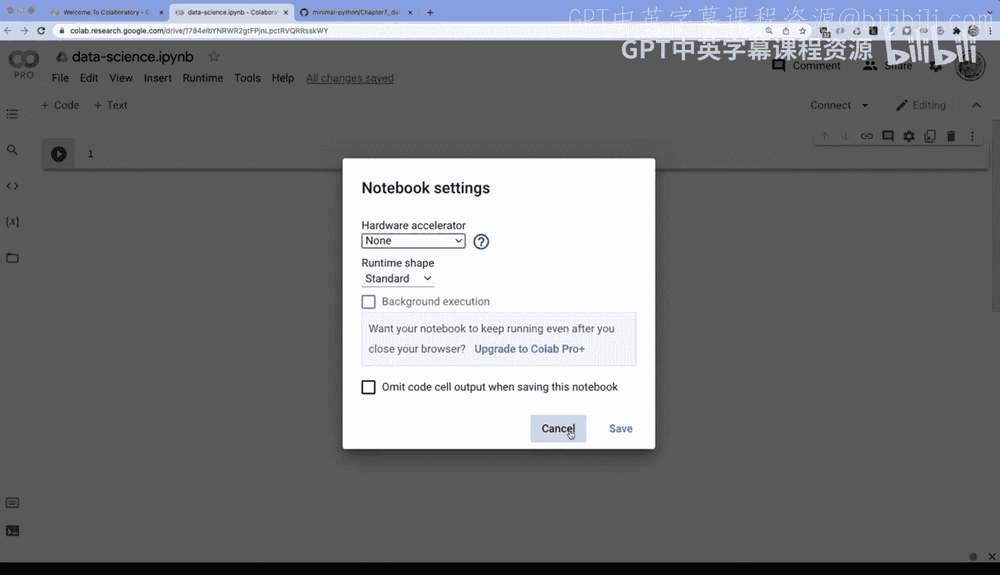
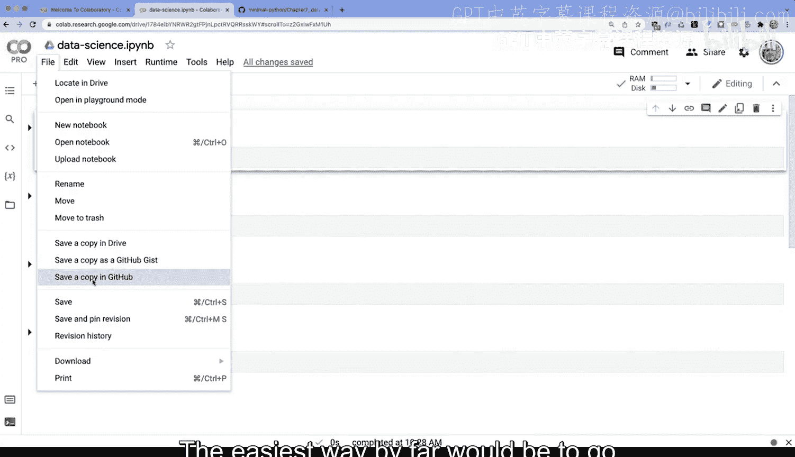
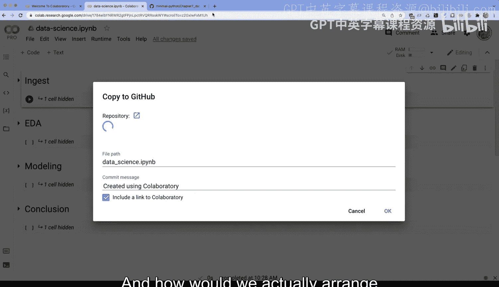
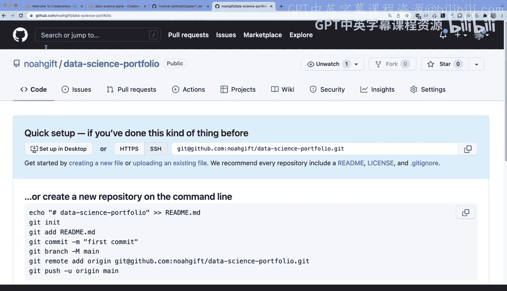
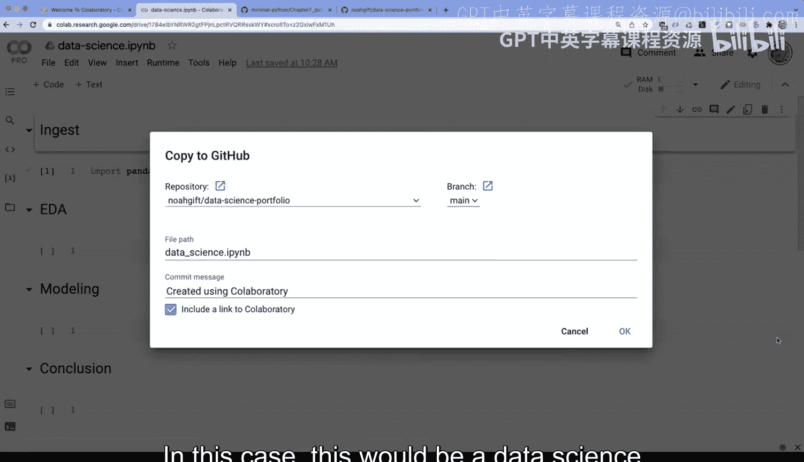
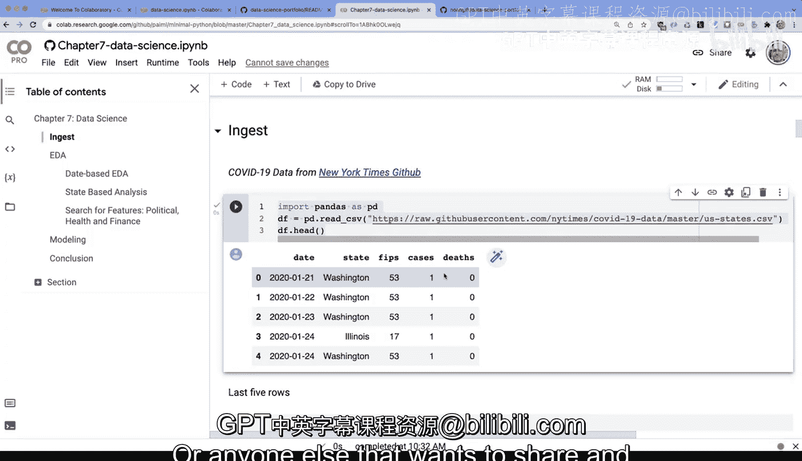
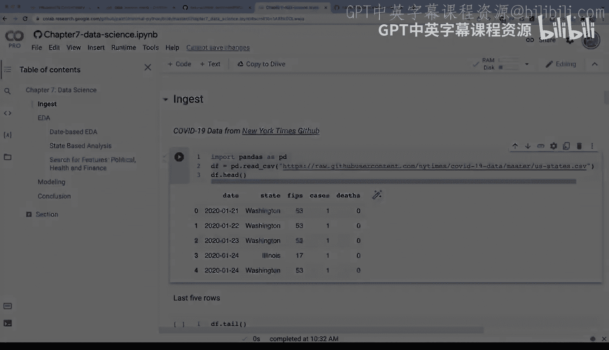

# 机器学习运维：P17：使用Google Colab进行数据科学项目 📓



在本节课中，我们将学习如何使用Google Colab笔记本进行数据科学项目和作品集项目。Colab是一个基于云的免费Jupyter笔记本环境，特别适合机器学习、数据分析和协作。

## 概述

Google Colab提供了一个便捷的平台来编写和执行Python代码，无需进行复杂的本地环境配置。它支持GPU加速，并能轻松与GitHub和Google Drive集成，便于项目管理和分享。

## 创建与设置新笔记本



上一节我们介绍了Colab的基本概念，本节中我们来看看如何创建和设置一个新的笔记本。

首先，访问Colab后，你会看到默认的欢迎界面，其中包含一些使用说明。

要创建一个新笔记本，请点击菜单栏的 **文件** -> **新建笔记本**。系统会创建一个空白的笔记本模板。



创建后，有两件重要的事情需要注意：
1.  你可以为笔记本命名。点击顶部的默认名称（如“未命名的笔记本”），将其修改为与项目相关的名称，例如 `你的数据科学项目`。这有助于他人理解笔记本的内容。
2.  在 **运行时** 菜单中，你可以更改运行时类型。如果你使用的是Colab Pro版本，可以选择性能更强的GPU，也可以选择TPU。这对于需要大量计算资源的任务非常有用。

## 构建清晰的项目结构

一个结构清晰的笔记本能让你的项目逻辑更分明，也便于他人阅读。我特别向学生和数据科学专业人士推荐创建层次结构。

以下是我推荐的项目结构，你可以通过创建多个代码单元格并添加标题来实现：

```python
# 数据获取
# 你的数据加载和初步处理代码在这里

# 探索性数据分析 (EDA)
# 你的数据可视化和分析代码在这里

# 建模
# 你的模型训练和评估代码在这里

# 结论
# 你的总结和结论在这里
```





通过这种方式，你可以将不同阶段的代码组织起来。Colab会自动为这些标题生成目录，你可以在左侧边栏中轻松导航。当代码块较多时，你还可以折叠每个部分，使界面保持整洁。

## 保存与分享项目



构建好项目后，下一步就是保存和分享。Colab提供了几种强大的分享方式。

### 保存到GitHub



最直接的方法之一是将笔记本保存到GitHub，这对于创建作品集或团队协作非常有效。

操作步骤如下：
1.  在GitHub上为你正在进行的作品集项目创建一个新的代码仓库，例如命名为 `data-science-portfolio`。
2.  在Colab中，点击 **文件** -> **在GitHub中保存副本**。
3.  在弹出的窗口中，选择你刚刚创建的仓库，然后点击确定。

这样，你的笔记本就会保存到GitHub仓库中，并生成一个公开的Colab链接。其他人可以通过这个链接直接打开并运行你的代码。

### 通过Google Drive分享

另一种强大的方式是使用Google Drive的分享功能。

操作步骤如下：
1.  点击Colab界面右上角的 **分享** 按钮。
2.  在分享设置中，将权限修改为 **“知道链接的任何人”** 并设置为 **“查看者”** 或 **“编辑者”**。
3.  复制生成的链接。
4.  你可以将这个链接放入项目的README文件中，或直接分享给他人。

这种方式的好处是，任何人无需登录即可访问笔记本，非常适合进行演示或代码共读。

## 查看一个完整项目示例

为了更直观地理解，让我们来看一个更复杂的数据科学项目示例。假设我们有一个分析《纽约时报》数据的项目。

打开该项目的Colab链接后，你会注意到清晰的结构：
*   **数据获取**：这部分代码读取一个CSV格式的《纽约时报》数据集。
*   **探索性数据分析**：对数据进行可视化和初步统计。
*   **建模**：基于数据训练机器学习模型。
*   **结论**：总结分析结果和模型表现。

这个示例展示了如何使项目具备100%的可复现性，并确保其易于导航和理解。关键在于将数据、代码和逻辑清晰地组织在一起。

## 总结





本节课中我们一起学习了使用Google Colab进行数据科学项目的核心工作流。我们涵盖了从创建和设置新笔记本、构建清晰的项目层次结构，到通过GitHub和Google Drive保存与分享项目的完整过程。记住，无论是学生、数据科学专业人士还是任何希望分享成果的人，遵循清晰的结构和利用便捷的分享功能，都能让你的项目更加专业和高效。