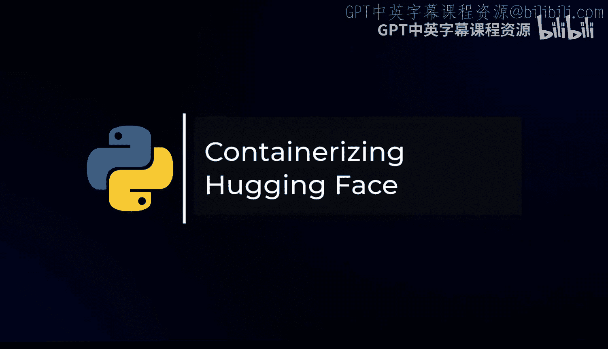
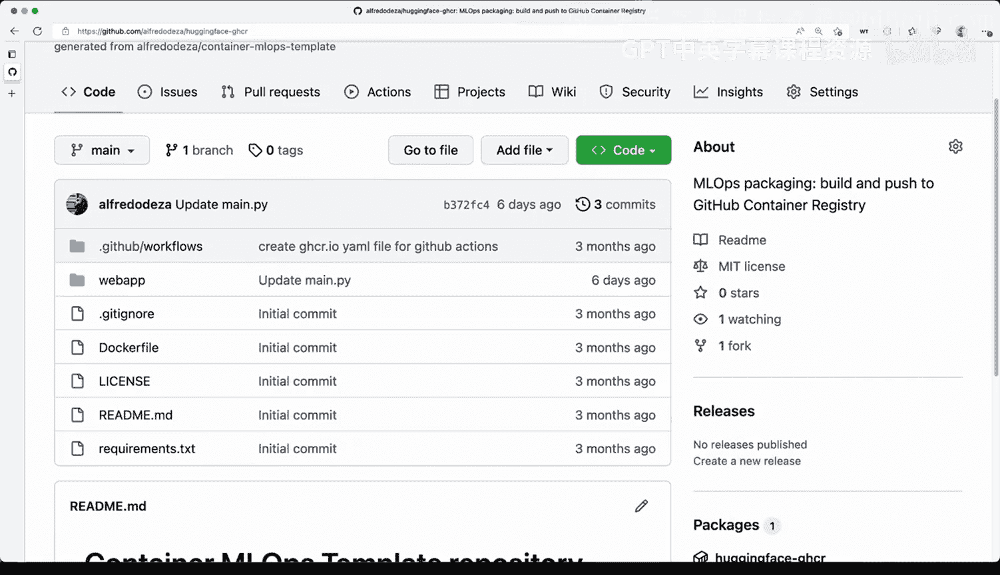
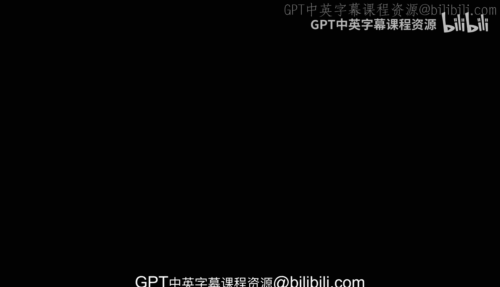

# 杜克大学｜机器学习运维｜DevOps⧸DataOps、Azure、MLFlow和抱脸｜MLOps ｜ Machine Learning Operations p170 29_03_03_Hugging-Face容器化.zh_en -BV1yE421c7uA_p170-

Now that we have seen a quick overview of these hugging phase dash GHCR and we'll see later why that is important now that we've seen a little bit of kind of like how hugging face would work with fast API let's look at how we would containerized hugging phase so we have already the application。

 but now we want to see some of these files specifically the Docker file and how is the web application going to be be part of these container so what we're going to be doing here right now is going to take a look at Docker file and then see what are the important parts when you're constructing your building your containerizing these web application so the first thing that and this is just 13 lines of a configuration file for Docker it's called a Docker。

File if you're familiar with Docker then this will feel very straightforward if you're not。

 it is just a configuration file so that we know how to construct these container we're going start from the top we're going to use the Python 38 and why Python 38 well I'll tell you in a second when we see the requirements because once we see the requirements you'll understand that as of these day it is Python 38 is kind of like my go to version because some of these requirements will now be able to get installed next we set the working directly to be slash web app and we go ahead and install the dependencies inside the container。

Next， we copy all of the contents from the web， the local web application into the remote or inside the container slash web app directory。

 finally and this is best practice we're going to be using the entry point and here the executable is Ubicorn which is the command line tool the python server that is going to help us serve fast API Finally we're going to use this command to serve it when we start the container is going to be hostt and then we're going to bind to any address and we're going to use main column app。

 All right， so let's take a look very quickly at the requirements。

 although we've quickly seen that before and I'm going to click here and then go to requirements and see why that is important well the important thing is that Tensorflow has some issues with other python versions that are not Python 38 so I'm going for the。

I know works and this is something that you as an engineer。

 either a data engineer or MLOps engineer or even a machine learning engineer that is dealing with dependencies have to go through find what works and find how you can make sure that whatever you are packaging like in this case I am that is going to work very well so that is how you would go and package something like hugging face notice that I just list the dependencies and then next that we've seen how this works with a web app and we've seen the main。

 how we're doing the inference and how we're generating essentially an interaction with the text generation with the GPT2 model how that comes to be a container so that those sort of important files and that is how you would go ahead and configure that containerization。

