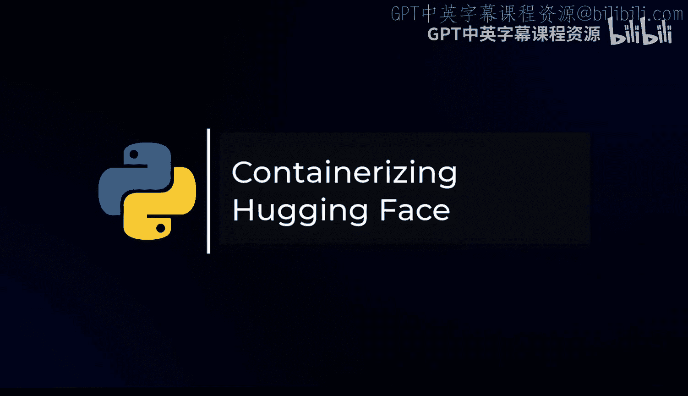
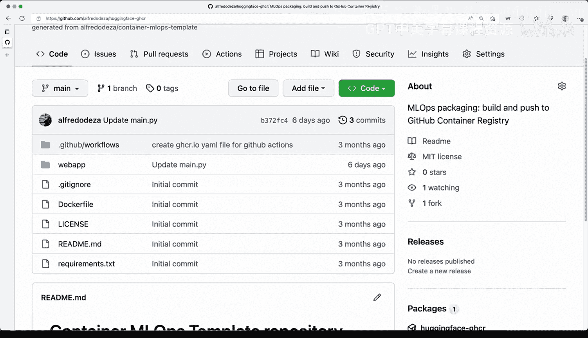
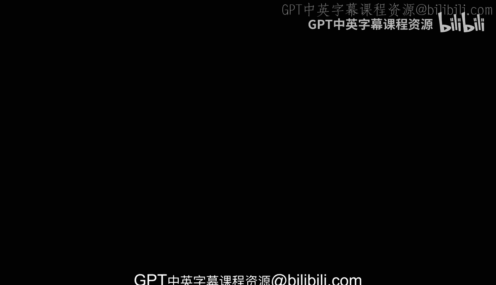

# 机器学习运维：第170讲：Hugging Face模型容器化教程 🐳



在本节课中，我们将学习如何将基于Hugging Face和FastAPI构建的机器学习Web应用进行容器化。我们将重点解析Dockerfile的配置，理解如何将应用及其依赖打包到容器中，并确保其能够顺利运行。

---

## 概述

上一节我们快速了解了Hugging Face与FastAPI结合的基本工作流程。本节中，我们将具体探讨如何将这样的应用容器化。我们将详细分析Dockerfile的每一部分，并解释相关依赖的选择，以确保构建出的容器镜像能够稳定运行。

## Dockerfile解析

Dockerfile是一个仅13行的配置文件，它指导Docker如何构建容器镜像。如果你熟悉Docker，这会非常直观；如果不熟悉，可以将其理解为一个构建清单。

以下是构建步骤的分解：

1.  **选择基础镜像**
    我们使用 `python:3.8` 作为基础镜像。选择此版本的原因将在查看 `requirements.txt` 文件时说明。

2.  **设置工作目录**
    通过 `WORKDIR /webapp` 命令，将容器内的工作目录设置为 `/webapp`。

3.  **安装依赖**
    接下来，我们执行 `RUN pip install -r requirements.txt` 来安装所有Python依赖包。

4.  **复制应用代码**
    使用 `COPY . /webapp` 命令，将本地Web应用的所有内容复制到容器内的 `/webapp` 目录中。

5.  **定义启动命令**
    最后，我们通过 `ENTRYPOINT` 指定容器启动时的可执行文件为 `uvicorn`。这是用于服务FastAPI应用的Python服务器命令行工具。启动命令为：
    ```bash
    uvicorn main:app --host 0.0.0.0
    ```
    这表示启动应用，并绑定到所有网络地址。

## 依赖管理 (`requirements.txt`)

现在，我们来看看为什么选择Python 3.8。关键在于 `requirements.txt` 文件中的依赖项。

以下是关键依赖示例：
```txt
transformers==4.15.0
torch==1.9.0
fastapi==0.70.0
uvicorn==0.15.0
tensorflow==2.7.0
```

TensorFlow等库与特定Python版本的兼容性至关重要。在本例中，Python 3.8被验证能与所列的TensorFlow版本稳定协作。作为工程师（无论是数据工程师、MLOps工程师还是机器学习工程师），处理依赖关系是核心任务之一，你需要找到并确定能够协同工作的版本组合，以确保打包的应用能够顺利运行。

## 总结





本节课中，我们一起学习了如何将Hugging Face模型与FastAPI Web应用进行容器化。我们解析了Dockerfile的各个组成部分，从基础镜像选择、依赖安装到应用代码复制和启动命令定义。同时，我们也探讨了依赖管理的重要性，特别是Python版本与特定库（如TensorFlow）的兼容性问题。通过这种方式，你可以将机器学习应用可靠地打包和部署。