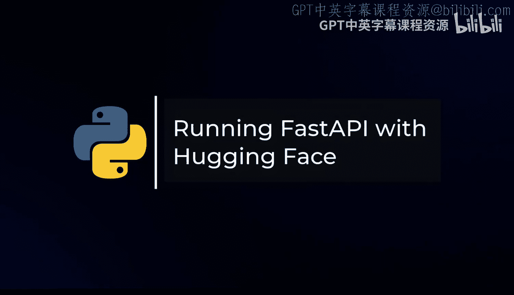
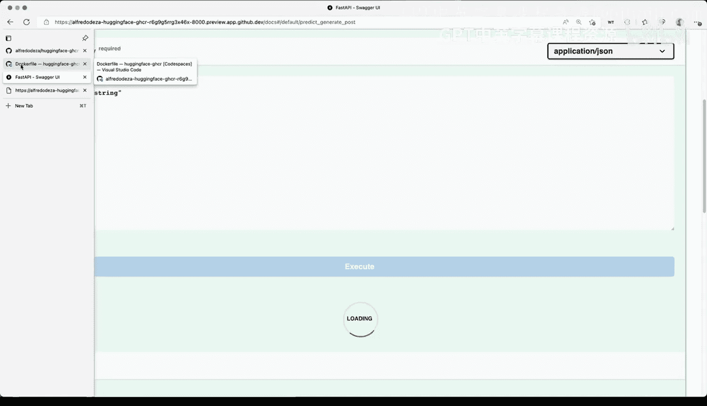
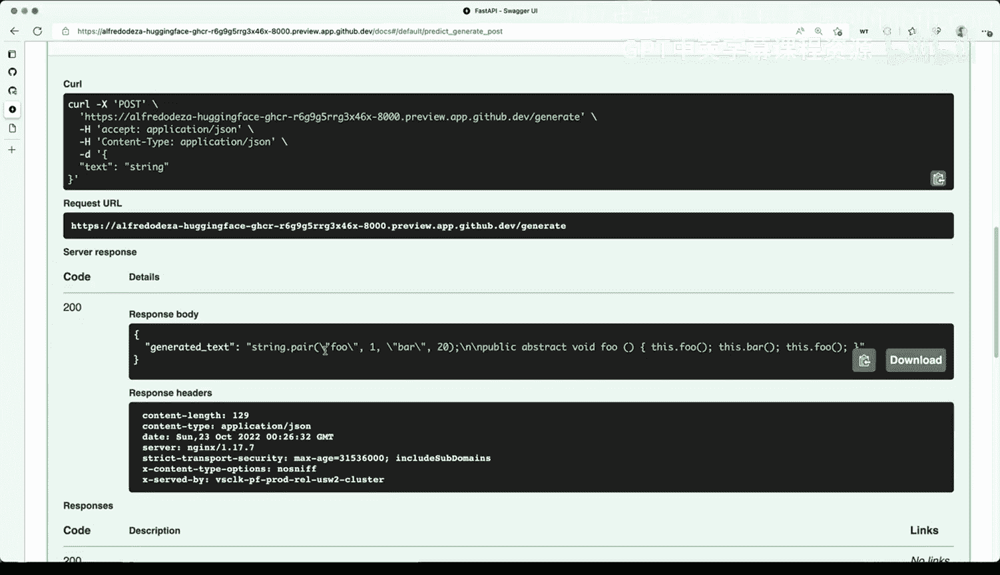
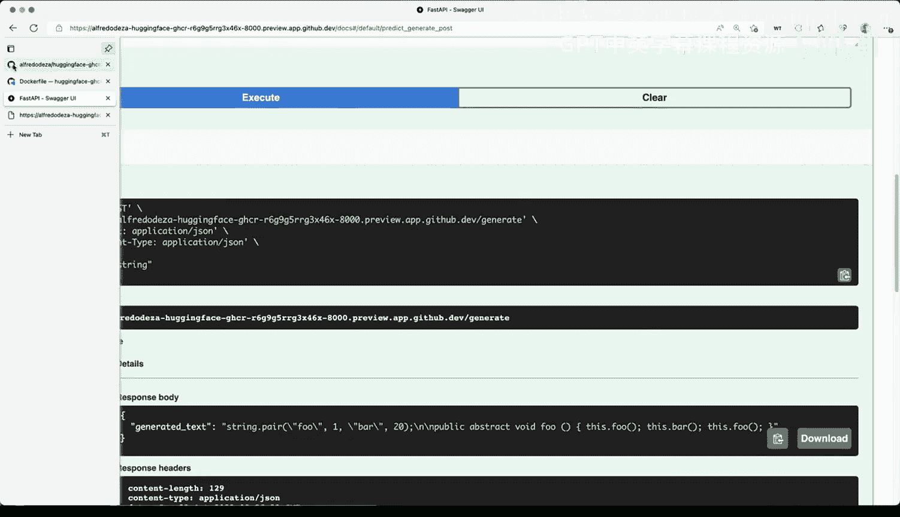
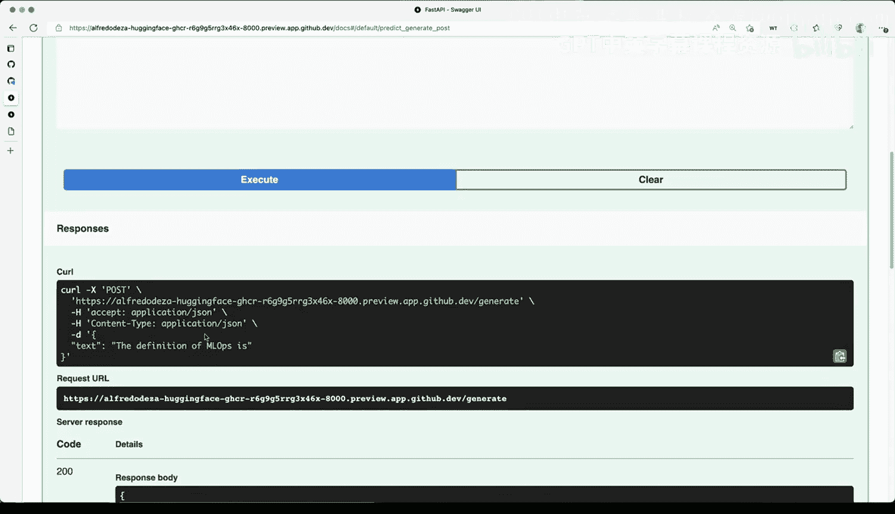
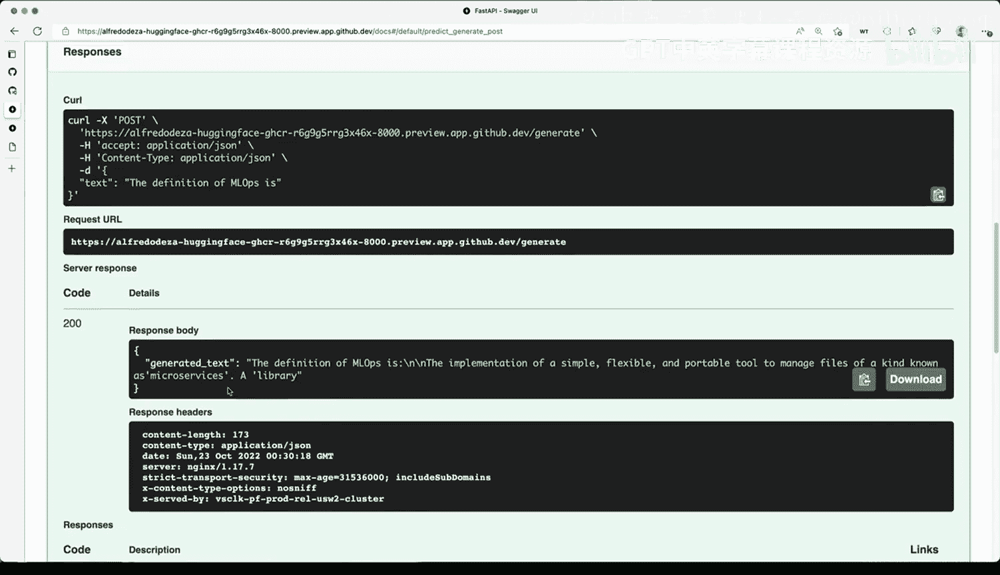
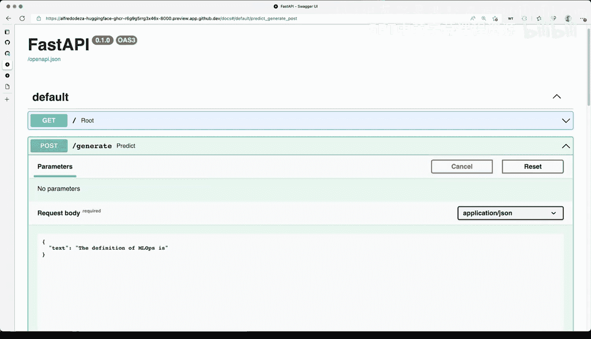

# 杜克大学｜机器学习运维｜DevOps⧸DataOps、Azure、MLFlow和抱脸｜MLOps ｜ Machine Learning Operations p171 30_03_04_使用FastAPI运行Hugging-Face.zh_en -BV1yE421c7uA_p171-

Now that we've seen the components of containerizing hugging phasese application using Fast APIpi。

 we need to actually go ahead and build that container。

 The first thing that I want to do before I build a container I want to show you how let's open up the Docker file again and close these how is it that we're going to be run in it so effectively we need to run this Uicorn and then host it is important to run it locally because otherwise you're going not be able to verify that after containerization is going to work so let's make sure that this works locally。

 I'm going to run and create a virtual barbie so dependencies run Ubiorn and see if that works and then if it works perfect I'll create the Docker container so I'm going to go back and create a terminal create a new terminal and then I'm going to close this up and make the So window and then I am going to run Python 38。

And I'm going to specify that I want the virtual environment module which is dashm VM and I'm going to create a VM virtual environment。

 so I'm going to do this and depending on your system。

 you might get something that wants to have like a dependency and yes we want to make sure that VS code will use that so it will use that interpreter and now we're going to do we're going to source VM then activate and now that we've activated。

 we're going to go and install our dependencies now I know that that comes from requirements in that text so I'm going to use Pip and this is going to take a second so I'm going to go ahead and run it and then come back when it completes。

All right， so that completed。 And one thing that we want to do now is to make sure that Ubiorn is accessible。

 So I'm going to do which Ubicorn and you can see that that's right there。

 So now we need to go and open up our Docker file。Take a look at our Docker files。 So I'm going to。

Make this window a little bit smaller。 There we go。 So what we want is to capture the command。

 So let's go ahead and change directories into web app。

 and now we're gonna do Ubicorn dash host and we'm going to say zero that' zero zero which means bind to anything。

 and then'm going to say main that app which is the Python module is main and app is the application for Ubiorns。

 I'm gonna run these and I'll probably get a message that this is now running onport 8000。

 which is the default port for running Ubiorn application So hugging face will get those models download it and then we have that available on port 80。

 we're gonna open that and then you can see that we have the self documentcument and API to interact with the G2 model and generate some text。

 I'm going go to slash docs and I'm gonna say go ahead and this is the interactive fast API which is swagger the open API and we'm going have。

T generation when I want to try it out and this is probably going to take a quick second while it interacts with the model so it's effectively interacting with the API now this is not necessarily tremendously important but it allows you to get a little bit of a little bit of an interaction so you can see here that it was able to generate what it seems like a little bit of code so string that pair and basically created a function I believe so that's fine we've verify that it works I'm going to go back here to the terminal I'm going to control C and now I want to show you how to actually build this container so I'm going make this a bigger window and then I'm going to close these the first thing that you want to make sure is that you have Docker installed in this case I do have Docker installed and when you need to do is make sure that you are in the same path where that Docker file is。

To build this container， I'm going to say Docker， build and I' I have to tag it。

 so in this case I'm going to say hugging face and that's the container name and then I'm going to use a label saying local。

And I am going to use dot to signal or to tell Docker the context the main。

 the root directory where the bill is going to happen is right there。 So I'm gonna run these。

 and this is going to take a second because it's going to be downloading several layers and then it's going to be installing the dependencies。

 Allright， so that went really fast。 usually it's not these fast。

 but the reason is these fast is because I was able to run it before。

 And so some of these layers are were not necessarily necessary to download them again。

 Now we want to run it and we want to make sure that these also works as a container。

 not only building it。 So I'm gonna to say Docker run and I'm gonna to make it interactive and I am also going to expose the port 8000。

8000 from the container locally to port 8000 on this machine。

 and then I am going to run hugging face colon local and then let's see what happens。

 So this is going to take a second and it's almost almost like running a new application All right so that seems like it's available I'm going open that up again and I immediately at a bad gateway。

 Why is that， Well， because these it is still trying to load this mouse again。

 now you already saw that downloaded in the beginning。 now it downloading them again。

 why is it doing that Well because this time is's in a container it is no longer running locally。

 it's running in this container So you can see now that the port 8000 now that the application is up and running So let's go back to our tab here that said bad gateway I'm going do a refresh and then you can see that it is loading and you can see now that the output here in the。

gIt's a 200 okay。 This is effectively interacting with hugging face and fast API through the open API through swagger。

 which is what we did before。 So I'm going to go ahead and interact with these and I say dogss I'm gonna run the local open open API。

 and'm going to try to test it out with something else that is not a string。 So we can say。

 for example， what's the the the definition。The definition of。

MlOs is and then' to say to see if that actually works and generate something interesting this will take a couple of seconds on my system and we'll just wait it out until completes All right so that completed and we get our curl output there and we're gonna get the definition of MLopies。

 the implementation of a simple flexible and portable tool to manage files of a kind known of microsavver as well not quite what I was looking for here but we verified that these works both running locally and running in a container and we also saw how to build these with Docker and containerizer properly with some commands。

