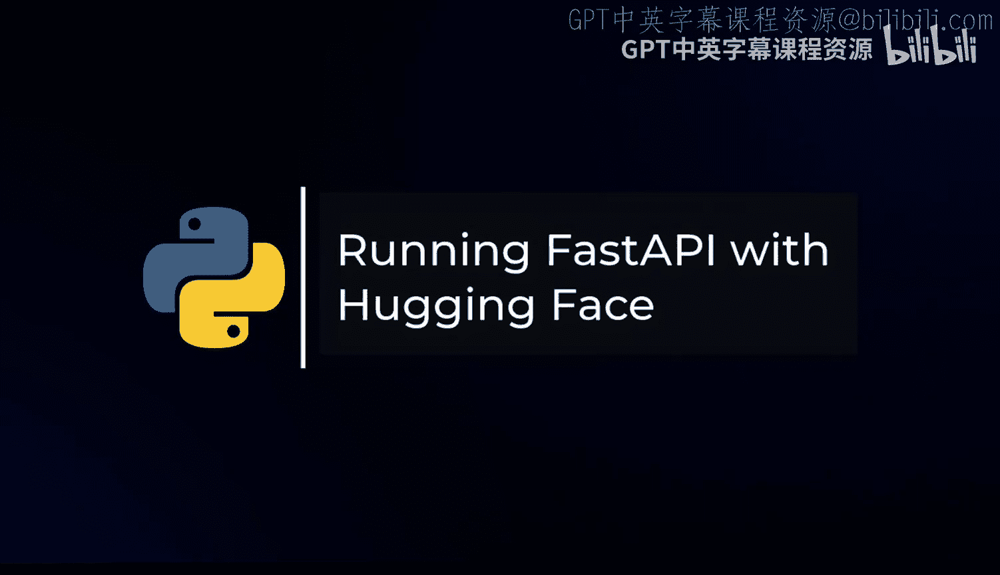
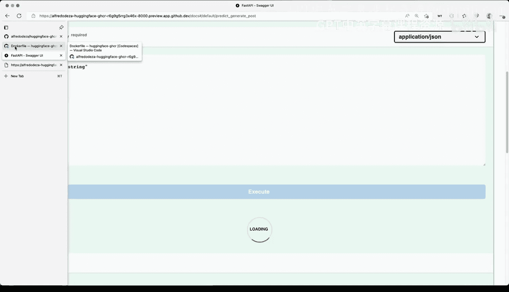
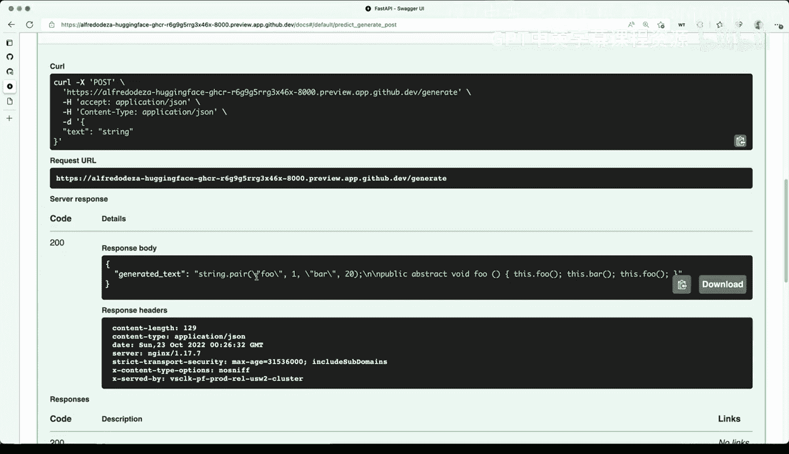
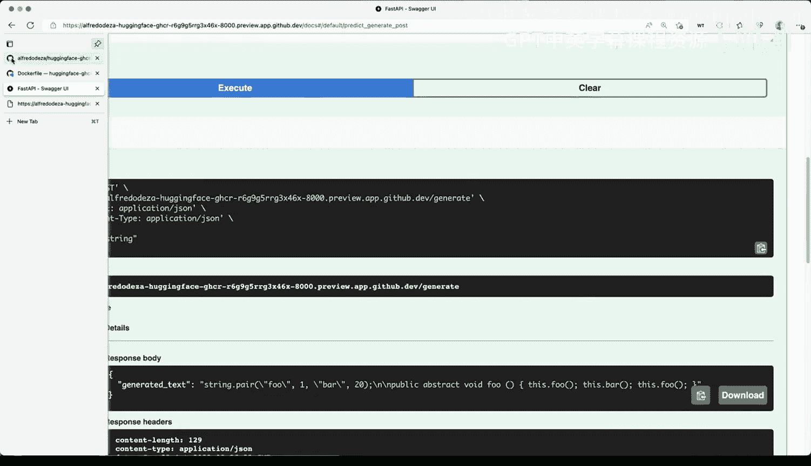
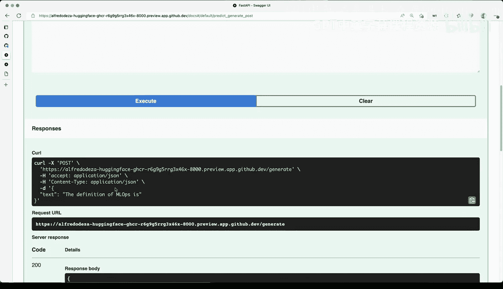
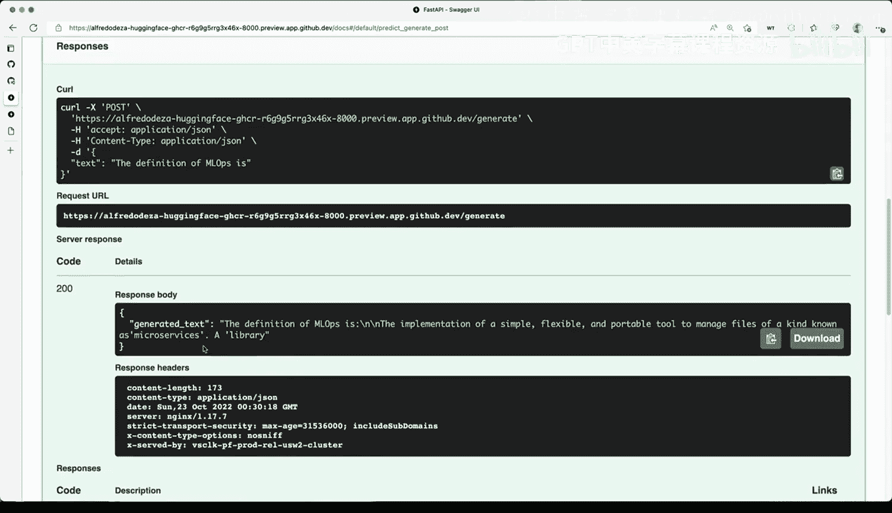
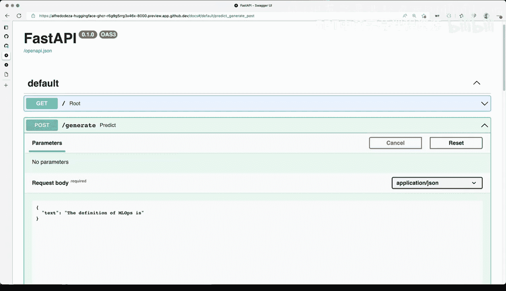

# 机器学习运维：第30章：使用FastAPI运行Hugging Face模型 🚀



在本节课中，我们将学习如何将一个基于FastAPI和Hugging Face模型构建的Web应用进行容器化。我们将从在本地环境中运行和验证应用开始，然后使用Docker构建容器镜像，并最终在容器中运行该应用，确保其功能与本地环境一致。

---

## 本地运行与验证 🔍

上一节我们介绍了使用FastAPI构建Hugging Face模型应用的基本组件。本节中，我们来看看如何在本地运行这个应用，这是容器化之前的关键验证步骤。

在构建容器之前，首先需要在本地环境中运行应用，以确保所有功能正常工作。如果本地运行失败，容器化后也无法正常工作。

以下是具体的操作步骤：

1.  **创建并激活虚拟环境**：使用Python的`venv`模块创建一个隔离的Python环境。
    ```bash
    python3.8 -m venv venv
    source venv/bin/activate  # 在Windows上使用 `venv\Scripts\activate`
    ```

2.  **安装依赖**：根据`requirements.txt`文件安装所有必要的Python包。
    ```bash
    pip install -r requirements.txt
    ```

3.  **验证Uvicorn可访问**：确保用于运行FastAPI应用的Uvicorn服务器已正确安装。
    ```bash
    which uvicorn
    ```

4.  **运行应用**：进入应用目录并使用Uvicorn启动FastAPI应用。`--host 0.0.0.0`参数允许从任何地址访问。
    ```bash
    cd web_app
    uvicorn --host 0.0.0.0 main:app
    ```
    应用默认运行在`8000`端口。启动后，Hugging Face会下载所需的模型。

5.  **测试API**：在浏览器中打开`http://localhost:8000/docs`，访问FastAPI自动生成的交互式API文档（基于Swagger UI）。在这里可以测试文本生成端点，例如向模型发送一个提示并查看其生成的响应。

完成本地测试后，使用`Ctrl+C`停止本地服务器。

---







## 构建Docker容器 🐳

在确认应用可以在本地正常运行后，下一步是将其打包到Docker容器中，以实现环境一致性和便捷部署。

首先，确保Docker已安装在你的系统上。然后，在包含`Dockerfile`的目录中执行构建命令。

以下是构建和运行容器的命令：

1.  **构建镜像**：使用`docker build`命令，指定一个标签（如`huggingface:local`）来命名镜像，并使用`.`指定当前目录为构建上下文。
    ```bash
    docker build -t huggingface:local .
    ```
    该命令会依据`Dockerfile`中的指令，逐层构建镜像，包括安装系统依赖、复制代码和安装Python包。

2.  **运行容器**：使用`docker run`命令启动容器。`-p 8000:8000`参数将容器的8000端口映射到主机的8000端口，`-it`参数允许交互式运行。
    ```bash
    docker run -it -p 8000:8000 huggingface:local
    ```
    容器启动后，应用会开始运行。初次运行时，容器内部需要重新下载Hugging Face模型。

3.  **验证容器化应用**：在浏览器中再次访问`http://localhost:8000/docs`。如果看到API文档页面，说明容器化应用已成功启动。你可以像在本地一样，通过Swagger UI测试文本生成功能。

---

## 总结 📝

本节课中我们一起学习了将FastAPI与Hugging Face模型结合的应用进行容器化的完整流程。

我们首先在本地创建虚拟环境、安装依赖并运行应用，验证了核心功能的正确性。接着，我们使用Docker命令构建了容器镜像，并通过端口映射在容器中运行了该应用，最终确认了容器化版本与本地版本功能一致。







这个过程涵盖了从开发环境验证到生产环境部署准备的关键步骤，是机器学习模型服务化（Model Serving）中一项重要的实践技能。