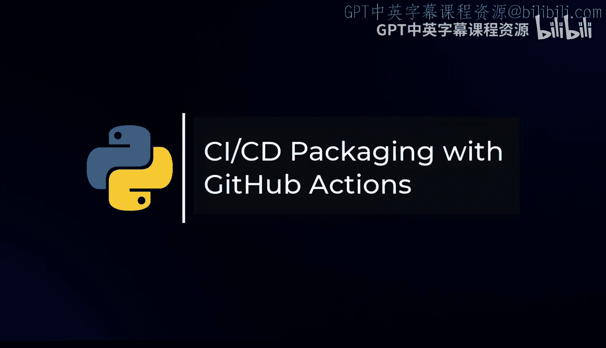
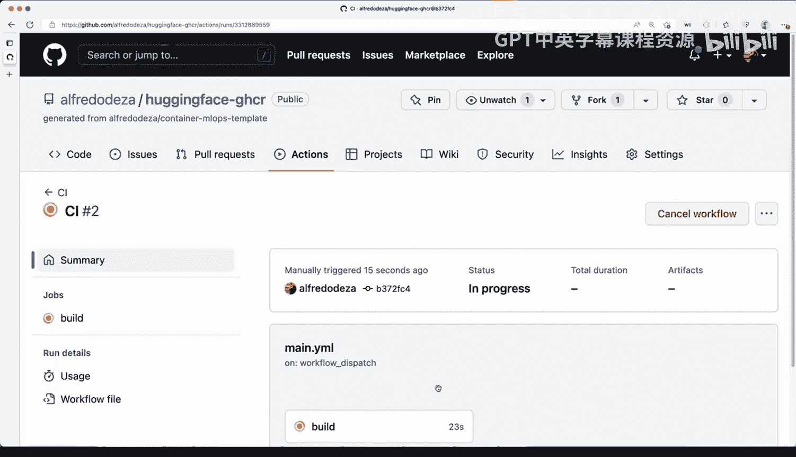
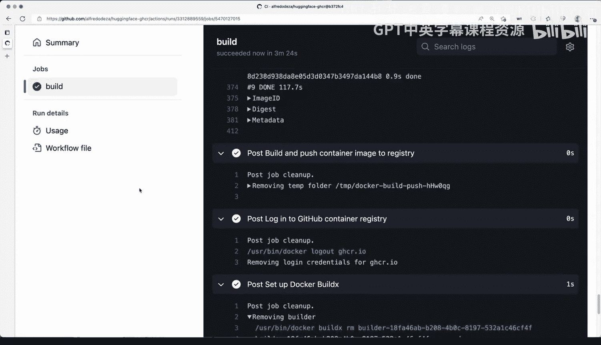
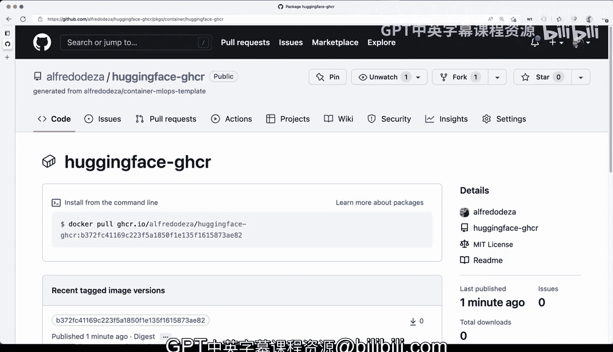

# 杜克大学｜机器学习运维｜DevOps⧸DataOps、Azure、MLFlow和抱脸｜MLOps ｜ Machine Learning Operations p172 31_03_05_GitHub-Actions实现CI-CD打包.zh_en -BV1yE421c7uA_p172-

Let's go back to our hugging phase repository。 We've already seen the containerization and how it works and fast API and how all of these can be created。

 creating a build image。 But assuming some of the MLlops。

 some of the machine learning operations workflows that you will be doing one of the things that you want to keep in mind is that you need to automate。

 So if you had to publish this container somehow。 let's see if we open the Docker file and you go through you go through all of these steps and then you build this container。

 and then you push it to a registry could be the Docker hub， it could be some other registry。

 like a private registry， Azure has its own container registry。

 Amazon as well at AWs all of them have their own different destination。

 So if you had to do this manually there's a few steps in both right so you have to make sure have Docker installed that these things are not changing and then you're tagging properly。

But you need to always think about automation。 Auto is the foundational process where you have everything go or as much as possible go one click so I'm going to show you one way that we can accomplish these by using Github actions actions are possible to do right here you can see there's this button called actions in a Github。

 essentially you can do this anywhere， but actions is pretty straightforward because it's already on Github So what I've done here is I've created a workflow and a workflow can be created by either creating clicking on actions and adding a new workflow and I'll show you right here what happens if I click a new workflow I can search any workflow。

 but I can say for example， build let's see if I if I can do this with container if something happens So there you go publish Docker container So you would select。

Something like this one and see you have also deploying container to the actual web app。

 but let's take a look at what the Poed Docker container will look like so you click on configure and the beautiful thing about these is that you will be able to have everything already pre-done for you so well here's a cosigning a few things that you might want but everything is already done for you and all that you need to do is well this is a lot of signing stuff to make sure that you're actually publishing a Docker container but you can you can use GiHub actions to predo everything that you need to do and essentially you could just use these assets because you can see here that the registtry is GHCR that I owe that means that's the GiHub container registry so you don't need to set any other account you will be able to authenticate very straightforward with the same credentials as the GiHub action。

Alright， so why am I showing you this， Well I'm gonna click cancel the reason I'm showing you this is because you don't need to write this from scratch。

 You can certainly use this repository as an example and I'll show you the one that I created here that is very straightforward。

 I'm not signing the container is just a very simple。

 very straightforward process that you can use this a foundational one to build upon。

 So let's go let's go through some of the steps basically work to help you get started。

 you can name these whatever you want then the controls basically I'm commenting out the push and pull request so I'm not publishing any containers when I'm merging。

 but you can certainly unment these and whenever you're making a change or pushing a change to say the main branch you are able to you're able to to。

To publish effectively when there's a change push to main Now a thing that it's oddly worded or oddly phrased is this workflow dispatch thing it allows you to and I'll show you in a second to trigger to trigger a build by manually by clicking a button you have an option to do these next you have to define jobs and then build and where is it going to run well this is going to run to latest that's fine and then what are the steps Well the first steps the first step is always to check out the repository。

 the contents of these repository and then this set Docker buildex means that you'll get all the tooling necessary to do a Docker build and next we're going to authenticate to the Github container registry you can see here that the authentication is already taken care of these two variables are already defined I don't need to add anything they're already there。

You don't need to change anything。 So so far I think we are good to go here with authenticating and setting up the environment。

 Next there's this little weird couple lines here all that means is that we will make a lowercase representation of our Github repository name so if our repository name had upper casing or camel casing this would make sure that that's right and it's all lowercased and that it's a constraint that we must follow for publishing the container and then lastly build and push container image to registry so you can see here pushes through like if you wanted to just build it and not push and that would be false and then finally what are the tag so remember I was talking about doing this manually and having to tag every time well this would be using the Github Sha which is the commit hash use for the commit that produce this change。

Allright， so so that is the workflow， the full automation and you could actually essentially copy paste these and put it in your own repository。

 and it would just work， you don't need to even change anything here because I'm not using any variables or any hardcode variables that So I'm going to show you how to run this。

 I'm going to go to actions and then I am going to go to the C。 remember there wasn a name。

 That's what this means。 I'm going to click here C。 you can see I run it like a few months ago。

 and that workflow dispatch。 Remember we had that workflow dispatch that is oddly named。

 that's what allows you to do this。 I'm going to click here run workflow and run workflow from main So I'm going to build that is going to take a second to appear over here because this is all done synchronously and then once it does we'll see how that log appears。

 Allright so you can see that the workflow run was successfully requested now it appears it's skewed and now it's in progress。

click here and see how that looks。 Allright， so this is what you will be presented with。

 you will see that the status is in progress。 There's the build the build is going on。

 What are the jobs。 if you have a workflow that requires many different jobs you will see that that status going on there。

 and now I want to check I want to check on the logs。

 I'm going to click on build and you can see that the setup job brand actions check out。

 remember we were going through some of sorry for the scrolling。

 but this happens automatically remember we were going through some of the processes that there are some of the steps in the workflow check out it will be one。

 to set up build Docker build， authenticating to the container registry。

 making sure that the lowercase the repository name and username are all lowercase and now build and push into container image registry This takes a while So let's scroll the way down and make sure to come back once once it completes which should shouldn。

t that long that still quite a bit to keep waiting on it。 So let's just come back when it's done。

 All right so this is completing。 and there we go， it's now complete and everything was pushed now let's take quick look it's also a good thing to make sure that your usage isre you're not running 10000 publishing images and making sure that that's all right so I'm gonna scroll the way to the top and we're going to go to hugging face GHCR my repository and scroll slightly to the bottom here and you can see here and I have a package What is this package I'm going click here hugging face dash GHCR and you can see here that it was last published one minute ago that is exactly what we've done we've published we've automated everything first we verified in the previous videos we verified that everything was working and now we have these fully automated fully done。

In an automated fashion and now it's available for anyone well in this case I would need to authenticate。

 but I could Docker pull this hugging face repository or image from the container registry and get that API that fast API working with hugging phase from anywhere and you can see here that the different image versions are there。

 so if you wanted to have some other versions then the tag would be different so there you go that is how you implement CicCD packaging with containers and hugging phase and using GitHub and fast API。

