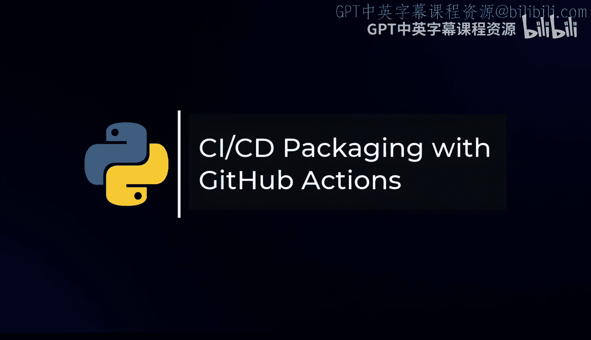
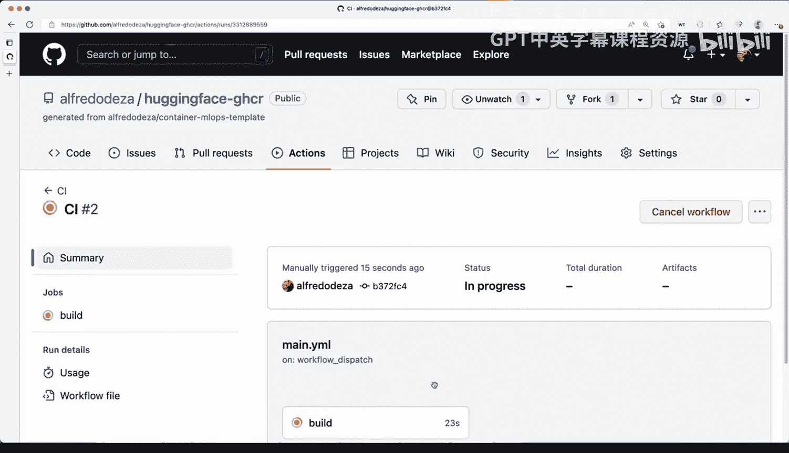
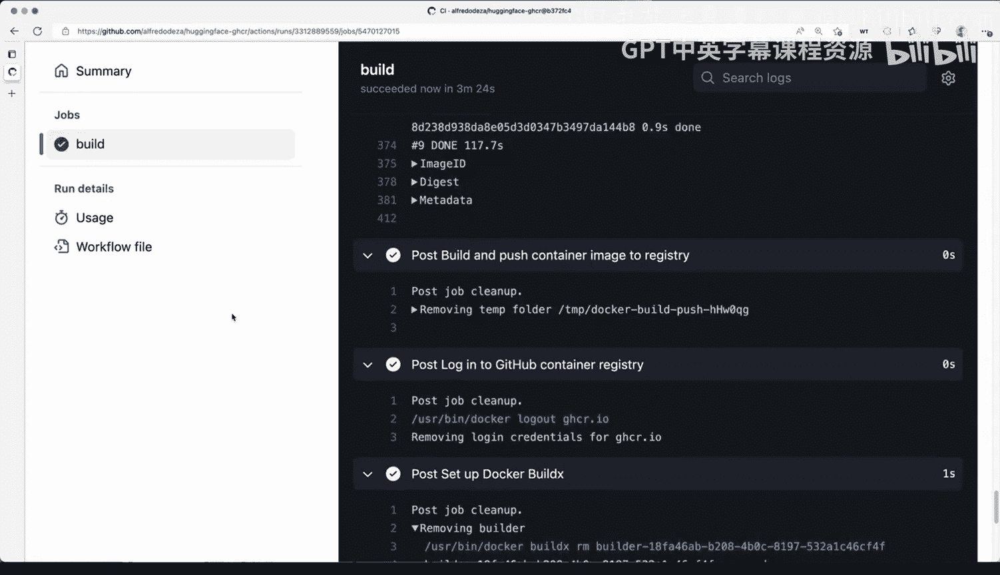
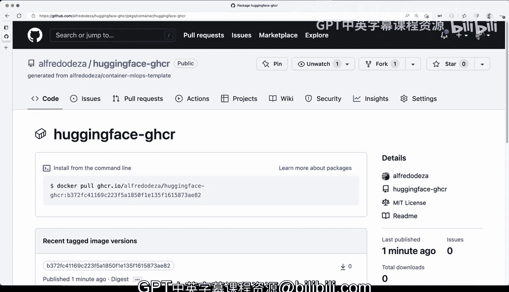

# 机器学习运维：172：使用GitHub Actions实现CI/CD容器化打包 📦



在本节课中，我们将学习如何利用GitHub Actions自动化机器学习模型的容器化打包与发布流程。我们将从一个已容器化的Hugging Face模型仓库出发，实现一个完整的持续集成与持续部署（CI/CD）流水线。

---

## 概述

上一节我们介绍了如何使用Docker和FastAPI将机器学习模型容器化。本节中，我们来看看如何将构建和推送容器镜像的步骤自动化，从而无需手动执行这些重复性任务。我们将使用GitHub Actions来实现这一目标。

## 创建GitHub Actions工作流

GitHub Actions允许你在代码仓库中直接定义自动化的工作流。以下是创建一个自动化构建和推送Docker镜像工作流的步骤。

首先，在GitHub仓库中点击“Actions”选项卡，然后选择“New workflow”。你可以搜索并使用预置的工作流模板。

例如，你可以搜索“publish Docker container”并选择一个合适的模板。这些模板已经为你配置好了大部分必要的步骤。

以下是一个我创建的基础工作流示例，它非常简单直接，适合作为你自动化流程的起点：

```yaml
name: CI

on:
  push:
    branches: [ main ]
  pull_request:
    branches: [ main ]
  workflow_dispatch:

jobs:
  build:
    runs-on: ubuntu-latest
    steps:
      - name: Checkout repository
        uses: actions/checkout@v2

      - name: Set up Docker Buildx
        uses: docker/setup-buildx-action@v1

      - name: Log in to GitHub Container Registry
        uses: docker/login-action@v1
        with:
          registry: ghcr.io
          username: ${{ github.actor }}
          password: ${{ secrets.GITHUB_TOKEN }}

      - name: Convert repository name to lowercase
        run: |
          echo "REPO_NAME=$(echo ${{ github.repository }} | tr '[:upper:]' '[:lower:]')" >> $GITHUB_ENV

      - name: Build and push Docker image
        uses: docker/build-push-action@v2
        with:
          context: .
          push: true
          tags: |
            ghcr.io/${{ env.REPO_NAME }}:${{ github.sha }}
```

## 工作流步骤详解

以下是上述工作流中每个步骤的详细说明：

1.  **触发条件**：工作流会在代码推送到`main`分支、创建拉取请求到`main`分支，或通过`workflow_dispatch`手动触发时运行。
2.  **检出代码**：第一步总是将仓库的最新代码检出到运行环境中。
3.  **设置Docker构建环境**：此步骤配置了Docker Buildx工具，用于构建镜像。
4.  **登录容器注册表**：此步骤使用GitHub Actions内置的`GITHUB_TOKEN`自动认证到GitHub容器注册表（GHCR）。
5.  **规范化仓库名称**：容器镜像名称必须为小写。此步骤将仓库名转换为全小写格式。
6.  **构建并推送镜像**：这是核心步骤，它构建Docker镜像并将其推送到GHCR。镜像的标签使用了本次提交的哈希值（`${{ github.sha }}`），确保了每次构建版本的唯一性。

## 运行工作流

创建工作流文件（通常位于`.github/workflows/`目录下）并提交到仓库后，你可以手动触发它。

进入仓库的“Actions”页面，找到你创建的工作流（例如名为“CI”的）。点击“Run workflow”按钮，选择从`main`分支运行。

工作流开始执行后，你可以点击进入查看实时日志。日志会清晰地展示每个步骤的执行状态，例如代码检出、环境设置、认证、镜像构建和推送。

## 验证结果

工作流成功运行后，你可以前往GitHub容器注册表（`https://ghcr.io`）查看已推送的镜像。



在注册表中，你应该能找到以你仓库名命名的包。点击进入后，可以看到刚刚推送的镜像，其标签为对应的提交哈希。这证明自动化流程已成功将你的容器化应用发布到了云端注册表。

现在，任何人都可以通过`docker pull ghcr.io/你的用户名/仓库名:标签`命令来获取这个镜像，并在任何支持Docker的环境中运行你的FastAPI模型服务。

---



## 总结



本节课中我们一起学习了如何使用GitHub Actions为机器学习项目搭建一个自动化的CI/CD流水线。我们创建了一个工作流，它能够自动构建Docker镜像、登录到GitHub容器注册表，并将镜像推送上去。这个过程消除了手动操作的繁琐和潜在错误，实现了“一键”发布，是机器学习运维中实现高效、可靠部署的重要一步。