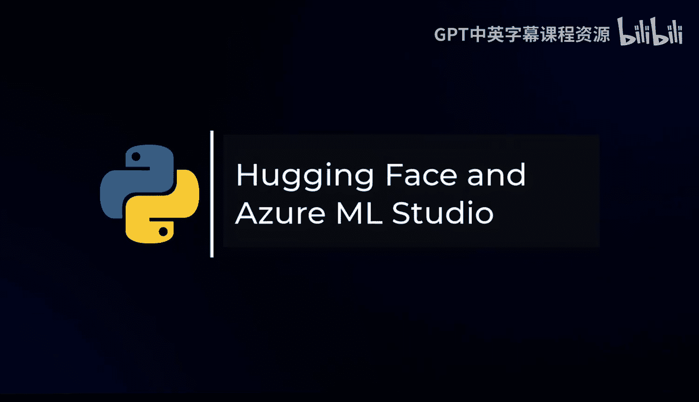
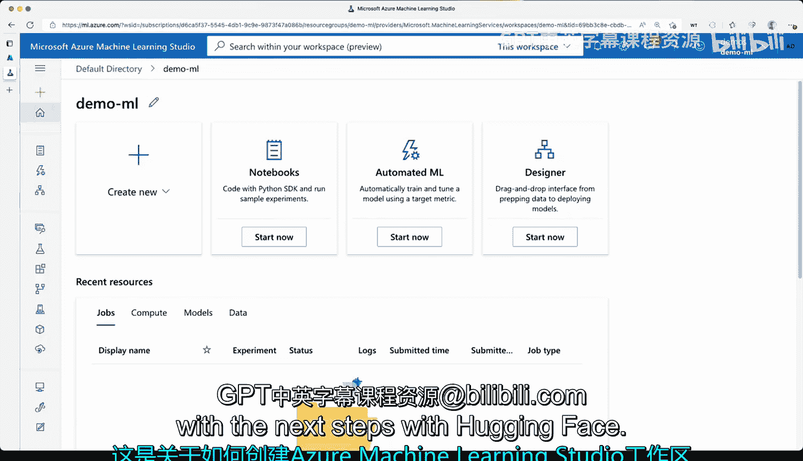

# 杜克大学｜机器学习运维｜DevOps⧸DataOps、Azure、MLFlow和抱脸｜MLOps ｜ Machine Learning Operations p173 32_03_02_Hugging-Face与Azure-ML-Studio.zh_en -BV1yE421c7uA_p173-

I'm going to be doing a quick overview of what Azure Maine Learn studio is。

 I'm here in the portal from Microsoft Azure and I'm going to create or go to the Azure machine learning or aure machine learning studio section here and I'm going to create a new workspace these are the steps that you would have to follow if you want to get a little bit involved with this service So like always you always going to have to have a resource group。

 I'm going to do demo M。 I'm going to call it that and the workspace name I'm going to do the same I usually tend to do the same for the workspace name and a resource group。

 especially if I want to do something like a demo and then I'm going to review and create that's going to go through some validation steps。

And then I'm going to finally click create。 So once that's done。

 it's going to initialize and submit that deployment is going to be in progress and that's going to take a quick while。

 So let's come back when that deployment is complete and we can load Azure machine learning in studio。

Alright， so the deployment is complete so we're gonna go to the resource。

 go into the resource means that we will be able to launch the studio so I've clicked on launching the studio there and that will be going pretty fast and we are going to see a couple of interesting things regarding couple of the different the different things that were going to be doing with hugging phases specifically we are going to be registering a hugging phase data next we're going to register a hugging phase model and finally we do some inspection so how does that work well the first thing that we need to take a look is this section over here so this section over here allows us to do various different operations you can always go to create new if you're adding something new like say for example a data which I'll show you later or a model which I also show you later。

But essentially this is your your main your main section now depending on how zoomed in you are like right now I'm pretty zoomed in like you know your view might change a little bit but I usually try to do demo in this way alright so you have this main section here。

 we're going to be looking at data and then and then we're going to be looking at models so these two in particular let's take a look at data。

We can actually create data we are able to create a data asset so creating a data asset。

 they call it a data asset because you can be several different things I tend to call them data sets and the way we're going to be doing that later is by creating one so say for example we wanted to test over here and the description test and I'm going to go very quickly here。

 I'm going to select a tabular one and then next you are going to see that you have different types of origins for or sources for those you can even play around with Azure open data sets and even from web files from web files it means that you would only need to paste a web URL and do some data validation so I'm not going to go through that because we're going to do that later when we start registering a data set with or going through the actual steps of doing that。

With hugging， but we're actually just reviewing how these will work and again we're are working primarily with datas and now with models so let's go to models here and if I go to models we would do something similar we would click register and we could do from local files from our job output and all of these actions are available also through the Azure SDK I'm gonna to go here to the home and within here we're not going to be touching on a few of these different things like Automl and designerer notebooks you can definitely play around with notebooks but you have a fully dedicated environment for doing all kinds of machine learning operations All right so that is a very。

 very quick overview on how to create an Azure machine learning studio workspace and how how are the components of Azure machinery studio are going to work with the next steps with Huging face。

