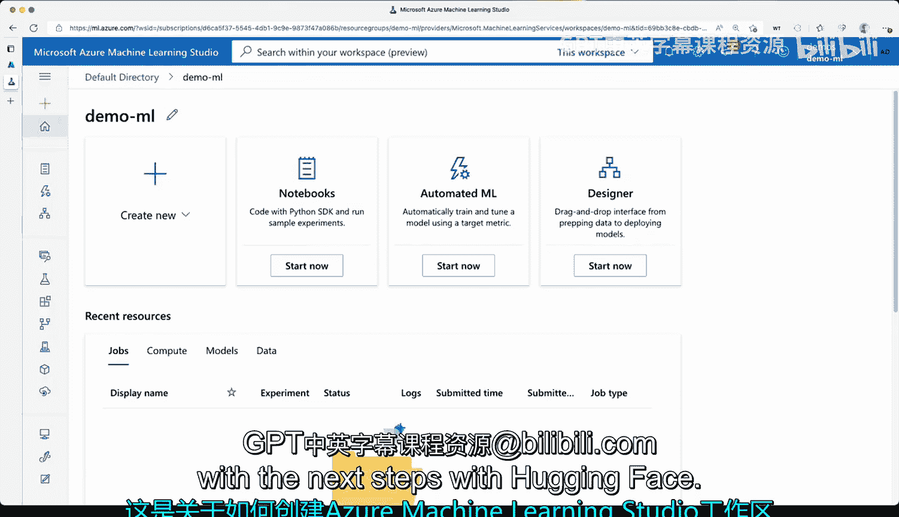

# 机器学习运维：第32章：Hugging Face与Azure ML Studio

## 概述
在本节中，我们将学习如何创建并使用Azure机器学习工作室（Azure Machine Learning Studio）的工作空间，并了解其核心组件，特别是如何为后续集成Hugging Face资源（如数据集和模型）做准备。

---

## Azure机器学习工作室简介 🧠
Azure机器学习工作室是一个云端环境，用于准备数据、训练、测试、部署、管理和跟踪机器学习模型。它提供了一个集成的界面，支持从数据到模型的全流程操作。

上一节我们介绍了机器学习运维的基本概念，本节中我们来看看如何设置一个核心的云平台工作环境。

## 创建工作空间 🛠️
首先，我们需要在Microsoft Azure门户中创建一个机器学习工作空间。工作空间是Azure机器学习中的顶级资源，它包含了进行所有机器学习活动所需的环境和配置。

以下是创建新工作空间的步骤：

1.  在Azure门户中，导航至“Azure机器学习”或“Azure机器学习工作室”部分。
2.  选择“创建”一个新的工作空间。
3.  为工作空间选择一个资源组。资源组是用于存放相关Azure资源的容器。
4.  为工作空间命名。为方便演示，通常将资源组和工作空间命名为相同或相似的名称。
5.  点击“查看 + 创建”，系统将进行配置验证。
6.  验证通过后，点击“创建”以提交部署。

部署过程需要一些时间来完成初始化。部署完成后，即可进入该资源并启动工作室。

## 工作室界面导览 🖥️
部署完成后，我们可以进入资源并启动Azure机器学习工作室。工作室界面主要分为几个功能区，支持各种机器学习操作。

核心功能区允许我们执行多种操作，例如创建新的数据资产或注册模型。虽然界面布局可能因缩放比例略有不同，但主要模块清晰可辨。

我们将重点关注“数据”和“模型”这两个部分，因为它们是与Hugging Face集成的关键。

## 管理数据资产 📊
在“数据”部分，我们可以创建和管理数据资产（Data Assets）。数据资产可以来自多种来源，例如本地文件、Web URL或Azure开放数据集。

以下是创建数据资产的基本流程：

1.  点击“创建数据资产”。
2.  填写名称（如“test”）和描述。
3.  选择数据类型，例如“表格”类型。
4.  在“下一步”中，选择数据来源。来源可以是本地文件、Web文件或Azure开放数据集等。
5.  对于Web文件，只需粘贴URL并进行数据验证即可。

我们将在后续专门注册Hugging Face数据集时详细演练这些步骤。

## 注册与管理模型 🤖
在“模型”部分，我们可以注册和管理机器学习模型。注册模型意味着将模型文件及其元数据存储到工作空间中，便于版本控制和部署。

注册模型的途径包括：

*   **从本地文件注册**：上传本地训练好的模型文件。
*   **从作业输出注册**：将训练作业输出的模型直接注册。

这些操作不仅可以通过工作室界面完成，也可以通过**Azure SDK**以编程方式实现，便于自动化流程。

## 其他功能与环境 🚀
返回工作室主页，我们还能看到其他功能模块，如自动化机器学习（AutoML）、设计器和笔记本。

*   **笔记本**：提供了一个完全集成的Jupyter Notebook环境，支持进行数据探索、模型训练和实验。
*   **自动化机器学习**：自动尝试多种算法和参数以找到最佳模型。
*   **设计器**：通过拖放界面构建、测试和部署机器学习管道。

这些工具共同构成了一个全面的机器学习操作环境。

---

## 总结
本节课中，我们一起学习了如何创建Azure机器学习工作室工作空间，并快速浏览了其核心界面与功能。我们重点了解了如何管理**数据资产**和注册**模型**，这是后续集成Hugging Face资源的基础。工作室还提供了笔记本、AutoML等强大工具，支持端到端的机器学习工作流。在接下来的课程中，我们将具体实践如何将Hugging Face的数据集和模型注册到该平台中。