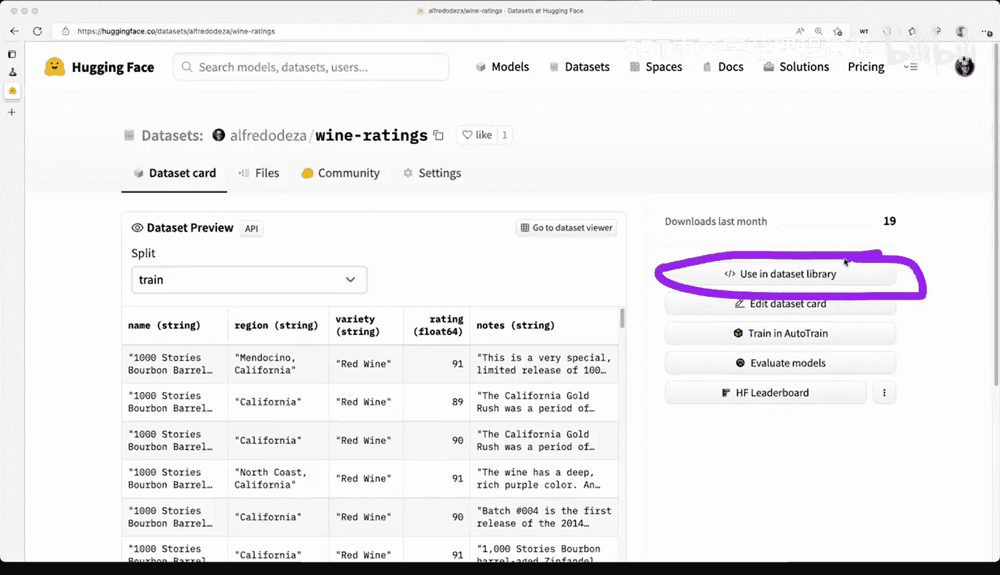
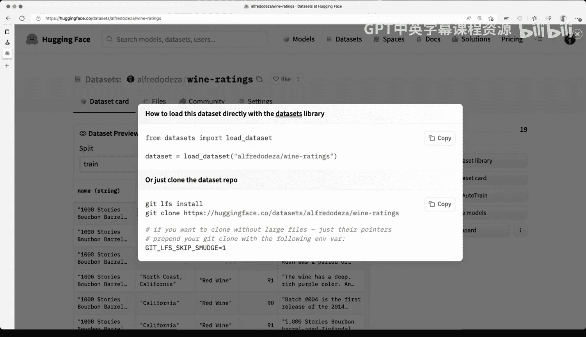
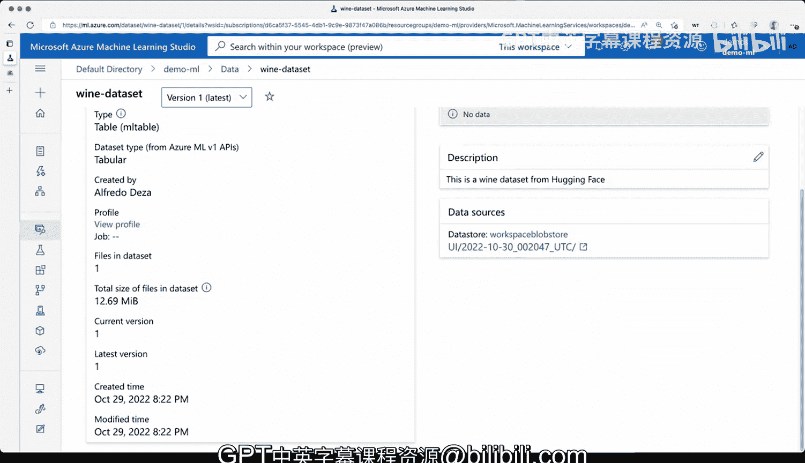

# 杜克大学｜机器学习运维｜DevOps⧸DataOps、Azure、MLFlow和抱脸｜MLOps ｜ Machine Learning Operations p174 33_03_03_在Azure注册Hugging-Face数据集.zh_en -BV1yE421c7uA_p174-

Now let's see how we can download a dataset from Huging phase for this operation。

 We're going to be using the datasets or the data library from hugging face and here you can see that I'm going to be using the winebradance dataset from my account and I'm going to go ahead and click this one that is very。

 very handy。 I really like it。 it has all of the examples that we need so we essentially need to have these from datas import load data to get these datas。

 you have to make sure that you have your PipP installsting datasets it's effectively Pip installstall datasets I already have done that so I'm going to copy that and I'm going to use a Jupyter notebook so that I can load that make that work I'm going to head over to Vicious Studio code and I already have datasets I make sure that that's working but I'm going to paste from datasets import loaded data。

and then I'm going to execute on line3 and then make sure that that is loaded。 al right。

 so that downloaded a CsB data and now I'm going to create a new new cell and let's poke around what this data set contains。

 so I'm going to run this and as expected we're going to have three three different types of distinct distinct types of data and I really want to have the full train one。

 so in order to get that I have to say trains。 I'm going to say。This is going to be a， you know。

 the train train data set。I'm going to say that equals to that。 and I'm going to run that。

 That's perfect。 And now if I poke a train data set and I run these。

 you will see that now I have like the all of those 3200 rows now。What is it that I want， Well。

 I want to download it locally。 So I am going to。I'm going to there's a lot a lot of information here。

 I want to make it go to pandas， So I'm going to say Df， which is stands for data frame。

 I'm going to send it over to pandas and see what I get perfect。 So that works。

 And now I can say Df describe yep。Let's see what happens there。 perfectfect。 So 32000 rows。

 that's perfect。 That's exactly what I want。 Now what I'm going to be doing is I'm going to send it to a CSB file。

 Alright， so I'm going to click code again。 So I'm going to do Df。

And I'm going to say two exactly to CSB。 And I'm going to say perfect wine ratings， CSP index fall。

 That's fine。 And that's going to create。It's going to create a CSP file over there。 All right。

 I like to do this with pandas。 If there's another method that youd like to use， that's fine as well。

 But for this is's going to be useful to just use pandas。 Allright。

 so I'm going to execute these and you can see here that my handywin ratings file， its over here。

 and then you will have all kinds of different things。What are we going to do。

 We're going to register these on Azure。 So in order to do that， we're going to head over。

To the web browser。 And then instead of going here I'm going to go to azure Mainery Studio and then I'm going to go and head over to data。

 I'm going to click click create on create and I say wine data set， this is a wine data set from。

Hgging face。And the type is going to be， this is going to be tabular。

And I'm clicking next and then we're going to say from I'm going to upload it from my local。

 my local drive， which is fine。 so local files， then next。And then we're going to， this is。

 this is fine。 This is the storage， like where， like what type of storage I want。

 Azure blob storage is fine。 I'm gonna to click next。And now I'm going to say， yeah。

 fine if the path already exists。And I'm going to click upload。

 It's going to bring up this a small window。 I'm going to select the one ratings。

 so I know that this is very small， but this is essential we're going to do。

 I'm going to open that I'm going to upload that that that was 12 mebyte。 I'm going to click next。

And then that's going to lose some validation behind the scene and see that validation that will that completed。

Yes， this is a format is limited comma UTF8 perfect S row， I don't want to skip any column heaters。

 all files have the same heaters。 That's fine。嗯。And and and that that's that's pretty good。

 We have name region variety rating and then which is exactly what the data set is。

 if you remember if I go back here and click out of that name region variety rating and some notes。

 So exactly the same。 Nothing has changed。 So I'm going to go next。And now here behind the scenes。

 Aure has done a lot of validation on some of the column names and what type of what type of data we're dealing here。

 This is more than a decimal is kind of like a well I was looking more for like a float but a decimal with a dot that sounds great and that sounds perfect so it was able to correctly do that。

 so you can change that if for example this was like a boolean you would change that here。

 that's perfect on click next。And then finally I'm going to click create so it's going to create a data。

 they call it now data assets， I still call these datasets that fine and what is the the thing here is that we have we have versions so do you see here files in data1 and current version1 that means that every single change every time I'm pushing a new version to this data willll get this uploaded and this is more meaningful if you're doing this programmatically with say for example the az or CI or using some of the APIs where you might be doing this programmatically and changing this but I wanted to show you using the UI so that you can get like a more paused a more easy way or understanding what are some of the things that you will be seeing instead of me running several commands。

And making something happen， but this is programmatically accessible through the Python API as well as other SDKs。

 other languages that are supported So you could say for if I have 100 versions here。

 you could say you know I want version 10 not version 100 and then that would also work。

 So there you go that is how you download a hugging face data set locally and then you get to upload it up to Azure machine learning studio。

