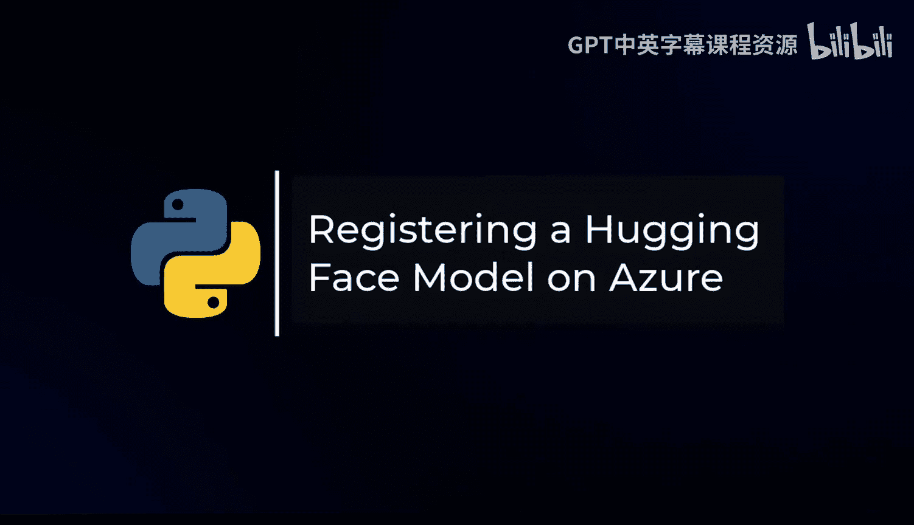
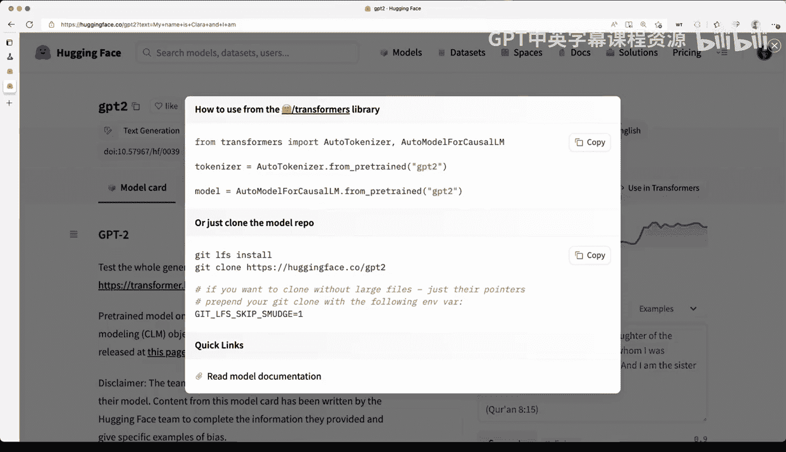
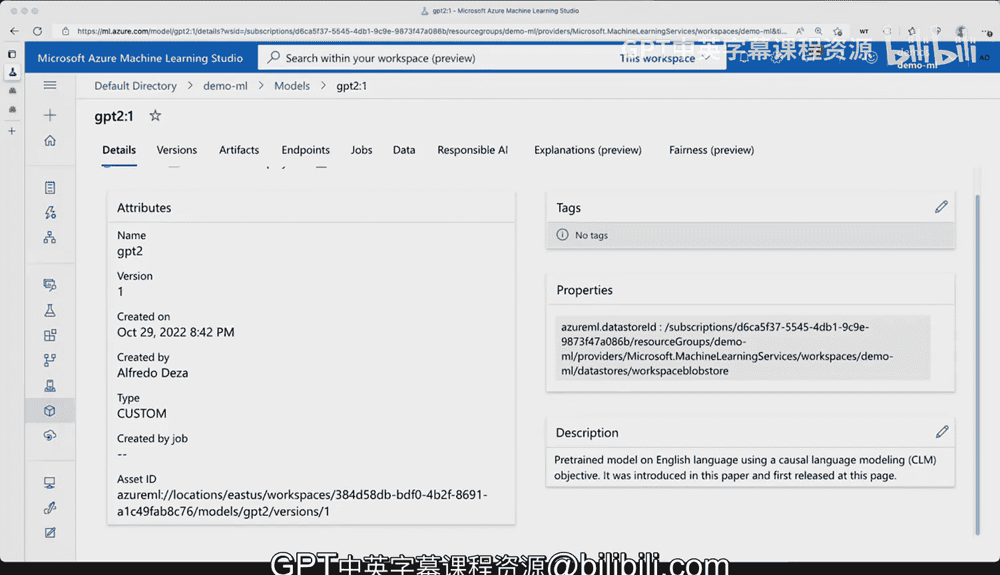

# 杜克大学｜机器学习运维｜DevOps⧸DataOps、Azure、MLFlow和抱脸｜MLOps ｜ Machine Learning Operations p175 34_03_04_在Azure注册Hugging-Face模型.zh_en -BV1yE421c7uA_p175-

have the G2 model here loaded on the hugging phase web Ui and what I'm going to be doing is looking at how to use it in transformer so essentially I want to find out how does the API look so I'm going click here and this very nice cart is going to open up I'm not going to clone it although for effects of what we're going to try to do right now which is downloading first and then pushing it over to azure machineachinery and studio we're going to be doing is not I mean you can absolutely 100% do a git clone of G2 and then upload whatever files you want。

 but we're not going to do that we're going to do it with code So we're going to use it with transformers I'm going copy these and I actually have it already good to go and I've preinstalled a Piytorch and transformers already for。

This to works， I'm going to open Vi Studio code。And you can see here that I've already pasted that over here。

 So I'm going to run this code。And the model， well I don't really need the tokenizer and the model was pre downloaded before。

 That's why it took 3。8 seconds。 If you have not run this code before。

 it will take a few seconds to run。 Alright so now that model is down download it in the local system somewhere。

 and now what I'm gonna to do here is I'm going say model safe pretrained。Yes。

 I want to use that and yes， I want to use G2。 So what what do you think that will do。

 Let's run run it and find out I'm gonna run these take a few seconds and now I have a G2 directory and inside of there I have this config adjacent which essentially it tells me lots of metadata for the model that I've just downloaded。

 and I have this Pytorrch model bin。 So this Pytorrch model bin is G2 that is loadable or consumable with Pitorrch itself。

 So allright， so I have the bin there and I'm gonna go to back to the browser and then I'm gonna open going open Azure machinery in studio。

 now remember before we're looking at the wine data set we got that uploaded and I'm going go home and what we're gonna do now is。

We are going to take a look at the model。 So the model is the one that will allow us to register a model。

 So again， you can do this programmatically with the SDK with Python。

 You can I believe maybe the Azure CI for sure the SDdK。

 So if you're doing this programmatically with Python in an automated way。

 you can definitely do this。 I'm going to click register and I'm going to say from local files again。

Model type I am going to do I'm going to let it as unspecified type。

 which is fine and I'm going to select the model file or folders。

 I to click here and then browse file Allright so that loaded it and instead of downloading the CSP like before and I know this is kind of tiny but here I'm going to say I want to upload the pytorrch underscore model that bin so 486。

75 mebytes that is fine I'm going to click next and then I'm going to say this is G2 and then for the description。

 let's go here and do a little bit of this description over there'm gonna go here put it here。

And then what version is it well for these we're going to just use whatever that default is in this case is's going to be one I'm not going to use any text I'm going to click next and I'm going to click register。

Okay， so that completed and it took quite a second。

 remember I was uploading almost 500 megabytes worth of data and we have our model GP to here and then we have a little bit of the of metaada but why why。

Why would you want to have these register on National Machine learning Studio Well there's various different things and various reasons why you may want to do that first is that you have the ability to have a simple version in scheme and this is not tied only to anything with hugging phase。

 you can do it with Onx and all kinds of other models as well。

 or types but you can also deploy it like if you wanted to do something with this model。

 you wanted to deploy， you could deploy it to look at this to a batch endpoint to a realtime endpoint。

 you could share the model， you have right now we only have one version。

 but imagine having like10 versions we could check if explanations of furnness。

 we could have a cluster and do some analysis and do all kinds of different things there and these asset ID at the very bottom would allow us to retrieve that model if we。

To and have some interaction。 Allright， so that is how you would download a hugging phase model using transformers to a local local directory and then upload that。

 register that as a version model on Aure machine learning studio。

