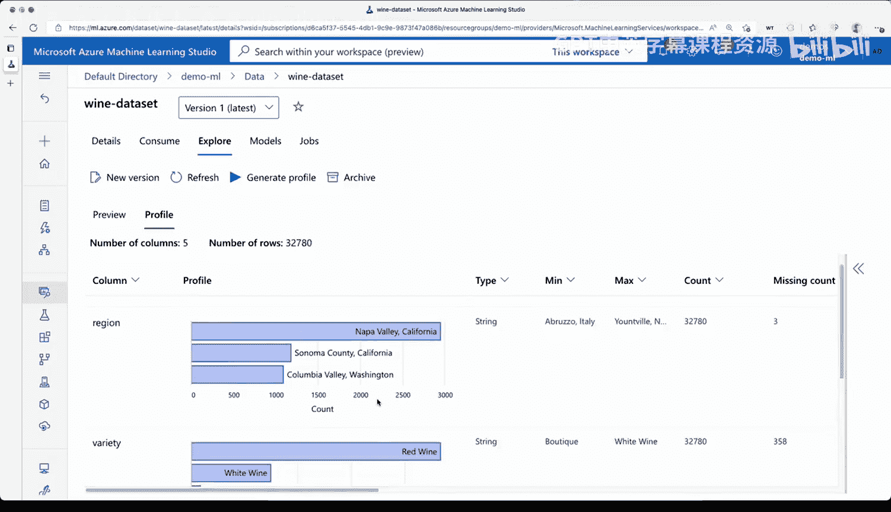

# 杜克大学｜机器学习运维｜DevOps⧸DataOps、Azure、MLFlow和抱脸｜MLOps ｜ Machine Learning Operations p176 35_03_05_在Azure检查Hugging-Face数据集.zh_en -BV1yE421c7uA_p176-

Back on the aher machine learning studio interface。

 we remember we already have our dataset or wine dataset and we want to do some exploratory analysis so if we go to explore up here。

 we can this is going to generate a little bit of data and then but like nothing really like this is kind of like working a little bit with pandas and you're showing kind of like the head and is giving you a little bit of like a preview the other thing that you can do is like if you go and click profile and for what we're trying to do here。

 I'm going to make this a little bit smaller so you can have a bigger bigger picture。

You can see here that get a little bit of like informational stuff that you'll have here you have Napa Valley。

 the regions， Oregon， Tuscany， and you have all kinds of different information that you get from the get go without running anything specific on the data variety and ratings can ratings on wines go from all the way from 85 to a little bit over 100 and you can see that there's almost nothing。

 there's only 88 out of the 3200 that are in the range of 9097 to 99。So， and we don't have anything。

 I think， on on 100。 but you get a little bit of information。 and this is already very useful。

So now that we have that here one of the things that you can do besides exploring that you can see actually here we already talked a little bit about the rating and the nodes in the region you can see that the nodes because its all it's all text string there's nothing there。

 one thing they wanted to show you is this way of consuming so now these would be slightly slightly different different than doing it with hugging phase you essentially come here and that's the Python SDK so there you go some details you can create newer versions if I want to don't want to essentially overright。

 we want to make some changes and then I would do that same process of uploading this now I can also do that with the SDK but then would matter All right so that is how you lose some exploratory work。

Over here with datas and take a look at how that looks and how to work with it and what type of things we will be dealing with and this is all coming from a hugging phase。

