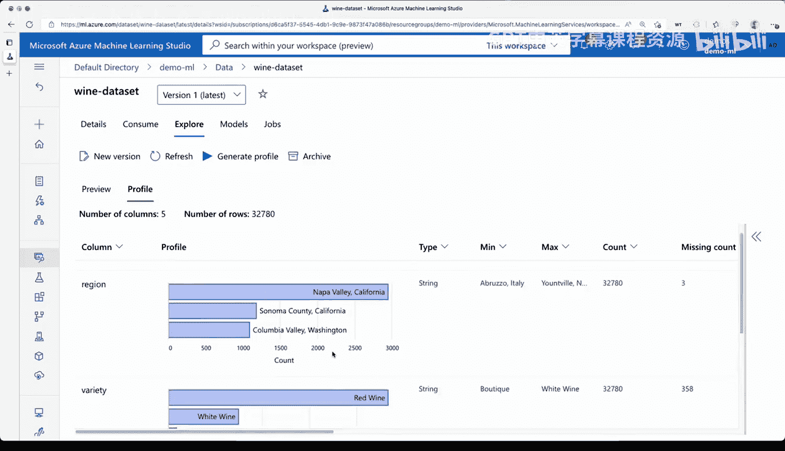

# 杜克大学｜机器学习运维：35_03_05：在Azure中检查Hugging Face数据集

在本节课程中，我们将学习如何在Azure机器学习工作室界面中，对已注册的Hugging Face数据集进行探索性分析。我们将了解如何查看数据概览、生成数据剖面报告，并理解数据集的基本特征。

## 探索数据集

回到Azure机器学习工作室界面。我们记得已经注册了葡萄酒数据集。现在，我们想进行一些探索性分析。

如果点击上方的“探索”按钮，系统会生成一些数据预览。这类似于使用Pandas库查看数据，它会显示数据的前几行，为你提供一个预览。

## 生成数据剖面报告

除了简单的预览，你还可以点击“剖面”按钮来获取更详细的信息。为了更清晰地展示，我将界面调整得小一些，以便你能看到更大的视图。

在这里，你可以看到一些信息性的内容。例如，数据集中包含“纳帕谷”、“俄勒冈”、“托斯卡纳”等不同产区。你无需运行任何特定分析，就能直接获取这些信息。

关于葡萄酒的评分，其范围从85分到略高于100分。你可以看到，在3200条数据中，只有88条记录的评分在97到99分之间。并且，我认为没有100分的记录。这些初步信息已经非常有用。

## 分析数据特征

现在我们已经查看了数据概览。除了探索功能，你还可以在这里看到关于评分和产区的节点信息。由于“产区”字段全是文本字符串，其节点分析没有数值信息。

我想向你展示的另一种使用方式与直接使用Hugging Face略有不同。你本质上是在这里使用Azure的Python SDK。你可以看到一些详细信息，例如，如果你想创建新版本而不是覆盖原有数据，你可以进行修改并重新上传。当然，你也可以通过SDK来完成这个操作。

## 总结

本节课中，我们一起学习了如何在Azure机器学习工作室中对数据集进行探索性工作。我们查看了数据的外观，学习了如何与之交互，并了解了我们将要处理的数据类型。所有这些数据都来源于Hugging Face平台。

