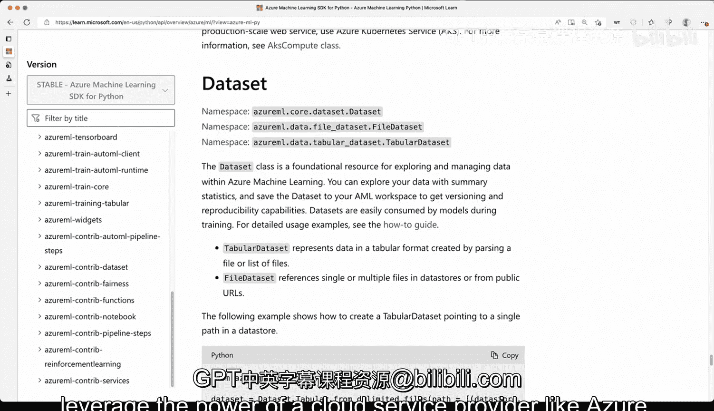

# 杜克大学｜机器学习运维｜DevOps⧸DataOps、Azure、MLFlow和抱脸｜MLOps ｜ Machine Learning Operations p177 36_03_06_Azure-ML-Python-SDK.zh_en -BV1yE421c7uA_p177-

We've gone through a couple of the things that you can do with huggingface models and datas and uploading those to Azure。

 but I wanted to take a moment to describe a little bit of the Azure machine learning Python SDK it is a great way to programmatically interact with what we've already seen within the portal and Azure Ma learning studio so all of the steps that I've already covered in the UI mostly are going to have parity with the Python SDK this allows you to do all kinds of different things including setting up infrastructure configuring nodes you can see here that some of the key areas that are essential here for this SDK I specifically like the ability to be to deploy web services so you can actually deploy and serve a model right away but you can also get trigger training model。

And and doing that with specialized infrastructure。 Now， specifically。

 I want to use a couple of the things that we've already touched on。 One is registering a model。

 So I'm going to search this because this is。very。Very， very intense and very thorough documentation。

 So there's， there's lots you can， I don't know if you can see my cursor there。

 but we're not even halfway through。 and there's lots to cover。 So let's start with the model。

 And how is it that you can actually go。And register。

 I'm gonna go a little bit towards here and this is pretty powerful right here because once you have your model and you can see here that you can name it you know what the model is kind of like the forms that we've already fill down when we were creating that now's I think that's very powerful once you are able to authenticate can you can interact with a model。

 you can even delete it later， you can download it so basically allows you to do and you can run this locally as well so you don't need to be running on the cloud as long as authentication is done So I'm going scroll away to the top so that you can see how you can authenticate I'm call way to the top this is stable versus experimental there's always new features coming up but workspace is kind of like the main thing that you need to be aware with when you're interacting with all of these models and actually。

Azure in reality so the main piece， whenever you're interacting with anything in Azure and machine learning。

 you have to create these double it's always referenced in the docs as WS and that stands for workspace So you can see here workspace create you have the name of your workspace remember we created a workspace is specifically for Azure machine learning studio and then there subscription ID the resource group and if it doesn't exist it has this ability of creating the resource group for you in any case and what's the location and then you're able to get that going。

 So once that's done， you're going to be able to use that workspace in any environment really but you can actually save that to a configuration file and that is known as theg digestJson you can。

You can save it like that and then reuse it whenever you want to reload it。

 So different ways of actually getting that authentication。

 getting that already done for you to select the right machine learning work workspace。 Now， last。

 what I want to show you is。The data As that you can do here so I'm going scroll almost all the way to the bottom here and this is the model deployment and this is exactly the part where I wanted to show you what this data is so data is kind of like what we did before with huggingface datas you have the same ability of registering a data using the APIs here。

 you can see we're importing from Azure Ml。 core import data and then you define that this is the limited limited files in this case a data already exists in Azure and you're able to use that and it has it has the ability to send those to panda's data frame which is pretty useful and you have the ability inject or retrieve those datas from also。

URL paths， you can definitely just the ability to do registering as well。

 but that doesn't seem to be covered here， but definitely lots of other abilities to explore more what you can do with the Pyth SK and so this is all relevant because once you're in the Azure infrastructure in the Azure cloud。

 you can use these things that came from hugging phase for your own exploring and your own training of your own models and your own deployment and it's very useful to have it and leverage the power of cloud service provider like Azure。

