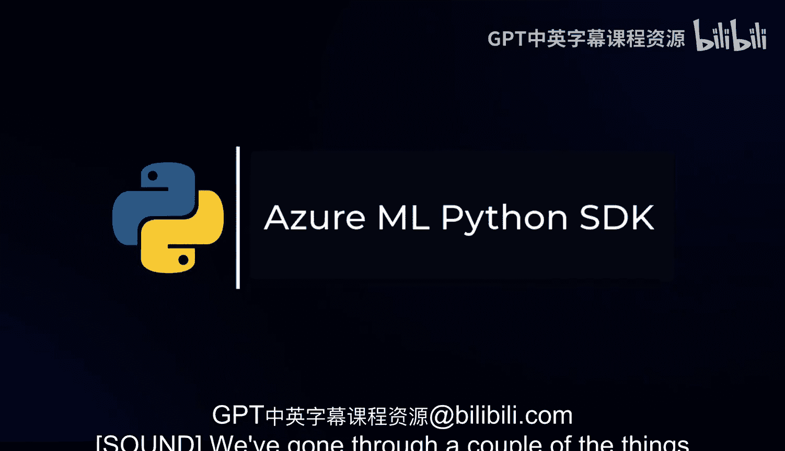
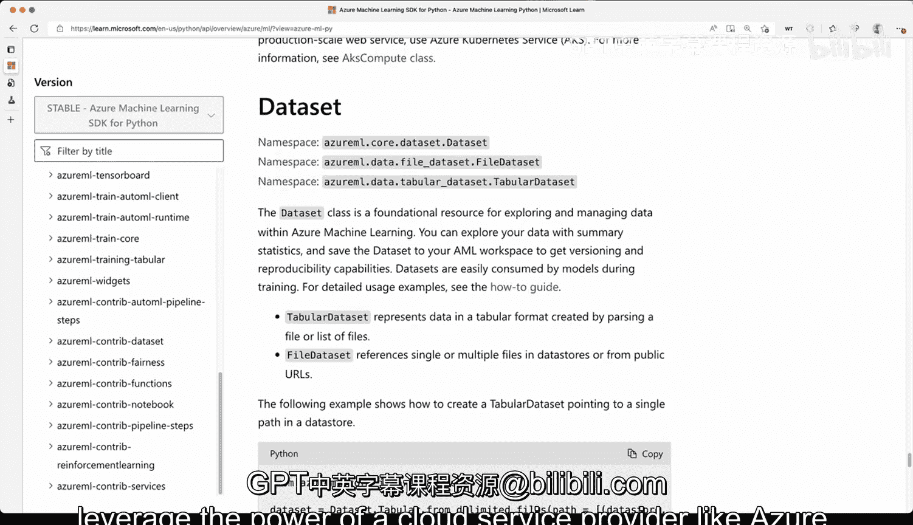

# 机器学习运维：第36章：Azure机器学习Python SDK入门指南 🚀



在本节课中，我们将学习如何使用Azure机器学习的Python SDK。这个SDK允许我们以编程方式与Azure门户和Azure机器学习工作室中已有的功能进行交互。我们将重点介绍如何注册模型、进行身份验证以及处理数据。

## 概述

上一节我们介绍了如何使用Hugging Face模型和数据并将其上传到Azure。本节中，我们来看看如何通过Python SDK以编程方式实现类似功能。Azure机器学习Python SDK提供了与我们在门户界面中看到的功能相对应的编程接口，使我们能够自动化执行各种任务。

## 身份验证与工作区设置

在使用Azure机器学习Python SDK之前，首先需要进行身份验证并设置工作区。工作区是Azure机器学习中的核心概念，它充当了所有资源和操作的中心枢纽。

以下是设置工作区的关键步骤：

1.  **导入必要的库**：首先，需要从`azureml.core`导入`Workspace`类。
2.  **创建工作区**：使用`Workspace.create()`方法，并提供工作区名称、订阅ID、资源组和位置等信息。
3.  **保存配置**：可以将工作区配置保存到`config.json`文件中，以便后续轻松加载。

**核心代码示例**：
```python
from azureml.core import Workspace

ws = Workspace.create(name='your_workspace_name',
                      subscription_id='your_subscription_id',
                      resource_group='your_resource_group',
                      create_resource_group=True,
                      location='eastus2')

# 将配置保存到文件
ws.write_config(path='.azureml', file_name='config.json')
```

一旦工作区设置完成，你就可以在任何环境中使用它，并通过加载配置文件来重新建立连接。

## 注册与管理模型

完成身份验证后，接下来我们可以探索如何注册和管理模型。注册模型是MLOps工作流中的一个关键步骤，它允许你对模型进行版本控制、跟踪和部署。

以下是使用SDK注册模型的主要功能：

*   **命名与描述**：为模型指定一个名称和描述，类似于我们在UI表单中填写的信息。
*   **模型交互**：一旦模型被注册，你就可以通过SDK与之交互。
*   **下载与本地运行**：你可以将模型下载到本地环境运行，只要身份验证有效，不一定非要在云端运行。
*   **删除操作**：在需要时，你也可以通过SDK删除已注册的模型。

这个功能非常强大，因为它为模型的整个生命周期管理提供了程序化的控制能力。

## 数据处理与部署

除了模型管理，Python SDK还提供了强大的数据处理和模型部署能力。这让我们能够以代码形式复现在UI中执行的数据准备和模型服务化流程。

以下是关于数据处理和部署的一些要点：

*   **数据注册**：与注册模型类似，你可以使用`azureml.core`中的`Dataset`类来注册数据。这类似于我们之前用Hugging Face数据集所做的操作。
*   **数据来源**：数据可以来自本地文件、Azure中已存在的数据存储，甚至是URL路径。
*   **转换为Pandas DataFrame**：注册的数据集可以方便地转换为Pandas DataFrame，这对于数据探索和预处理非常有用。
*   **模型部署**：SDK的核心功能之一是部署Web服务。你可以快速部署和提供模型服务，也可以触发在专用基础设施上的模型训练任务。

**数据处理代码示例**：
```python
from azureml.core import Dataset

# 注册一个基于文件的数据集
datastore = ws.get_default_datastore()
dataset = Dataset.File.from_files(path=(datastore, 'path/to/your/data'))

# 注册一个表格数据集，并可转换为Pandas DataFrame
tab_dataset = Dataset.Tabular.from_delimited_files(path=[(datastore, 'data.csv')])
df = tab_dataset.to_pandas_dataframe()
```

## 总结

本节课中我们一起学习了Azure机器学习Python SDK的基础知识。我们了解了如何通过代码设置工作区和进行身份验证，这是与Azure ML服务交互的起点。接着，我们探讨了如何使用SDK注册和管理模型，实现模型的版本控制。最后，我们介绍了如何处理数据以及部署模型为Web服务。



掌握这个SDK非常有用，因为一旦你的项目运行在Azure云基础设施上，你就可以利用这些工具来探索来自Hugging Face等源的数据和模型，进行自己的模型训练和部署，从而充分利用像Azure这样的云服务提供商的计算能力。SDK的文档非常详尽，涵盖了从基础设施配置到高级工作流自动化的方方面面，是构建可扩展机器学习运维流水线的强大工具。