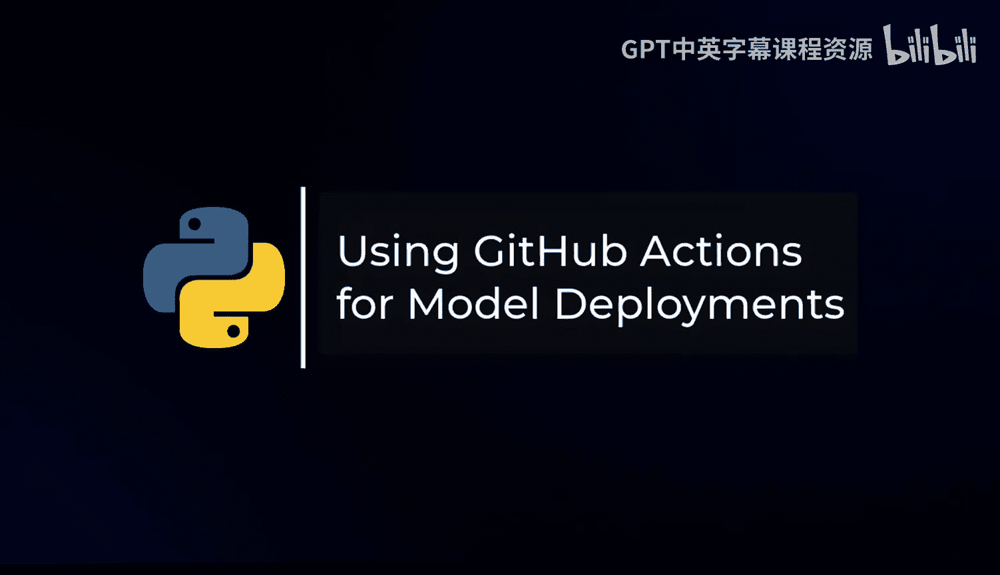
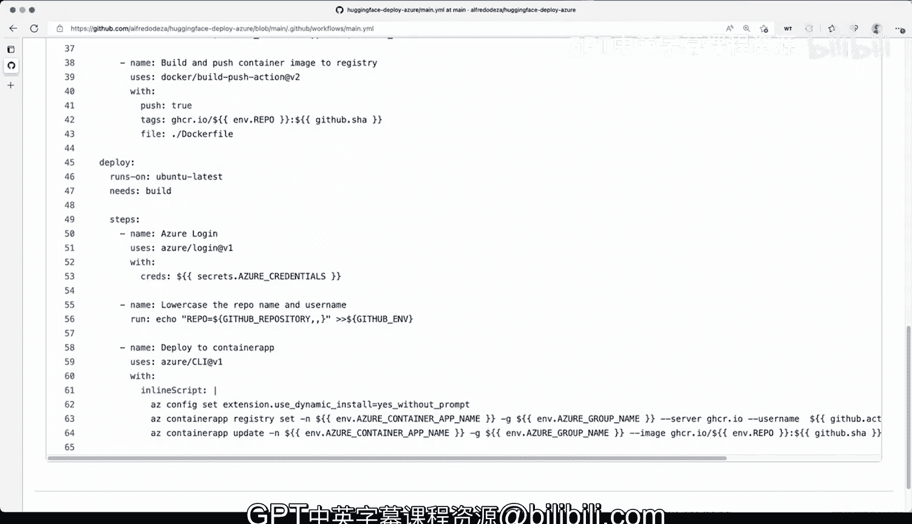

# 杜克大学｜机器学习运维｜DevOps⧸DataOps、Azure、MLFlow和抱脸｜MLOps ｜ Machine Learning Operations p178 37_03_02_使用GitHub-Actions部署模型.zh_en -BV1yE421c7uA_p178-

Let's go through some of the things that you will have to know and understand in order to be able to use Github actions for model deployments and specifically Hugingface so we're going to take a look and we're going to be working with this repository called Hugingface deploy Azure and what we're going to be doing here is go through some of the details that are required and then we'll take several different approaches to actually deploy so the first thing that I want to show you that this is a web application similar to what we've seen before in many of the examples is going to be using G2 for doing some text generation live through the fast API that is being exposed so there's nothing much to it。

 let's take a look a quick look at the dependencies and then the Docker file and then we'll go through some of the more interesting parts on the Github actions side of thing。

Tranformers， let's see Tensorflow fast API and Uiccorn so that we are able to run these so's those are the requirements。

 so let's take a look very quickly at the Docker file。

 the Docker file is just 15 lines long and just very。

 very few things that are actually important we have the installation of the requirements we copy the web application。

 we are exposing port 8000。 the entry point is UBcorn which is in charge of launching actually making this application run。

 so that that's very good and then we are running the host0 that0 that0 so basically binding to any address and then making sure that main app that is coming from web app is actually being run All right so those are the details let's take a look now at Github actions for that we're gonna go to the Github slash workflow。

going look at main yamo and let's take a look at a few things that are going to be happening here。

 First I'm going to make sure that the Azure container app name is called demo container in this case if you want something else you'll have to update that the Azure group name one thing that I tend to follow is that I tend to use the same name that way remember and I can destroy the resources when I'm done next I have all these commented out because I don't want to automatically trigger for now every time I push to the main branch you can actually un this if you're ready to to do this like in a production environment where anything will get triggered once the changes are made to the main branch and what we're gonna to have here when we'm going to be working with is a workflow underscore dispatch which allows us to manually trigger this is oddly named and it's kind of like difficult to remember but it's something that is useful to know when you're starting to work and design your workflow。

For a pipeline using GiHub actions Allright so let's see what are some of the things they're going to be doing so this is going to start with creating a Docker image sets sets up Docker build X。

 that means that everything that is needed for building the Docker image will happen there it is going to authenticate to different registries in this case this ones registering or authenticating to the GiHub container registry that is what GHCR that IO means is the GiHub container registry and you don't need to add any secrets because all those are already set up for you。

Then we're going to mangle the name and make sure that everything is lowercase that's why it is using the shell actually to make sure that those are set andex is going to push the contents to the GiHub container registry using the name of the repository and the commit Now on the deployment side of things this is going to stay very consistent except for a couple of things that we'll see in a second first we're going to authenticate login to Azure and I'll show you how how to make sure those Azure credentials are set next we're going to do this operation again we're making sure that everything's lowercase in the naming conventions and finally we're going to deploy to a container app we're going to use the Azure CLI action and we're going to use this snippet here。

 this inline script that is going to allow us to do that in this case it is authenticating to GH。

Our GiHub container registry is passing some secrets。

 you can see here that there's a secrets of Pat and that is what it's going to take to deploy that now I understand that this is a lot to take in it is not very demonstrative but what I wanted to do is take you through step by step on everything that you will have to do some things will change here a little bit depending on the target destination that we're going to be working with so say for example if we're going to be using Docker。

 we're going to use the Azure container registry， well some of these details are going to use Salfor scenes。

 we've already seen examples on using the GiHub container registry。

 we will be using something slightly different and for now we are going to concentrate only in the packaging and the push to different container different destinations specifically Docker hubub and Azure the Azure container registry。

 we're not yet going to deploy we will be seeing that。A little bit later， all right。

 so that is a quick overview on the GiHub actions needed for model deployments。

