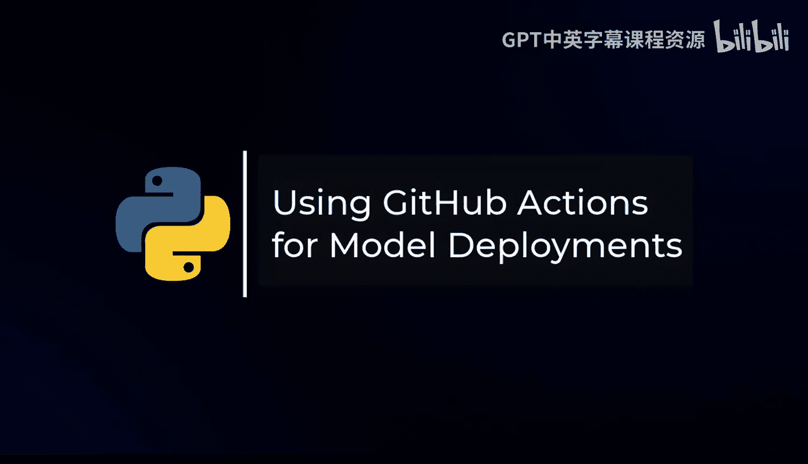
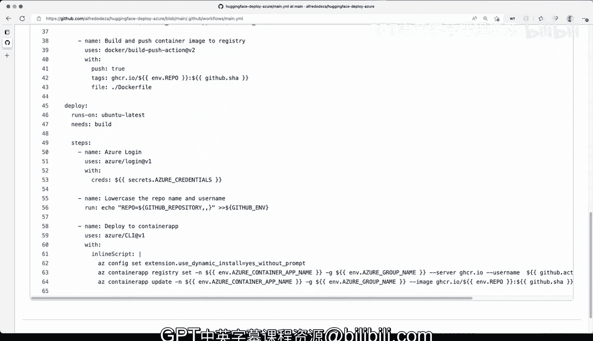

# 机器学习运维：第37章第3节第2部分：使用GitHub Actions部署模型 🚀

在本节课中，我们将学习如何使用GitHub Actions工作流来部署机器学习模型。我们将以一个具体的项目为例，该项目旨在将基于Hugging Face模型的文本生成Web应用部署到Azure云平台。课程将涵盖从代码结构分析到GitHub Actions流水线配置的完整流程。

---

## 项目概览与结构 🔍

首先，我们来了解将要部署的项目。这是一个基于FastAPI的Web应用程序，它集成了Hugging Face的GPT-2模型，能够提供实时的文本生成服务。其核心结构与我们在之前课程中见过的许多示例类似。

以下是项目的主要组成部分：

*   **依赖项**：项目依赖于几个关键的Python库，包括`transformers`（用于加载Hugging Face模型）、`tensorflow`（作为后端框架）、`fastapi`（用于构建API）和`uvicorn`（用于运行ASGI服务器）。
*   **Dockerfile**：用于将应用容器化。这个Docker文件非常简洁，只有大约15行。它的主要步骤包括：安装上述依赖项、复制Web应用代码、暴露端口8000，以及设置启动命令来运行Uvicorn服务器。

通过Docker化，我们确保了应用可以在任何支持Docker的环境中一致地运行，这是现代应用部署的基石。

---

## GitHub Actions工作流详解 ⚙️

上一节我们介绍了项目的基本结构，本节中我们来看看实现自动化部署的核心——GitHub Actions工作流配置文件（`.github/workflows/main.yml`）。

这个工作流定义了从代码推送到最终部署的自动化步骤。以下是其关键部分的解析：

### 环境与触发配置

工作流首先定义了一些环境变量，例如Azure容器应用的名称和资源组名称。为了在开发阶段进行控制，自动触发（例如在推送到`main`分支时运行）通常被注释掉。取而代之的是，我们使用`workflow_dispatch`事件，这允许我们在GitHub界面上手动触发工作流，便于测试和调试。

### 构建与推送Docker镜像

工作流的第一步是构建Docker镜像并将其推送到一个容器注册表。

以下是构建阶段的核心步骤：

1.  **设置Docker构建环境**：使用`docker/setup-buildx-action`动作来配置高效的Docker构建环境。
2.  **登录到容器注册表**：使用`docker/login-action`动作进行身份验证。在本例中，目标注册表是GitHub Container Registry (GHCR)。GitHub会自动提供所需的令牌（Token），无需额外配置密钥。
3.  **处理镜像标签**：通过一段Shell脚本确保镜像名称全部为小写，以满足大多数注册表的要求。
4.  **构建与推送**：使用`docker/build-push-action`动作。它会构建Docker镜像，并使用当前代码仓库的名称和Git提交哈希作为标签，将镜像推送到GHCR。

### 部署到Azure容器应用

镜像准备就绪后，下一步就是将其部署到Azure。

以下是部署阶段的核心步骤：

1.  **登录Azure**：使用`azure/login`动作，通过存储在GitHub仓库Secrets中的Azure服务主体凭证进行认证。
2.  **执行部署**：使用`azure/cli`动作运行Azure CLI命令。该命令会创建一个或更新一个现有的Azure容器应用，并指定从GHCR拉取我们刚刚推送的Docker镜像。这里需要提供一个个人访问令牌（PAT）作为Secret，用于授权Azure从GHCR拉取私有镜像。

---

## 总结与拓展 🎯

本节课中我们一起学习了如何配置一个完整的GitHub Actions流水线，用于将机器学习模型应用部署到云平台。

我们分解了工作流的两个主要阶段：**构建**（将代码打包成Docker镜像并推送到注册表）和**部署**（在云平台创建或更新运行该镜像的服务）。虽然本次示例以Azure和GHCR为目标，但整个模式是通用的。

理解了这个基本框架后，你可以轻松地替换其中组件。例如，你可以将镜像推送到Docker Hub或Azure Container Registry (ACR)，也可以将应用部署到AWS ECS或Google Cloud Run。关键在于掌握`认证`、`构建推送`和`云平台CLI部署`这三个核心环节的配置方法。

通过将这一过程自动化，你能够实现持续集成和持续部署（CI/CD），确保模型更新可以快速、可靠地交付到生产环境。