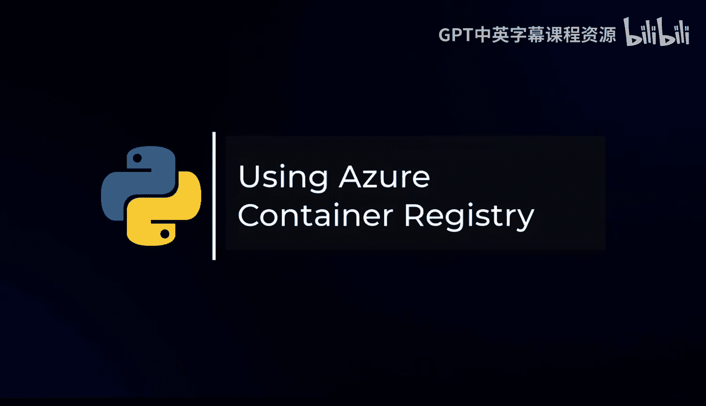
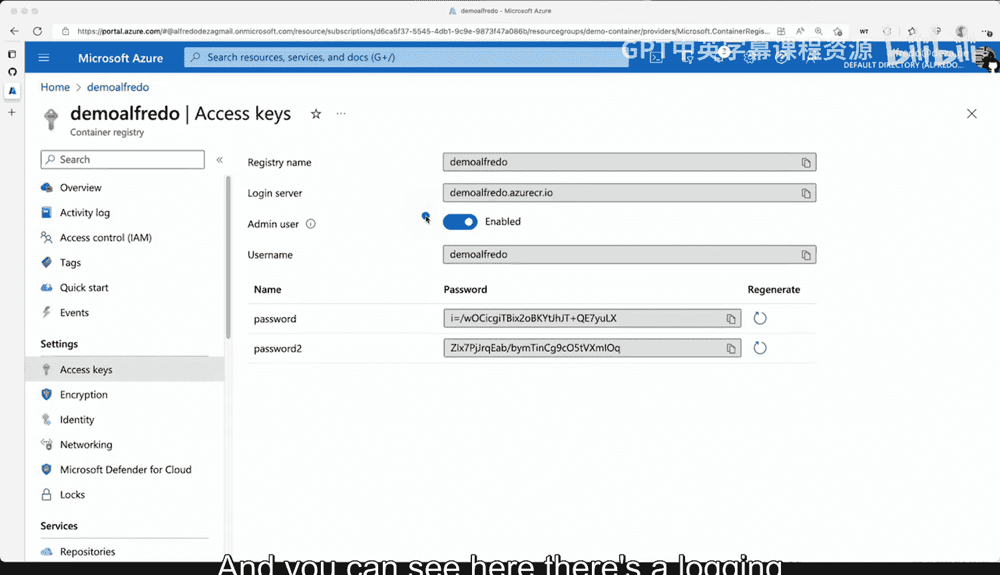
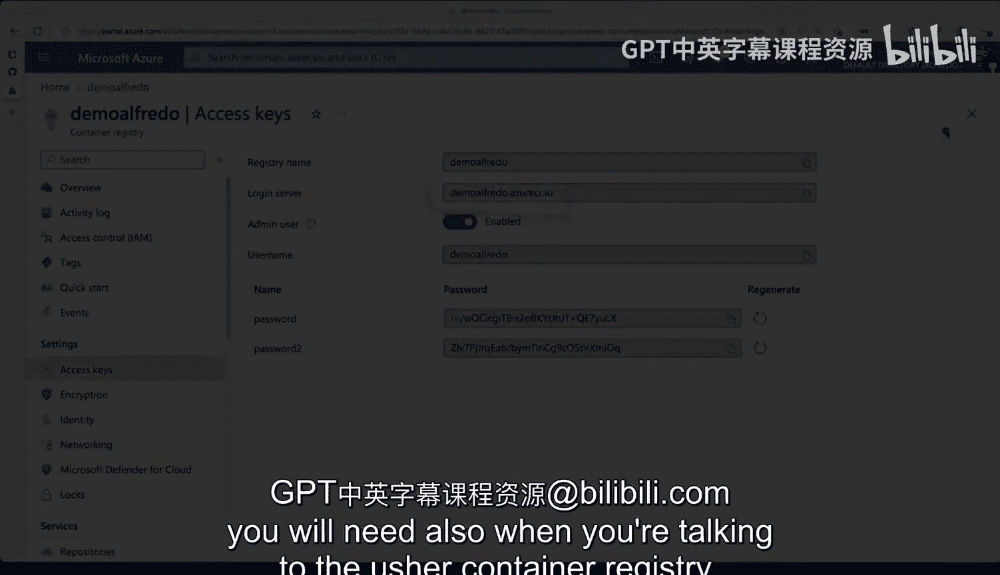

# 杜克大学｜机器学习运维｜DevOps⧸DataOps、Azure、MLFlow和抱脸｜MLOps ｜ Machine Learning Operations p179 38_03_03_使用Azure容器注册表.zh_en -BV1yE421c7uA_p179-

One of the different destinations that we're going to cover is using Azure container registry。

 So in order to create an Azure container registry。

 well what we need to do is go through go through the portal in Azure make sure you're authenticated and then take a look at the regsisttry so we're going to open here when I look for this I'm going to say registry and we're going to select the container registries and there's no container registries to display of course and we're going to be creating a new one。

 so I'm going to go ahead and create container registry and go through the steps。

 So in this case I'm going to use a very specific subscription that I have here I am going to create a new resource group and I'm going to call it demo。

Container that sounds okay。 and I'll be using these for other services that I'm going to be creating in Azure so that I can deploy these containers later so the registry name is going to be demo dash Alfredo that way I make sure that it is unique in this case resource names may contain only alpha Mary characters so I'm going to remove the dash and make that compliance。

 So there we go I don't think Canada central is good for me I'm going to try and pick and choose East US and hopefully that works。

Availability zone is not something that I need for this。 the S standard sounds okay。

 there are other premiums and basic operations that are also needed。

 so this is fine from now I'm gonna to review and create so the validation pass there I'm going to click create and this is going to take a second you're gonna see that the deployment is initialized and now it's in progress and this is going to take a while and we'll just wait it out Alright so that went very。

 very fast let's go to the resource and take a look at some of these things that we will be needing here so in this case we are required to do some things so we let's take a look at the access keys and the access keys in this case we want we want to actually have the ability to log in to log in to this and we need to make sure that whenever we're able to log in we have the ability to have an admin use。

This is a requirement to use Azure container registry when we're pushing images This is the one that you will be using so in this case you can see here that there's two passwords there's a username the username is actually the Alfredo that's fine and there's some password I'm going be using actually just just one password is fine there's another password if you need to use two passwords for our reasons and you have the ability to regenerate those as well this is exactly what you need to log in and authenticate to an Azure container registry so I'm gonna to leave these run in I'm going to close this up and then but this is everything you need and actually the username。

The user here and the password will need to be added as secrets later on the GiHub repository。

 on the secrets for GiHub actions later， but this is exactly everything that you need in order to be able to push some images and you can see here there's a login server。

 that's the server name that you will need also when you're talking to the Azure container registry。

