# 杜克大学｜机器学习运维｜DevOps⧸DataOps、Azure、MLFlow和抱脸｜MLOps ｜ Machine Learning Operations p18 25_02_02_理解旅行商问题.zh_en -BV1yE421c7uA_p18-

嗯。Al right， so I'm live with a new series I'm going to do。

 which is each week I'm going to build out heuristics， meta heuristics and algorithms in Python。

 It feels like a great series to start and already have a lot of work that I've done on this already。

 And so the the concept here just to set the stage a little bit is that。😊。

Most of my interest is in machine learning operations and what is interesting is that you don't always need to use machine learning to solve problems in fact heuristics are really useful and you can use heuristics to solve everyday problems you can use heuristics to cross the street you know you can use heuristics about which line to get into at the grocery store and I think the sharper you get a heuristics in a sense the better off you're going to be so with that being said I'm going to go ahead and share my screen here and we'll get right into it。

All right， so to get started here， what I'm going to do is go into code spaces。

 which is one of my favorite environments to code in and I'm going to go here。

And get right into a repo that I have got set up that is actually called heuristics and so let's go ahead and get into this。

Heuristics Copit assisted algorithms and heuristics and let me set the stage a little bit for this particular repo so the idea is that I'm actually customizing my environment by using a Docker file and also a dev container which loads certain extensions like in this case we can see Github codepilot what's nice about this is means that anybody can fork this repository and get the exact same environment that I've got in here。

A couple of things I'll note is that I have a make file， almost all projects I set up。

 I put a make file inside and then I also have some code here and I'll show you basically these examples today so I'm going to go into greedy algorithms and I'm also going to go into optimization which is something I studied in graduate school and I've continued to be very interested in optimization。

 the most classic optimization problem is the traveling and salesman and I have some solutions for that as well and so in order to get started here you could just fork this repo and just copy everything I did in my case I've already got it inside of code spaces so I'm going to click this button and just launch it again。

So this would take just a second here and look you can see here there's a tip customize your codespace using devcontainer。

Json file， so it really is actually a pretty amazing technology GithHub codespaces if you haven't played around with it。

I forget what it costs a month， you know， 10 bucks a month is probably worth it。

 I would recommend it。And notice here I also have a virtual environment。

And this just makes it so that I can get coding immediately and so let's start with this concept of a greedy algorithm。

 probably worth just really quickly sketching this out with sketchketpad here。

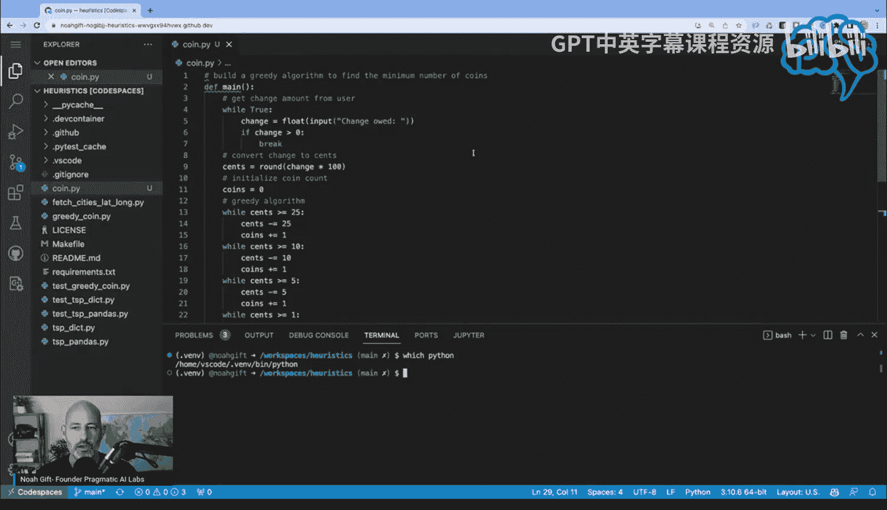

And we'll go to this here and let me just sketch out what it is I'm doing。Okay。

 so in this particular scenario， the concept of a greedy algorithm is that you take the obvious choice first and here we go。

 greedy Algo。Like this。 And so the obvious choice with getting the correct change would be like and let's even set the scenario would be。

 let's say that you're being hired to build the software for a vending machine and we'll I don't know。

 make a little vending machine here。Like this。And it serves out some kind of soft drink or food or whatever。

And so this is our， this is our machine。And and and what we need to do is we need to build a service that can actually return back the least amount of coins because the problem is。

 you don't want to go back every single day because all the pennies are gone， right， you want to。

 you want to build an efficient algorithm that will give you the correct amount of change。

 And so we know that。Commonly， I mean， there's other coins， but in the US， there is a 25 cents coin。

There is a 10 cents coin。 Theres a nickel and there's a penny right so there's four denominations And so so what we would like to do is we want to build a piece of code that will always first select the biggest coin because it means that it's going to be less coins you have to store right' it's actually a constraint and then this would be the second option So that would be the second thing that we do and then this would be the third option and then the last option would be a penny So this means that we would have to change out the change in the change machine at the lowest possible rate because it's always know pulling out the highest denomination first So that's and fortunately it's pretty straightforward to do in Python and so that's what I'm going to build。

 So let's go ahead and do this。So in order to build out。

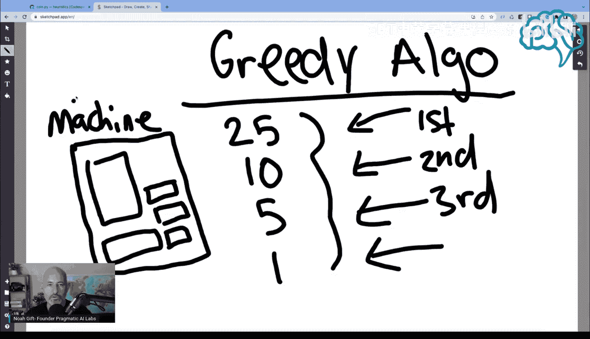

A greedy change algorithm we can take a look at this code that I've already written here and we can see some of the things that I've done previously。

 I have a couple different examples of it but in a nutshell you would want to build a dictionary with a coin type as the key and the number of coins as the value and at the very top here I would say your change for this and this would just really set the stage for you you put in this amount of currency and then we would select inside of a list the options right so a 25 cents 10 cents5 cents a penny so we use these as float values and then instead of here I would have a coin lookup and so in this case why would I use this so the idea here is that I can then later figure out counts of things and so now I have a coin dictionary。

That is at the top here， and I say for every coin in coins， go ahead and you know。

 set this up into the。Set this up into our structure。

In the dictionary and then say for coin and coins as long as the change is greater than the coin。

 go ahead and subtract and then go ahead and add count right and so this coin d will keep track of the counts of how many times I've given out that coin and then finally I say for coin and coin dictionary if the coin。

Is greater than zero。 Go ahead and print it out and then return back the dictionary。 Now。

 that's there's lots of ways you could write a greedy algorithm。 But again。

 the idea is that you take the the biggest coin。And you return it until there's nothing left and then you take the next coin。

Now in order to build this out。Into command what I did is I added the command tool click and I put an argument called change and it says type floatat and it says return the minimum number of coins for a given change。

 And now I can actually use it from the command line。 So so pretty straightforward。

 So if we go ahead and do this and I just type in let's actually make this executable。

 So if you add a shippingang line here。 This will make the code executable。

 or make it able to be run without using the Python command。And if as long as I do this。

 if I say chma plus x。Then I can run this as a chamean script。 And in fact， what I will do next。

Is just go ahead and run this， so greedy coin， goshsh help。

And it says right here returns the number of coins for a given change。 Now。

 let's even change this because we don't need to put Python 3。We can just make it exactly like that。

 so if I put in， for example。0。99。It says your change for 99 cents would be three quarters。

 two dim and three pennies right So it prints out a nice little little payload for me to play around with。

 Now， I also could use this from i Python This is a technique I think that's really important is when I like to build algorithms out is I like to build a chameleon tool。

 but I also like to build it out in a way where I could use it again for some other thing。

 right like maybe I want to build a microservice or I want to build you know。

 I don't know some kind of machine learning system why don't I just build this out in a way that's that's reusable And so now it's pretty easy。

 I just say from。Greedy coin， import greedy coin。Like this。 and I could do the same thing。

 I could say amount。Is equal to 0。99。Then I could just say greedy coin。This。And I could do a amount。

That。And notice in this case， if we look at the return value。Here。

 we can say type the return value is in fact a dictionary and the return value is。The queen。Plus。

 the count of this。 So I've actually got a really nice little tool because not only do I have the chaalleion tool interface to it。

 but I also could use it in some other thing like a microservice or some other systems。

 So I think this is really a neat little trick to do when you're building out algorithms is to to make it decomposable and you can use it multiple ways。

 Now， one of the things I'm going to do as well， is now that we build this out， let's build it again。

 but this time I'm going to have the coppit system。

 help me write it out and just show how powerful it is。 so。😊。

And it might even make it slightly different and kind of be a little bit non deterministic。

 so I'm going to say。Here it will say new greedy coin。不 by。On that。

And now I'm going to go over to this thing and I'm going to say， okay， let's start having fun。

 so I'm going to import click because I know eventually I want to build a Camme in tool and then I'm going to say to coppit。

I want you to help me build a greedy coin。 So， you know， build a algorithm。 So build a function。

You find the minimum number of coins。 and let's just see what it does。 Gry change。

And you have to let it think for a second， here we go， so it says。

Your change for change so it's using stuff I've already written before， but but what we could do。

Is we could， we could change it a little bit by， by giving it some different prompts。

 So we can say build a function。That。Returns the minimum。Number。Number。Of coins。呃。Only using。Quars。

And dims。So so maybe we have a machine that only gives back quarters and dims。 So。

 so this is kind of cool because this should potentially tweak our code a little bit here。😊。

And make things a little more non deterministic。So it didn't。

 you have to be careful because it won't always follow your directions。

 but we can we can change a little bit。And we could just say this。And we can just change。

 change this here。And we can say。This this looks this looks reasonable。

 So so one of the things about the the code assist thing is it's going to， if it finds something。

 I believe locally， it's going it's going to probably heavily weight that。

 but but what we can do now， look it already promised me to build a command is I can say build a click group so I can even overwrite it。

And this the group will allow us to。To actually make multiple groups and so we can say click。

 yeah mean。the minimum number of coins for a service。But I want to build a command。

Let' say mean do command。Oh be change， as we float。

And so what what a sub command or a command is and click allows you to have multiple different kinds of of commands。

 So what we could do is change this a little bit， we could say returns a dictionary with the coin type as a key。

嗯。And we could say only returns， only users quarters and times。 Yeah。

 so it was pretty pretty smart actually that it that it knew that we could write it a second one。

I hear。That says Geff。You know， build another one。Build a greedy。Algorithm。Over coins。But only use。

A pennies。Nickels and dimmes。 How about that。 Yeah， I like that greedy coin too。

 and let's see what it does。 see it can help us build it out。So now it's a little bit smarter， right。

 because we've been able to prompt it a little bit。And so we can even change this。

We we can change this returns。We can just say this is a。For a given change。And we can say change。

Change big or something like that build， but but but we we we probably want to prompt this a little bit。

 So build a click command that returns。B change。The the。Only quarters in dimes。There we go。Change。

Pnce。There we go， so we say cutie。Now it's always smart enough to know there we go。

 build one that returns back pennies， nickels and dimes。That's exactly what I， well， let's see。

 what does it do？I think。Click argument， change。😔，Recoin but so I need to name this so so sometimes you do have to pay attention。

 you have to know what you're doing， you can't just blindly follow it's it's good。

 but it's not perfect there we go。Now we just invoke this perfect。 Yeah。

 so so now I have two different greedy algorithms， all AI assisted。

 and so I would just as well put here。Inside， and we'll say user bin env Python。Like that。

 And then we can actually chaot it。This。Xnubrity corn algorithm。

And then we can try different commands so we can say P&E。We can say99 cents。

It says 19 nichels three pennies right so P And D would be we could even change this so it's a little more user friendly。

For a given change。And then we would say for this one。Using。Quooters and dimes。And using。

Using pens nickels and that， there you go。 So so if I go through here and I type in dash help。

This will say returns the minimum number of coins for a given change using pennies。

 nickels and dimmes， so'll say P&D。Say that 99 cents。 There we go， 90 Nicholas three pennies。

What if we say$110？Now， why is it not returning？21 nickels。

 So I think our code is a little bit screwed up because it should be returning back。

The the dimes here。For greedy coins。Greedy Coin 2 is it not using greedy Coin 2？Gre going， too。

Return the number of number of kind coins。Would be 21 nickels for pennies。Gy， that should not。

Be returning 21 nickels for， for pennies。 We may have like a little bug in our。

 in our code that I'd have to。To to， to dig into a little bit to figure it out， but in general。

You can build things very quickly。 and and you do have to actually pay attention to it。 That's。

 that's probably the big thing。 I'll just delete this one， because it's。

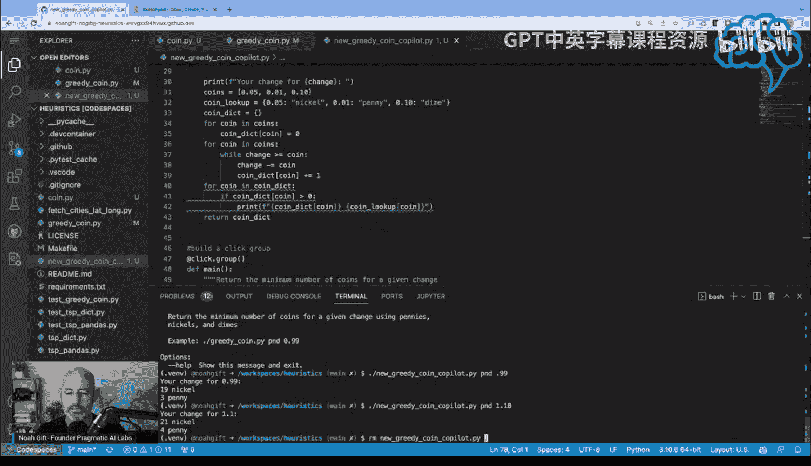

Bgy。Now the next thing that I'm going to work on now that we've played around with this thing would be to go into the traveling Salman problem algorithm and so what I will do。

It's just sketch that out。So this is kind of a fun one because the concept of a traveling salesman problem。

 which is referred to as the TSP， is that you have a list of cities。

All over the place and these cities， you want to find the shortest route and because the the the list of cities and we'll call cities is is is。

Is basically。Infinite right like this。 the cities are infinite that there is no perfect solution for the the traveling salesman problem right and so one of the things that you have to do is figure out a way where you can get at the very root end you want to minimize。

嗯。You want to minimize for the distance right， and that's really the goal is to minimize for the distance now。

They're one of the algorithms that I'm on to write。Is what we would do is we would。

 we would pick randomly。A starting city。Right so we would pick。

 let's say this one to start with and then you use a greedy algorithm next so it's random plus greedy and so with greedy we would we would if this one was three and this one was five we would start with this first right you always pick the best possible solution first if you're given a choice and then the same thing if we go through here and we go through here and this one is four and this one is seven you would then pick the shortest one and and then that at the end will give us some kind of of a set of coordinates like you know it'll be like a one。

you know to a2 and then it'll be like the distance was was seven and then and then at the very end you try to minimize the total distance and you run this through a simulation multiple times right so this is where the minimization comes in。

Is that you actually run many times。Run run many times， and then you minimize for。

 for the results so。What we're going to do here。I next。

 is actually build us out programmatically step by step。

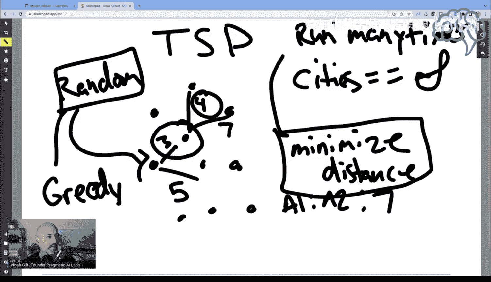

Okay， so to do that。First， let me just show you a full solution because because the the full solution。

 I think is kind of fun。 So I actually did use。😊，Copit to help me out with this。

 And so what what I told Copilot to do was I wanted to do something beyond just like a simple travel and salesman problem。

 I wanted to make something very realistic and what I did was I asked it to help me build real cities in America in this case we have a list of these cities we have New York。

 Knoxville， Birmingham， Baltimore， Bangor， Cleveland， Chicago， Denver， Los Angeles， San Francisco。

 Raleigh， Seattle， Boston， Houston， Dallas Miami， Atlanta Fort Worth。

 Phoenix and San Diego and and I basically create a data frame with these cities and I actually have the list of the latitudes and the longitudes so this is a real world problem that we could solve by using this library called Gepi and let's take a look at geoy real quick and see what what it actually does so Gepii is pretty pretty sweet actually because what it does is。

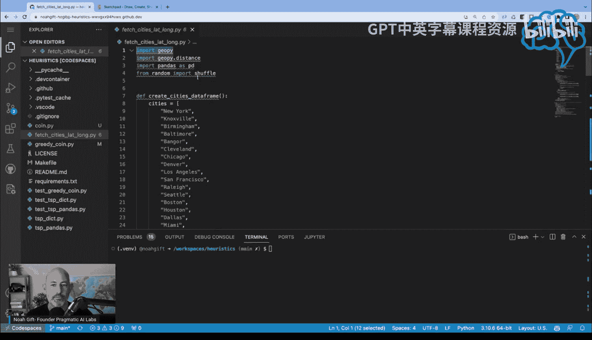

How was you to deal with？The you know， any kind of thing involving geography and python calculating the distance right is the one I care about which is which is really a useful skill to have turns out and so in our particular scenario here what I do as I say look I want to I want to list of the latitudes the longitudes and for every city that's in this list right here let's go ahead and。

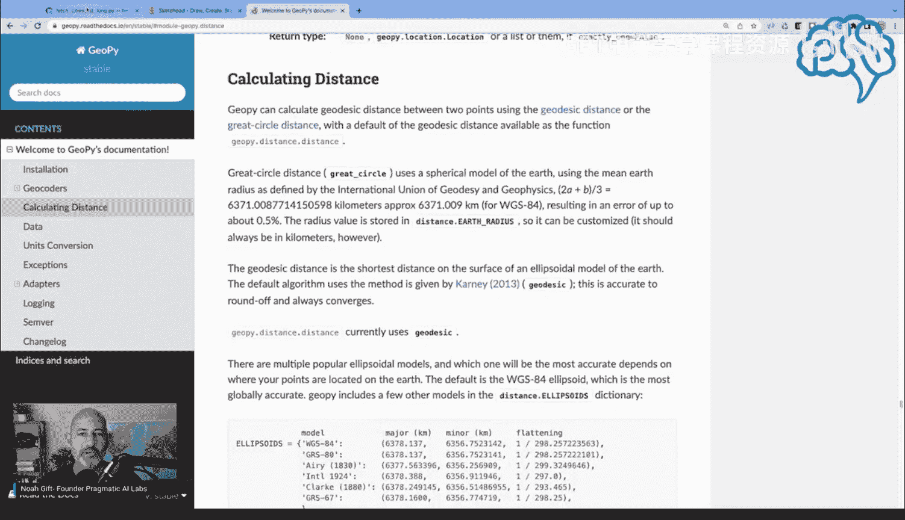

Let's append the the latitude and the longitude。 and let's make a data frame that actually includes all those values。

 So let's go ahead and also use i Python to play around with this。

 So this is what's kind of cool about I Python is you can take little pieces of your code and and play with it。

 So in this case， I'll say from fetch cities And we go through here and we'll say。😊。

Such cities la long。Import all。Now， what I'll do is' we'll say C's data frame is equal to the name of this function in Python。

Create citiess data frame。Pretty pretty simple， there we go。

And it'll take a second because it's got a， you know query of the stuff from wherever GeI holds it。

 I actually don't know where this thing is getting kept。 there must be some cloud provider somewhere。

 but look， if I say type。And I say cities D F。IThis？You see at the pandas data frame。

 And then if I do cities。Y， dots。Head to just see a few of them， we can see here we go。

 We have New York Ratitude longitude， right so so very， very powerful。 And again。

 the copi wrote this for me like it literally wrote this code for me and then。😊。

The next thing that I need to do is I needed to create a traveling salesman solution that will solve this in fact。

I could even put some documentation inside of here that says， you know， traveling。

It was my problem using pandas and viewI there we go， so I have some good documentation now。

I also think and let me open up another shell， I also think it's a good idea to always be linking your code constantly and formatting it whenever you're using like these AI assisted tools right so we see my code is still pretty good。

But also format it just so that it looks things are looking good。

And what it does here is we first create a list of cities and this is kind of part of the magic here and I had to fix this myself is we want to shuffle the cities because we're trying to create lots of different simulations and we want to minimize the shortest route amongst all simulations and so if we go back here again remember that we want to randomly start at different cities right and so here we go we say here's my city list right so we can see on each run the cities should be different to do the simulation then we could a list of distances and then we loop through and we basically get the distance from the current city to the next city。

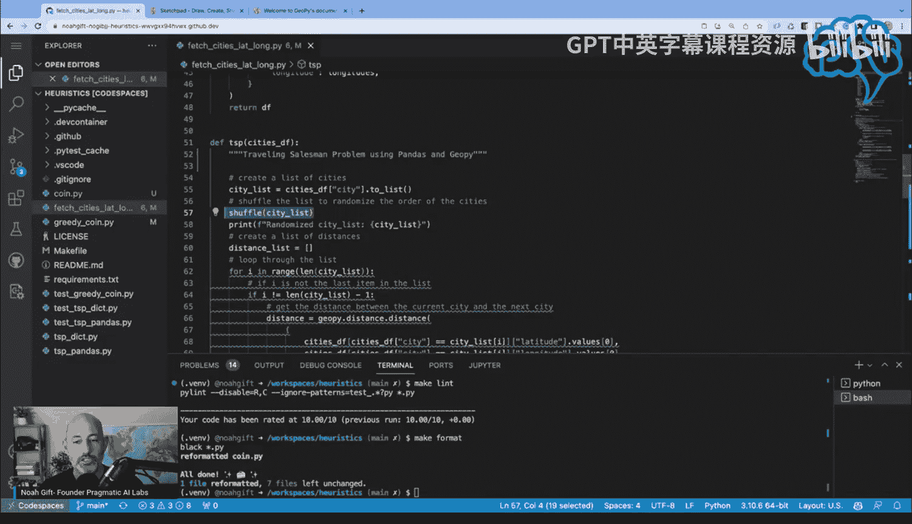

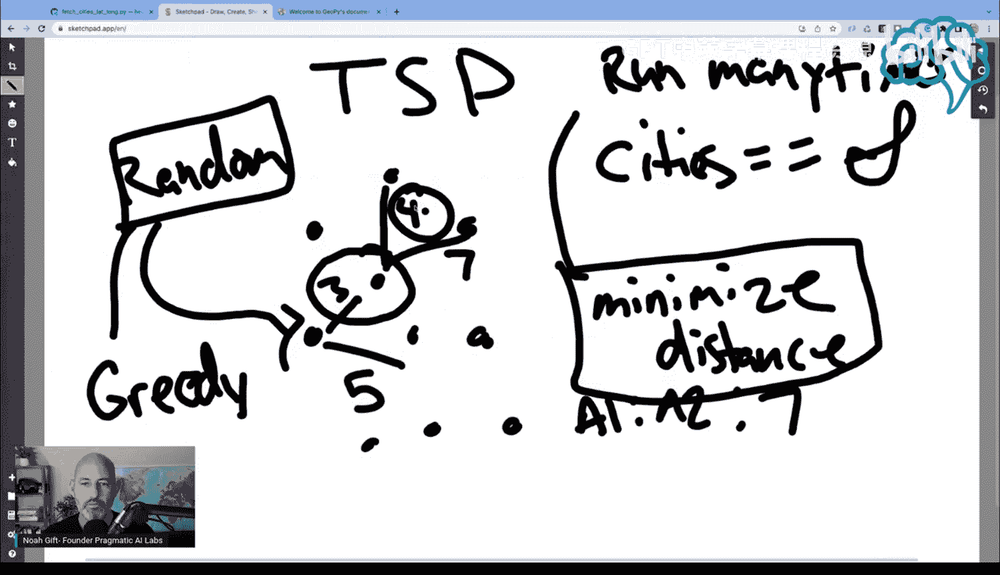

And then what we do。As we append the distance to the distance list。

 we get the distance between the current city and the first city and then we append all that to a list。

 And so finally you return back the sum of the distance and the city list so that's really what is returned is the total distance traveled for all the cities you visited and then the list of the cities right so we can compare the route because in a real。

 real problem， you don't want to just know what the shortest distances。

 you want to know what places to go to so that you could actually use the solution。

 And now here's the magic part， which is I then build a function that runs the simulation you know a multiple amount of times now I could actually extend this。

 which I think I will to make it more of like a useful tool but in this case we say run the simulation 100 times and minimize for the shortest distance and then print all the cities that we visited。

 So this doesn't even use commandland tools but let's just go ahead and run it。

 So I'll go ahead and I'll say you know fetch。嗯。Let's chaot it， so let's say chaot CHMOD plus X。

Fetch， fetch the cities。There we go， and let's double check that we can put this chaang line at the top。

 so this will be a here user bin EV Python。And once we've done that。

 I should be able to run it just like a script。Here we go。

 And so it's going to take a little bit of time。 It's going to chug。

 and it's going to grab all the different things， but it's going to run 100 simulations of the traveling salesman problem。

 And that's going to print them all out。 And， and we can take a look at this output here。

 We can see here that look。You know， it says the the first simulation it found。

The total distance was 3300 and。33689 miles so that's a big big trip right and it shows the exact list of cities here which would be if you went to New York。

 Los Angeles， Birmingham， Baltimore， Knoxville， Phoenix， Fort Worth。

 Houston you know that's how long the trip would take now look at the next one。

If we start at Los Angeles and we go to Cleveland right that's only 29000 and you can see all the different times here。

 And finally we actually figure out that the shortest distance for that particular set of cities would be 26000 miles。

 So it's a pretty big difference right between this one would be 33000 miles and 26000 miles here and it says the route that they would recommend taking is you would start。

In Birmingham， then go to Baltimore， then go to Fort Worth， then go to Miami， then go to San Diego。

 then go to Denver， then go to Seattle， then go to San Francisco right so so pretty useful script actually。

 but we can make it even more useful and I think this is one of the tricks with heuristics is to build them into tools is by adding a commandme and tool interface for it So let's go ahead and do that So what I'm going to do is I'm going to import click。

So we'll go ahead and import click here。And let's also just make some documentation for the script。

 we can say like you know。This is a。Communline tool。Utility tool that figures out。

The shortest distance。Visit in all cities and a list， sure， that works。

And then we can even put some documentation on the functions we wrote， create a pandas data frame。

 perfect。And just make this like really high quality code。And that looks good。

And now the main is what we need to swap a little bit here。And。We can。

We can basically main function that runs the TSP problem。And we probably want to do here it count。

And instead of saying 100。Let's see her。Counts。How did it find how many times to run this， Let me。

 let me look at this again。 Oh， I I know how to function that runs the traveling salesman。哎。

Once that runs。He。That runs。Yesy。5。Now， let's look at down here。What do we do？

Loop in this case it's not 100 times we're doing 10 times。

So we need to change this to account right here， so we need we need to say。

I'd say like a little note here， you know， run。P X times。That's right。

So we would say count right here。呃。And we would say a number of times。え？Simulation multiple times。

You mission。Ps。Now we need to。You'll write a click group here， so let's say。

We'll say createate click group。And we'll do a group there we go。

 so this is kind of a pattern that they do。With click is to make like this holder。There we go。

 we don't need a pass statement because Linting won't like that。

 And now we need to build a command that runs。That runs the simulation。X times perfect。

 that is exactly what I want and we'll say click command。

 And now let's move this up this main function just to get it。

 I hate it when I have to move things around。That's one sign that you might have a little bit too much text in a function is if it's a little bit unwieldy to kind of scroll up and down。

 but we have this main function here。Next up， I'm going to say again。

 add click command that runs simulation next times。In this case， I'm going to say simulate。And。

We do exactly that， right we say default would be 100。To run the simulation。

And a number of times we run the simulation。And we can put in simulate counts。

That it did exactly what I would want to do now I probably。

Want to tweak this a little bit and add a little bit more documentation so I can even ask the open AI codex。

 which is part of the coppit to do more。And that's exactly what I want。

And I'm going to even change this。So it says dotslash fetch cities simulate count， you know， 100。

 I think the default should be like maybe like 10。And we can say count， you know， 15。

simulationulation， X times and。Sortest distance in cities visited。

There we go that's that's exactly what it's going to do and。If we look at this。Yes。Es。Oh， because。

We want to take this out， there we go。Perfect， and this will be the the main count。 No。

 I could even put。UDoes it it see how many times I'm going to run this same， oh no， it does。

Say running the simulation， We could put a little print message， though here。 We could say prints。嗯。

exactlyactly， so like it even knows what I'm thinking。

 which is pretty cool about the open AI tool here， runs a simulation this many times。

Now what would be kind of cool， so first let's run this and I'll just there we go。

 it's again super smart， I'm going to run this。嗯。Fs， let's ask for help。And say， look。

 there's a sub command or command called simulate， let's run it。

You simulate and let's run it five times。Gone unexpected oh counts I need to do count well I could have done help。

 right， which would have told me。How my own tool works， right， So we say here counts。There we go。

Count 5。 so it's going to run the simulation five times。

 and then it's going to give me the shortest route to actually travel。 So。

 so this is actually pretty darn useful as a tool for people。 If you wanted to use this yourself。

 like it's already ready to go with。The， the caveat。 Look at this。 So this found， it actually found。

An even shorter route， which is pretty cool。 So let's see， I mean， I'm curious， actually。

 what's the shortest distance it could find if I let it run for a while。 And this is， again。

 the reason you want a cuulate interface is so that you can do a more rich exploration。 It may。

 I don't know if this is the the global minimum， right。

 let's see So let's let's see if I run it 100 times what happens。😊，Okay。Now。

 that looks like that is the shortest possible way to go。I mean。

 it's likely that this is the the shortest possible route here。

 which would be 23000 miles now what we can do to make this tool even more useful is I think we could build something that would。

Let us swap out this list of cities。 And so。Um。We could even put something。Here。

Which would be cities。But instead。嗯。Cities sit啊。Cities， something like cities。呃。

Equal to none something like that like so， so basically cities equal to none。 So， so we could say。

If the city is。If nobody passes in cities and use these cities right so we could say like you know if。

Cities is none then。let's give it the default values right here。Yeah明白。And I could use my tool。

 Python Black to format this。So we'll go through here， we'll say make format。There you go。

 cleaned it up for me。 So basically， if I don't pass anything in， then I'll use it。

 But what I would like to do is I'd like to take a list of cities and I want to make a new city list if somebody wanted to find other cities to to put into this list。

 So that way it's a general purpose tool。 So I just need to build a small little function here that and we can have coppit help us so build a。

😊，Function that。Picks。He。List of strings。It returns。That takes。诶。That takes。Let's see in arbitrary。

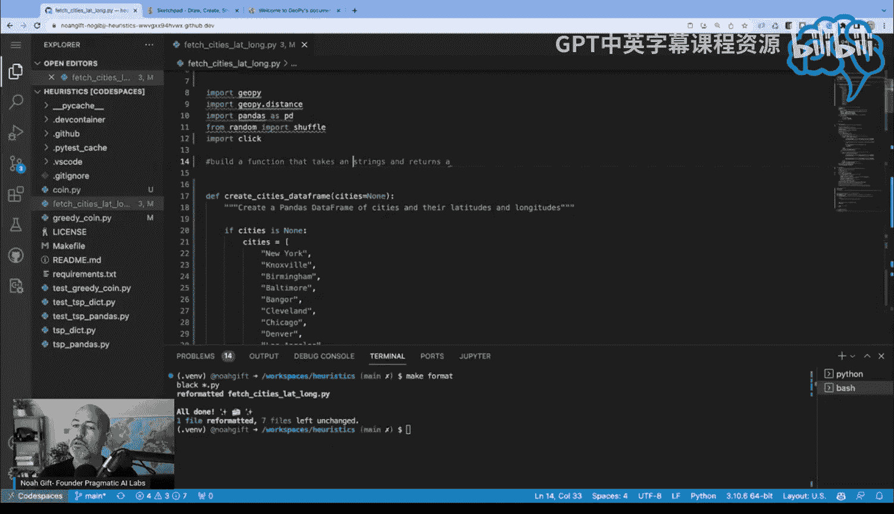

I forgot how you called it， it's asterisk args and Python it' called。Variable length argument。

 so it takes variable。

Length。Argument of strings and returns a list ofidius。Of cities。Here we go。

 that's that's what I want。 So， so basically， I want。Yeah， so not a big function and so。

But what we can do now。Is we can we can basically say， you know。

 like those was aicit city from the command line from。From input。Input like that now。嗯。

What I want to do is go or or cities。See， I don't I guess that's all that's okay I mean it's but let's let's link to just make sure I don't have any bugs in my code。

 Yeah， see that's not good19。Creates cities， cities we we should say cities。嗯。You know， my cities。

 here you go， my cities。That that looks good。I it。Perfect。

No value argument count and function called， yeah， we can we can fix this as well。

To this is something that's common。Here。I went。どんな。Now what I want to do。Okay。Is。

I want to create another。Click group。That does custom simulations。

And so let's go ahead and say a crate。嗯。No， I want to do it below， I want to do this below this。So。

Right。click and that takes a variable number of arguments of cities asked in。Exactly what I want。

So let's see， and we'll call this。My cities。嗯。Cious。Go let's try that we're seeing。We're just cities。

 we're just say cities。Okay， so it's got that。And then。We'll do the next thing。

 which is is going to build this。This is a Kame tool that figures out the short system of this all cities in a list。

 so create a list of cities。Is what we want？And we can。That this looks correct， C data frame。

 but we also want to add an argument that says run simulation。

Exactly multiple simulations and here we go we can we can do this。

 this is cha tool and we can say example。Here。Z。😔，Exactly。

 this is exactly what we want to do it show people that you can pass in the cities just like that。

Now。We don't want to show that much because that's a little obnoxious， right。

 but we just want to show that you can pass in， you know， different different cities。

And we can say count。You right like that。And now we want to do here。This it's cities Latin long。

 Okay， so let's go ahead and run this。Check this。And天吧。Oh， because TSB run the TSB function。

Because we need to put in。City's relative function。Yeah。We need to do this。We need to do mean counts。

😔，Mean count。No we would say default would be。5， let's try that。 Now， I can linknt it。

 It's always a good idea to linkn your code when you're doing all kinds of crazy stuff。

 So it says we didn't， we't finding cities。 So I have some bugs here。 I need to fix this real quick。

 So we'll say 19。😊，Redefining cities。😔，Reeffinineance cities 149。😔，Yeah， this is not good。

 so we need to change this to cities。CLI or something like that。And now。Tn it again。

 So we have less stuff on these variable counts。We need to pass in count， right？And then， yeah。

 we don't。Mean。The main function， so our main function， we need to change it。This。So that。

It can accept a data frame。So let's change that， that's the other problem。Sony。And we couldn' say。嗯。

D。We can say and we can make this as well none。We can say like。If， yes。But。哪。Or if not the F。

 if not the F。A big one。Otherwise。Itd say else。Say there we go， exactly right。

 We could just say like。Basically， if I don' pass one in。

 then just use the default one and then we would do this。

 we would say exactly cities Df and again I can link it。We can， we can run this。Perfect， so。

 so this is why the Li， I think with the AI tools are are killer feature。 but formatted， there we go。

 code formatted。 Now， let's see if we can run this thing。 So now I've put in my own custom cities。😊。

We did we screwed up something。嗯。And。Let's see if I can fix this。If not， the F。What did I do？If。😔。

If not， dear， if。😔，有。And say。😔，Yes。What this is none。I may have screwed up my logic。There we go。

 Yeah， So I just， I didn't do the right equality thing。 So there we go。 So that's 8，8000 distance。

 But， but see， we have one， one issue。Which is I'm going to need to put these things in strings。

 right， like new， it's weird that it picked New York。 So we'll say New York。Ooxville。

So in New York Knoxville。

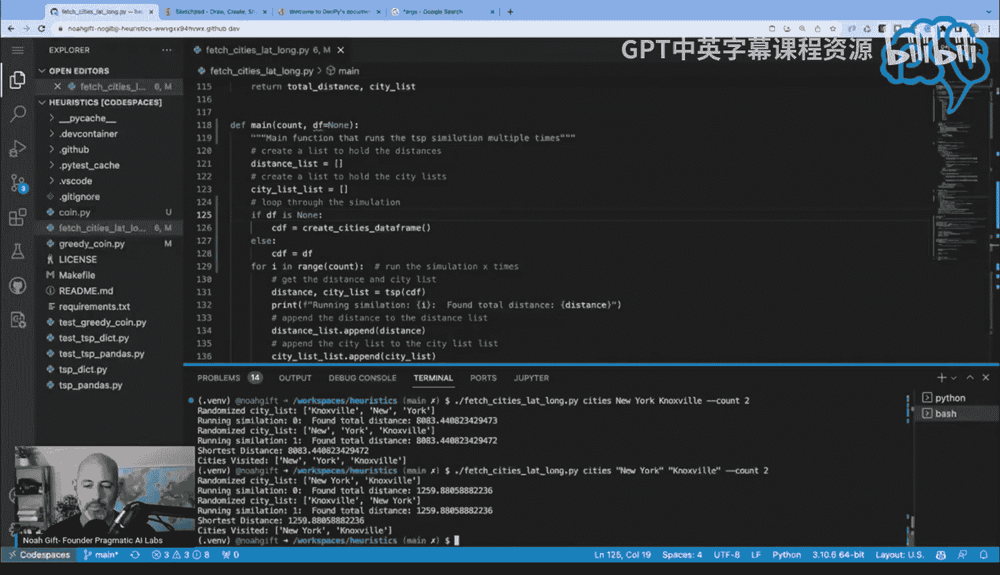

There we go， right， so that that worked。And then I need to change the documentation so that it reflects this。

We found a small little bug， but it looks like it's working。 So， so now I just need to like。

 I need to just Google like， you know， pop。Upkin。Cities to visit in the US there we go。

 let's just do that and let's let let's do this。Let's just say the cities everyone should visit Okay。

 let's build it out so kind of sucky that I have to actually cut and paste it but whatever。

 So we'll say first up Boston。

These the top cities I should visit what's up next？

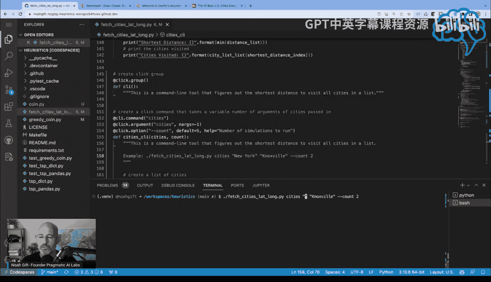

Here we can go to Huntington Beach， used to live near there， so it's not a bad place。

I can each。Then the next one。What's next here in the best cities to live， I mean。

 we could probably have open AI help us in the future as well to actually give us prompts for the best cities to visit。

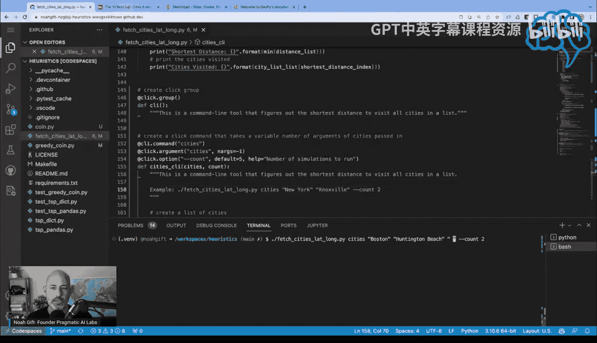

But there we go， Chicago。

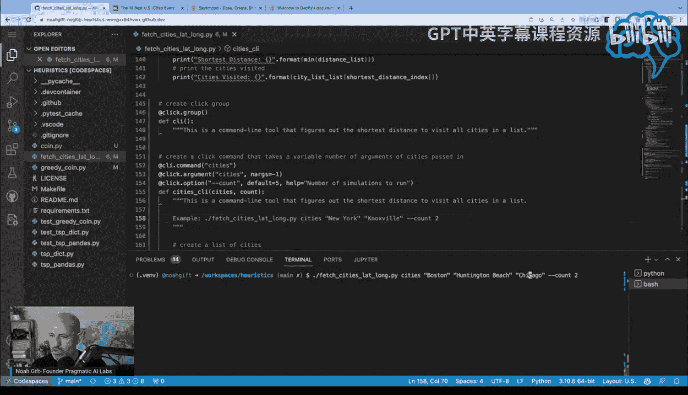

Up next here。😔，So go to port。Aransis， Texas， never heard of it。

嗯。Orranis。In Texases， this might be a good place to go to。诶。And let's do than that。There we go。

so we can。Let's just do a few right。 There we go。 So we， we can say Boston， Porttorans， Chicago。

 Huntington Beach， and we do a couple simulations to to figure it out and we can figure out that。

So we may want to do it like， I don't know， 10 simulations。

Figure out this particular best cities to visit and we can see that the minimum。

That it was able to find the best solution was 5，671 using randomized greedy start algorithm。And。

Not bad right， so we we have a general purpose tool that other people can actually use。

 And so what I'm going to do because I'm going to do this every week is I'm going to check all this in。

 so let's go ahead and say。Get status say get add all this。And we'll say checking in。

Adding customizable。ReadD or traveling sales in a solution， ReadD greedy TSP with random start。

CLI that accepts customidious。So other people can now use my code and you can plan your trip to travel across America or Europe or wherever wherever you want to go by using this particular tool。

 So again， you can go to。This repository right here。

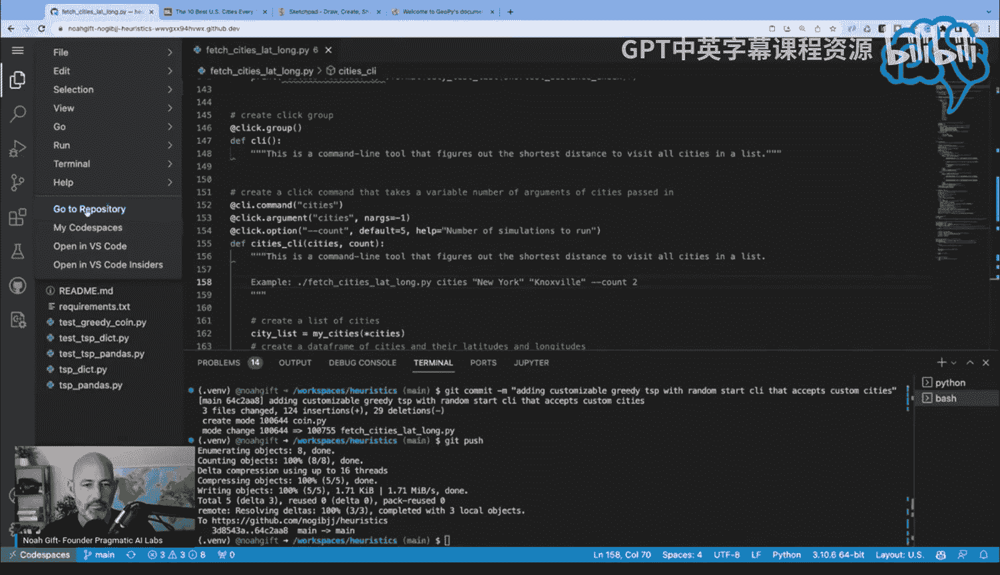

You know， G I， B J J heuristics。 And this is， this is this was day one， right。

 So I'm going to go ahead and put this in here。 we'll say。A one or week one。

And I'll put a link to the different code examples。That I was able to build。So the first one was。

This one， which is a traveling salesman solution。Which was。ComAnd lines。Tool that accepts arbitrary。

Cities and finds。Shortest path。This path。Which is pretty cool， actually。

I think probably a lot of people would like this。And then the second one。Um using。really。And能。

Simulations。And then the second one is the greedy coin， which I started with greedy Co。B in CF。

So I'm going to try to always build CIs I think CIs are the way to go for simulations and scientific computing。

 I even built some tests for these as well， which which is pretty cool and maybe I'll just have a second to show that。

😊，Let me let me put this tool in right here。 So yeah。

 maybe the last thing I'll show since I have a little bit of time left is that not only can I write code。

With open with Copilot to assist me。

But I can also build tests。 And so， for example， if I go to。The the。

 if I wanted to build some kind of a test for this， we can take。

 take a look at one of these like TSP pandas。We take a look at this。No， I don't want that one。

 I want to see test TSP panda is this one。 Look what I could do。

 I could say from P test import fixtures， import it。Like this import TP pandas。

 import credit cities and I can actually go ahead and I write my fixtures that use P test syntax and I actually used open AI。

To help me out with this as well， so if I say make tests。

I't all my tests right so I could add one more test real quick。 I have a second to do it。

 So let's say touch test。Ftch cities。Why。Let's go ahead and try this out。Let's。Let's build this out。

 we can say。From。Cities。Pports。啊。In。My cities and create data frame。

 I think those are the three there we go important look it's it's even helping me all this stuff cr a list of cities。

Sure， I like it。Created beta frame。There we go。And。What else。

 what else we're going to do so test it exactly。Sert that。Yeah， the that's not exactly。No。

 I guess that's right。 That's right。That's a kind of a dumb test， but what I can also do is。

iss helped to create。Fixtures as well， but I mean， let's just be quick。This is a death test。嗯。

It's cities data frame， sure， let's do that。There we go， and we could also say ga test main。嗯。Sure。

 these are kind of like silly tests， but sure let's go for it。

 let's try it out so let's say make make tests。So it was like just like a first pass like why not。

 why not， why not go through here and？And now this one， aha， look。

 so that was a good test because that was incorrect。Sert that mean is equal to none。

Because mean accepts。嗯。Requires one positional argument counts。we need to say counts。1。

And we could basically try that whereas is I don't think it returns anything， so maybe we try that。

Cate cities data frame failed。 Test main does mean work。

So we have we definitely have some some kind of bug here。 Now this is a。

 this is kind of a weird test。Create citiess data frame is equal to D F。嗯。Well， first of all。

I don' don't even need that tests。But this one is the one that I'm kind of curious about。

Let's let's try one more time， make sure this one passes I mean the main thing I care about is does an integration test pass。

 which is can I can I actually run this thing？And let's see what it does。It should return back。

 There we go。 So it passed， right， So that's good enough right， So now I can just say gets data。

 So we also can use P test with the code pilott。 And so it's， it's pretty shocking。 actually。

 how quick you can write code with Copit。To add。Yes， commit。I mean。Here go。Yeah，I mean， a test。

 need a command line。Violet， let's say get pull。Yeah， we'll merge this。Or get push。

If I go to the repo， I can even see this thing。

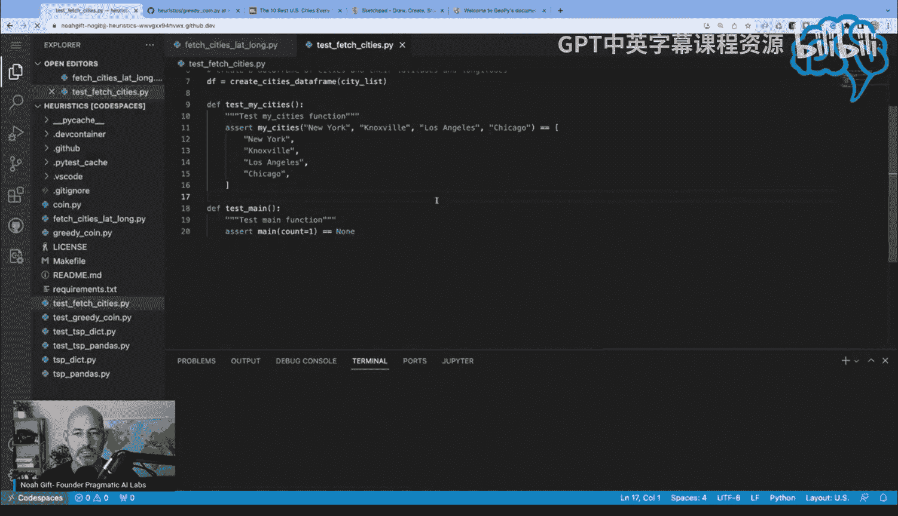

Cooking。Right here。I can go to actions and see the whole project building， there you go。Right。

 and I think I have a status badge。 but let me just double check， copy。Do I have a status bad。

 If I don't， I'll put one in。 Yep， I already have one in there。 So next week。

 I'll pick some other meta heuristic or。Or， or。Bistic week2， TBbD， TBb。All， thanks for who showed up。

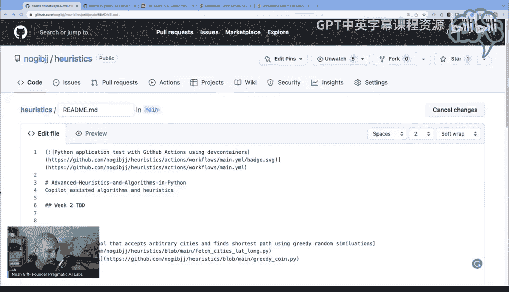

