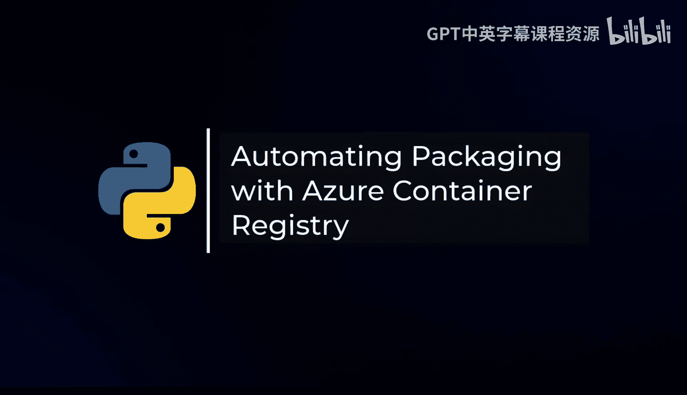
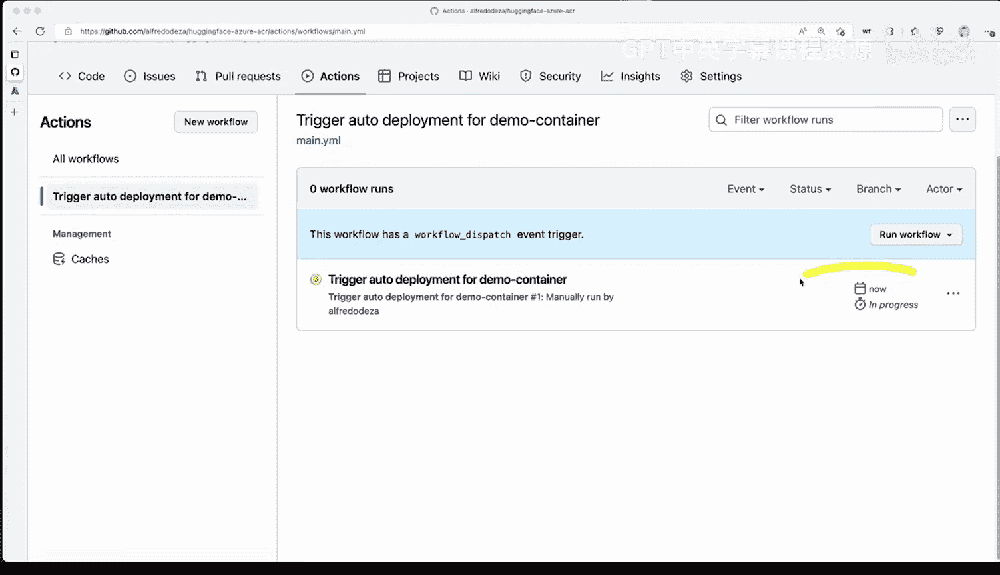
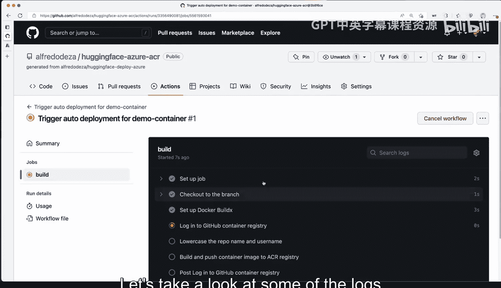
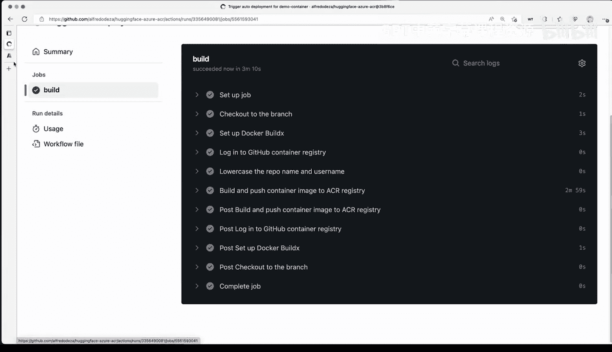
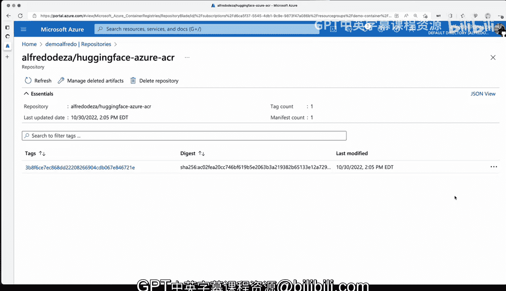

# 杜克大学｜机器学习运维｜DevOps⧸DataOps、Azure、MLFlow和抱脸｜MLOps ｜ Machine Learning Operations p180 39_03_04_通过Azure容器注册表实现自动化打包.zh_en -BV1yE421c7uA_p180-

嗯。Let's automate the packaging with the Azure container registry that we were able to create before in order to automate that。

 well let's take a look again at the workflow file here。

 which is the Yal file and we'll need to make some changes to this the false that already have so you can see here that I have this login to Github container registry I am going to be using in the Azure container registry。

 So this will need to get updated。 and then the other thing that we'll need to update is this tags so that it has the actual server from from the container registry that we created。

 Al right， so we're going to have to make those changes and then the other thing is I'm going to have to use the username password from the container registry those are going to be secrets I'm going to have to update those so now that we know what the things are that I need to update I'm going to go to。

Settings and create those secrets for my repository over here。 So I have secrets。

 I'm going say I want secrets for actions because this is what we need。

 and I'm going to click new repository secret。 This is going to be I'm going to prefix everything with AR。

 which is aure container registry。 I'm going to say username。

And then I'm going go back to the portal where I have this demo Alfredo registry。

 the registry name is demo Alfredo。 the username is demolfredo， Yes。

 I want to copy that and thenm to add it as a secret remember once you add it as a secret you don't have access to the plain text anymore and this will be part of a secret you can update it and delete it but not not read it back again。

 So one thing to be mindful about。 so I'm going to click add secret so perfect I have one ACR username then I have another one which is the AR password。

 So I'm gonna to see AR password。And then the password is going to be one of these two。

 let me pick the first one。 I'm going to copy that to the clipboard and I back to action secrets。

 I'm I paste that here， I'm going to add that secret and now I have these two secret so perfect so that that's good to know that this is now ready and set and now we can go and update our workflow file。

 so I'm going to go to the Github workflow directory and open the Yao file and go ahead and edit I can use right here the web interface to Li this is going to be pretty pretty straightforward。

 So these are some things that I'm not going to need right now because I'm not going to be doing a deployment I am just going to be doing the containerization and pushing out So if you remember I need to make sure that the regist is updated so let's take a look again back at the portal and that login is basically。

The login server， I'm going to copy that， go back to the Github actions。

 go to registry and make sure that these values is updated。

 So in this case it's demo like if we're using something else that will probably change and the username is going to be。

This is going to be secrets and this is going to be ACR username。

 Remember we were adding those as as the secrets in a repository。

 this is going to be secrets and this is not going to be token。

 This is going to be ACR underscore password。Next we're gonna take a look at the next step so that's lowercase the repo name that stays the same and then we're going to build and pushush to container to image to let's call it to to acr registry push is true That means that you have the option to actually not use anything in there and the tags are going to require this registry name again I'm going to copy that I'm going to put it over here I'm going to say that so demoredo that Azure Cr that Io and then it's going to go to the repository environment and the GiHubsha is going to be the file Docker file is fine that's exactly what I have already you've already the Docker file and I'm going to start a commit update main Yamo that sounds fine I'm going to commit the changes。

Al right， so changes have been committed and now what we need to do is actually we're double checking that our changes are there。

 we have username password and we have here the things that we need to do to tell Docker where it needs to push and now I'm going actually go ahead and trigger so I'm going to go to the action tab and you can see here that there's nothing on because there are no workflows run but our little workflow YaO has this thing the title over there trigger out of deployment and I want to run the workflow。

 this is what allows me to run it manually and when I click run the workflow and see what happens this is going to take a second to update and once that's done will come back here to take a look actually there we go was pretty fast but this will take you can see what's skewed now it's in progress this will take a second because it needs to build let's take a look at some of the logs and you can see it's login and authenticating and it's build。

The image， and then it'll push it。 But once it's done， we'll come back and see what the result is。

Allright so that completed and it took about a little bit over three minutes to complete and we were able to well be mindful that everything that you name in a step will be used here in the logs this is not post login into Gi container registry this is ACR and you can see here that the ACR registry change that we made that was being captured All right so that's great we've been able to post to the Azure container registry that means that if I go here back to this over and I do an overview I can say activity log I will be able to see that there's some operations there we go。

 you can see that that login credentials was used some operations were created well this is actually happening when with the subscription when we were creating this and we're creating or updating the container registry so that's。

That's pretty good， let's take a look at some of the things that we have here。

 we have repositories and we have the Alfredodesa Hugingface Azure ACR that actually came from using that automation we can have here we see the tags。

 last modified like well just a few minutes ago tag count manifest count one and this is actually coming from repository name is coming from the actual tag that we use so there you go that is how you use this automation to push containers to the Azure container registry。

