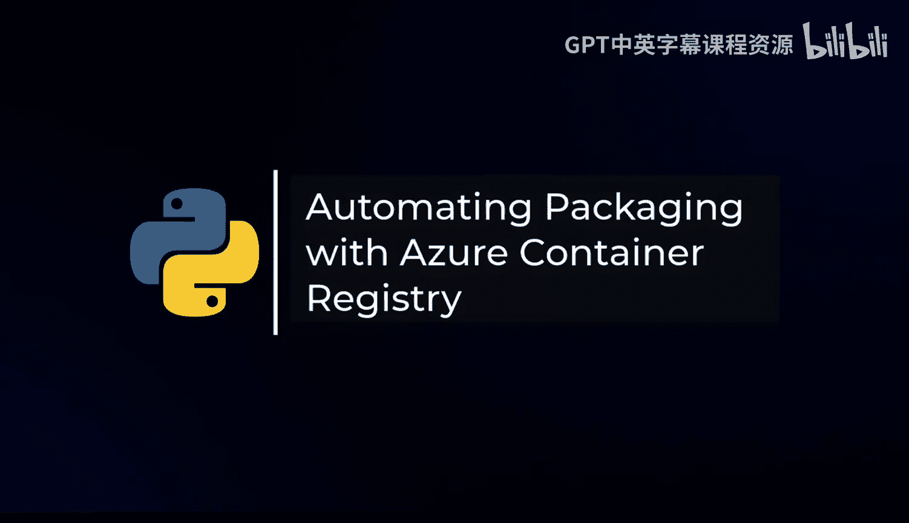
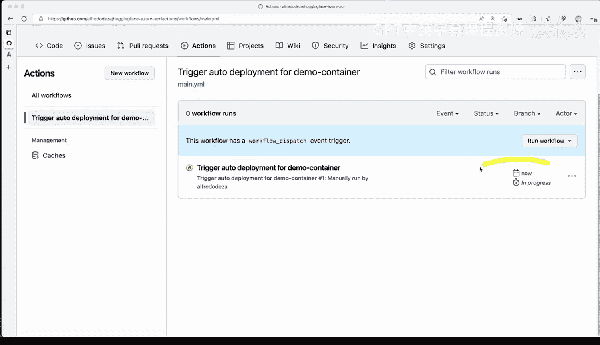
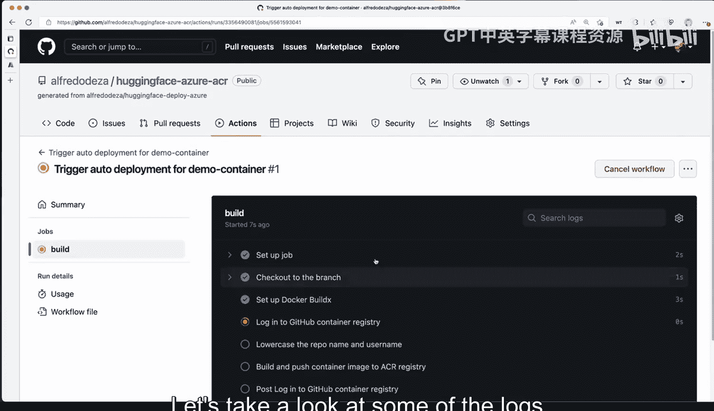
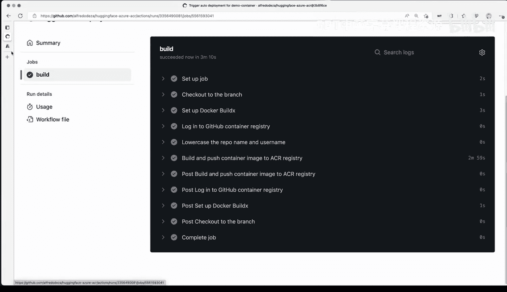
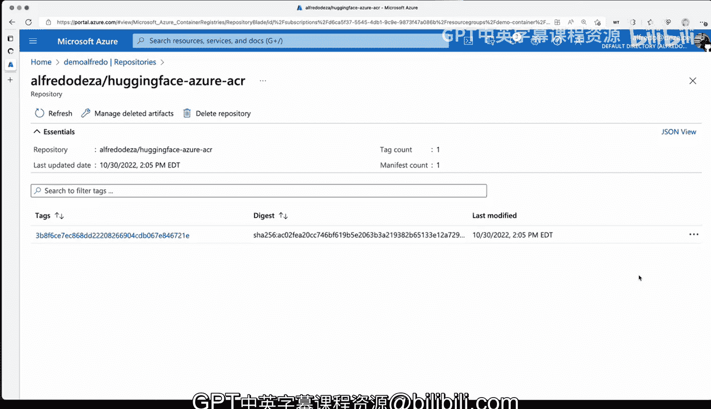

# 机器学习运维：第180课：通过Azure容器注册表实现自动化打包

在本节课中，我们将学习如何利用之前创建的Azure容器注册表，来自动化机器学习模型的打包和推送过程。我们将修改GitHub Actions工作流文件，配置必要的密钥，并最终将Docker镜像推送到Azure容器注册表。

## 准备工作与流程概述

首先，我们需要回顾并修改现有的GitHub Actions工作流文件。这是一个YAML文件，我们需要更新其中的容器注册表登录信息和镜像标签。

当前工作流中登录的是GitHub容器注册表，我们需要将其改为Azure容器注册表。同时，镜像标签也需要更新为我们创建的Azure容器注册表的服务器地址。

此外，我们需要使用Azure容器注册表的用户名和密码，这些将作为密钥存储在GitHub仓库中。

## 配置GitHub仓库密钥

现在，我们知道了需要更新的内容，接下来前往GitHub仓库的设置页面，为我们的仓库创建必要的密钥。

进入“Settings” -> “Secrets and variables” -> “Actions”。点击“New repository secret”来创建新密钥。

我们将为所有与Azure容器注册表相关的密钥添加“ACR_”前缀。首先创建用户名密钥。

1.  **密钥名称**：`ACR_USERNAME`
2.  **密钥值**：从Azure门户中，找到你的容器注册表（例如 `demoalfredo`），复制其用户名（例如 `demoalfredo`），并粘贴至此。

点击“Add secret”完成添加。请注意，一旦添加为密钥，你将无法再查看其明文内容，只能更新或删除。

接下来创建密码密钥。

1.  **密钥名称**：`ACR_PASSWORD`
2.  **密钥值**：从Azure门户的容器注册表设置中，复制访问密钥（例如两个密钥中的第一个），并粘贴至此。

再次点击“Add secret”。现在，我们已经成功配置了`ACR_USERNAME`和`ACR_PASSWORD`两个密钥，准备工作就绪。

## 更新GitHub Actions工作流文件

配置好密钥后，我们现在可以更新工作流文件了。进入仓库的`.github/workflows`目录，找到YAML文件并进行编辑。

我们主要关注构建和推送镜像的步骤，暂时不需要部署部分。需要更新的关键部分如下：

1.  **登录步骤**：将登录服务器从GitHub容器注册表改为Azure容器注册表。从Azure门户复制你的容器注册表登录服务器地址（例如 `demoalfredo.azurecr.io`）。
2.  **认证信息**：将用户名和密码的引用改为我们刚刚创建的GitHub密钥。
    *   用户名：`${{ secrets.ACR_USERNAME }}`
    *   密码：`${{ secrets.ACR_PASSWORD }}`
3.  **镜像标签**：在构建和推送步骤的`tags`部分，同样需要使用完整的Azure容器注册表地址作为前缀，例如 `demoalfredo.azurecr.io/your-repo-name:${{ github.sha }}`。

修改完成后，提交更改到主分支。

## 触发工作流并验证结果

提交更改后，我们可以手动触发工作流来测试自动化流程。进入仓库的“Actions”标签页，找到对应的工作流，点击“Run workflow”。

工作流开始运行后，你可以查看实时日志。它会依次执行登录认证、构建Docker镜像，最后将镜像推送到Azure容器注册表。

整个过程大约需要几分钟。完成后，日志会显示所有步骤成功执行，包括推送到ACR注册表。

## 在Azure门户中验证

最后，我们可以在Azure门户中验证推送是否成功。导航到你的Azure容器注册表资源。

1.  在“概述”或“活动日志”中，可以看到近期的推送操作记录。
2.  进入“仓库”部分，你应该能看到一个新创建的仓库，其名称来源于工作流中定义的镜像标签。
3.  点击该仓库，可以查看详细信息，如标签列表、最后修改时间等。你会看到刚刚通过自动化流程推送上去的镜像标签。

## 总结

本节课中，我们一起学习了如何实现基于Azure容器注册表的自动化打包流程。我们首先配置了GitHub仓库的密钥以安全地存储认证信息，然后修改了GitHub Actions工作流文件，将构建目标从GitHub容器注册表切换到Azure容器注册表，并更新了相应的登录和标签配置。最后，我们手动触发了工作流，成功地将Docker镜像自动构建并推送到了Azure容器注册表，并在Azure门户中验证了结果。这个过程是构建完整MLOps流水线中持续集成与交付环节的重要一步。