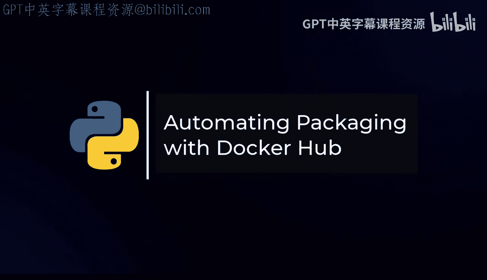
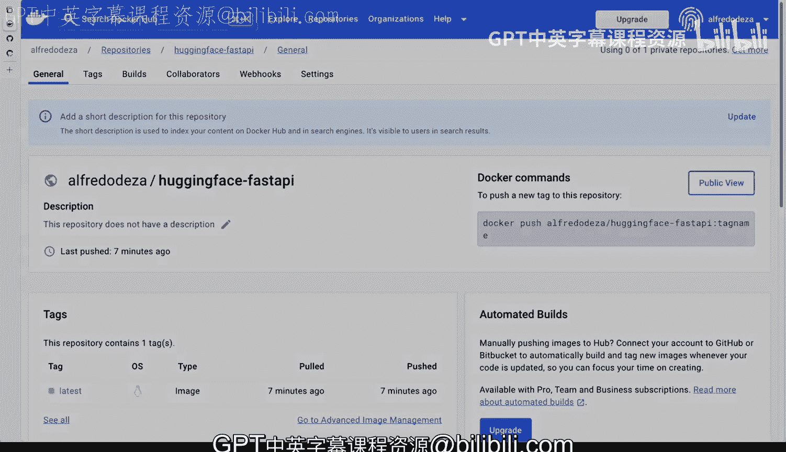

# 杜克大学｜机器学习运维｜DevOps⧸DataOps、Azure、MLFlow和抱脸｜MLOps ｜ Machine Learning Operations p181 40_03_05_通过Docker-Hub实现自动化打包.zh_en -BV1yE421c7uA_p181-

。

Let's take a look at how we can package our machine learning model with GiHub actions and push it to DockerHub so I have my repository here and in here we're going to take a look at the workflows that are going to be configured for what we want to try to do。

 let's see all of the components that are actually needed to make that happen so I'm going to go into the workflows directory under that GiHub and I'm going to open this CMO file so this is very very straight forward what we need to do is just define on when this is going to get triggered in this case anytime that I'm making a push to the main branch and you can configure this in any way you want we're not going to go dive into the details as to how all of these different options work on GiHub actions but we are also going to add the workflow。

patch always so that we can trigger this manual and you will see these triggering manual triggering later on in a few minutes alright so moving on we're going to bring down the project as well we're going to check out all of the components all of that code all of the files and we're going to use the Docker slash login dash action the version1 so this means that well use these provided by Docker and we it will allow us to essentially authenticate to Docker。

It requires using the username and password which I'll show you in a second how to do this essentially this is username and your access token Once that is done and you've successfully authenticated to Docker hubub you will be able to push the container to Docker hub in this case I want to actually build and push so I'll set the context I'll say that the Docker files the one at the root level and push true means that yes。

 in fact don't only build it， but also push it once you are done and the tag is going to be hugging face dash fast API latest great so now what are these things and and how do I get them well we go to hub that Docker do co I have that here if you are logged in you will see your repositories I can actually log out and so you can see this as well this is what you would get。

If you go to hubdocker。com then you would go and sign in as I was doing before and you would be able to see all of your repositories again al right so how do you get those tokens you will go to settings account settings right here and then you will go to security and then you will see that your access tokens are right here so some of these are auto generator。

 some of these are manual you would go go to new access token right there。

 click on that and create a token descriptions so you be given the description so say for example Github actions packaging for ML and then you would get generate access permissions read right and the sounds okay to me for the type of things that we want to do because we want to actually push that and then you will get something like like these these will allow you to paste these inside your Github actions so you need to grab that。

And make sure that that's available。Now you have this， you have your username or have your token。

 what you need to do is go back to your GiHub repository and you're going to go to you're going to go to settings。

And then in settings， you're going to we're going scroll down to secrets and variables and you're going to select actions。

 So I'm going to click on actions and you're going to add them right here with a new repository secret。

 You can see that I've already added Dockerhub access token and Dockerhub username So make sure that whatever you're adding here is exactly the same as the ones that we were seeing in the workflow。

 So again， if we go very quickly to check the code and we go to Github workflows and the Docker image those need to match these ones right here。

 So I know they match and I know they are already set and correctly done。

 So I'm going to go ahead and trigger that。 How do I trigger that， go to actions。

I select Docker image CI， which is the one workflow that I have。

 I click on that and then because I have workflow dispatch I'm gonna click on run workflow。

 I'm going click on run workflow and then that is going to take a second and then it's going to show up right right here once it's ready since and there we go it shows up now I'm going to click on this one which I had just run a few minutes ago and you can see it finished on two under under three minutes pretty fast in two minutes 18 seconds it was able to push no problem So if I go back to Docker hub and exit out of here。

And I go back to where I was before。 you will see that Hugingface dash fast API is right there。

 This is using the tag that I said on the Github action and you can see that the latest is appears right here coming up up seven minutes ago So once why the run complete。

 I'll get an updated version here so that is very quickly how we can set up and push to Dockerhub if you have an account and and do it with your hugging phase models。

