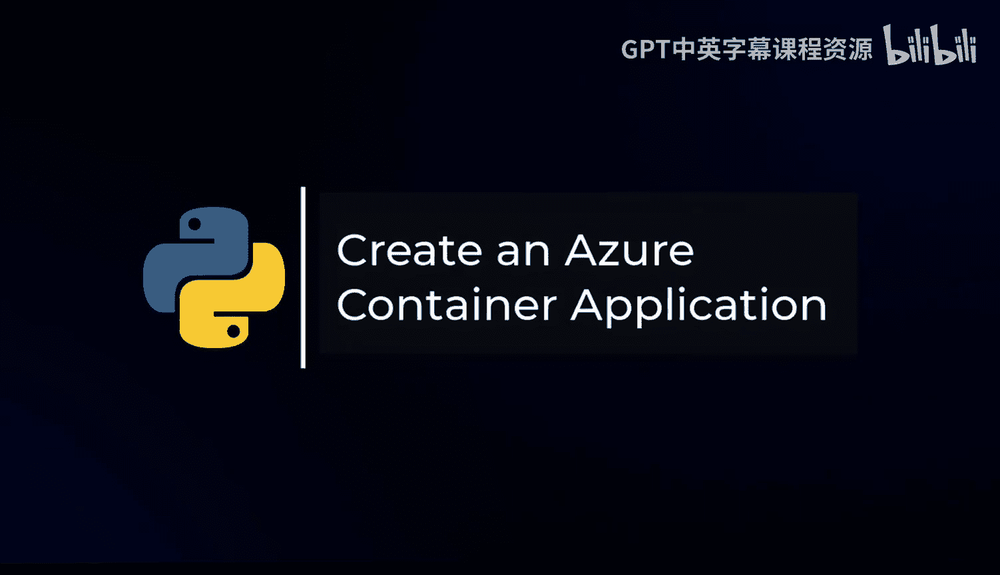
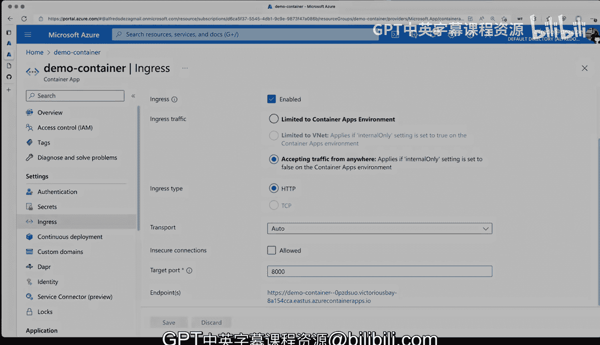

# 杜克大学｜机器学习运维｜DevOps⧸DataOps、Azure、MLFlow和抱脸｜MLOps ｜ Machine Learning Operations p182 41_04_02_创建Azure容器应用.zh_en -BV1yE421c7uA_p182-

Yeah。Now what are Azure container apps， it's the ability to have serverless infrastructure for your deployments。

 It allows you to deploy an actual container and nothing think about anything else and this is a very powerful way to deploy Hu phase models and in fact actually pretty much anything machine learning models wise and you will see that you have instant scale and the ability to to select different things when you're creating one。

 So I're gonna to go ahead and going to create a container application。

 which is the first step in order to try to deploy and then we'll go and try to try to go through the steps that will be needed in order to have deployment。

 So let's take a look at the process here when I create container app and I click this is going to load the subscription that's fine。

 the resource group we've been used。Uing one that is demo dash container and that will be great。

 That's exactly what we need。 The demo the container app name is pretty important because if if we choose something here whatever name we pick will be used for for our automation later and actually I want to show you here kind of like why is that important because here we will need to update these values。

 So the Azure container app name is demo container。

 the Azure group name also name the same these are optional not optional but options and these are variables actually So these values can be whatever you are using。

 So demo dash container is fine。 So if I go back here demo dash container is correct and container app name will have to be。

Will have to be something unique。 So if I was doing only demo， let's see well。

 that still works and that that's fine， but demo dash container sounds fine to me。

 I don't want I don't I understand why this is suggesting Canada central thats you know that's fine。

 I want E US and we will be doing review and create。And then this looks correct to me。

 And now will let's see accept in from anywhere on 48000。

 these are some of like the settings that we will be using。And this looks。

 this looks okay so I'm going to go ahead， let's actually take a quick look at some of the things that we have here。

All right， so we have， well， this a quick start image， let's take a look at a quick start image。

 a simple hellowork container that sounds fine。This all looks okay。 and the target port is 80。

 will'll be able to change those later。 Al right， so I'm going go click read and and then wait a second until it completes。

Alright， so this completed， so let's go to the resource here。

 I'm gonna to click go into the resource。 this has loaded。 this is fine。

 let's take a look at some of the different things that we have here so we have an application URL actually if I go there will have welcome to uszure containers which is the base or the basic example container is going to be used and we are going to be using some of some of those now you have the ability to pass in secrets set up continuous deployment and manage your app through revisions that's that looks pretty good we have monitoring as well so if there are any problems we can take a look there and then we can see what Ingress looks like。

And here we will will have the ability to map to map some of the ports now。

 remember if I go here to my tab remember that if I'm using Huging phase， the UBcorn actually fastpi。

 the UBcorn setting if I take a look at the Docker follow here we'll be using port 8000。

 so we we'll need to make sure that those are updated but this effectively allows us to have everything ready。

 so I'm going to make that tiny change， I'm going make sure that this is port 8000 on the target port and thats the Inggress type HttP for now。

 accepting tracking from anywhere that looks okay and I'm going click save and and then that's it。

 this is going to update an Ingress， and then that is going to be mapped when we do an actual deployment to Azure。

All right， update ingress has been completed and there you go。

 this is how you create a container app and then we'll go and proceed to see how we can automate and push something so that this is working。

 serving our hugging phase with fast API model and application。

