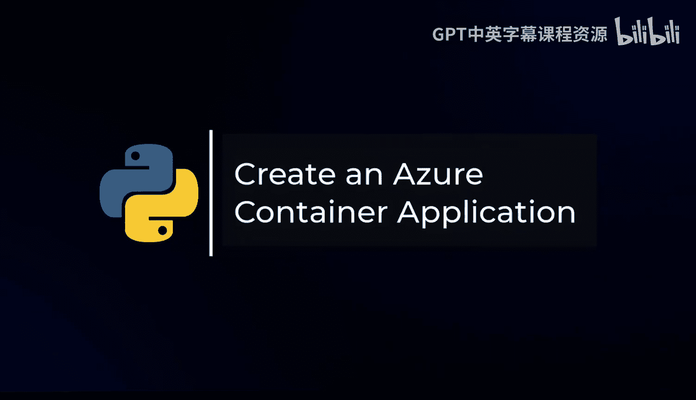
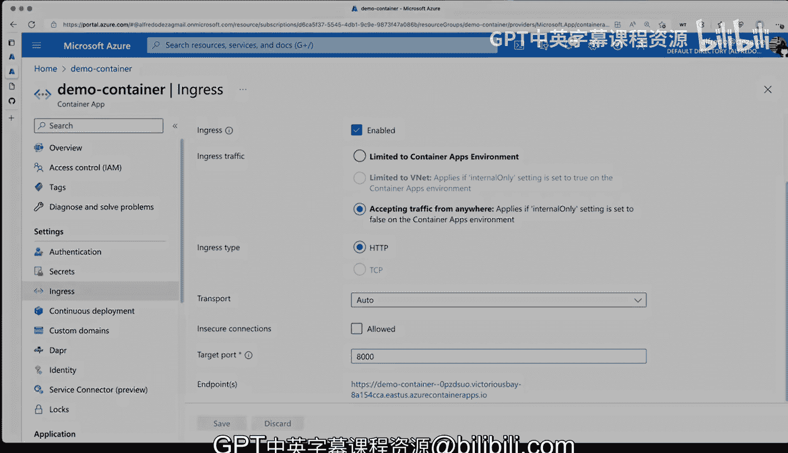

# 杜克大学｜机器学习运维｜MLOps：第41章：创建Azure容器应用

## 概述
在本节课中，我们将学习如何在Azure平台上创建一个容器应用。Azure容器应用提供了一种无服务器的基础设施，使我们能够轻松部署容器化应用，而无需管理底层服务器。这对于部署机器学习模型，特别是基于Hugging Face和FastAPI的模型，是一种非常强大的方式。我们将逐步完成创建过程，并了解如何配置关键设置。

## 什么是Azure容器应用？
Azure容器应用的核心是提供无服务器部署能力。这意味着你可以部署一个实际的容器，而无需考虑任何其他基础设施问题。这种方式特别适合部署机器学习模型，因为它能提供即时扩展能力，并在创建时允许你选择不同的配置选项。

## 创建容器应用
现在，我们将开始创建容器应用。这是尝试部署模型的第一步，之后我们将逐步完成部署所需的其他步骤。

以下是创建Azure容器应用的具体步骤：

1.  **选择订阅和资源组**：首先，系统会加载你的Azure订阅。我们将使用一个名为 `demo-container` 的资源组，这符合我们的需求。
2.  **命名容器应用**：容器应用的名称非常重要，因为我们后续的自动化流程会用到这个名称。例如，我们将其命名为 `demo-container`。资源组名称也与之相同。这些名称是变量，可以根据你的实际情况进行设置。
3.  **选择区域**：系统可能会建议一个区域（如加拿大中部），但我们可以选择其他区域，例如美国东部。
4.  **配置入口设置**：在创建过程中，我们需要配置入口设置。默认设置允许从任何地方通过端口80访问。但根据我们的Dockerfile配置，应用实际运行在端口8000上，因此后续需要更新此设置。
5.  **使用快速启动镜像**：初始创建时，系统会使用一个简单的“Hello World”容器镜像作为快速启动示例。
6.  **审查并创建**：确认所有配置无误后，点击“审查并创建”按钮，等待部署完成。

## 配置与验证
创建完成后，我们需要进入资源页面进行验证和进一步配置。

上一节我们介绍了创建过程，本节中我们来看看如何配置和验证已创建的应用。

1.  **访问应用URL**：在资源概览页面，你可以找到一个应用URL。点击该URL，如果看到“Welcome to Azure Containers”的页面，说明基础示例容器正在运行。
2.  **管理功能**：在容器应用的管理界面，你可以设置密钥、配置持续部署，并通过修订版管理你的应用。同时，监控功能可以帮助你排查问题。
3.  **更新入口端口**：由于我们的Hugging Face FastAPI应用使用Uvicorn运行在端口8000，我们必须更新入口的目标端口。将目标端口从默认的80更改为8000，并确保入口类型为HTTP，允许从任何地方访问。
4.  **保存更改**：完成端口更改后，点击保存。系统将更新入口配置，为后续的实际部署做好准备。

## 总结
本节课中，我们一起学习了如何在Azure上创建和配置一个容器应用。我们了解了Azure容器应用的无服务器特性，逐步完成了从选择资源组、命名应用到配置入口端口的关键步骤。现在，我们已经拥有了一个可以运行容器化应用的基础环境。在接下来的课程中，我们将学习如何自动化部署流程，将我们的Hugging Face FastAPI模型应用推送到这个容器中并使其正常运行。