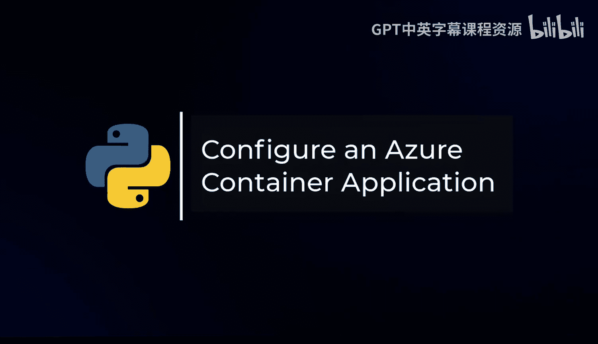
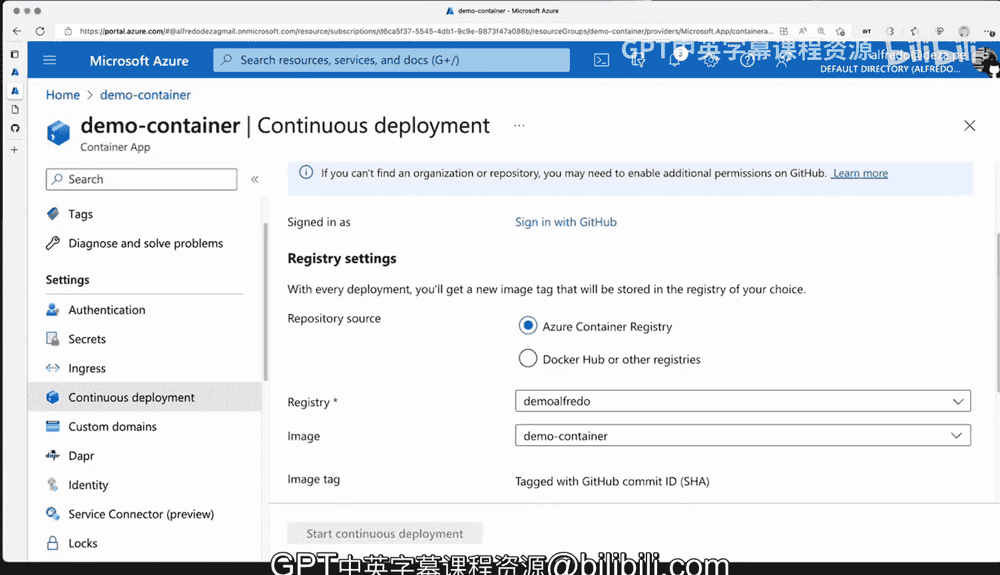

# 杜克大学｜机器学习运维｜DevOps⧸DataOps、Azure、MLFlow和抱脸｜MLOps ｜ Machine Learning Operations p183 42_04_03_配置Azure容器应用.zh_en -BV1yE421c7uA_p183-

After creating your container app there are a couple of things that you will need to make sure that are set first is the ability to ensure and triple check and we've already gone through this but triple check that that Ingress let's take a look at this is well first of all that it is of course enabled that Ingress traffic is accepting traffic from anywhere you can also say you know limited to container apps environment so anything behind the firewall behind the firewall and Azure Ingress type HttP is fine for now remember we don't have SSL enabled and I'm going to scroll through here and transport these auto that's fine and insecure connections are we can be allowed or disallow but specifically you know we've already changed this to port 8000 make sure that this is set and map correctly to the exact port that you're going to be using I know UBCn uses port 8000 so that's why。

I went ahead and did it。 I made that change before。 The other thing is that。For the type of model。

 for the type of service that we want， we have a thing here in our application that we need to make sure is changed。

 that is in the containers side of things here in the application so let's take a quick look and see what happens there。

Allright so I've clicked containers and the container here is well I basically can choose whatever I want。

 but in here you can see some of the simple hellowork container where is it coming from what's the name well in this case is coming from Azure container registry azure Docs you know that's fine and then we can we can go here and see that in this case the container resource allocation has a quarter of a CPU core and only half a gig of RA that is tiny that is barely barely enough to get this container up and running we will need to make some changes here so that when we're deploying hugging face and the fast API application we will be able to make changes here and actually be able to load so you have to go through the edit and deploy and we're not going to deploy right now but we're going。

Do make some edits here on the performance on these containers。

 So I'm going to click on this simple hello word1。And I'm going to go and say I want to these are some of the basics and here going to scroll and I want to say that this is going to need。

 let me see the maximum is two cores if I do three。

 you know it won won't let me and half a gig is not enough， so I'm going to save four gigs。

 I'm going to save that。And then you can take a look at scale and this is the scale rule setting。

 This is great because it can go through minimum of 0， a maximum of 10。

 it can be you know it can be more， you know it can be 30 I think0 to 10 is fine and that that sounds pretty good and then you go to to create now we don't need to change this right this second but whenever we are this is to create and deploy a new a new revision。

 but when we're done pushing our image， we'll need to come here and change this and I'll show you how that works。

 but these are things that well need to do anyway ways and you need to be aware where these options are next time we're deploying I'll go and change this very fast and not go into deep explanation All right so we've gone through a couple of the things here that you will need to know containers on what the scale is and how that looks。

And you can see here that you can make that change regardless on the scale scale rules and you can make those change there as well。

 so it actually takes you there。 it's kind of confusing because it takes you there to the same to the same thing now if you want to set up authentication if you have some models that you don't want to have completely open in the while then you would add that here we're not going to set that up right now finally you have continuous deployment which allows you to signing with GiHub and update GiHub for you so that it sets up the options that you want so here you can see here the demore is already setting the registry in the images demo container we're not going be doing that because we're already have everything ready to to deploy so we're gonna skip these for now and then head over to do the automation on the next on the next lesson。

