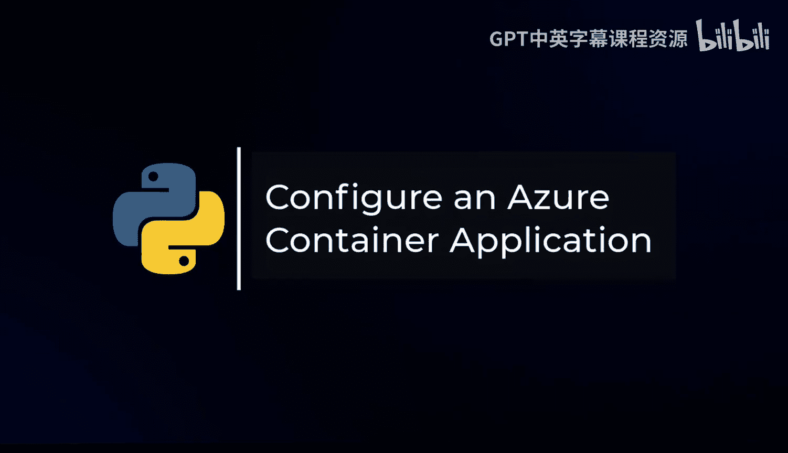
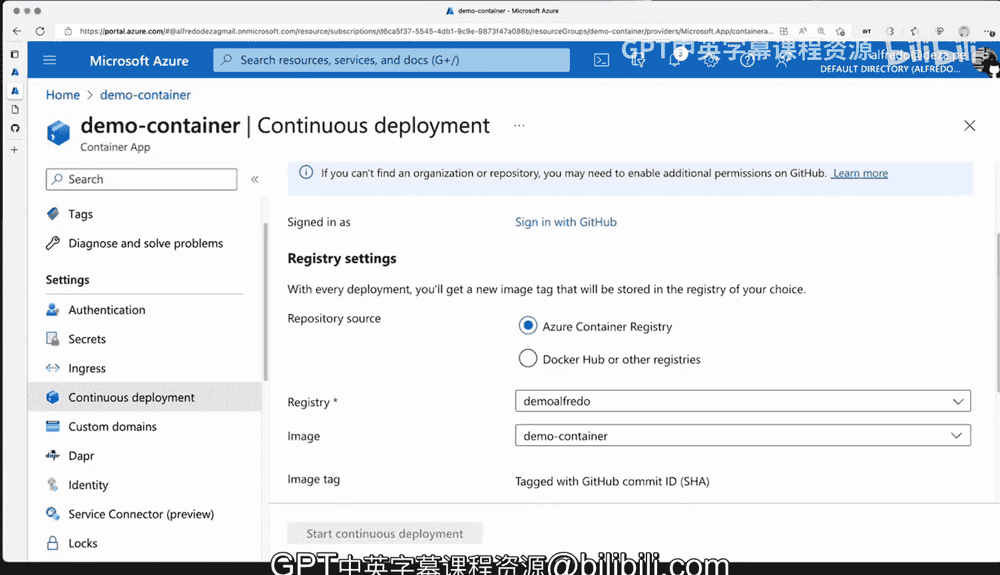

# 机器学习运维：04：配置Azure容器应用



## 概述
在本节课中，我们将学习如何配置Azure容器应用，以确保其能够顺利运行机器学习模型服务。我们将重点关注入口设置、容器资源配置和自动扩展规则。

---

## 入口流量配置

上一节我们创建了容器应用，现在需要确保其入口配置正确。

以下是入口配置的关键检查点：

*   **启用入口**：确认入口功能已开启。
*   **流量来源**：设置为接受来自任何地方的流量，或限制为容器应用环境内部（防火墙后）。
*   **入口类型**：目前选择 **HTTP** 即可，因为我们尚未启用SSL。
*   **目标端口**：必须正确映射到应用实际使用的端口。例如，我们的应用使用端口 **8000**。

---

## 容器资源配置

入口配置完成后，我们需要调整容器的计算资源，以确保应用有足够能力运行。

在容器设置中，默认配置可能仅为 **0.25个CPU核心** 和 **0.5GB内存**。这对于运行Hugging Face和FastAPI应用来说通常不够。

我们需要编辑容器配置：

1.  点击容器进行编辑。
2.  将CPU核心数提升至最大值 **2个**。
3.  将内存增加至 **4GB**。

```yaml
# 容器资源配置示例
resources:
  cpu: 2
  memory: 4Gi
```

---

## 设置自动扩展规则

资源配置完成后，我们需要设置自动扩展规则，以应对不同的负载。

在“扩展”设置中，我们可以定义容器的副本数范围：

*   **最小副本数**：可设置为 **0**，以便在无流量时节省成本。
*   **最大副本数**：根据需求设置，例如 **10**。

此设置允许应用根据负载自动伸缩，在0到10个实例之间动态调整。

---

## 其他配置选项

除了核心配置，Azure容器应用还提供其他重要功能。

以下是两个可选但重要的配置项：

*   **身份验证**：如果模型API需要保护，可以在此处添加身份验证层，避免完全公开访问。
*   **持续部署**：此功能允许与GitHub集成，自动构建和部署新的容器镜像。当代码仓库更新时，容器应用会自动同步。

---



## 总结
本节课中，我们一起学习了配置Azure容器应用的三个关键步骤：正确设置入口流量、调整容器计算资源以满足应用需求，以及配置自动扩展规则以实现弹性伸缩。理解这些配置项是确保机器学习服务稳定、高效运行的基础。在下一课中，我们将进行自动化部署。