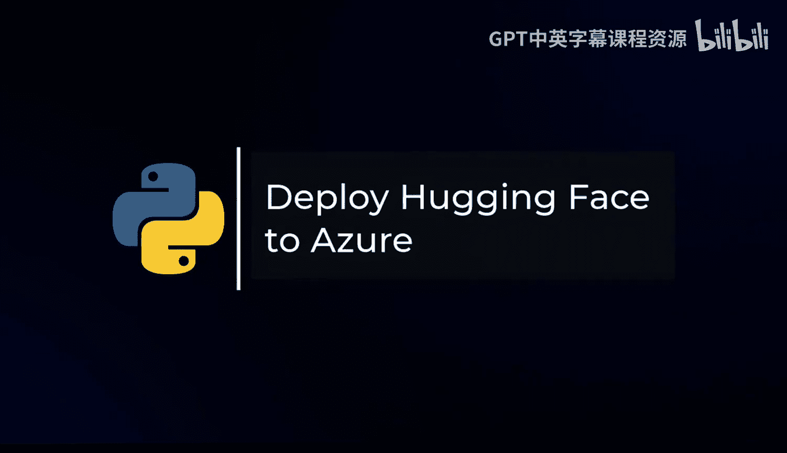
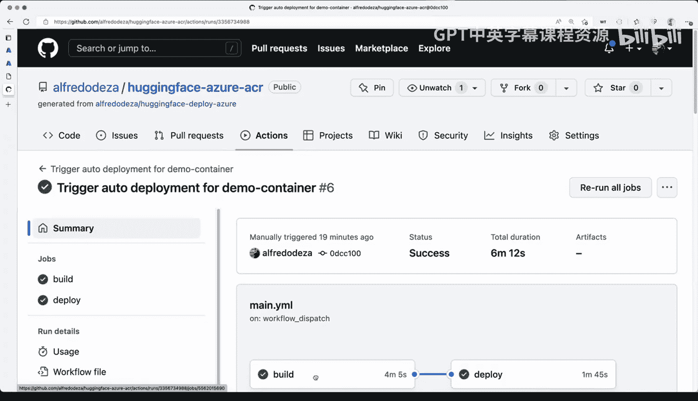
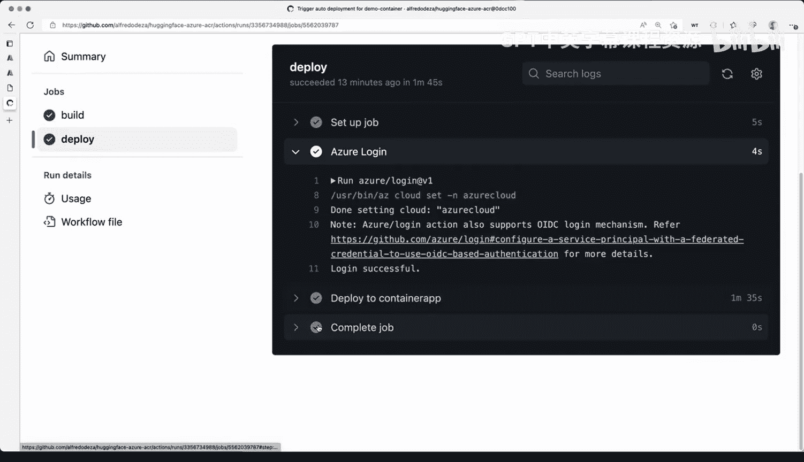
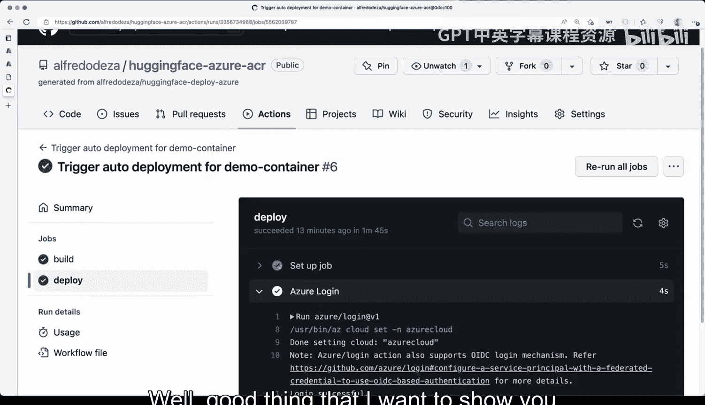
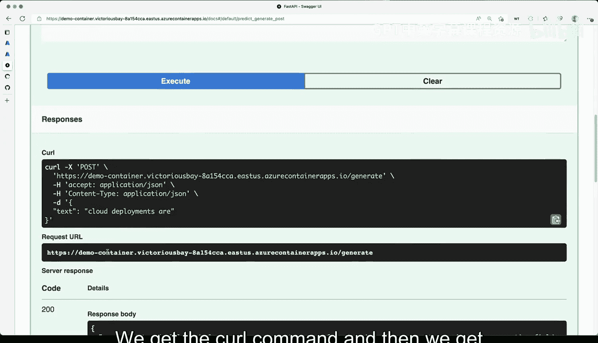
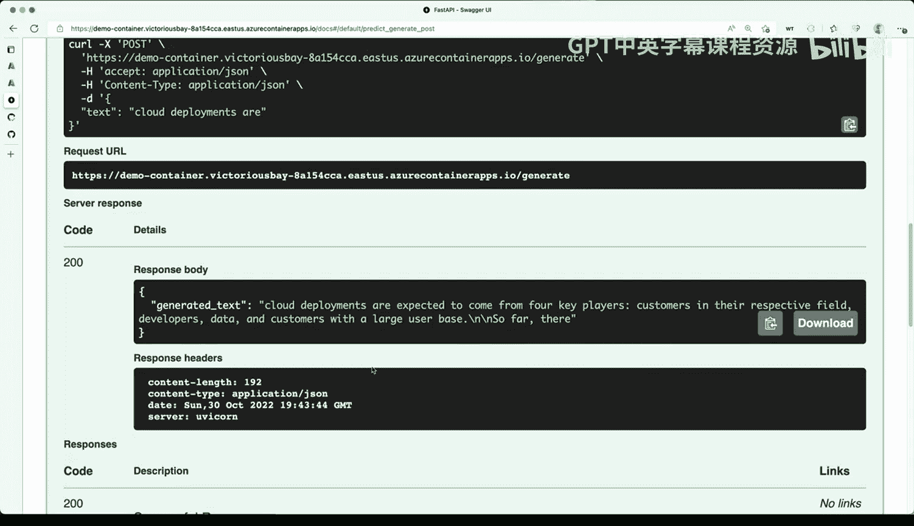
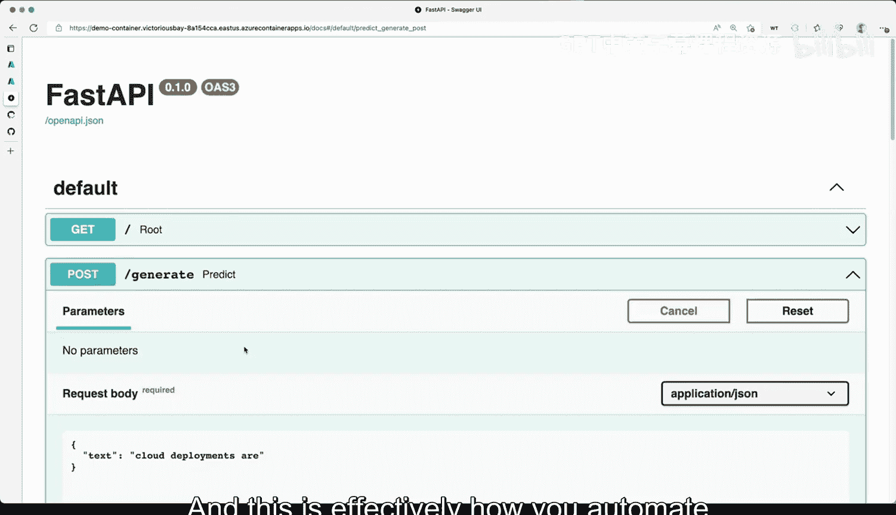
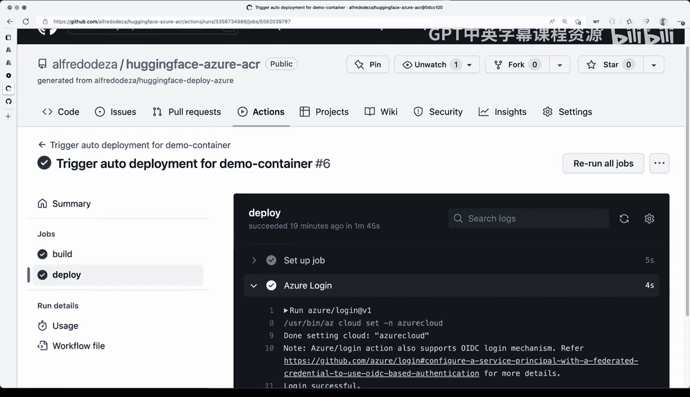

# 杜克大学｜机器学习运维｜DevOps⧸DataOps、Azure、MLFlow和抱脸｜MLOps ｜ Machine Learning Operations p184 43_04_04_将Hugging-Face部署至Azure.zh_en -BV1yE421c7uA_p184-

Now we're ready to deploy our hugging phase application or hugging face containerized application。

To Azure， we have several things in place， but there are a couple more things that we're going to need to complete these full automation。

 I'm going scroll here down on this repository。 We're not going to necessarily need a personal access token from Github because we are not going to be using Github container registry。

 This is something that you would use If you were using container a container registry and Github。

 We are going to be using。Azure container registry itself。

 so don't pay attention to the generator pad。 we are going to need an Azure service principle and then we're going to be doing that once we capture that output of running this command is we're going to be able to add it as a secret with Azure credential so what you need to do is run these command and you need to be very aware of the Azure subscription ID it is something that you'll have to be able to follow it and find it like actually with these links。

 but it is something that is everywhere you go on the portal the Azure subscription I will be there so you run that command and you capture that output and it will be Jason so let's take this step by step I'm going to scroll all the way up here go to settings then go to secrets once again click secrets then going to click action。

And then here we're going to have these three ones。

 We've already seen the Azure container registry password， the username。

 but now we're gonna to add the Azure underscore credentials and that is so that we can authenticate to Azure and tell Azure hey。

 we have a new image it's been built you need to publish it and get that deployment update Alright so once you have that we're going to go back to the actions so that we can see what are some of the things that we need to change so Github workflows and I made a couple of changes already I'm going go to the main that Yao is the only workflow the only Yamo file and then I'm going to scroll all the way down。

And I should have been able to update these but I didn't and I hardcoded them。

 This is just something to keep in mind I forgot to update those over there。

 but let's walk through kind of like the process here that we're gonna be following to make this happen So first as you know and we've already done a little bit of this we're going to set up the Docker build。

 we're going to log into actually Azure container registry you can see here that we tried before using the Github container registry but it uses the same action so I forgot to mention here that we're going to be using Azure that's the name that doesn't matter。

 you can say anything it's just a string to identify what's happening here this is important part the registry is demolfredo Azure Azure CRo Azure container registry I that's the address weve use before the ACR and the score username。

And the password which was generated when we created that。

 we're going to make sure that the name is lowercased and then we're going to build。

 we're going to build and push container to acr registry now you can see here that the tags is very important because I'm using demo that Azure Cr that Io which is exactly where we need to push and otherwise this wouldn't be able to understand if you're missing this part。

 which is something that is pretty crucial， what will happen is Docker behind the scenes we assume that you're pushing to the Docker hub and in this case we're not pushing to the Docker hub we're pushing to the Azure container registry All right。

 so once all of that building is done is going to push that to the container registry then we're going to authenticate to Azure again and this is where the service principle credentials that Json output that is going to happen once you run that command is captured here as Azure underscore credentials that is。

How you're going to authenticate。 And then next， we're going to finally deploy to the container app。

 Now， I'm going to make this slightly， slightly bigger。 Let me see if I can do this。

I'm going to make this a little bigger actually let me go and do 175% because I want to cover some of these things I'm going to run here。

 So we're going to use the Azure CI action and that allows us to do some call sum Azure CI。

Commands using Github action。 So first， we're going to say that we are going to install the extensions automatically without a prompt。

 That allows us to ensure that the container app。Extension is going to be installed regardless if it's available or not。

 then we're going to say on that first line， I'm going to keep scrolling here on that first line we're going to say that while demo container is the name of our container that's also the group of the container and we're going to say that the server is demoredo that Azurecr。

o which does a container registry， then we're going to passing the username and password so we're setting those secrets。

 those authentication things that we Azure will need to know so this is effectively setting that on the Azure side of things then we're going to update so that we are using two CPUus and four gigs of Ram which is we're basically maxing out the container what Azure allows us for container applications and then we're going to do one last update and I hope you can see that here which is going to be that we're saying that what the image is and what。

specifically is and in this case， I'm using thelfredo that Azurecr that I owe s alfredodesa。

 which if you remember that's a registry that's a repo actually in the interface Azure AC is the repository that I used to build this and I actually actually name my container the same and finally that GiHub which is the commit where all of these action happened so those are all of the steps and for because I want to try to make this go a little bit faster I already went ahead and trigger these so I'm gonna go to actions and you can see I was able to trigger the auto deployment So basically go here and you run the workflow and manually and then that's fine so let's take a look at these last trigger auto deployment and you can see here that the bill took four minutes and the deployment took a minute in45 seconds let's take a quick look at the build。

which we've already seen before says the jobs says DockerBuildex。

 which have already explained that that's the environment for being able to build with Docker and then it builds the container and pushes it to the container registry so once that's done we go on the deployment which is something that you haven't seen yet which we've already seen before on the Yao but not actually as an actual deployment as an actual Github action item Github workflow that has run we authenticate it to aher logging and that we're perfectly and then we deploy to the container app and inside the container app all kinds of different outputs you can see here that the identity is already protected because we're using secrets and once that's done it completes the job So what does completing the job mean well a good thing that I want to show you here is I'm going open up a new tab I'm going to scroll all the way to the bottom so that you can see a couple of things that you need to make sure。

sure they you have an aphram， well some of these things are going to be covered next。

 but specifically I wanted to tell you how to tail the locks and it's this specific commander you want to run and I want to show you my terminal as I was deploying these。

Now this is my terminal and you can see here that the A container apps logs show name。

 demo container resource group， demo container follow。 That's the command that I need to do。

 I've already authenticated on the command line。 and this is what we will be looking in order to see what's going on。

 Now I ran it and this is effectively going and and showing me the output。

 Now we are seeing all of these funky characters here because thats color coded but whenever I'm running that container and the command line。

 it will go ahead and download remember Hiface downloads models dynamically so this is downloading the model and we're seeing the products here。

3304050%，6 I'm gonna scroll super fast here so I can call the way to the bottom and then once that's done then Ubiorn is telling us that it starts the process is waiting for application startup and then it starts and remember it's mapped to port 8000 you need to make sure that that port is mapped on。

Ingress on the container app。 Alright， so once it it completes。 well。

 I'm pretty sure this is already running， I can see that there's no logs， any more logs。

 and you can see here that there's some2 hundreds。 that's me trying out the application。

 So I'm going to change over to the browser and see how that looks All right on the browser I want to show you the Azure container application and some of the things that you should be looking at when this is completed。

 First， it might sound suspicious that this is still the simple hellowork container where well I didn't update that what I did is I overrote its values。

 you can see that the image source。 it's coming from the Azure container registry but that registry has changed。

 this is demoredo Azurecr that I owe which is exactly where what we created before and now the image is no longer that the full one is now hugging face dash Azure A and the image tag。

 Well， that's the latest shot。We created and over there and then the container resource allocation is now updated to use two CPU core and memory size of4 gigabytes Alright so those are two things that I wanted to show you there but one thing that I wanted to show you additionally is that this is now deployed in demo dash container and you can see here there's a shot identifier is US that Azure container apps IO that's that's effectively the application running in the cloud so now let's try it out I'm going to go to s docs。

And that's going to load the swagger， the fast API swagger implementation of open API。 All right。

 so these loaded and we can play around a little bit with the open API。

 we're gonna effectively try it out before releasing how to do this and when to say cloud deploying give it a prompt cloud deployments R and then when I execute this so that we can do some text generation。

 it's going to execute it's going to talk to that model。 All right， that took a second。

 we get the curl command and then we get the request URL and then generate a text these cloud appointment are expected to come from our key players custom respective field developers data and customers with large user surveys All so that seems pretty okay and this is effectively how you automate specifically with Github actions deploying how you face to Azure using the Azure container registertry you can use any registry you want。

 but you will have to remember to update the required settings in order to。

perly authenticated pullo from those sources of truth。

 those sources of where you container will be leaving。

