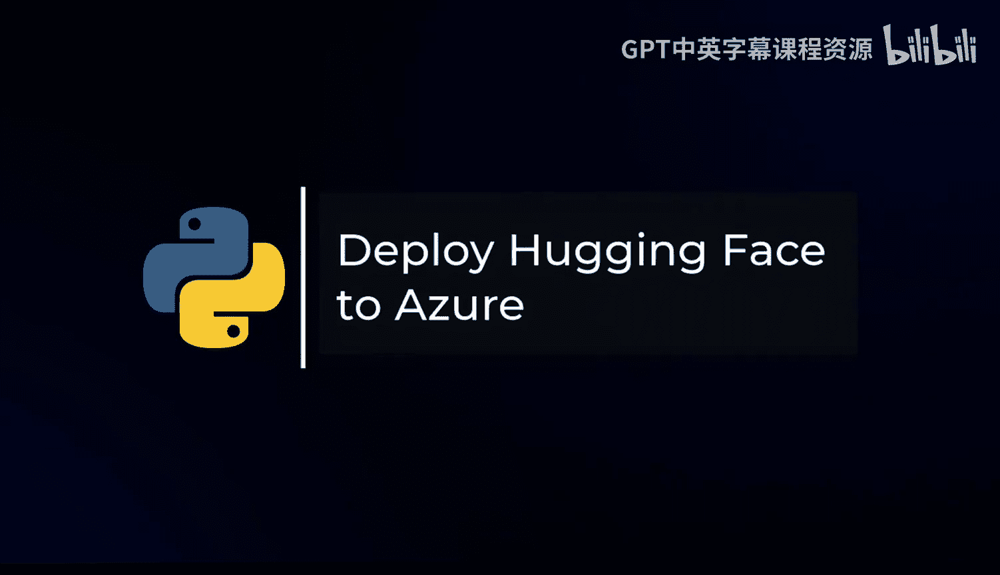
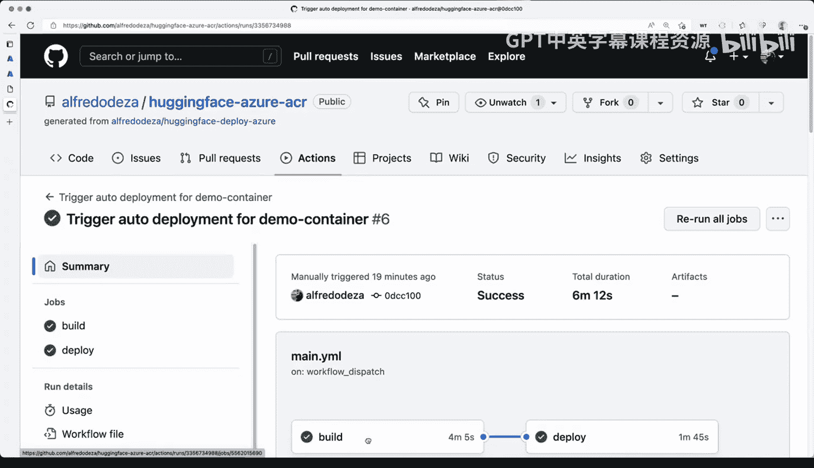
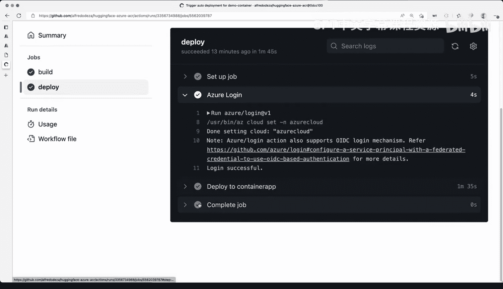
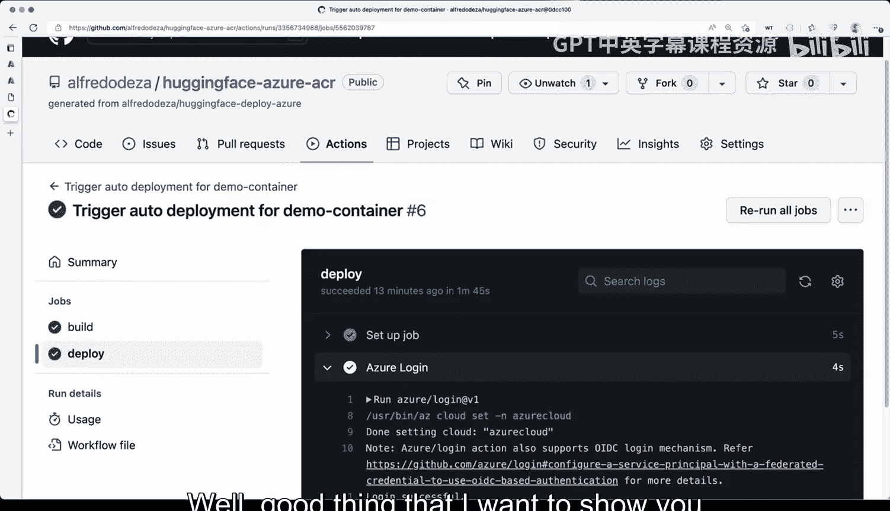
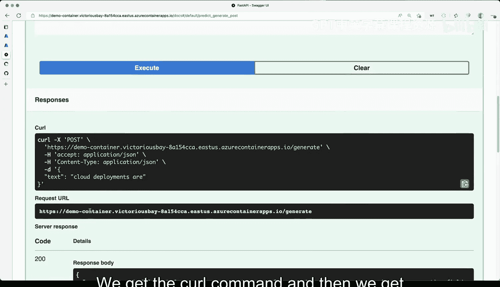
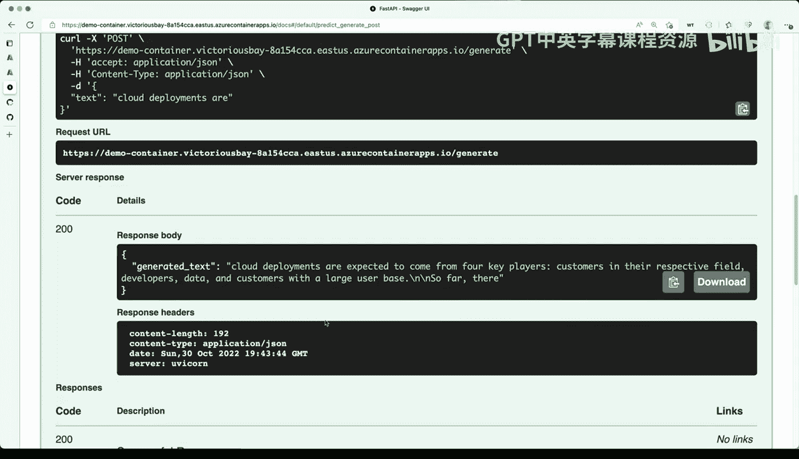
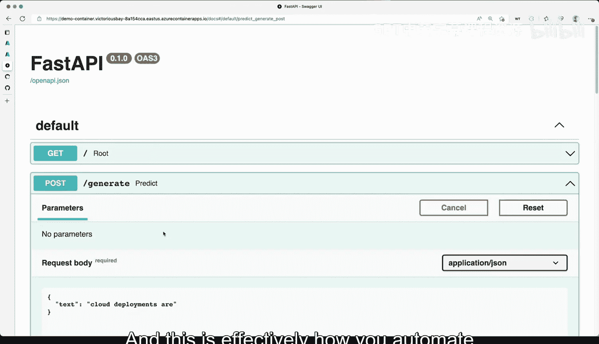
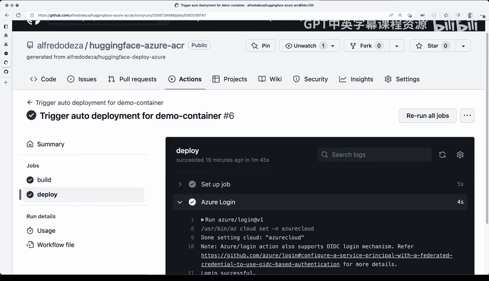

# 机器学习运维：04：将Hugging Face模型部署至Azure ☁️



在本教程中，我们将学习如何将一个容器化的Hugging Face应用，通过GitHub Actions工作流，全自动地部署到Azure容器应用服务中。我们将涵盖从设置必要的认证密钥，到配置自动化构建和部署流水线的完整过程。

---

## 准备工作与认证设置 🔑

上一节我们介绍了项目的基本结构，本节中我们来看看部署前需要完成的准备工作，主要是设置Azure的认证信息。

我们需要创建一个Azure服务主体，用于在GitHub Actions工作流中认证Azure。运行以下命令（请将`<your-subscription-id>`替换为你的Azure订阅ID）：

```bash
az ad sp create-for-rbac --name myMLServicePrincipal --role contributor --scopes /subscriptions/<your-subscription-id> --sdk-auth
```

命令执行后会输出一段JSON格式的凭据信息。请完整复制这段输出。

接下来，我们需要在GitHub仓库中设置密钥。
1.  进入GitHub仓库的 **Settings** 页面。
2.  在左侧边栏选择 **Secrets and variables** > **Actions**。
3.  点击 **New repository secret** 按钮。
4.  创建一个名为 `AZURE_CREDENTIALS` 的密钥，并将上一步复制的JSON内容粘贴为值。

此外，我们还需要设置Azure容器注册表的用户名和密码密钥，分别命名为 `ACR_USERNAME` 和 `ACR_PASSWORD`。

---

## 配置GitHub Actions工作流 ⚙️

完成认证设置后，我们来配置自动化的构建与部署工作流。工作流定义在 `.github/workflows/main.yml` 文件中。

以下是工作流的核心步骤：



1.  **构建Docker镜像**：工作流会基于项目中的Dockerfile构建一个新的容器镜像。
2.  **登录并推送至Azure容器注册表**：使用之前设置的 `ACR_USERNAME` 和 `ACR_PASSWORD` 密钥，将构建好的镜像推送到指定的Azure容器注册表。**关键点**：在构建命令中，必须明确指定注册表的地址（例如 `demo.azurecr.io`），否则Docker会默认推送到Docker Hub。
    ```yaml
    - name: Build and push container image to registry
      uses: docker/build-push-action@v2
      with:
        push: true
        tags: demo.azurecr.io/huggingface-azure:latest
    ```
3.  **认证Azure**：使用 `AZURE_CREDENTIALS` 密钥进行Azure CLI认证，为后续部署操作授权。
4.  **部署到Azure容器应用**：使用 `azure/CLI` 动作执行Azure CLI命令，更新Azure容器应用的配置，使其使用最新推送的镜像。

在部署步骤中，我们通过Azure CLI命令来更新容器应用。主要操作包括：
- 确保已安装容器应用CLI扩展。
- 为容器应用配置从ACR拉取镜像的凭据。
- 更新容器的资源分配（例如，设置为2个CPU核心和4GB内存）。
- 最终，将容器应用的镜像更新为我们刚推送的新版本。





---

## 执行部署与验证 ✅

配置完成后，我们可以在GitHub仓库的 **Actions** 标签页手动触发工作流运行。

工作流执行分为两个主要任务：
- **Docker构建任务**：耗时约数分钟，完成镜像的构建和推送。
- **部署任务**：耗时约1-2分钟，完成Azure容器应用的更新。

部署过程中，我们可以通过Azure CLI在终端实时查看容器日志，以监控应用启动状态：
```bash
az containerapp logs show --name demo-container --resource-group demo-container --follow
```
日志会显示模型下载、服务启动（例如在8000端口监听）等过程。

部署成功后，我们可以在Azure门户中验证：
1.  进入容器应用资源，确认 **镜像源** 已更新为我们ACR中的新镜像。
2.  确认 **容器资源配置** 已按工作流中的设置更新（如2 CPU， 4GB内存）。

最后，我们可以通过容器应用提供的公开URL（格式为 `https://<app-name>.<region>.azurecontainerapps.io`）访问已部署的Hugging Face模型API，并使用Swagger UI界面进行测试，例如输入提示词“cloud deployments”来生成文本，验证服务是否正常运行。

---

## 总结 📝









本节课中我们一起学习了将Hugging Face模型部署到Azure的完整自动化流程。我们首先设置了Azure服务主体和容器注册表的认证密钥，然后配置了GitHub Actions工作流来自动完成镜像构建、推送至ACR以及更新Azure容器应用。通过这个流程，我们可以实现代码推送后自动触发模型服务的重新部署，从而建立起一个高效的机器学习运维流水线。