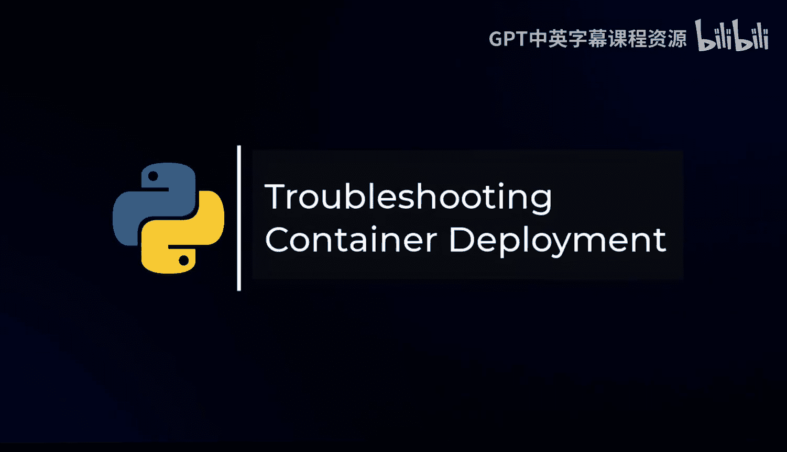
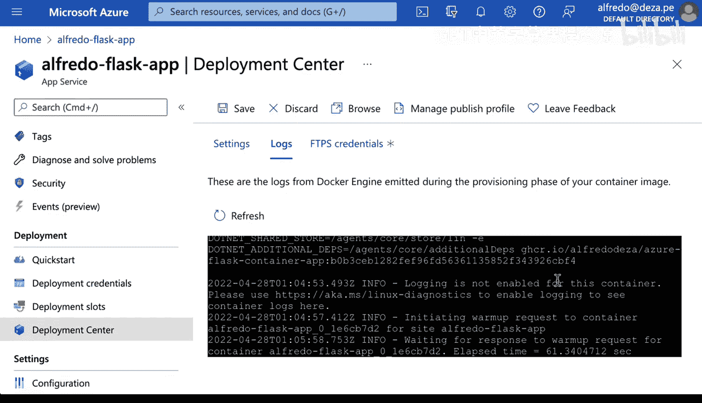
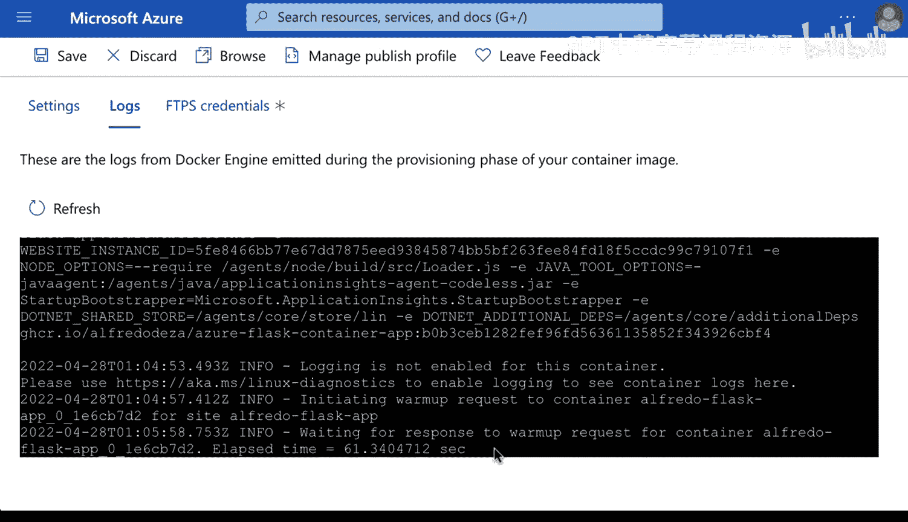

# 杜克大学｜机器学习运维｜DevOps⧸DataOps、Azure、MLFlow和抱脸｜MLOps ｜ Machine Learning Operations p185 44_04_05_容器部署故障排查.zh_en -BV1yE421c7uA_p185-

So now we've dealt with a broken container it doesn't start but what happens if you have the incorrect port well let's make that change again we're going to clean these up。

 make that syntax error go away and change the port to something else I'm going to remove this syntax error so it doesn't bother us anymore and here I'm going to put say port 8000 and I'm going to commit those changes and say setting。

U40000。And then commit those changes and what this is going to do is as you know we have automation now it's going to build this container。

 push it to the GiHub container registry， and then it's going to tell Azure that it needs to pull this new container and try to run it up again so let's click on this one you will see that it's built in a container that's going to take a few seconds。

 hopefully not too long and then it will go back and deployed so let's just wait a minute until this setting up for  a000 commit gets built and deployed and push to Azure。

Okay， so our action was successfully completed。It gives us the URLs。

 I'm going to click on that and what's going to happen。 I'm going to click this。

 we'll just stay there loading nothing， nothing seems to happen。 So what you need to do is again。

 go back to。The portal。You get here。And you need to go back to the deployment center， click on that。

 and then check the logs。😔，And let's make this a little bit bigger。

 There we go and you will see that is waiting， waiting for response to warm up for a container。

 it's been waiting there for 61 seconds， so that that's not good。

That's not good and you can see here something interesting Do run port 80。

So this is crucial right here and nothing is telling you that you have the wrong port so when it will happen is that this will stay there for a while。

 it will try to load that and it will eventually time out once it times out it will tell you but all this time you will be waiting and seeing trying to see if there's anything anything going on so you definitely want to check thats there's a smaller threshold there to check for the port so you might want to have a test or something that prevents changes like this happening now for the problems with the syntax error。

I was scrolling all the way back， and I was able to see here in the logs that were captured that the syntax error I'm going to go all the way up。

scroll pretty fast and I scroll almost all the way to the top and you can see here that we have the syntax error that I introduced before。

 so it does end up showing in the logs。 It's just somehow pretty hard to catch。

 but if you go through and pour through all of the logs you will be able to see it Now if I go all the way to the bottom you will see that it's still waiting for the response because you can't get any responses from port 80 So you now have a couple of things that can go wrong wrong port and and wrong or in ball code like a syntax error that breaks your container when it tries to start and it gets to Azure and it gets deployed。

 So so that's it those are two things that you need to watch out for。

