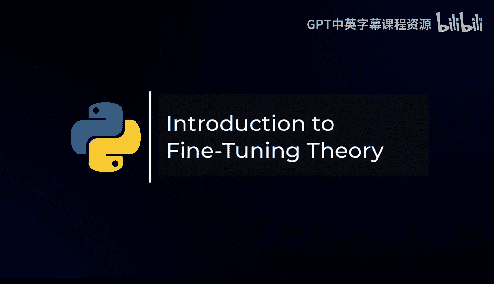
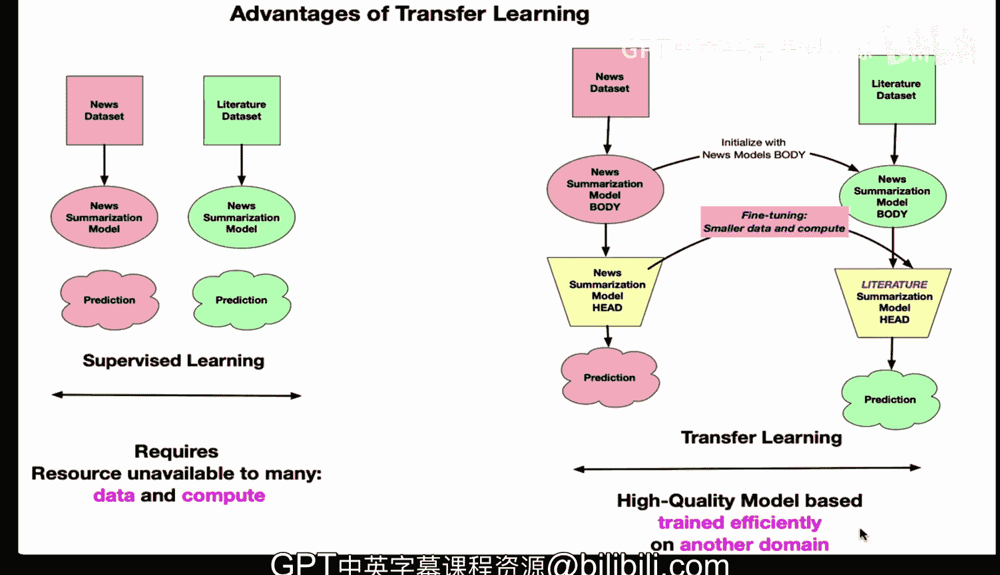

# 杜克大学｜机器学习运维｜DevOps⧸DataOps、Azure、MLFlow和抱脸｜MLOps ｜ Machine Learning Operations p186 45_04_02_微调理论入门.zh_en -BV1yE421c7uA_p186-

Let's take a look at some of the advantages of transfer learning as opposed to other types of machine learning。

 a very classic type of machine learning is supervised machine learning。

 many people have heard about it and it really is about taking historical data training a model on that historical data to then make a prediction like for example。

 the points for a player could it predict the salary that that player would make in the future that would be a classic supervised machine learning problem and in particular with NLP here。

 we can see here that you would have some news data you would go through and create a summarization model and then that could be trained on you lots of data and maybe the model would be a large language model so there would be billions of parameters and it would take a very expensive process to create a prediction。

And then if you have a different kind of NLP problem and you have a different domain in this case。

 there would be a literature data set， you'd have to do the same thing again and create a different kind of news summarization model。

 it also could be billions of parameters and be very expensive。

So the problem here is that for many people， many organizations。

 they don't have the data really the raw data to begin with and they also don't have the compute resources to do really this global scale type supervised machine learning Fortunatelyly this is where transfer learning comes in and really this is one of the advantages of the hugging phase platform is that you can take a news data set。

 for example， or some data that was trained in a particular domain and you can take the body of that model and you can actually replace the head in this case。

 the news summarization model head， you can fine tune it with a smaller amount of data and then serve out a prediction Similarlyly you could also fine tune something on a totally different domain so let's say this was trained on a news data you could take a literature data and again use the body which could have。

Billions of parameters inside of it and be trained by some of the top machine learning engineers in the world and machine learning researchers and then you would just take a little bit of new data creating an evaluation metric and then put the head of that particular fine tune job with some new data and then you would be able to serve out a prediction So the idea here is that you can create high quality models that are trained extremely efficiently and on another domain right so this is one of the key advantages of transfer learning and how it applies to the huggingface platform。

