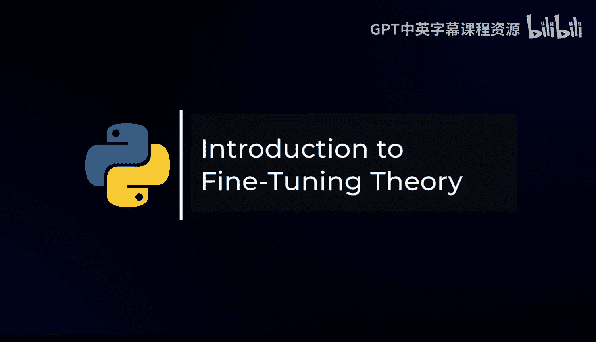
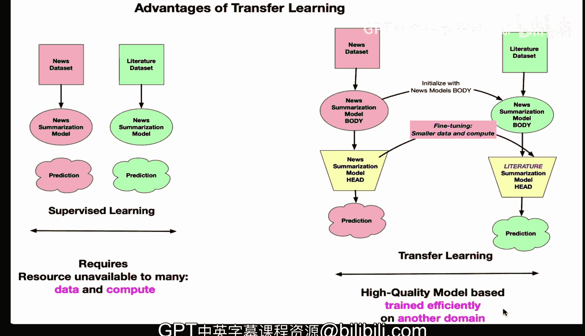

# 机器学习运维：45_04_02：微调理论入门 🎯

在本节课中，我们将探讨迁移学习相较于其他机器学习方法的优势，并解释其核心概念，特别是如何通过微调（Fine-tuning）来高效地创建高质量的模型。

---

## 迁移学习的优势

上一节我们介绍了机器学习的基本概念，本节中我们来看看迁移学习带来的独特优势。

一种非常经典的机器学习类型是监督式机器学习。许多人听说过它，其本质是利用历史数据训练一个模型，然后进行预测。例如，根据球员的数据点预测其未来的薪资，这就是一个经典的监督式机器学习问题。

在自然语言处理领域，你可以看到这样的例子：拥有一些新闻数据，通过处理并创建一个摘要模型。这个模型可能在大量数据上进行训练，可能是一个拥有数十亿参数的大语言模型，其创建过程会非常昂贵。

如果你遇到另一种NLP问题，并且属于不同的领域，例如一个文学数据集，你就必须重复上述过程，创建一个不同类型的新闻摘要模型。这个模型也可能有数十亿参数，并且非常昂贵。

这里的问题是，对于许多人或组织而言，他们既没有足够的原始数据作为起点，也没有计算资源来进行这种全球规模的监督式机器学习。

幸运的是，这正是迁移学习发挥作用的地方。这也是抱脸平台的优势之一：你可以获取一个在特定领域（例如新闻数据集）上训练过的模型，然后利用该模型的主体部分。你可以替换模型的“头部”，例如新闻摘要模型的头部，并用少量数据对其进行微调，从而得到一个可用的预测模型。

同样地，你也可以在一个完全不同的领域上对模型进行微调。假设一个模型是在新闻数据上训练的，你可以获取文学数据，再次利用其主体部分。这个主体可能包含数十亿参数，并由世界顶尖的机器学习工程师和研究人员训练而成。然后，你只需使用少量新数据，创建一个评估指标，并用这些新数据为该特定微调任务配置一个新的“头部”，之后你就能进行预测了。

因此，核心思想是：你可以创建高质量的模型，这些模型训练效率极高，并且能应用于另一个领域。这是迁移学习的关键优势之一，也是其在抱脸平台上应用的方式。

---

## 核心概念总结

本节课中我们一起学习了迁移学习，特别是微调的核心优势。我们了解到，与需要海量数据和计算资源的传统监督学习相比，迁移学习允许我们复用预训练模型（其主体部分），并仅用少量新数据和计算资源来微调其“头部”，从而高效地为新领域或新任务创建高质量的预测模型。这种方法极大地降低了机器学习的门槛和成本。