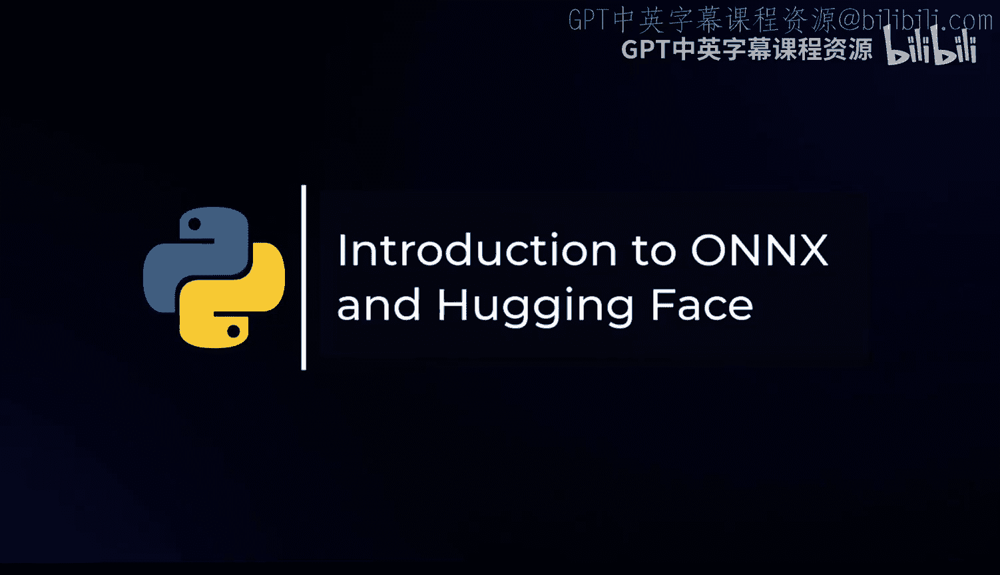
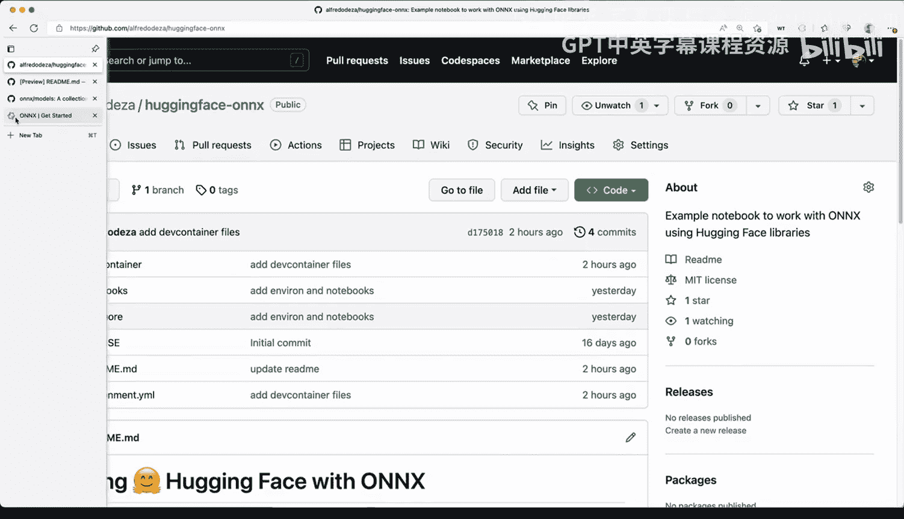
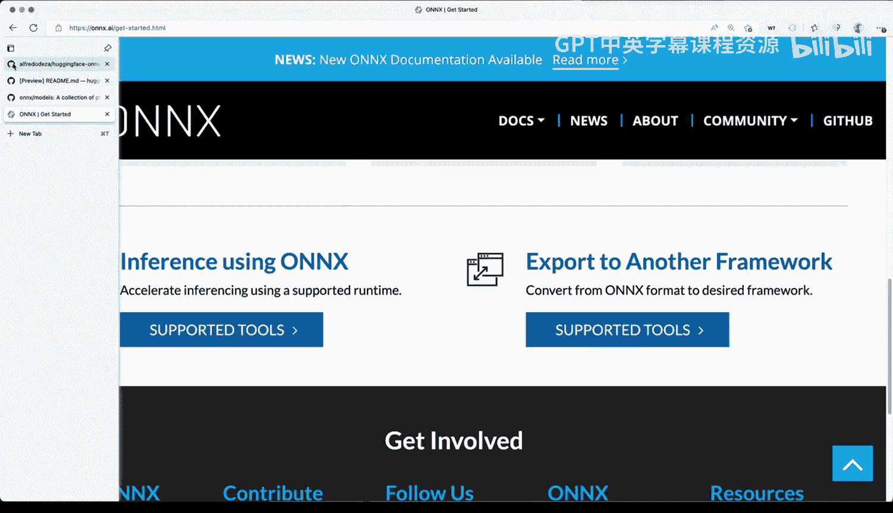
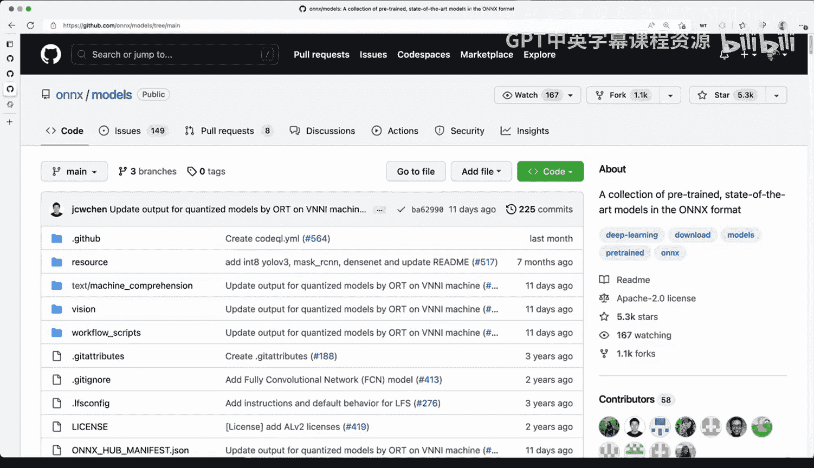

# 杜克大学｜机器学习运维｜DevOps⧸DataOps、Azure、MLFlow和抱脸｜MLOps ｜ Machine Learning Operations p188 47_04_04_ONNX与Hugging-Face介绍.zh_en -BV1yE421c7uA_p188-

Let's go through some of the concepts that you will need in order to work with hugging face andonyx andonys specifically I want to show you the main landing page here。

 the get started page because it has a couple of things that are useful to understand before we dive in into the details so first off is that you have the ability。

To work regardless of the framework that you're choosing to create a model or to work with model。

 you can export to a normalized or that is like an onx format now the Onx format will allow you to deploy to different types of architectures and regardless of where where that machine learning framework came from and then finally you'll have cloud services that work natively with the OnX format format so that you can interact with it and not specifically be tied to an actual framework now export to the OnX format is is specifically we're going to concentrate on today and we'll take a quick look at what the OnX model Sue is and we'll work a little bit with not specifically a reference tutorial but well be using hugging face which is what we've been covering Now inferencing using OnX and exporting to another framework are definitely things that I highly suggest。

You do and go through now let's take a look at the repository huggingface dash Onyx which I put together take very quick look at the environment。

 the Yamo file and see what are the dependencies you'll be working with All right so primarily the dependencies are Python 38 I'm going to be installing Pytorrch from the Pytorrch channel this is a Conda environment file that means that we'll be using Conda behind the scenes to work with these and we're going to of course install the huggingface transformformers library that has this special notation that the square brackets that say hey I'm going be working with Onyx that will pull in some extra dependencies they will be needing finally the Onx runtime and a couple of extra things for working with Jupiter notebook so pretty straightforward not many dependencies and this will get you up and running in in no time。

Next the other things that we need to do is well we're going to explore a little bit of the notebooks in this part。

 we're going to do the introductory portion of it so let's go quickly and run run this notebook with like include a notebook with Conda and install the penencies so that's going to be the introduction notebook right here so this is the readme this is the same repository and running new Vis Studio code here and we'm going to take a look at what is this about all right so。

The first thing that you need to make sure is that ensure that you are using the one the right interpreter here。

 I'm using the kernel that has the con base one that I just created and I make sure that con install all the dependencies so here have like a brief introduction this is again。

Kind of like what you will need to install with Conda like this already doesn't match exactly what you need to install so please refer to the environment。

 the Yal file that has everything you need to its going to be updated with exactly the things that you need to do All right so hugging face has the ability to work with configurations that are already ready to use without you having to figure out anything for some of the most like the top like the top models。

 the most popular models like part B open like GT2 and Roberta and T5 I mean these are highly popular。

 highly desirable models that you can work with so once you've installed all the dependencies you can make sure that everything works by executing the help menus so you can use the transformers that onx help that will give you essentially what you're using here。

I the onx portion of the libraries with the Transers' library so that you can start interacting with it so what you're going to be doing is and this way of running Python dashm is using the Onx module so transformers that onx as a command line tool so let's poke around a little bit of the help menu output here。

 this is the way that you verify that this has been installed and everything is ready to go so here you have the module and then you pass what features and we're going be looking at the features that are available offsets is the type of offset for Onyx and we won't be diving into that and you can see here you can export from Tensorflow or pytorch we're gonna to be using pytorrch by default and you have a little bit of extra settings here that we're not。

Go be touching either。 And then one thing that you're required to do is using the positional argument。

 the output and we'll see how that works。 and you can essentially name the onx model。

 the resulting onx model with anything any other name that you may want。 Alright。

 so scrolling down here primarily the thing that we want to know is what type of configuration we are going to be using。

 So here you can see that I'm importing from the models。

 I'm going to transformers that models Roberta I'm going to import Roberta config and Roberta onx config these come from the transformers library itself。

 Som running this code I'm going to be able to see that I do have a couple of different types of features these features。

 these configurations。Are available to you I can select one or the other and I can poke around what exactly is available for me from in this case that Roberta model all right so I do have a little bit of suggested reading here the Hu face transformer serial decision that's really good but essentially what I wanted to cover today are a couple of things basically how you get all of these appencies you installed。

 we used Onyx rather conda we made sure that theda the Conda kernel was selected。

 we were able to verify works we poked around some of the different different features and flags are going to be using and how is that going to work and'm going to see that in a different video but specifically the configuration was something really really crucial one last thing I want to show you is the model Su if you've never heard about a mouseu is the github。

 co onyx models its called the Onyx Su because。That is where people tend to store Orx Or writers tends to store some of the OnyX models so let's quickly go through here。

 so the Brime has a lot of information but these specifically I want to talk about machine comprehension so we look at that and we have GT2 Bquad。

 but I wanted to show you Roberta which I really like on a hides and use cases so we have depend penencies。

 the model， you have a description and you can even go ahead and download so you have Roberta basedase Roberta sequence classification so you can download these these are stored on Gitthub using LFS and it is you're able to go through a little bit of the details of the model so you can see here what Onx version is supported and the offset version so those are two crucial details you will need to understand for Onyx if you're going to be working with that so you have。

even a little bit of information on the preprocessing and the output and how what should be expected if you are going to be doing a little bit of working working with working with OnX so you can even see here that it's using Hoging F transformers already because the sequence classification and tokenizer are coming from there as well so whenever you're hearing。

 hey let's take a look at the OnX model Su， that means you are looking at OnX slash models。

 the GiHub organization and the models Gitub repository so that's it。

 those are the key consoles that you'll need to know in order to work with OnX and Hoging face。

