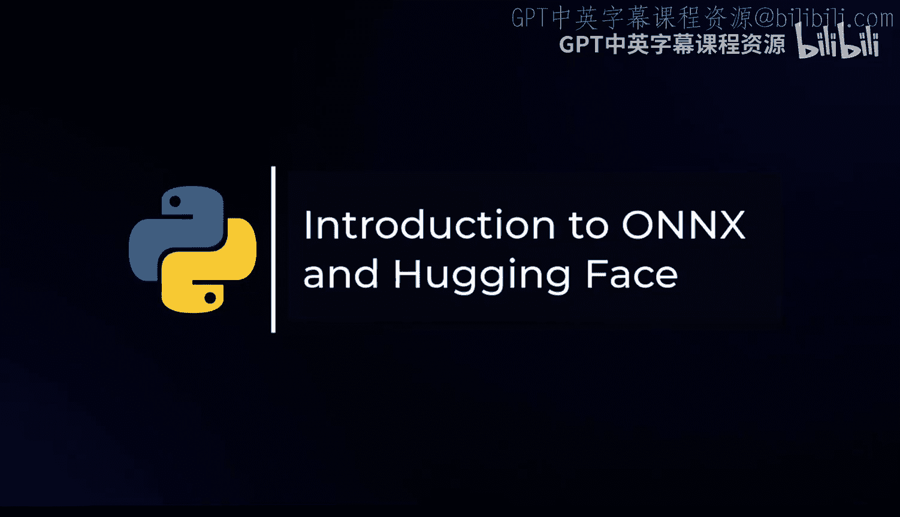
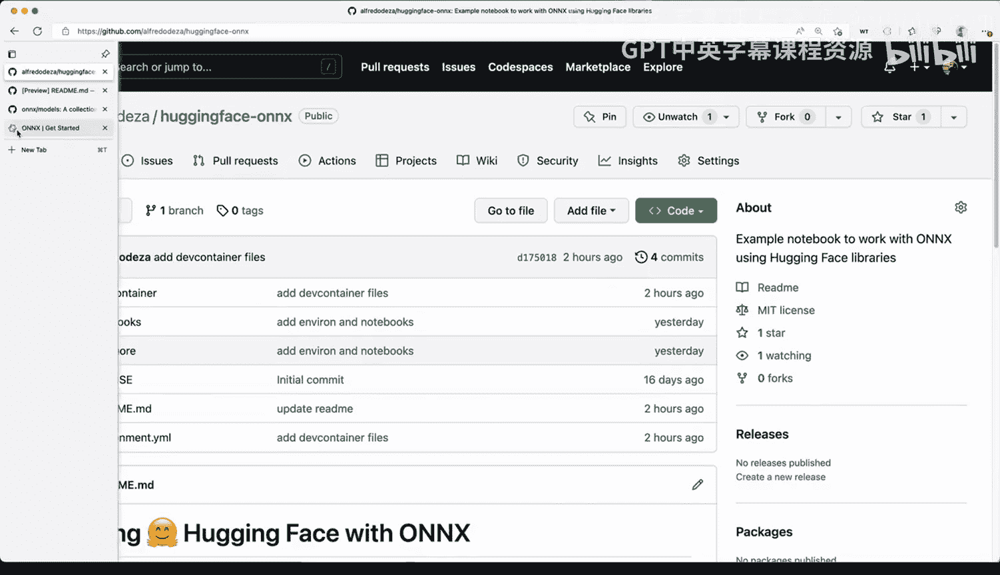
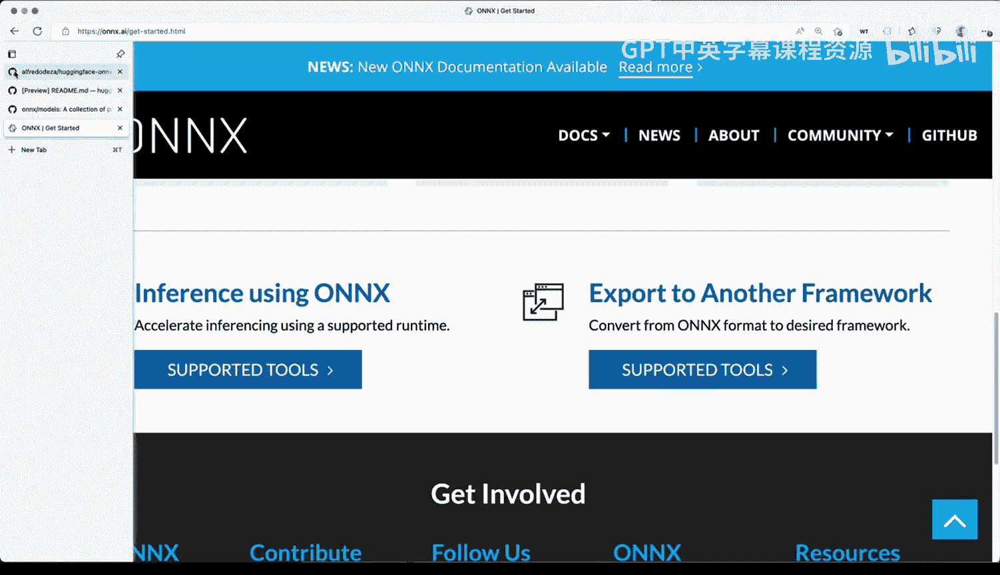
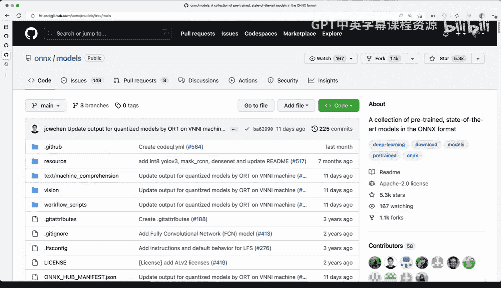

# 机器学习运维：04：ONNX与Hugging Face介绍 🧠

在本节课中，我们将学习ONNX（开放神经网络交换）格式以及如何将其与Hugging Face库结合使用。我们将了解ONNX如何实现跨框架的模型部署，并介绍开始使用所需的关键概念和工具。

## 概述

为了使用Hugging Face和ONNX，我们需要理解几个核心概念。首先，我们将查看ONNX的官方入门页面，它提供了在深入细节之前需要了解的有用信息。

无论你选择使用何种框架来创建或处理模型，你都可以将其导出为一种标准化的格式，即ONNX格式。ONNX格式允许你将模型部署到不同类型的架构上，而无需关心模型最初来自哪个机器学习框架。最后，许多云服务原生支持ONNX格式，这意味着你可以直接与之交互，而不必被绑定在某个特定的框架上。

今天我们将重点讨论如何导出到ONNX格式。我们会快速了解ONNX模型库，并主要使用我们一直在学习的Hugging Face进行实践。使用ONNX进行推理以及将模型导出到其他框架，是我强烈建议你学习和实践的内容。

## 环境设置与依赖

现在，让我们看一下我准备的 `huggingface-onyx` 代码仓库。快速浏览一下环境配置文件（YAML文件），了解我们将要使用的依赖项。

主要的依赖项包括：
*   **Python 3.8**
*   从PyTorch频道安装的 **PyTorch**
*   这是一个Conda环境文件，意味着我们将使用Conda来管理环境。
*   安装 **Hugging Face Transformers** 库，并带有特殊标记 `[onnx]`，这将拉取一些额外的依赖项。
*   最后是 **ONNX Runtime** 和一些用于Jupyter Notebook的额外工具。

依赖项相当简单，不多，这能让你快速上手运行。

## 探索入门笔记本

接下来，我们需要探索一下本部分的笔记本。我们将完成其入门部分。让我们快速运行这个笔记本，使用Conda安装依赖项。这就是这里的入门笔记本。

首先，你需要确保使用的是正确的解释器。我使用的是刚刚创建的Conda基础内核，并确保Conda安装了所有依赖项。

这里有一个简短的介绍，再次说明了你需要用Conda安装的内容。请注意，这可能不完全匹配你需要安装的所有东西，所以请参考包含所有必需项的环境YAML文件，它会更新为你需要做的确切步骤。

## 使用Hugging Face预配置模型

Hugging Face能够使用已经配置好、无需你额外设置的模型。对于一些最流行、最受欢迎的模型，如BERT、OpenAI GPT-2、RoBERTa和T5，你可以直接使用。

安装所有依赖项后，你可以通过执行帮助菜单来确保一切正常。你可以使用 `transformers.onnx` 的帮助命令，这将显示你正在使用的库的ONNX部分，以便你可以开始与之交互。

你将通过以下方式运行Python的 `-m` 模块：`transformers.onnx` 作为一个命令行工具。让我们稍微查看一下帮助菜单的输出。这是验证安装是否成功、一切是否就绪的方法。

这里你有模块，然后传递参数。我们将查看可用的功能。`opset` 是ONNX的操作集版本，我们不会深入讨论。你可以看到，你可以从TensorFlow或PyTorch导出，默认我们将使用PyTorch。这里还有一些额外的设置，我们也不会涉及。

你需要做的一件事是使用位置参数 `output`，我们稍后会看到它是如何工作的。你可以为生成的ONNX模型指定任何你想要的名称。

## 理解模型配置

向下滚动，我们主要想知道我们将使用哪种类型的配置。在这里，你可以看到我从 `transformers.models.roberta` 导入了 `RobertaConfig` 和 `RobertaOnnxConfig`。这些来自Transformers库本身。

运行这段代码，我将能够看到我有几种不同类型的功能配置可供选择。我可以选择其中一个，并查看RoBERTa模型中具体有哪些可用选项。

这里有一些建议阅读材料，Hugging Face Transformers的文档非常棒。但今天我想涵盖的主要内容基本上是：你如何获取所有这些依赖项、我们如何使用ONNX（更确切地说是Conda）、我们如何确保选择了正确的Conda内核、我们如何验证其工作、我们探索了将要使用的一些不同功能和标志及其工作原理。我将在另一个视频中详细展示，但具体来说，配置是非常关键的一环。

## ONNX模型库

最后，我想向你展示模型库。如果你从未听说过模型库，它位于GitHub上的 `onnx/models`，被称为ONNX模型库，因为这是人们通常存储ONNX模型的地方。

让我们快速浏览一下。仓库包含大量信息，但我特别想谈谈机器阅读理解。我们查看一下，那里有GPT-2、BERT on SQuAD，但我想展示我真的很喜欢和使用的RoBERTa。

这里有依赖项、模型描述，你甚至可以下载它们。这些模型使用Git LFS存储在GitHub上。你可以查看模型的详细信息，例如支持的ONNX版本和操作集版本。这是使用ONNX时需要理解的两个关键细节。

你甚至可以看到一些关于预处理、输出以及如果你要使用ONNX进行工作时期望结果的信息。你还可以看到它已经在使用Hugging Face Transformers，因为序列分类器和分词器也来自那里。

所以，每当你听到“让我们看看ONNX模型库”，这意味着你正在查看GitHub上的 `onnx/models` 组织和模型仓库。

## 总结

本节课中，我们一起学习了开始使用ONNX和Hugging Face所需的关键概念。我们了解了ONNX格式如何实现跨框架的模型互操作性，设置了包含必要依赖项（如PyTorch、Transformers[onnx]和ONNX Runtime）的Conda环境，并探索了如何通过命令行工具和预配置来使用Hugging Face的ONNX功能。最后，我们介绍了ONNX模型库作为查找和下载预转换ONNX模型的资源。掌握这些基础知识，将为你在实际项目中部署和优化机器学习模型打下坚实的基础。