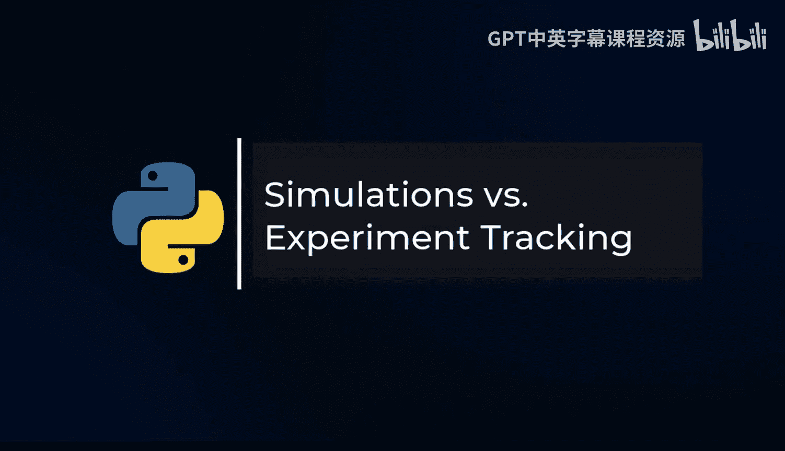
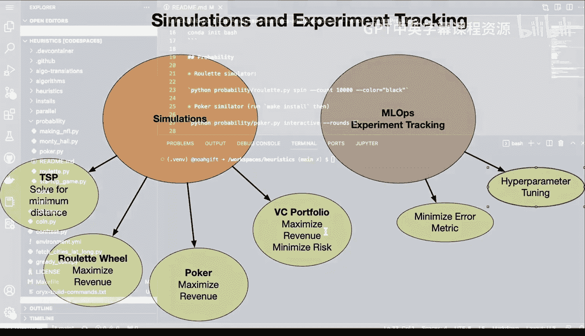
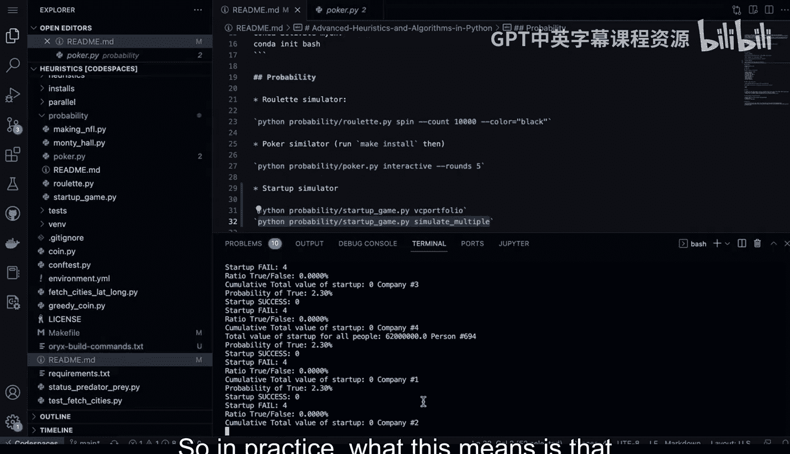
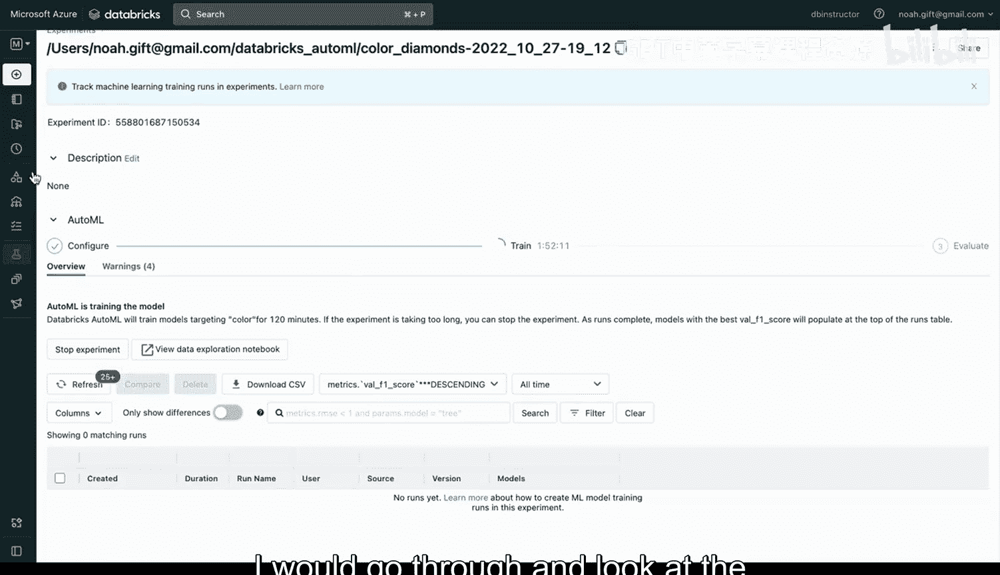
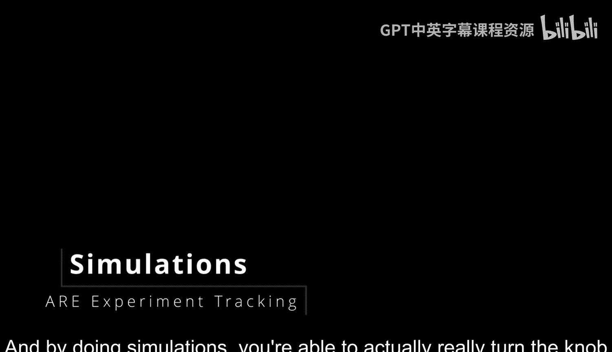
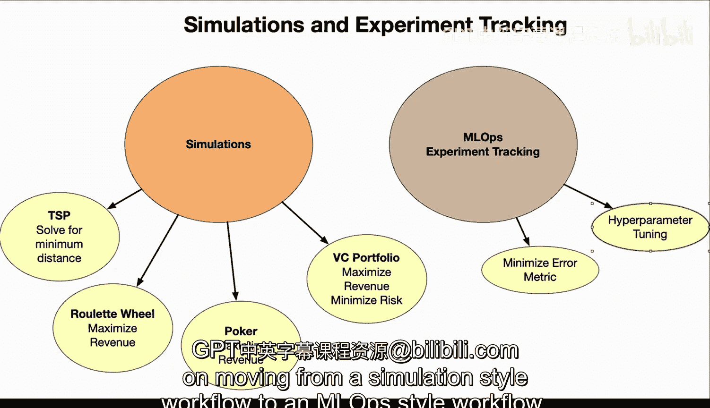

# 杜克大学｜机器学习运维｜DevOps⧸DataOps、Azure、MLFlow和抱脸｜MLOps ｜ Machine Learning Operations p19 26_02_03_仿真与实验追踪对比.zh_en -BV1yE421c7uA_p19-

Here we have a difference between simulations and MLlos experiment tracking。

 There are actually a lot of similarities。 If we take a look at a simulation like the traveling salesman problem。

 the idea is you run multiple times through， let's say。

 a greedy random start algorithm and you solve for the minimum distance。

 So what is the shortest amount of distance I would travel to to go to all the cities I need to travel Likewise with a roette wheel if you wanted to maximize revenue。

 you could create a bunch of simulations and see if there's a way to get a great outcome from a roette wheel。

 Well， as we know， there is no optimal outcome， but if you wanted to see it yourself you can actually go through here and figure out a simulation likewise。

 poker， you could build your own poker simulation to maximize revenue。

 or if you are looking for a start that you wanted to join。

 you'd see how the venture capital portfolios， maximize the revenue by minimum。Their risk。

 That's why they invest in 100 companies， and then they push all the risk to the startup employees。

Now， if you take a look at machine learning operations of experiment tracking。

 it's a very similar process。 You look through experiments。

 you want to minimize error across a bunch of different experiments or optimize for some metric you potentially want to do a bunch of hyperparameter tuning and see which one is the best tuning job。

 So the classic simulation and the MLop experiment tracking have a lot in common。

 Let's go ahead and take a look at both of those here I have a repository that has multiple simulations that I've created。

 The first one I want to take a look at is a roulette simulator。 This is kind of a fun one。

 If I wanted to simulate 10000 runs of a roulette wheel where I bet on the color black each time。

 what would happen， this is really a way to simulate the law of large numbers so you can see that in fact you don't have a great chance of winning。

😊。

If we go through here and we run this， you can see that I'm going to bet a dollar。

 and I'm going to select the color black。 and I'm gonna run tons and tons of simulations。

 and you can see these simulations。 I can even visualize everything that's happening。

 and what we see is that， in fact， I get negative winnings and it shows the number of blacks。

 the number of reds and the number of greens。 if I want to run the simulation again。

 I'll also get a negative outcome because of the law of large numbers eventually you can see that over time。

 I lose money plain roulette。 Now， if we want to take a look at that real quick。

 let's take a look at the roulette simulation here。Which is right here。

 the the basic gist of the code is that I use pandas。 I use click， and I build a wheel out first。

 Then what I do is I have a spin wheel。I have a simulate wheel。 I have a report that gets generated。

 I calculate my winnings across the simulation。 Here we have red， black， green， et cetera。

 I print things out， And then finally， I build it out into a commandmelan tool。

 which we can see here。 So that's really the the genesis of mini simulations。 Now。

 if I want to run a new simulation。 That's a different kind， we can also do a poker simulation。

 Let's go ahead and do that。If they go through here。And run a poker simulation。 Here we go。

 How much do you want to bet。 Let's bet a dollar and we'll bet it five times。

 And each time it shows me the hand。 It shows me whether I won。 And then at the very end。

 it says the expected value was $4 based on my bets。 But I was able to win 100。

 And this is a great way to actually simulate different ways you play a certain hand。 And again。

 if we want to take a look at the code real quick here。

 it's gonna to follow that same pattern as I build out whatever it is。

 the world that I'm going to simulate， in this case。

 the deck of cards I would go through here and build some helper code that would do things like deal with the code。

 I would pick certain hand so that I would know which ones I was betting against I would build things out。

 And then I would have my display。 And then finally， I would have the evaluation here。

 And then at the very， very end， I would do the simulation。 Now I have one more that I'll show。

 which is a fun one， which is， let's say we wanted to simulate。😊。

What it's like to be a venture capitalist。If I go through here and I run that。

We also can see here that oh， look， I was able to get a 20% return on my investment or I was able to get a 80% return on my investment。

 and you can see that the cumulative investment was。

 you know 500 and then the payout was 2885 million and it shows you each of the percentage owns of each of these 100 companies that they invested in And so you can see here that in this particular stimulation it did well Now what if I simulated lots of different startup employees right because they're getting the risk pushed to them and they don't have the ability to leverage lots of different companies to work for you can see that in fact。

In this scenario here that the probability of a startup being successful is 2% right over and over again。

 So this is really an idea that you'll see a lot is that by doing simulations。

 you're able to actually go ahead and figure out what it is you're trying to build and minimize or maximize for something。

 So in practice， what this means is that if I go over to databs here。

 and I wanted to take a look at in experiment tracking run that I'm doing here。

 you can see here that I would go through here， and I could actually see the differences， right。

 I would go through and look at the metrics that I'm trying to fill out。

 and that would show up in this experiment tracking tab here。

 So really in a nutshell the concept of experiment tracking is is very。

 very similar to many things that you would do when you're actually doing machine learning operations and by doing simulations。

You're able to actually really turn the knob on moving from a simulation style workflow to an MLOP style workflow。

