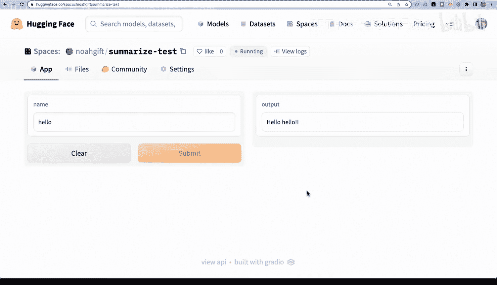

# 杜克大学｜机器学习运维｜DevOps⧸DataOps、Azure、MLFlow和抱脸｜MLOps ｜ Machine Learning Operations p190 49_04_02_Hugging-Face-Spaces介绍.zh_en -BV1yE421c7uA_p190-

Let's take a look at hugging face spaces。 The idea here is that you can discover amazing machine learning apps made by the community or what you can do as well is you can create your own new space。

 it's really a good idea to take a look here at some of the new stuff that's being developed。

 which is really cool。 And we can actually look at most likes， for example， we have Dolly， mini。

 stable diffusion。 These are all kind of fun things to play around with。

 I think this is a good one to start with。 stable diffusion， enter your prompt。 We can just say。

 you know， Mickey Mouse。😊，Mickey Mouse on the moon， right。

 something kind of fun and it will go through here and it will run a machine learning prediction based on。

Essentially the pretrain model that's hosted on Huging face。 And here we go。

 We got some great images here。 and that's kind of the fun part about this is we get to play around with this particular model and if we go to the files right here and we go to apps。

 we can say all of the different things that are happening in the set of apps this particular application and we can actually go through here and play around with this particular application and really steal ideas that are good ideas from other people。

 So the other thing we can do besides playing around with models。😊。

Is that we also can go over to the model section itself and even find particular categories。

 So again， if we go through here and we look at， for example。

 text and we look at something like summarization and we go to。

One of these summarization models like Google Pegas， what's nice about this is if I scroll down here。

 we can look inside and see who is actually use this in one of their applications。

 So this is a great way to actually play around with a particular model first when you're trying to explore it to look this is pretty easy if I wanted to go through and for example。

 take some Python Wikipedia page code and paste it inside of here we could actually try it out and it would go through here and do our text summarization and again。

 what's nice about this after it's done as we could go through to the files and we could take a look at the app and we could actually copy exactly the code inside of here and play around with it。

 So that's really the main takeaway here when when you're dealing with spaces。

 Now probably the most fun thing to do though would be to go over to the spaces environment and crone。

 So let's go ahead and do that。 go ahead and say。New space。

 and I'm going to go ahead and I'm going to call this Ho 5000。

And I'm going to select one of these technology streamlit。

 which is a machine learning visualization technology radio。

 which is the one that's most closely aligned with hugging face or static let's go ahead and pick radio and we'll go ahead and say create space Now once this has been created。

 I could clone this and really work with it in another environment and I'll show how to do that in a little bit。

 or what we could do is we can actually just play with it from right here。

 and this is actually not a bad idea。 So if we go through here and I go to the file section here and I go ahead and I say add and say create a new file I can actually play around with it right here so we just call this apppyy。

And I can actually paste this in。 and what will happen is once I paste it in immediately。

 it'll start building， and I can actually look at the build log in real time。And take a look at it。

 here we go， we can see by default， it installs some packages that that are very common and it pushes this image locally here and as it's building。

 we can actually take a look at the process if there's errors。

 it would also show up here and then finally when it's done。

It'll actually give us a hello world application。 All right。

 so here we have a another version of the same thing， right。

 This is just a kind of a hello world application。 we can take a look at the code。

 And if I want to play with it， notice it's running。

 If I go to this application and we type in something you can see in action。

 it works right So that's the idea is you can prototype things very， very quickly。

 most of the time you probably want to prototype a data or a model。

 but you can also play around with just hello world applications like that。

 And that's really the usefulness of the Huging face space。

