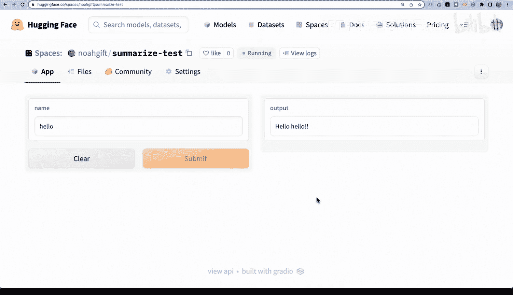

# 机器学习运维：04：Hugging Face Spaces 介绍 🚀


在本节课中，我们将学习 Hugging Face Spaces 平台。这是一个可以探索社区创建的优秀机器学习应用，以及创建你自己新项目的平台。我们将了解如何浏览、测试他人的模型应用，并学习如何快速创建和部署自己的简单应用。

## 探索社区应用 🧭

上一节我们介绍了 Hugging Face Spaces 的概念，本节中我们来看看如何发现和体验社区中已有的有趣应用。

浏览平台时，查看最新或最受欢迎的项目是一个好主意。例如，你可以找到 Dolly、Mini 或 Stable Diffusion 等模型的应用。这些应用通常设计得很有趣，便于交互体验。

以下是探索社区应用的步骤：
1.  访问 Hugging Face Spaces 主页。
2.  浏览“Most Likes”或“Trending”等栏目，发现热门应用。
3.  点击任意应用卡片即可进入并开始交互。

以 Stable Diffusion 为例，你只需在输入框中输入提示词（例如 “Mickey Mouse on the moon” 🐭），应用就会调用托管在 Hugging Face 上的预训练模型进行推理，并生成相应的图像。

## 深入研究模型与应用 🔍

除了直接使用应用，我们还可以深入研究其背后的模型，并查看其他开发者是如何使用这些模型的。

例如，如果我们对文本摘要任务感兴趣，可以进入模型板块，选择“Text”类别下的“Summarization”。找到如“Google Pegasus”这样的模型页面后，向下滚动，可以看到“Used in Spaces”部分。这里列出了所有使用了该模型的应用实例。

这种方式非常有用：
*   **快速测试模型**：你可以在模型页面的“Hosted inference API”小部件中直接输入文本进行测试。
*   **学习实现方法**：点击任意一个关联的 Space 应用，进入其文件页面（通常在 `app.py` 中），你可以查看并复制其源代码，了解如何将该模型集成到一个完整的应用中。

## 创建你自己的 Space 🛠️

现在，我们来动手创建自己的 Space。这是将你的想法快速原型化的最佳方式。

首先，点击主页的 “New Space” 按钮。你需要填写一些基本信息：
*   **Space 名称**：例如 `MyDemoSpace`
*   **SDK**：选择构建应用的技术栈。**Gradio** 与 Hugging Face 集成最紧密，非常适合快速创建机器学习界面。

创建完成后，你有两种主要方式开始开发：
1.  **在线开发**：直接在 Space 的网页编辑器中编写代码。
2.  **本地克隆**：使用 Git 将 Space 仓库克隆到本地，在熟悉的环境中进行开发。

## 快速原型开发实例 ⚡

让我们尝试在线快速构建一个“Hello World”应用。

在 Space 的文件页面，点击 “Create new file”，命名为 `app.py`。然后，你可以粘贴一段简单的 Gradio 代码：

```python
import gradio as gr

def greet(name):
    return "Hello " + name + "!"

demo = gr.Interface(fn=greet, inputs="text", outputs="text")
demo.launch()
```

保存文件后，Space 会自动开始构建。你可以在 “Logs” 选项卡实时查看构建过程。构建成功后，你的应用就会自动发布并提供一个可访问的 URL。

此时，你可以在应用界面输入文本，体验交互过程。通过修改 `app.py` 中的代码，你可以不断迭代，快速验证关于数据或模型的想法。

## 总结 📝

本节课中，我们一起学习了 Hugging Face Spaces 的核心功能。

我们首先了解了如何作为一个使用者，去**探索和体验**社区中丰富多样的机器学习应用。接着，我们学会了如何**深入研究**模型，并借鉴他人应用的实现代码。最后，我们亲自实践了如何**创建和部署**一个属于自己的 Space 应用，体验了其快速原型开发的强大能力。



Hugging Face Spaces 极大地降低了机器学习应用的门槛，无论是学习、实验还是分享，它都是一个极其有价值的平台。