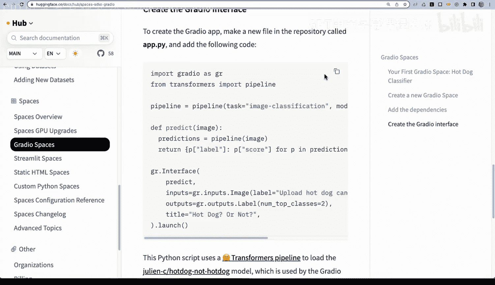
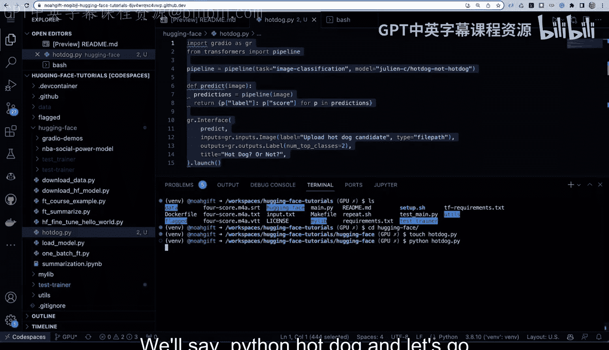
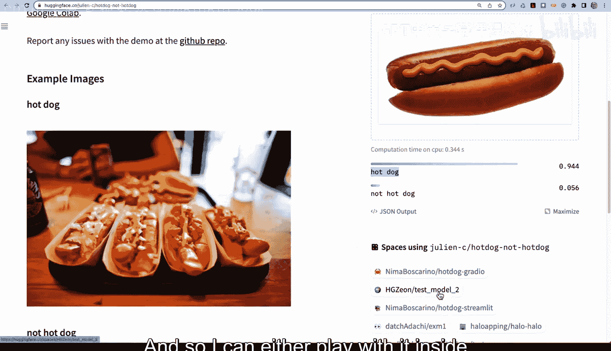
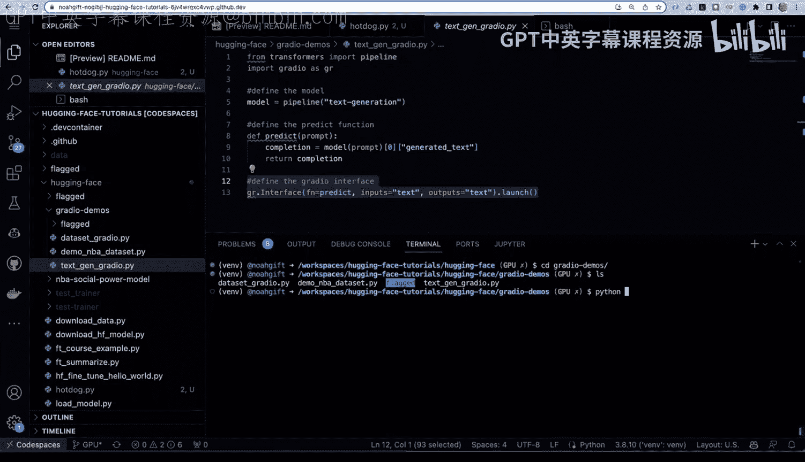
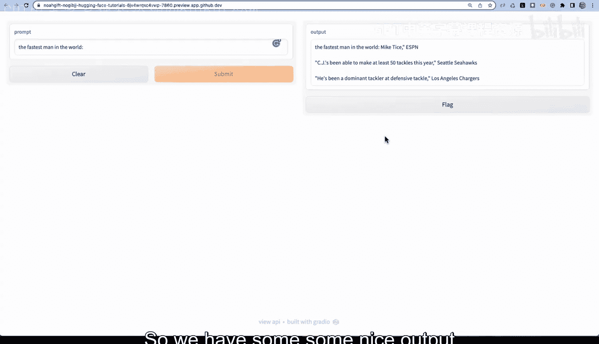
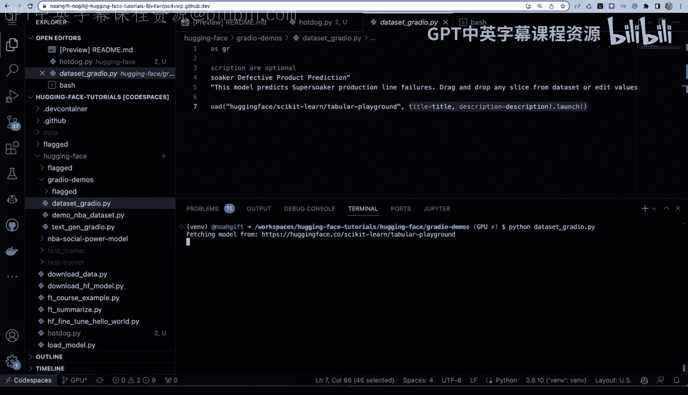
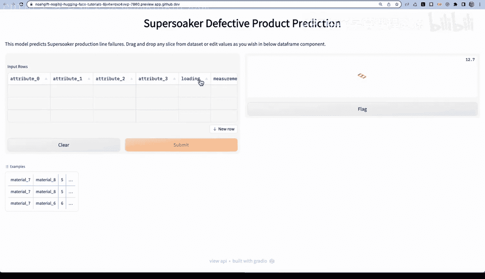

# 杜克大学｜机器学习运维｜DevOps⧸DataOps、Azure、MLFlow和抱脸｜MLOps ｜ Machine Learning Operations p191 50_04_03_Hugging-Face-Spaces操作演练.zh_en -BV1yE421c7uA_p191-

All right， So you're convinced you love hugging face spaces because again。

 according to the documentation， it offers a simple way to host M demo apps directly on your profile。

 But what if you want to learn a little bit more about it。 Well。

 I would say first thing is look at the docs right here。 we can see some of the demos。

 This is a great place to kind of look through things， look at the dependencies。

 all those kinds of things， we can also look at the fact that you can do GPU upgrade。 So for example。

 if this is a side project， you could potentially ask for the ability to do GPU right。

 which would be pretty and also you could install other packages like， for example， Pytorch， jacks。

 etc ceter。The other thing you can do if we look at the radioio spaces here is it gives you a bunch of documentation about how to actually build your own applications。

 And really the idea here is that you can actually load pre-existing applications and build them very quickly。

 So one of the classic ones is going to be the hot dog classifier here。

 So if I go to the documentation here。 What I could do is I could just copy this code。

 But where do I run it， I could run it inside of the spaces interface， which is not bad。

 but I also could just run it inside of Github code spaces。

Which itself is a great interface for building demo。 So inside of here。

 I have a hugging face directory， and I'm going to see the into there。

 and I'm going to call this hot dog。And what's nice about this is that I can actually get this very fast feedback loop by running things inside of this directory here。

 And so in fact， I'll go ahead and past that code in like this and notice there's not a lot of code。

 I say import radio as GR。 I also have to invoke the transformers right， in this case。

 this is somebody's hot dog or not pipeline right here。

 and then I would actually upload a particular image that has a hot dog or doesn't have a hot dog。

 So let's go ahead and run this。 We'll say Python hot dog。And let's go ahead and。

Get this thing launched。 So this will take just a second and it will again use our nice GPU interface here to play around with the official documentation。

 And what's great about this is that I can also play around iteratively with this particular application。

 Aha There we go。 We can actually drop an image right here。

 And so what I would need to do is find a picture of a hot dog somewhere on the internet。😊。

And I found one and I'm going to take it， I'm going to save the image locally on my desktop。

 I'm going to go ahead and select this and then grab that hot dog image here we go and let's go ahead and submit it Now the other thing we can do is we could just go to this user's profile。

 look at this application and look I drop the hot dog on here and it says。

 yep hot dog it was able to figure it out and so I can either play with it inside of somebody else's interface or again。

 get it running locally here and iterate on it now in this particular example that was a hot dog but what if I wanted to go through here and look at maybe another kind of a demo and so I'm going to go into these grade demos here。

And I have one that is a text generation demo。 and if we take a look at this it's very simple。

 I do from Transformers' import pipeline， I say import radio as G。 I define the model。

 which is going to be a text generation model and then define a predict function and then I make the interface。

 which is very straightforward here and gives us the ability to use it。

 So this is really nice because the feedback loop again as very quick because it's local and it's all installed inside of this environment let's go ahead and take a look at how this works。

Here we go， I am going to look at the documentation too， it says that it's using GPT2。Here we go。

 we can say the。Fastest man in the world。And let's go ahead and see what happens。

 It says the fastest man in the world is Mike Tce ESPN。

 CJ has been able to make at least 50 tackles this year。

 He's been a dominant tackle at defensive tackle right so we have some some nice output here for maybe like a chat bot or some other kind of interface here。

 and I've been able to really， really quickly prototype it because I'm using the ability to make an interface and also wire in some code。

 Now you don't need to only build out things that work with models although that's one of the more useful things。

 You also can take a look at data sets。 And in this case。

 this is a radio example that has a super soaked effective product prediction and I can put some description data in here and look I load the interface。

 I load the hugging faces learn tabular playground and I can pass in the title and I can pass in the description and I can play around with things as well。

 So let's go ahead and try thatll。

Python data set， radio。Again， we go through here and we launch it and this allows me to also play around with things like datasets and make new rows and do all kinds of really fun things inside of a interface here and cement things and so what's really useful about this kind of an interface here is that I have the ability to rapidly prototype both data attributes and well as model attributes。

 and this is really the advantage of using radio and hugging face spaces。

