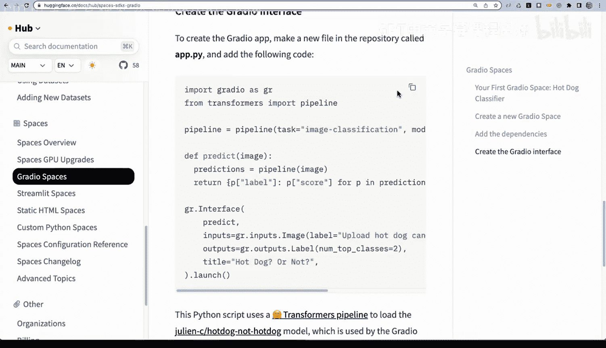
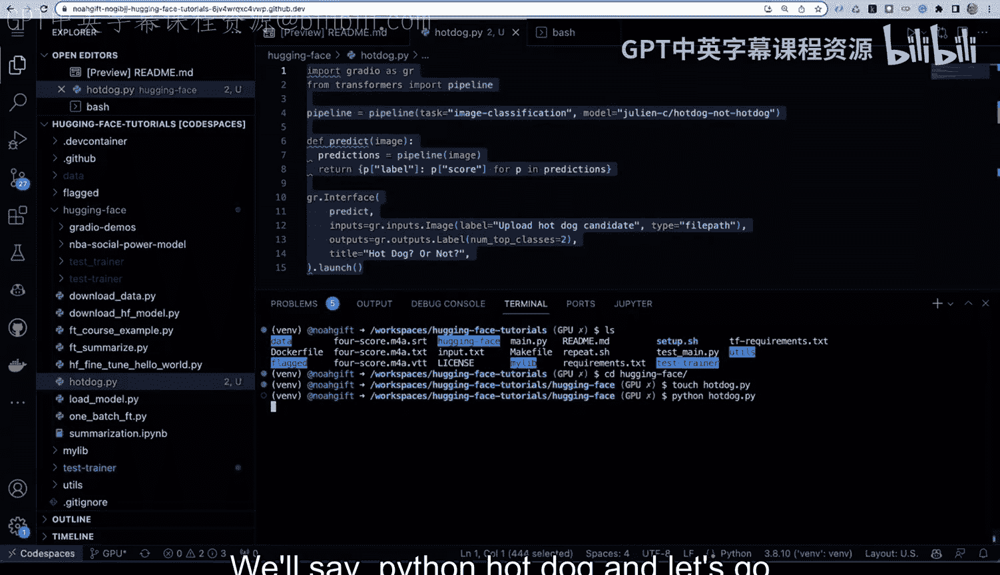
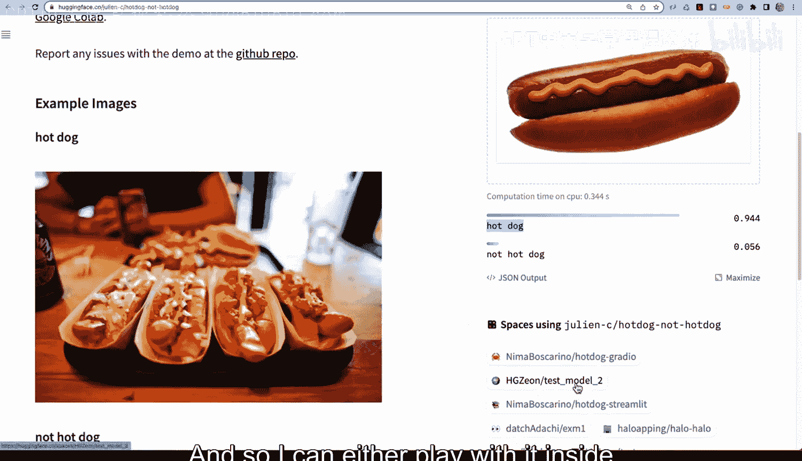
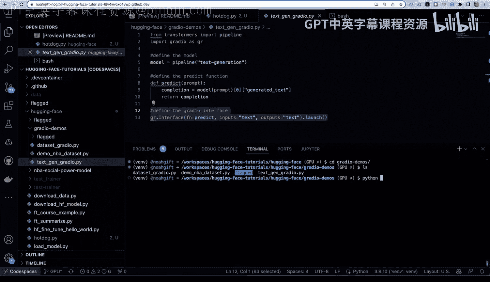
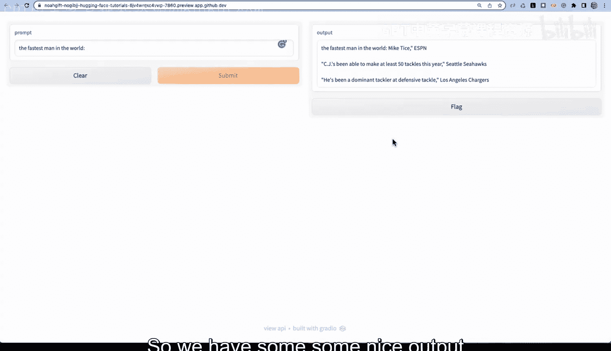
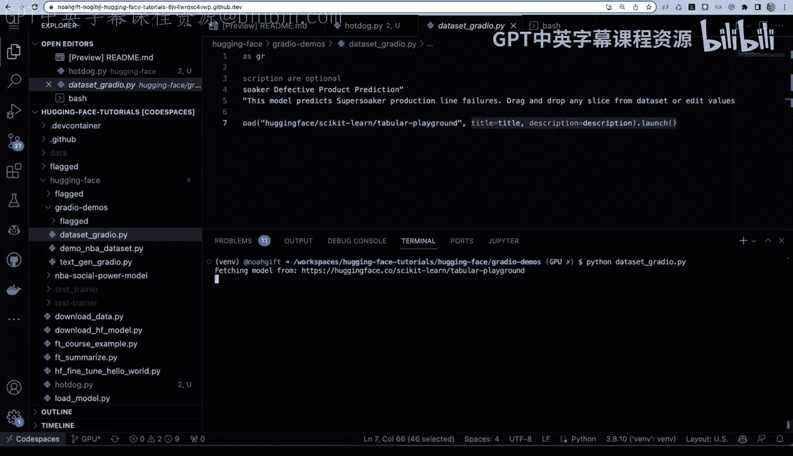
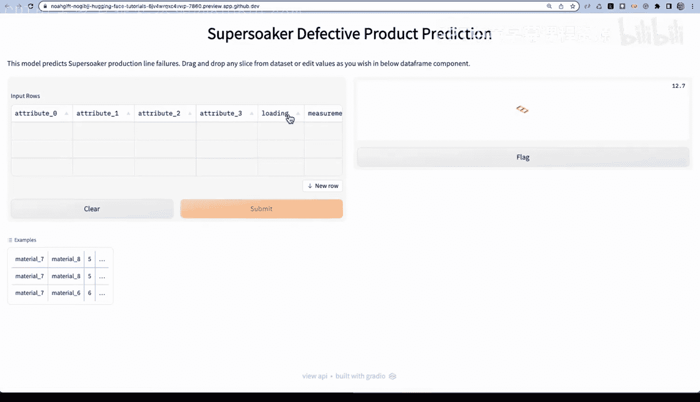

# 机器学习运维：04：Hugging Face Spaces 操作演练 🚀


在本节课中，我们将学习如何使用 Hugging Face Spaces 来快速构建和部署机器学习演示应用。我们将通过几个具体示例，展示如何利用现有的代码和模型，在本地或云端快速创建交互式应用。

---

## 概述

Hugging Face Spaces 提供了一种简便的方式，可以直接在你的个人资料页面上托管机器学习演示应用。如果你想深入了解其功能，最佳起点是查阅官方文档。文档中展示了各种演示案例，你可以查看其依赖项等信息。此外，你还可以申请 GPU 升级以加速计算，这对于个人项目非常有用。你也能安装其他软件包，例如 PyTorch、JAX 等。

## 探索与构建应用

上一节我们介绍了 Spaces 的基本概念，本节中我们来看看如何实际探索和构建应用。

如果查看 Gradio 的 Spaces 页面，你会发现大量关于如何构建自己应用程序的文档。其核心思想是，你可以快速加载并构建已有的应用程序。



### 示例一：热狗分类器 🌭

一个经典的例子是热狗分类器。在文档中找到相应代码后，你可以选择运行环境。虽然可以在 Spaces 界面中直接运行代码，但使用 GitHub Codespaces 也是一个极佳的选择，它为构建演示提供了出色的界面。

以下是在本地环境中运行热狗分类器的核心代码：

```python
import gradio as gr
from transformers import pipeline

# 加载预训练的热狗分类管道
classifier = pipeline("image-classification", model="julien-c/hotdog-not-hotdog")



def classify_image(image):
    result = classifier(image)
    return result[0]['label']

# 创建 Gradio 界面
interface = gr.Interface(fn=classify_image, inputs="image", outputs="text")
interface.launch()
```

运行此代码后，应用会启动。你可以上传一张图片（例如从互联网上找到的热狗图片）进行测试。应用会判断图片中是否包含热狗，并给出结果。你既可以在他人的应用界面中体验，也可以在本地运行并迭代改进。

### 示例二：文本生成演示 📝

接下来，我们看看另一个演示：文本生成。这个例子非常简单，代码如下：

```python
from transformers import pipeline
import gradio as gr

# 定义文本生成模型
generator = pipeline('text-generation', model='gpt2')



def predict(prompt):
    # 使用模型生成文本
    completion = generator(prompt)[0]['generated_text']
    return completion

# 创建界面
interface = gr.Interface(fn=predict, inputs="text", outputs="text")
interface.launch()
```

运行此应用后，你可以在输入框中输入文本（例如“The fastest man in the world”），模型会基于此生成后续内容。这种快速的反馈循环得益于本地环境和已安装的库，使得原型设计非常高效。

### 示例三：数据集交互演示 📊



除了模型，你还可以构建与数据集交互的应用。例如，下面是一个用于产品预测的数据集演示：

```python
import gradio as gr
from datasets import load_dataset

# 加载数据集
dataset = load_dataset("merve/supereffective-product-prediction")

def add_row(title, description):
    # 此处应包含将新数据行添加到数据集的逻辑
    # 为演示简化，这里仅返回输入信息
    new_entry = {"title": title, "description": description}
    # 实际应用中，你会将 new_entry 添加到 dataset 并可能重新训练模型
    return f"Added: Title - {title}, Description - {description}"

# 创建界面
interface = gr.Interface(fn=add_row, inputs=["text", "text"], outputs="text")
interface.launch()
```

运行此应用，你可以输入产品的标题和描述，模拟向数据集中添加新数据行。这种界面让你能够快速试验数据属性和模型行为。

## 核心优势



使用 Gradio 和 Hugging Face Spaces 的主要优势在于能够**快速原型化**数据属性和模型属性。你可以在一个统一的界面中，高效地测试想法、展示成果并与他人分享。

---

## 总结






本节课中，我们一起学习了 Hugging Face Spaces 的基本操作。我们通过热狗分类器、文本生成和数据集交互三个具体示例，演示了如何快速构建和迭代机器学习演示应用。关键在于利用现有的代码库和 Gradio 库，在本地或云端环境中实现快速的开发反馈循环。这为展示模型能力、测试数据想法提供了强大而便捷的工具。