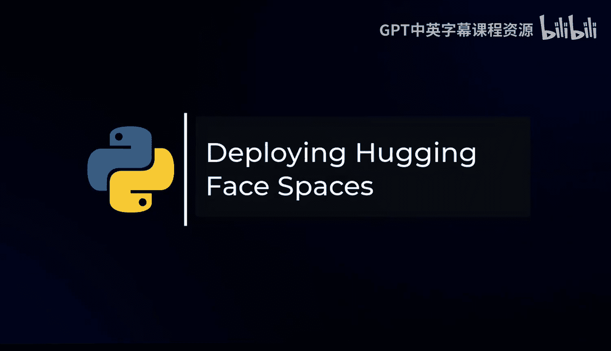
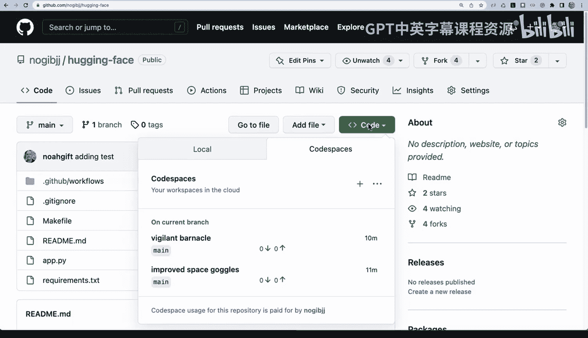
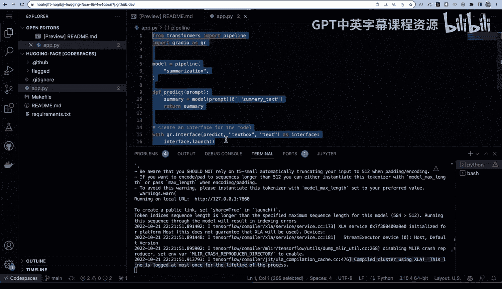
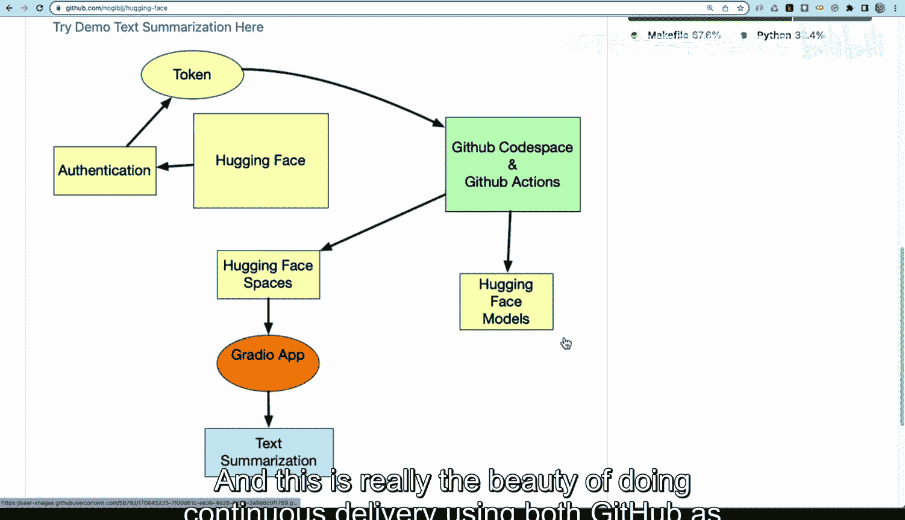

# 杜克大学｜机器学习运维｜DevOps⧸DataOps、Azure、MLFlow和抱脸｜MLOps ｜ Machine Learning Operations p192 51_04_04_部署Hugging-Face-Spaces.zh_en -BV1yE421c7uA_p192-

Let's take a look at the lifecycle of how to do a continuous delivery of a huggingface spaces application using Github。

 You can see here that I could grab a token from Huging face That's one of the key things to be aware of once I take that token。

 I would put this into the Github codespace environment as well as the Github actions environment from here。

 this allows me to do anything I need to do。 Like， for example。

 push a model back into Huging face as well as interact with the spaces application。 In this case。

 I could test first the graio application here。 let's say， for example， text summarization。

 and then later automatically push that change directly to spaces。

 So this is continuous delivery of machine learning application。

 Now let's go ahead and take a look at how that would work in practice。

What I would do is I would go to Github。To the workflow here。 createate a main do flow here。

 and notice I would say sync to hugging face under the main branch I would run this on abutu latest and I would have my secret that would be set up inside of hugging face。

 I would go ahead and add this whatever location， the space lives in in this case。

 this particular one one would be noAAgi demo and then I would push this automatically every time and make a change to this repository So I could add in steps as well for testing other things。

 And now if we look at the application is's a very straightforward right。

 a very simple application here that does a summarization pipeline。

 So how would we actually make sure that this continuous delivery would actually work。 well。

 pretty easy what we would do is use our codespace environment。 And you can see here。

 I've got a couple of them running。 So what I'm going to do is I'm going to toggle over to one of them。

 and here we go。

We've got this application right here and notice that when I run this locally。

 it'll actually launch a interface and once I've launched this interface here。

 I can actually browse it directly inside of this environment and look at paste it in some Python code。

I pasteed in some information about the Python language and I had it summarize it and there we go。

 we actually were able to summarize that change。 so if I clear it and I want to go through here and grab that same data again。

 we can see the same application workflow again。 so it's a great way to prototype out what it is you're building and use in fact。

 both the local development environment as well as the continuous delivery process of the GitHub ecosystem here。

 in fact， this synchronization， if it was failing， in this case it was we would have to double check if there was some kind of a linked problem or there was a test problem and this is really the beauty of doing continuous delivery using both Github as well as hugging face spaces。

