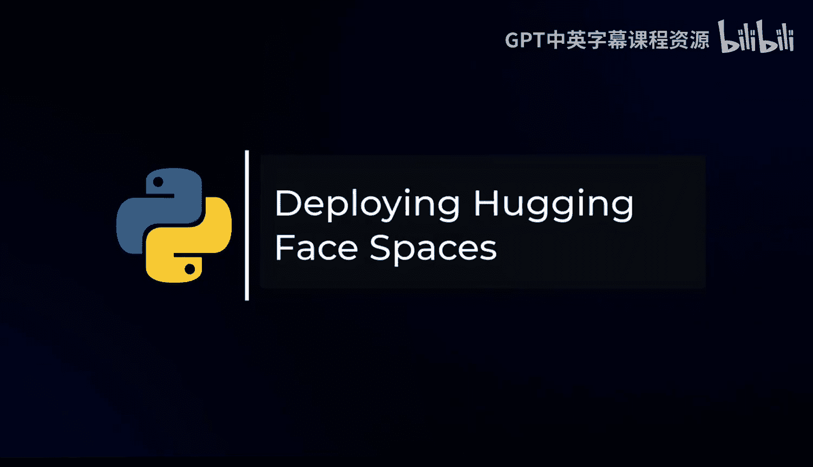
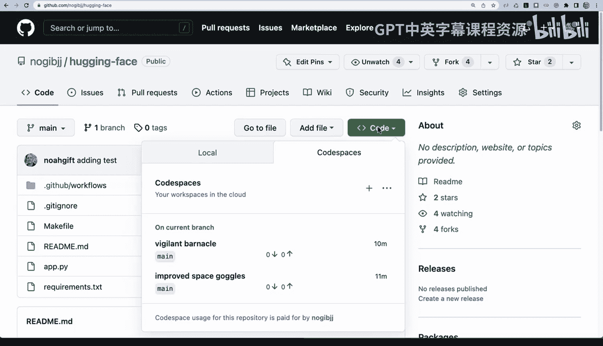
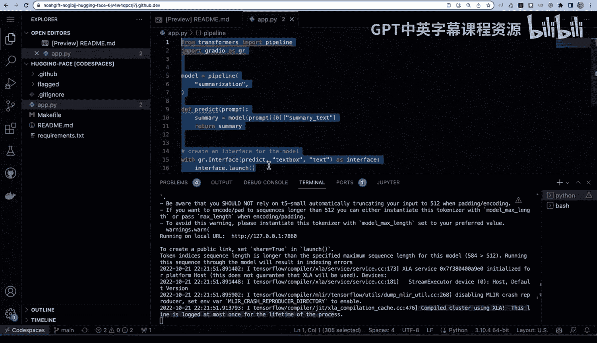
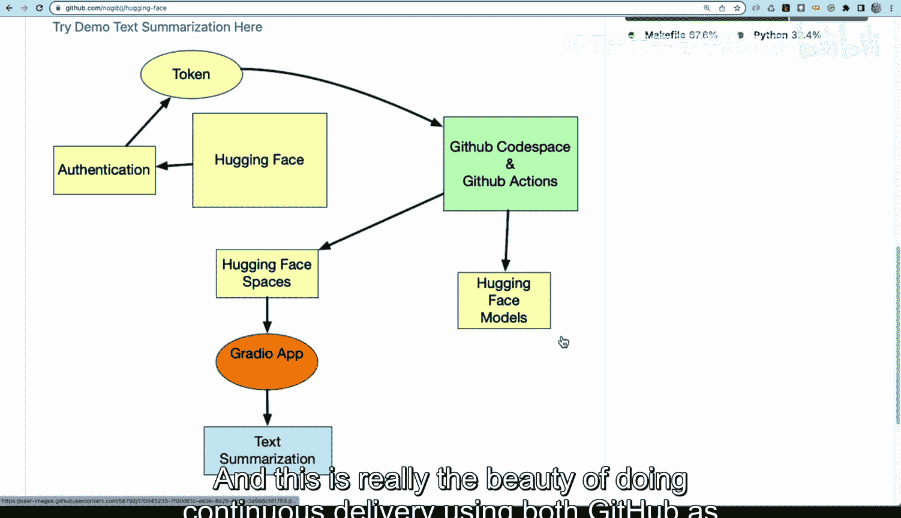

# 机器学习运维：04：部署Hugging Face Spaces应用



在本节课中，我们将学习如何利用GitHub生态系统，为Hugging Face Spaces应用实现持续交付。我们将涵盖从获取访问令牌、配置自动化工作流，到本地测试和自动部署的完整生命周期。

## 概述

持续交付是现代机器学习运维的核心实践之一。它允许开发者自动地将代码变更部署到生产环境，同时确保质量和稳定性。本节将演示如何为Hugging Face Spaces上的应用搭建这样一个自动化流程。

## 核心流程与配置

上一节我们介绍了持续交付的概念，本节中我们来看看如何为Hugging Face Spaces应用具体配置。

整个持续交付流程的核心在于利用GitHub Actions自动化工作流。以下是实现此流程的关键步骤：

1.  **获取Hugging Face访问令牌**：首先，需要在Hugging Face账户中生成一个访问令牌。这个令牌是进行自动化操作的身份凭证。
2.  **在GitHub中配置密钥**：将上一步获取的Hugging Face令牌，以密钥的形式添加到GitHub仓库的Settings -> Secrets and variables -> Actions中。
3.  **创建GitHub Actions工作流**：在项目的`.github/workflows/`目录下创建一个YAML文件来定义自动化流程。

一个典型的工作流配置示例如下：

```yaml
name: Sync to Hugging Face
on:
  push:
    branches: [ main ]
jobs:
  sync:
    runs-on: ubuntu-latest
    steps:
      - uses: actions/checkout@v3
      - name: Push to Hugging Face
        uses: huggingface/huggingface_hub@main
        with:
          hf_token: ${{ secrets.HF_TOKEN }}
          local_dir: .
          repo_id: your-username/your-space-name
```

在这个配置中：
*   `on: push` 指定当代码推送到`main`分支时触发工作流。
*   `secrets.HF_TOKEN` 引用了我们在GitHub中配置的Hugging Face令牌。
*   `repo_id` 需要替换为你的Hugging Face用户名和Space名称。

## 本地开发与测试

在代码被自动部署到Spaces之前，进行本地测试至关重要。这可以确保应用功能正常，避免将有问题的版本部署到线上。



我们可以利用GitHub Codespaces或本地开发环境来运行和测试应用。以下是测试一个文本摘要应用的基本方法：

1.  在开发环境中启动Gradio应用界面。
2.  通过生成的本地URL在浏览器中访问该界面。
3.  在界面中输入文本（例如一段关于Python语言的描述）进行功能测试。



如果应用能够正确返回摘要结果，就证明本次变更是有效的，可以安全地触发后续的自动化部署流程。

## 持续交付的价值

通过结合GitHub Actions和Hugging Face Spaces，我们构建了一个高效的持续交付管道。其优势主要体现在以下几个方面：

*   **自动化**：代码推送后，构建、测试和部署过程完全自动化，无需手动干预。
*   **快速反馈**：如果自动化流程中的任何一步（如测试）失败，开发者会立即收到通知，可以快速定位和修复问题。
*   **可靠部署**：只有通过所有预设检查的代码变更才会被部署，保证了生产环境应用的稳定性。
*   **开发体验**：开发者可以在本地或Codespace中舒适地开发、原型设计和测试，然后自信地将代码变更交付出去。

## 总结



本节课中我们一起学习了为Hugging Face Spaces应用实现持续交付的完整流程。我们从配置Hugging Face令牌和GitHub Actions工作流开始，探讨了如何在本地测试Gradio应用，最终实现了代码变更的自动部署。这套实践将帮助您更高效、更可靠地管理和迭代您的机器学习应用。