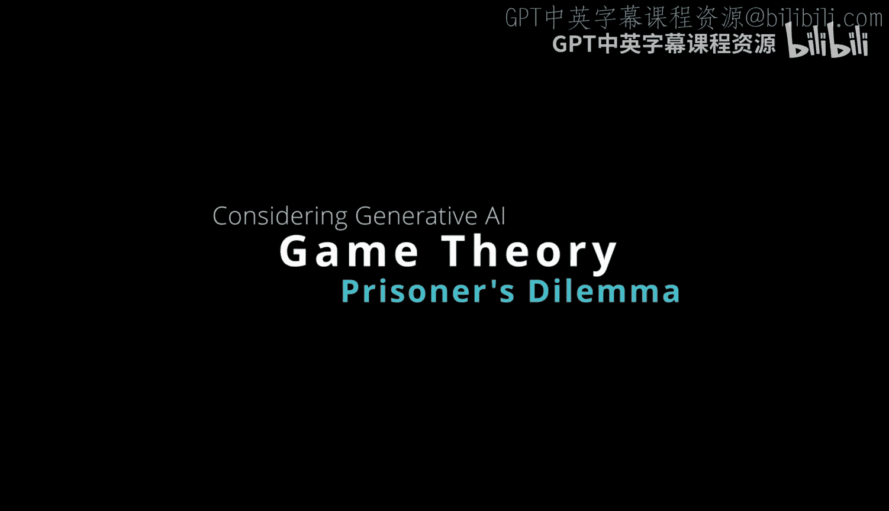
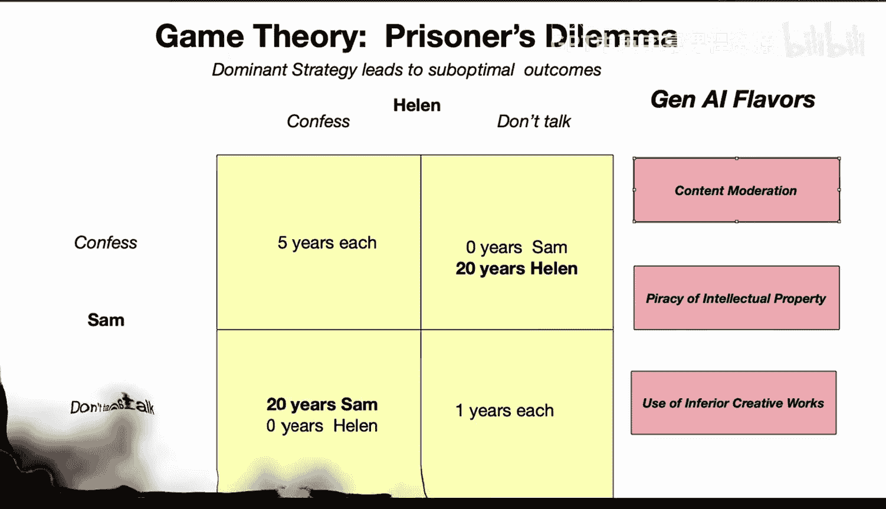

# 杜克大学｜机器学习运维｜DevOps⧸DataOps、Azure、MLFlow和抱脸｜MLOps ｜ Machine Learning Operations p195 54_04_07_GenAI博弈论.zh_en -BV1yE421c7uA_p195-

。Game theory is a mathematical framework that is able to study interactions as games with players and strategies and payoffs and to figure out what are the optimal strategies or what are the dominant strategies that lead to suboptimal outcomes in the case of the prisoner Zlemma。

 this is the classic game theory problem where the dominant strategy which is to be selfish will lead to a suboptimal outcome for everybody if you imagine you're a prosecutor and you don't have the evidence to convict both Sam and Helen who you've collected for a crime。

 the only way to get what you need from them is to figure out a way to pit them against each other So we see in this matrix here of both of them don't talk each will only get one year in jail but if you separately take them and you say if you confess you'll actually be able to go free and you'll have no time in jail。

 but the person that we brought to。WithYou'll actually go to jail for 20 years。

 you're incentivizing everybody to confess and when you confess。

 you're going to get five years each if you both confess。

 if one person doesn't talk and the other one does。

 the penalty is so severe that it doesn't make sense to actually stays silent and so even though the optimal strategy if they were able to communicate would be that each of them go to jail for a year。

The two people don't trust each other and so as a result。

You're able to get this suboptimal dominant strategy。

 which is you both confess and you both go to jail five times longer than you would。

 So this is kind of the classic way to think about when a system is set up where everyone loses we can think about this game theory perspective as well with generative AI。

 So here's a good example， let's say we get to a world where all content moderation is done by some AI system and what we can find out is that there are severe incentives for making sure that your content is you know engaging。

 etc ce。 and if you don't have enough engagement， your company will lose money。 So as a result。

 even though you're getting lots of bad generative AI content。

 you actually reduce the moderation because that affects your bottom line to your company once your competitor realizes they also are starting to lose money。

 each of you will go ahead and change your content moderation strategy。

So that there's less and less rigor and eventually your platforms could become a full platform of generative AI that is a very poor quality potentially has very toxic content and so we could call this a race to the bottom likewise with generative AI you would be possible to get in a scenario where you assume that let's say another competitor or another country or another government is actually going to take intellectual property and pirate it and so as a result you feel like you have to pirate the same intellectual property and so what happens is instead of respecting the intellectual property rights。

 everybody pirates and eventually you get to the point where there is no concept of intellectual property anymore so that could be again a race to the bottom because you're anticipating something bad that the other person will do another one that maps to the prisoner's dilemma here is the use of inferior creative work。

If you feel like your competitor might actually start to use inferior AI work that has been generated by some prompts。

 you would then do the same thing eventually each of you starts producing worse and worse art till eventually。

All the art that you produce is of poor quality。 So everybody loses。 the customer loses。 and。

 of course， the people that are creating the art are no longer employed。

 So then we have no actual good art ever again。 So you can see here that。

If you're only thinking about things from trying to be the dominant strategy and you're not doing it iteration。

And youre only thinking about one turn， you could lead to a dominant strategy being that everything will be a suboptimal outcome to all of the players in the game。

 so this is a very important thing to consider when you're considering new technologies like generative AI is what are the impacts and how can we create an iterative strategy where we're able to cooperate with each other so that we're not into a race to the bottom？

